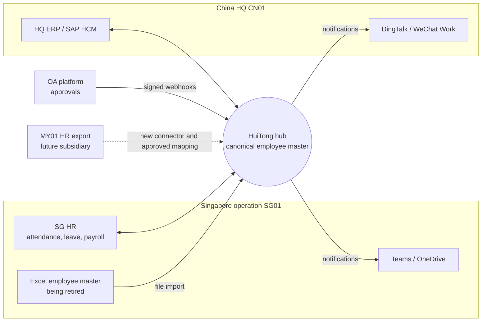

# ADR 0002: Hub-and-spoke integration layer around a canonical employee model

- **Status:** Accepted
- **Date:** 2026-10-20
- **Traceability:** M1, M2 · capabilities A, B, C

## Context

Organisation E's Singapore operation and China HQ each run systems suited to local requirements (see [`../problem-statement.md`](../problem-statement.md)):

- a locally compliant Singapore HR system for attendance, leave and payroll;
- HQ ERP and SAP, with customised features;
- an internal OA platform where approvals happen, although the follow-up work happens elsewhere;
- Teams and OneDrive in Singapore, and DingTalk and WeChat in China;
- an Excel employee master, which is the only consolidated view management has.

The client was explicit about what success is _not_: "replacing all systems with one global platform". It wants an integration and automation layer that lets local and HQ systems exchange approved data securely. Each new overseas market may add another locally compliant system, so the PoC architecture must extend to other functions and subsidiaries.

The forces on the design:

- **Different schemas.** English or Chinese field names, ISO or `YYYY/MM/DD` dates, and department names or SAP-like 8-digit org-unit codes.
- **Approvals must trigger downstream work.** An approved manpower request has to start recruitment and onboarding without anyone re-keying it.
- **Controlled sharing.** Employee data crosses entities and countries, so access control and data protection have to hold everywhere.
- **Unknown systems.** The real vendors and APIs are unknown until the client meeting ([`../assumptions.md`](../assumptions.md)).

## Decision

We will build HuiTong as a **hub with one spoke per external system**:

1. **Adapters (spokes).** Each system sits behind the `SystemConnector` interface (Adapter). `ConnectorFactory` builds adapters from `Connector` configuration rows (Factory). Adding another system of a known type is configuration; adding a new type of system is one new adapter class. Connectors today: `sg-hr`, `cn-hq`, `oa`, `excel-master`, `teams`, `dingtalk`.
2. **Canonical employee model.** One model in `@huitong/shared` that every source maps into and every consumer reads. Versioned mapping configs apply Strategy transformers for date format, name order, department code, enum values and phone numbers.
3. **Canonical employee master with per-field provenance.** For every field, the master records which source supplied the value and when.
   - For SG01 employees, SG HR owns payroll and personal fields, and CN HQ owns `jobGrade` and `costCenter`.
   - For CN01 employees, CN HQ owns every field.
   - Fields with no single owner (`jobTitle`, `departmentCode`, `workEmail`, `hireDate`) raise an open conflict when sources disagree. HR picks the source of truth or enters a value, and the decision is audited.
   - Records are matched on HQ's global employee number (`E1xxxxx`), with work email as the fallback key.
4. **One sync pipeline.** A Template Method base job runs extract → map → validate → load → audit for every connector, on BullMQ ([ADR 0008](0008-jobs-events-realtime.md)).
5. **Events between capabilities.** The hub verifies OA webhooks and publishes `oa.approval.completed`, and the workflow module (area 2) subscribes to it. Attendance, leave and reporting (area 3) read canonical data, never a source system's own format.
6. **The master does not replace systems of record.** Payroll stays in SG HR and HQ records stay in SAP. HuiTong writes back to a system of record only after a person approves a preview of the change.

## Consequences

### Positive

- **Effort grows linearly.** n systems need n adapters and n mappings, against up to n(n−1)/2 pairwise links. Today's six systems could need up to 15 point-to-point links.
- **New subsidiaries are cheap to add.** The MY01 Malaysia export used in the AI mapping demo needs one connector row and one approved mapping ([ADR 0011](0011-ai-gateway-human-in-the-loop.md)).
- **Controls live in one place.** RBAC, masking, classification, audit and the cross-border transfer register are enforced once, not separately in every link.
- **Excel can retire.** The governed master can replace the Excel master as management's consolidated view.
- **Ownership is clear.** Area 1 owns the hub, and areas 2–4 consume canonical data and events.

### Negative

- **The hub is a central dependency.** Source systems keep working if it is down, but flows pause until it recovers. Retries, idempotency keys and health checks limit the impact; high availability is part of the AWS design (area 4).
- **The canonical model rests on assumed field lists.** It will need revision after the client meeting, and each change ripples through every mapping. This is why mapping configs are versioned.
- **Data and risk are concentrated.** Holding SG and CN employee data in one store makes the hub's hosting location a regulatory question: PDPA s.26 for data leaving Singapore, and PIPL Arts. 38–39 for data leaving China. Entity-scoped masking ([ADR 0010](0010-auth-sessions-rbac-masking.md)) and the hosting options in [ADR 0014](0014-deployment-docker-aws.md) respond to this. They are design considerations that the client's compliance and legal team must confirm.
- **Eventual consistency.** The master lags the sources between syncs, and resolving conflicts takes HR time.

## Alternatives considered

| Option                                                     | Why rejected                                                                                                                                                                                                                                      |
| ---------------------------------------------------------- | ------------------------------------------------------------------------------------------------------------------------------------------------------------------------------------------------------------------------------------------------- |
| Point-to-point integrations (SG HR ↔ SAP, OA → SG HR, ...) | Fastest for a single pair, but links and mappings multiply with every system, there is still no consolidated view, and controls are scattered across scripts                                                                                      |
| Replace local systems with one global HR suite             | Explicitly not what the client wants. Singapore payroll must stay locally compliant (CPF, IRAS), China payroll handles social insurance and the housing fund, and the cost and timeline are far beyond a PoC                                      |
| RPA only (bots re-keying between screens and spreadsheets) | Quick where no API exists, but brittle when screens change. Bots hold credentials, give no provenance and do not scale to new subsidiaries. RPA stays possible as one connector type behind `SystemConnector`, for a system with no API or export |
| Commercial iPaaS or ESB                                    | Mature, but the licence cost and lock-in are hard to justify before the client's systems are known, and it would hide the integration logic the team must build and explain. Our canonical model and mappings would carry over to one later       |
| Reporting warehouse only (ETL into a database)             | Solves consolidated reporting, but not "approved changes trigger downstream processes"                                                                                                                                                            |

## Amendment, 21 Oct 2026: draft records and write-back

Adopted from Azri's integrated plan (prompt 002). Point 6 above is tightened, and the employee lifecycle is made explicit:

- **An approval creates a draft.** An approved OA manpower request leads only to a draft (`PRE_HIRE`) record in the master, linked to the request. An approval is not yet a hire: the candidate may never join.
- **Activation needs two things.** The draft becomes active only once the agreed onboarding milestones are met (from area 2's workflow) and the verified record has arrived from the HR system of record (SG HR for SG01). The rule lives in the master (story B-6), so it holds whichever workflow triggers it.
- **Write-back is approved, audited and mock-only for now.** A write to a system of record needs HR's explicit approval of a preview, and the approval is audited. Against the client's real systems, writes are out of scope until the client agrees to them ([Q-17](../client/questions-for-client.md)); until then the SG HR mock demonstrates them, labelled as a mock ([A-21](../assumptions.md)).

## Amendment, 21 Oct 2026: identity matching

Adopted from Azri's integrated plan (prompt 002). Point 3 above named work email as a fallback match key. The code never used it, and it should not: an email can be reassigned, and SG and HQ systems may hold different ones.

- **Confirmed match:** the same group employee number (`E1xxxxx`). Nothing else makes two records one person, except a future HR decision to link them, which would be audited.
- **Possible match:** a look-alike name (the same Chinese name, the same romanisation, the same names in another order) or the same work email. Romanisation is a weak signal: 陈伟 and 陈玮 are different people who are both "Chen Wei", and Hokkien "Tan" and Mandarin "Chen" are the same surname, 陈. A sync preview lists the possible matches of every new record for HR to check, and the sync still creates the record on its own (story B-5, `identity-matcher.ts`).
