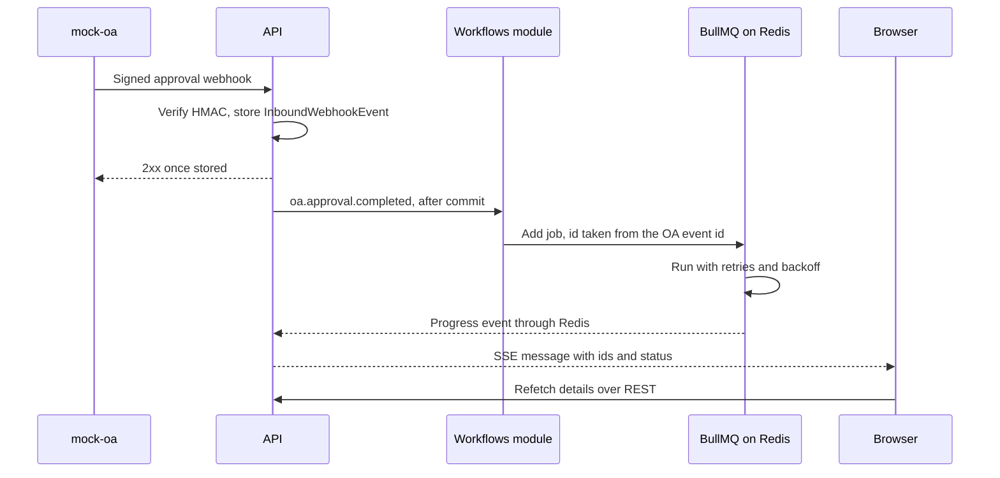

# ADR 0008: BullMQ jobs, in-process domain events and Server-Sent Events

- **Status:** Accepted
- **Date:** 2026-10-20
- **Traceability:** M4 · capabilities A, B, C, D, G

## Context

Much of HuiTong's work is too slow or too unreliable to run inside an HTTP request:

- A sync run pages through a source system, possibly over a slow cross-border link (A-19, Q-16), and must resume safely after a failure ([R-06](../grs/grs-by-design.md#32-register)).
- An OA approval arrives as a webhook. The connector hub (area 1) verifies and stores it, and the workflow module (area 2) must then start, without either module calling the other's internals ([ADR 0006](0006-api-nestjs-layered-modules.md)).
- OA may deliver an event twice, and jobs retry after partial success, so every step must be idempotent ([R-05](../grs/grs-by-design.md#32-register)).
- SLA reminders, escalations and retention purges run later, on schedules.
- HR expects live feedback: "Run sync" shows progress, and the workflow board updates as steps complete.

`CLAUDE.md` fixes BullMQ + Redis for jobs and retries. This ADR records how jobs, events between modules and live updates in the browser fit together.

## Decision

We will use three mechanisms, each for one purpose.

**1. BullMQ 6.3.16 on Redis 8 for durable work,** through `@nestjs/bullmq` 12 and ioredis 6, set up in `apps/api/src/infrastructure/queues/` (area 1).

- Default job options (attempts, exponential backoff, retention of finished jobs) are set once. A queue overrides them only with a stated reason.
- **Idempotency.** The job id comes from the `Idempotency-Key` header or from a natural key such as the OA event id, so BullMQ ignores a duplicate while the first job is retained. The durable guarantee sits in PostgreSQL: unique keys (for example one `InboundWebhookEvent` per `X-OA-Event-Id`) and upserts in the load step, so a rerun changes nothing ([ADR 0007](0007-prisma-postgresql.md)).
- Job schedulers run SLA checks and retention purges.
- Redis runs with `maxmemory-policy noeviction`, which BullMQ requires, and with append-only persistence, so queued jobs survive a restart.
- Workers run inside the API process for the PoC. They can move to their own container (same image, different command) without code changes.

**2. In-process domain events to trigger work between modules,** through a typed event bus in `apps/api/src/infrastructure/events/`. Event names and payload schemas live in `@huitong/shared` ([ADR 0009](0009-shared-zod-contracts.md)).

- An event is published only after the publishing transaction commits.
- Handlers stay thin: they validate the payload and enqueue a job, so the work itself is durable and retried.
- `oa.approval.completed` is published once the HMAC check has passed and the `InboundWebhookEvent` is stored. Area 2 subscribes and ignores event ids it has already handled.
- The stored webhook event doubles as an outbox. It records when its event was handled, and a scheduled job republishes any left unhandled, for example after a crash between commit and publish.

**3. Server-Sent Events at `GET /api/v1/events` for live updates.**

- One stream per browser tab, authenticated by the session cookie ([ADR 0010](0010-auth-sessions-rbac-masking.md)) and filtered by the viewer's role and entity scope.
- Messages carry ids, status and counts, never field values. The UI refetches details through the masked REST endpoints (TanStack Query invalidation), so masking keeps a single enforcement point.
- Messages are relayed from Redis (BullMQ progress events, plus a pub/sub channel for other notices), so the stream works wherever the workers run and with several API replicas.
- Heartbeats stop proxies closing idle streams, and nginx serves the route unbuffered. A reconnecting client sends `Last-Event-ID` and refetches.
- The server ends a stream when its access token expires. The client refreshes the session and reconnects.

## Consequences

### Positive

- Requests return quickly, and failed work is retried without anyone re-running it by hand.
- Area 2 depends on an event contract, not on connector code.
- Duplicate deliveries and retries are harmless, because idempotency holds in both Redis and PostgreSQL.
- SSE is plain HTTP: the same cookie, the same CSP (`connect-src 'self'`) and the same proxies apply, and the browser reconnects by itself after a network drop.

### Negative

- Redis becomes a hard dependency for background work. The readiness check reports it.
- An in-process event is lost if the process dies before its handler runs. The outbox covers `oa.approval.completed`; any new event that starts important work needs the same treatment.
- Results arrive later, so the UI must handle in-progress and partial states.
- `EventSource` cannot send custom headers and gives up after a 401, so the web client wraps it to refresh the session and reconnect.
- Long-lived connections need matching proxy settings in nginx, the load balancer and CloudFront ([ADR 0014](0014-deployment-docker-aws.md)).

## Alternatives considered

| Option                              | Why rejected                                                                                                                                                                                                                    |
| ----------------------------------- | ------------------------------------------------------------------------------------------------------------------------------------------------------------------------------------------------------------------------------- |
| Kafka or Amazon MSK                 | A replayable log for many independent services. We have one modular monolith, a few hundred events a day and no need for replay. Brokers and consumer groups add operations and concepts, and delayed retries need extra topics |
| WebSockets or Socket.IO             | Two-way messaging we do not need: user actions already go through validated, CSRF-protected REST. WebSockets need separate authentication and guard handling and an upgrade-aware proxy; Socket.IO adds its own protocol        |
| Polling with TanStack Query         | Simple, but laggy and wasteful. Kept as the fallback when a stream cannot open                                                                                                                                                  |
| Amazon SQS with EventBridge         | No local equivalent without an emulator, message delays capped at 15 minutes, and no job progress                                                                                                                               |
| pg-boss (a PostgreSQL-backed queue) | Fewer moving parts, but `CLAUDE.md` fixes BullMQ, which adds progress events, job schedulers, rate limiting and a maintained Nest integration                                                                                   |
| A workflow engine such as Temporal  | Another cluster to run, and it would hide the state machine that area 2 must build and explain                                                                                                                                  |
