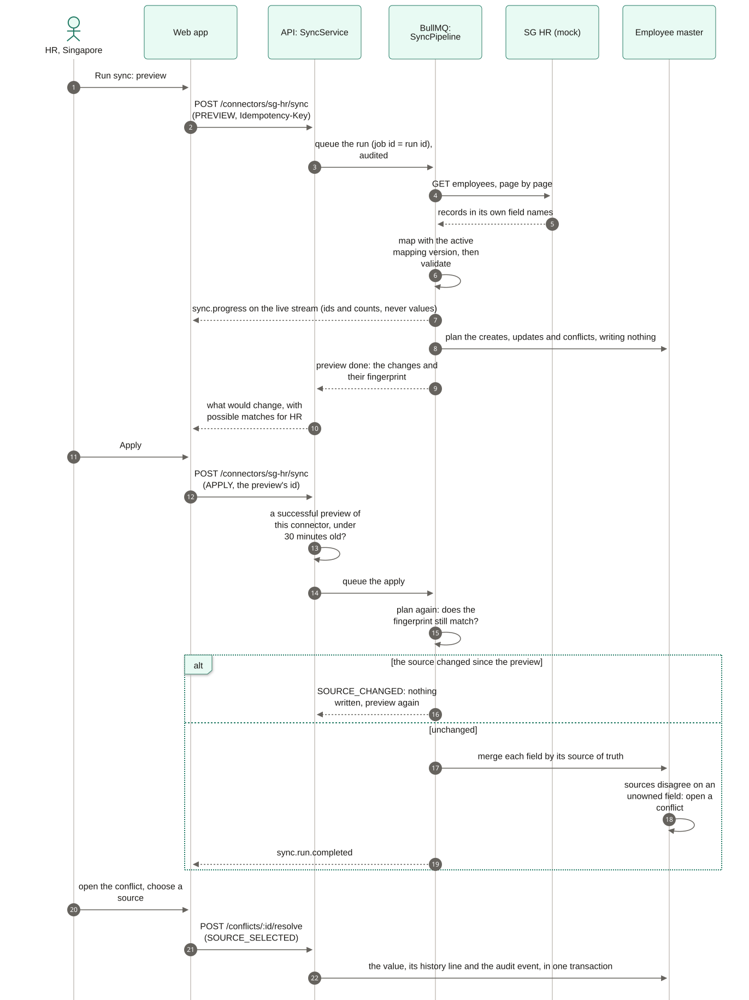

# Architecture

HuiTong is an integration and workflow layer between the systems Organisation E already runs. It does not replace them. Each system sits behind one adapter, a canonical employee master records where every value came from, and approved changes flow on as events and jobs ([ADR 0002](../adr/0002-integration-layer-hub-and-spoke.md)). Every system outside HuiTong is a mock until the client meeting ([ADR 0013](../adr/0013-mock-external-systems.md)), and every value is synthetic.

The diagrams below go from the outside in: who uses HuiTong, what it is made of, where it runs, how its key flows work, where data crosses a trust boundary, and the data model. The design patterns are in [patterns.md](patterns.md), the data formats in [data-formats.md](data-formats.md), and every decision in the [ADR index](../adr/README.md).

## Reading and rebuilding the diagrams

Each diagram's source is a Mermaid file in [`docs/diagrams/`](../diagrams/), rendered to the SVG beside it by `pnpm diagrams:build`. The renders take their colours from the design tokens and embed the app's font, so they look the same here and on the slides.

The ER diagrams are generated from `schema.prisma`. `pnpm diagrams:check` runs in CI and fails when an ER diagram no longer matches the schema, or when an SVG is older than its source; the fix is to run `pnpm diagrams:build` and commit the result.

In every diagram:

| Box                         | Means                                                       |
| --------------------------- | ----------------------------------------------------------- |
| Solid jade                  | HuiTong itself, or one of its parts                         |
| Light jade, rounded         | A person                                                    |
| Dashed outline              | A mock standing in for one of the client's systems          |
| Grey                        | A system or service outside the group, such as the AI model |
| Amber                       | A governance, risk and security control                     |
| Dotted, faded               | Retiring, or designed but not built                         |
| Dashed frame around a group | A boundary: HuiTong, a network, a legal entity              |

## System context (C4 level 1)

HR in Singapore and at China HQ syncs records, settles conflicts and consolidates attendance and leave. Hiring managers and admin operations work onboarding tasks; management and auditors read reports and the audit log. HuiTong reads from the HR systems of record and writes back only with HR's audited approval, which the mocks may demonstrate and the client's real systems will not see until the client agrees. The AI model receives column headers, value shapes and category codes, never anything that identifies a person ([ADR 0011](../adr/0011-ai-gateway-human-in-the-loop.md)).

## Containers (C4 level 2)

- **Web app.** A React 19 single-page app, served by nginx with a strict content security policy ([ADR 0005](../adr/0005-web-stack.md), [ADR 0018](../adr/0018-web-csp-inline-styles.md)). It talks to the API on the same origin, so session cookies stay `SameSite=Strict`.
- **API and job workers.** One NestJS process with a module per domain ([ADR 0006](../adr/0006-api-nestjs-layered-modules.md)). The BullMQ workers run in the same process, and modules react to each other through in-process domain events; the browser follows them over Server-Sent Events ([ADR 0008](../adr/0008-jobs-events-realtime.md)).
- **Data.** PostgreSQL through Prisma, with repositories as the only place a query is written ([ADR 0007](../adr/0007-prisma-postgresql.md)), and Redis for the job queues.

The API's modules, by ownership area ([module ownership](../team/module-ownership.md)):

| Area                                   | Modules                                                                                              |
| -------------------------------------- | ---------------------------------------------------------------------------------------------------- |
| 1: integration core and platform       | `auth`, `users`, `access`, `employees`, `connectors`, `mapping`, `ai`, `overview`, `health`          |
| 2: workflow automation                 | `workflows`                                                                                          |
| 3: attendance, leave and reporting     | `attendance-leave`, `reports`                                                                        |
| 4: governance, security and monitoring | `governance`, `audit` (the viewer), `analytics` (the dashboards; area 1 owns the clickstream ingest) |

## Deployment

### Locally

`docker compose up --build` runs the whole stack with seeded synthetic data: every image is multi-stage, runs as a non-root user and declares a health check, and every service waits for the ones it depends on to be healthy ([ADR 0014](../adr/0014-deployment-docker-aws.md)).

### The AWS target

The cloud target is designed and not yet deployed; area 4 builds it. CloudFront serves the web app from a private bucket and routes `/api/*` to the load balancer, so the app stays on one origin. The API runs on ECS Fargate in private subnets, with RDS and ElastiCache beside it, secrets from Secrets Manager, logs and metrics in CloudWatch, and Bedrock called with the task's IAM role. GitHub Actions deploys through OIDC, so no long-lived AWS keys are stored anywhere. Where China HQ's data may be stored is an open question for the client ([ADR 0014](../adr/0014-deployment-docker-aws.md), Q-37).

## Key flows

### An employee sync with conflict resolution (built)

A sync is always previewed first, and the apply writes exactly what HR saw: the server refuses an apply without a recent successful preview, and stops with `SOURCE_CHANGED` if the source has moved since. Each run follows the same five steps, extract, map, validate, load and audit (the Template Method in [patterns.md](patterns.md#template-method)). A field without a single source of truth whose sources disagree opens a conflict for HR; the decision, the master change and the audit event commit together. The details are in [area 1's guide](../team/area-1-integration-core.md#how-a-sync-works).

### A manpower request through to onboarding (designed)

Receiving the approval is built: the webhook's signature and timestamp are verified, and the event is stored once and published from an outbox. The workflow is area 2's to build, as its guide recommends ([area 2's guide](../team/area-2-workflow-automation.md#the-recommended-design)). An approval only ever creates a draft (`PRE_HIRE`) record; the master activates it when the onboarding milestones are met and the verified record has arrived from SG HR, and the rule belongs to the master, so no trigger can skip it. This is the first half of the [hero journey](../agile/hero-journey.md).

### The monthly attendance and leave consolidation (designed)

Area 3 builds the run on the same five-step pattern as the sync. Each system's leave codes (年假, 病假, 调休 and their Singapore equivalents) map to the group's categories by rules HR approves, and anything without a rule is an exception, never a guess. The screens exist on sample data today ([area 3's guide](../team/area-3-attendance-leave-reporting.md#the-recommended-design)).

## Data flow, trust boundaries and controls

| Crossing                        | What crosses                               | Controls                                                                                                                                                                                                 |
| ------------------------------- | ------------------------------------------ | -------------------------------------------------------------------------------------------------------------------------------------------------------------------------------------------------------- |
| Device to edge                  | Pages, API calls, live events              | TLS; httpOnly, `SameSite=Strict` cookies with refresh rotation; CSRF double-submit; a strict CSP; live events carry ids and counts, never values ([ADR 0010](../adr/0010-auth-sessions-rbac-masking.md)) |
| Edge to application             | `/api/*` only                              | Rate limiting; validation of every input; the RBAC guard; field masking by role and entity                                                                                                               |
| Application to data stores      | Queries and jobs                           | Parameterised queries only; classification on every field; an append-only, hash-chained audit log; retention rules                                                                                       |
| Application to Singapore (SG01) | Employees, attendance, leave; OA approvals | Credentials from the environment; no national ID numbers stored; webhooks verified by HMAC and stored once; write-back only on HR's approval                                                             |
| Application to China HQ (CN01)  | Employees, attendance, leave               | Another entity's fields only through an ACTIVE entry of the cross-border transfer register (PDPA and PIPL); everything else withheld by default                                                          |
| Application to a third party    | Mapping prompts                            | Headers, value shapes and category codes only; every call's tokens, cost and outcome recorded; no AI output is written without human approval                                                            |

The register, the classification map and the retention rules are administered in the governance pages (area 4); the API enforces them for every area ([GRS by design](../grs/grs-by-design.md)).

## Data model

One canonical employee master sits at the centre, keyed by the group employee number and never by a national ID. Every source's value for every field is kept beside it, and a change, its provenance and its history line commit together. The schema has one section per ownership area, and each section has its own ER diagram, generated from [`schema.prisma`](../../apps/api/prisma/schema.prisma). An entity drawn without attributes belongs to another section.

| Section                                                                                      | Area | Models                                                                                                                              |
| -------------------------------------------------------------------------------------------- | ---- | ----------------------------------------------------------------------------------------------------------------------------------- |
| [Identity and access](../diagrams/er-identity-and-access.svg)                                | 1, 4 | `User`, `RefreshToken`, `RolePermission`, `ClearanceRule`                                                                           |
| [Organisation reference data](../diagrams/er-organisation-reference-data.svg)                | 1    | `LegalEntity`, `Department`                                                                                                         |
| [Canonical employee master](../diagrams/er-canonical-employee-master.svg)                    | 1    | `Employee`, `SourceRecord`, `FieldProvenance`, `EmployeeChange`, `FieldSourcePolicy`, `Conflict`                                    |
| [Connector hub and mapping](../diagrams/er-connector-hub-and-mapping.svg)                    | 1    | `Connector`, `MappingConfig`, `MappingProposal`, `SyncRun`, `SyncError`, `InboundWebhookEvent`                                      |
| [Workflow automation](../diagrams/er-workflow-automation.svg)                                | 2    | `WorkflowDefinition`, `WorkflowInstance`, `WorkflowTask`, `WorkflowEvent`, `Notification`                                           |
| [Attendance, leave and reporting](../diagrams/er-attendance-leave-and-reporting.svg)         | 3    | `AttendanceRecord`, `LeaveRecord`, `LeaveCategoryMapping`, `ConsolidationRun`, `ConsolidationException`, `ReportTemplate`, `Report` |
| [Governance, security and monitoring](../diagrams/er-governance-security-and-monitoring.svg) | 4    | `AuditEvent`, `DataClassification`, `CrossBorderTransfer`, `RetentionPolicy`, `ClickstreamEvent`, `AiUsageRecord`                   |

The canonical employee master:

