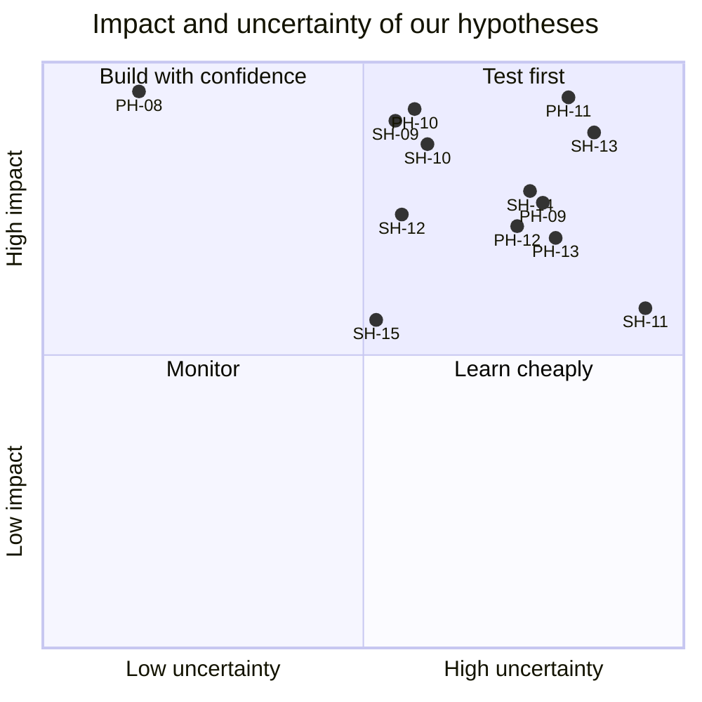

# Hypotheses

Problem hypotheses (PH) state what we believe is true about ASPRI-IPI's situation. Solution hypotheses (SH) state what we believe HuiTong will change. Each one names a measurable signal and how we will test it, so the design can change when the evidence does. Ids continue from PH-08 and SH-09: the earlier ones belonged to the earlier statements and are kept in the tag `archive/ps7-lesso-solar`.

**Status: Untested.** Validation happens at the briefing call (the week of 2 Nov, W3), in prototype tests (W4-W5) and through in-product metrics on synthetic data (W13 technical review, W18 final). Question ids refer to [questions-for-client.md](../client/questions-for-client.md); metric ids to [success-metrics.md](success-metrics.md).

## Problem hypotheses

### PH-08: re-typing into the TMS is most of the work after an assessment

We believe consolidation and TMS entry take about an hour a run, 60% of the work after an assessment, as the brief says, and that almost all of it is typing results already ticked on paper. We will know we are right when the client confirms the hour and that the typing, not checking, fills it. **Test:** interview and a walkthrough of one run (Q-76). **Signal:** minutes per run spent typing (baseline for SM-12, SM-13).

### PH-09: assessors reach different outcomes when they tally by hand

We believe two assessors watching the same performance can record different outcomes, because they tally the criteria by hand and may miss a critical item. We will know we are right when the client confirms corrections caused by tallying, or a sample of checklists shows them. **Test:** review of sample checklists with a training manager (Q-72, Q-74). **Signal:** the share of corrections caused by tallying or a missed critical item (baseline for SM-14, SM-18).

### PH-10: every agency is keyed separately, and rejections come back late

We believe the same results are keyed or uploaded once per agency, each in its own format, with at least one portal taking files only, and that rejected rows come back days later. **Test:** interview and one submission example per agency (Q-66, Q-67, Q-77). **Signal:** minutes per submission per agency, and the share of submissions with a rejected row (baselines for SM-16, SM-17).

### PH-11: the signal drops in the training environments

We believe parts of the training environments have no reliable signal, long enough that an online-only checklist would stop an assessment. **Test:** interview with IT and an assessor; a site walk if the client allows it (Q-70, Q-71). **Signal:** where and for how long the connection drops during a run.

### PH-12: course rules change often enough to need configuration

We believe course rules change often enough, through new courses and agency updates, that writing code for each course would not keep up, and that runs in progress must keep their rules. **Test:** interview with a training manager (Q-75). **Signal:** rule changes per course per year, and whether a running course ever changes rules midway.

### PH-13: an agency's audit needs the original evidence

We believe an agency may check the training provider's records long after a run, and asks for the checklist behind a result, who assessed it and every correction. **Test:** interview with compliance and operations (Q-79). **Signal:** how long records are kept, and what an audit asks to see.

## Solution hypotheses

### SH-09: a tablet checklist that works offline removes re-typing

We believe a tablet checklist that keeps every record on the device until it syncs, with a TMS connector that takes the verified results, will cut consolidation and TMS entry from about an hour a run to under 5 minutes, with no record lost. We will know it works when, in every demo run, no result is typed by hand after the assessment and an offline run syncs without loss or duplicates. **Test:** prototype test with an assessor (Q-63); in-product metrics on synthetic data. **Metrics:** SM-12, SM-13, SM-19.

### SH-10: versioned rules make competency consistent and auditable

We believe course rules kept as versioned configuration, with automatic competency, will make every assessor's outcome follow the same rules, and show which version decided each result. We will know it works when every rule-defined outcome in the demo is calculated, and a result shows its rule version. **Test:** sample checklists encoded as rules and checked against the training manager's own outcomes. **Metric:** SM-14.

### SH-11: an AI draft speeds up a new course's rules, with the training manager in control

We believe drafting a course's rules from its assessment plan, with a confidence and a rationale per rule, will cut the time to set up a course's rules, while nothing is used before the training manager approves it. We will know it works when a training manager approves a draft with edits in less time than writing it by hand, and no rule is used unapproved. **Test:** E2E #2 and a timed comparison on a synthetic course. **Metric:** SM-09.

### SH-12: verification with the evidence beside each result halves its time

We believe a verification queue that shows the evidence beside each result, with corrections that keep the original and record a reason, will halve verification time per run. **Test:** prototype test with an operations executive; in-product timing. **Metrics:** SM-15, SM-18.

### SH-13: files rendered from each agency's template are accepted first time

We believe agency files rendered from templates and validated against each agency's rules before delivery will be accepted the first time in 95% or more of submissions. **Test:** the portal mock's validation report on synthetic runs, then a real example per agency (Q-67). **Metric:** SM-17.

### SH-14: a per-agency allowlist and a tamper-evident trail make the data flows acceptable

We believe an allowlist per agency that denies by default, no national ID numbers stored, and a tamper-evident trail of every result and correction will satisfy the client's DPO and an agency's audit. **Test:** review with the client's compliance contact (Q-40, Q-78, Q-79). **Metrics:** GR-02, GR-04, SM-08.

### SH-15: a status board catches deadlines and rejections early

We believe showing every run's stage and every submission's status, with SLA reminders, will catch a missed deadline or a rejection before it costs a trainee their certification. **Test:** prototype walkthrough with operations and management (Q-77). **Metric:** SM-20.

## Prioritisation

Impact is the effect on the success metrics if the hypothesis holds; uncertainty is how little evidence we have today. High impact and high uncertainty means test first. The brief settles most of PH-08 (an hour a run, 60% of the effort), so its uncertainty is low.

| ID    | Impact (1-5) | Uncertainty (1-5) | Impact × uncertainty |
| ----- | ------------ | ----------------- | -------------------- |
| PH-08 | 5            | 1                 | 5                    |
| PH-09 | 4            | 4                 | **16**               |
| PH-10 | 5            | 3                 | 15                   |
| PH-11 | 5            | 4                 | **20**               |
| PH-12 | 4            | 4                 | **16**               |
| PH-13 | 4            | 4                 | **16**               |
| SH-09 | 5            | 3                 | 15                   |
| SH-10 | 5            | 3                 | 15                   |
| SH-11 | 3            | 5                 | 15                   |
| SH-12 | 4            | 3                 | 12                   |
| SH-13 | 5            | 4                 | **20**               |
| SH-14 | 4            | 4                 | **16**               |
| SH-15 | 3            | 3                 | 9                    |

### The top five to test first

1. **PH-11** the signal in the training environments: decides how far the checklist must work offline (Q-71).
2. **SH-13** files accepted first time: decides the agency connectors and the file renderers (Q-66, Q-67).
3. **PH-09** outcomes tallied by hand: decides how much the rules engine and its consistency checks are worth (Q-72).
4. **PH-12** how often rules change: decides how much of the rules model is versioning and approval (Q-75).
5. **SH-14** the allowlist and the trail: reviewed with the client's compliance contact (Q-78, Q-79). PH-13 (what an audit asks for, 16) follows, and sets the retention settings.
