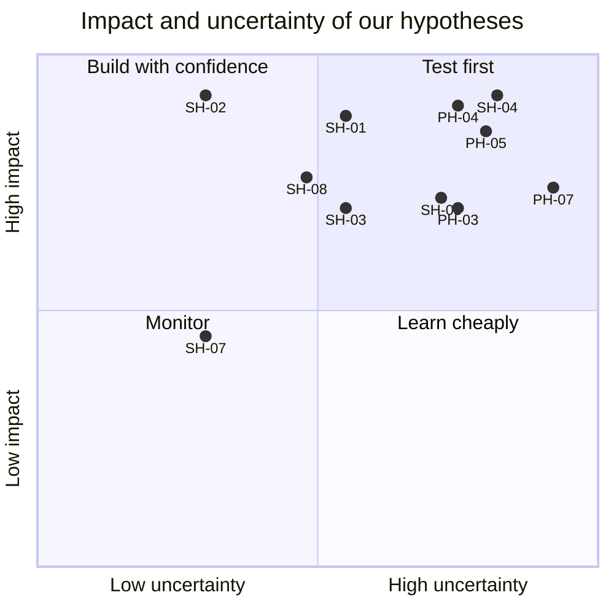

# Hypotheses

Problem hypotheses (PH) state what we believe is true about LESSO Solar's situation. Solution hypotheses (SH) state what we believe HuiTong will change. Each one names a measurable signal and how we will test it, so the design can change when the evidence does.

**Status: Untested.** Validation happens at the briefing call (the week of 2 Nov, W3), in prototype tests (W4-W5) and through in-product metrics on synthetic data (W13 technical review, W18 final). Question ids refer to [questions-for-client.md](../client/questions-for-client.md); metric ids to [success-metrics.md](success-metrics.md).

## Problem hypotheses

### PH-01: each new hire is typed several times

We believe SG HR types the same new-hire details into INFO-TECH and the intranet, and HQ types them again into SAP. The brief says the same data is entered in several systems; we will know how often when the client's walkthrough shows the manual entries of the same field per hire. **Test:** interview and screen-share walkthrough (Q-33, Q-59). **Signal:** entries per field per hire (baseline for SM-05).

### PH-02: the monthly summary is mostly reformatting and mapping

We believe preparing the monthly leave and payroll summaries for management takes about 16 HR hours, most of it spent renaming columns, fixing dates and mapping categories rather than checking content. We will know we are right when the client confirms at least 8 of those hours are mechanical. **Test:** interview, blank template review (Q-28, Q-30, Q-48). **Signal:** hours per stage (baseline for SM-01).

### PH-03: records disagree often enough to matter

We believe 10-15% of Singapore employees have at least one field that differs between INFO-TECH, HQ's SAP and any spreadsheet that consolidates them. We will know we are right when a structure-only comparison or the client's own experience points to disagreements in more than 1 record in 20. **Test:** interview, review of how records are kept in step (Q-05, Q-06, Q-50). **Signal:** share of consistent records (baseline for SM-02).

### PH-04: the SAP-before-intranet hand-off is where onboarding slips

We believe a new hire's SAP record, and then their intranet access, are requested person to person, and that waiting on them is the main reason new hires lack access on day 1. We will know we are right when the client describes at least one recent hire who started without intranet access, or waited days for it. **Test:** interview with SG HR and HQ HR (Q-33, Q-34, Q-59). **Signal:** entry-to-intranet lead time (baseline for SM-03).

### PH-05: data protection worries block automation more than technology does

We believe the client has not automated SG-CN data flows mainly because of uncertainty about PDPA and PIPL obligations, not for lack of interfaces. We will know we are right when the client names compliance review as a blocker for past integration ideas. **Test:** interview with the client and, if possible, the DPO (Q-37, Q-39, Q-40). **Signal:** whether the cross-border register and masking satisfy their compliance contact.

### PH-06: other companies share the pattern

We believe other Chinese companies in Singapore, and LESSO's own entities in new markets, pair a local HR product with HQ systems, each with its own export format. We will know we are right when the client names at least one other entity or company with a different HR product. **Test:** interview (Q-22). **Signal:** number of entities and systems named.

### PH-07: Treasury approvals are invisible from Singapore

We believe claims and payments that need HQ Treasury's extra approval wait without anyone in Singapore seeing where they stand, so claimants and HR chase them by message. We will know we are right when the client describes how a recent large claim reached Treasury and how long it waited. **Test:** interview with SG HR or finance and, if possible, HQ Treasury (Q-60). **Signal:** share of above-threshold payments with a recorded Treasury approval (baseline for SM-11).

## Solution hypotheses

### SH-01: a master with source-of-truth rules makes records consistent

We believe a canonical employee master with a source of truth per field and one conflict queue will raise cross-system consistency from about 85% to 98% or more. We will know it works when the sync engine reports at least 98% consistent records after HR clears the queue, with every decision audited. **Test:** in-product metric on synthetic data; walkthrough with the client. **Metric:** SM-02.

### SH-02: one entry onboards into both systems in the right order

We believe entering a new hire once in HuiTong, which creates the SAP and INFO-TECH records after HR approves a preview and requests intranet access only once the SAP record exists, will cut the time from entry to intranet access from days to the same day and lift day-1 readiness to 95% or more. We will know it works when, in every demo run, the workflow timestamps show the SAP record before the intranet access and the access granted on the day of entry, and replayed events create no duplicates. **Test:** in-product metric; prototype test with HR. **Metrics:** SM-03, SM-04, SM-10, GR-06.

### SH-03: a single view shrinks the monthly summary

We believe versioned mapping rules (leave categories among them), an exception list and a single view with dashboards will cut the monthly summary from about 16 hours to 2 hours or less. We will know it works when a run on three months of synthetic data needs only exception handling, and HR testers finish it in under 2 hours. **Test:** timed prototype test. **Metrics:** SM-01, SM-07.

### SH-04 — Visible controls make cross-border flows acceptable

We believe that showing controls where people use the data (masked fields with a "why is this hidden" explanation, classification badges, the cross-border transfer register and an append-only audit trail) will make SG-CN data sharing acceptable to the client's compliance contact. We will know it works when that contact accepts the register and masking design as a basis for a pilot. **Test:** design review with the client and DPO (Q-39, Q-40). **Metrics:** GR-03, GR-04, SM-08.

### SH-05: an AI assistant with an approval step connects another company in a day

We believe an AI schema-mapping assistant that proposes mappings with confidence scores and rationales, and that HR must approve, will connect another company's HR export in under a day. We will know it works when the joining company's sample goes from upload to an approved, versioned mapping config in under an hour of HR effort, with at least 80% of suggestions accepted unedited and none applied without approval. **Test:** in-product metric; prototype test. **Metrics:** SM-06, SM-09, GR-01.

### SH-06 — Status where people already work

We believe a workflow board in HuiTong, plus reminders in Lark/Feishu or DingTalk, will stop hiring managers chasing HR for status. We will know it works when hiring-manager testers can answer "where is my hire?" from the board in under 30 seconds, without asking anyone. **Test:** prototype test with a hiring manager (Q-34, Q-51, Q-61). **Metric:** task time in the prototype test; SM-04 in-product.

### SH-07: a bilingual interface invites HQ use

We believe a runtime EN/中文 switch, with Chinese category names next to their English equivalents, will let HQ HR use HuiTong without help. We will know it works when HQ testers complete the employee and single-view tasks in 中文 without assistance. **Test:** prototype test with an HQ participant or proxy. **Signal:** task completion rate in 中文.

### SH-08: a threshold rule makes the Treasury step certain and visible

We believe a configurable threshold that routes claims and payments above it to HQ Treasury, with the status visible to the claimant and HR, will ensure nothing above the threshold is paid without Treasury's approval and stop people chasing it. We will know it works when, in every demo run, claims above the threshold wait for Treasury's approval, those below do not, and the claimant can see where a claim stands. **Test:** in-product metric; walkthrough with the client. **Metrics:** SM-11, GR-06.

## Prioritisation

Impact is the effect on the success metrics if the hypothesis holds; uncertainty is how little evidence we have today. High impact and high uncertainty means test first. The brief settled part of PH-01 (data is entered in several systems), so its uncertainty dropped.

| ID    | Impact (1-5) | Uncertainty (1-5) | Impact × uncertainty |
| ----- | ------------ | ----------------- | -------------------- |
| PH-01 | 4            | 1                 | 4                    |
| PH-02 | 4            | 3                 | 12                   |
| PH-03 | 4            | 4                 | **16**               |
| PH-04 | 5            | 4                 | **20**               |
| PH-05 | 5            | 4                 | **20**               |
| PH-06 | 3            | 3                 | 9                    |
| PH-07 | 4            | 5                 | **20**               |
| SH-01 | 5            | 3                 | 15                   |
| SH-02 | 5            | 2                 | 10                   |
| SH-03 | 4            | 3                 | 12                   |
| SH-04 | 5            | 4                 | **20**               |
| SH-05 | 4            | 4                 | **16**               |
| SH-06 | 3            | 3                 | 9                    |
| SH-07 | 3            | 2                 | 6                    |
| SH-08 | 4            | 3                 | 12                   |

### The top five to test first

1. **PH-04** the SAP-before-intranet hand-off: decides how much of area 2's onboarding workflow is worth automating (Q-59).
2. **PH-07** the Treasury step: decides the claims and payments workflow and its threshold rule (Q-60).
3. **PH-05** compliance as the blocker: decides how prominent the governance features must be.
4. **SH-04** visible controls: the answer to PH-05; reviewed with the client's compliance contact.
5. **SH-05** the AI mapping assistant: the riskiest new idea, tested on the joining company's sample in W4-W5. PH-03 (how often records disagree, 16) follows, and sets the real baseline for SM-02.
