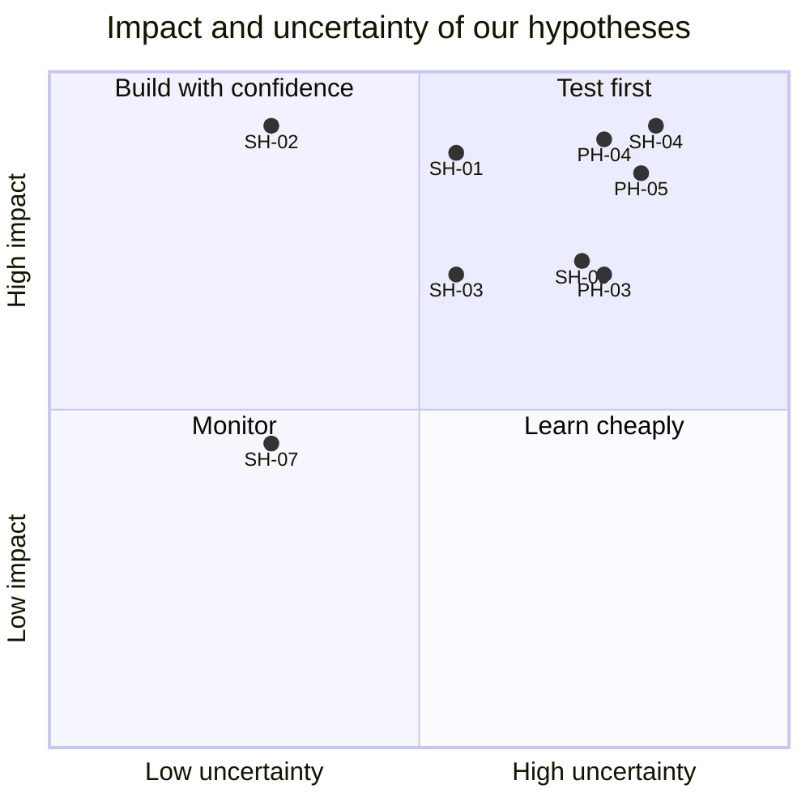

# Hypotheses

Problem hypotheses (PH) state what we believe is true about Organisation E's situation. Solution hypotheses (SH) state what we believe HuiTong will change. Each one names a measurable signal and how we will test it, so the design can change when the evidence does.

**Status: Untested.** Validation happens at the first client meeting (W2-W3), in prototype tests (W4-W5) and through in-product metrics on synthetic data (W13 technical review, W18 final). Question ids refer to [questions-for-client.md](../client/questions-for-client.md); metric ids to [success-metrics.md](success-metrics.md).

## Problem hypotheses

### PH-01: each new hire is typed several times

We believe SG HR types the same new-hire details into OA, SG HR and the Excel master, and HQ types them again into SAP. We will know we are right when the client's walkthrough shows at least two manual entries of the same field per hire. **Test:** interview and screen-share walkthrough (Q-06, Q-33). **Signal:** entries per field per hire (baseline for SM-05).

### PH-02: the consolidation is mostly reformatting and mapping

We believe the monthly attendance and leave consolidation takes about 16 HR hours, most of it spent renaming columns, fixing dates and mapping leave categories rather than checking content. We will know we are right when the client confirms at least 8 of those hours are mechanical. **Test:** interview, blank template review (Q-28, Q-48). **Signal:** hours per stage (baseline for SM-01).

### PH-03: records disagree often enough to matter

We believe 10-15% of Singapore employees have at least one field that differs between SG HR, HQ's SAP and the Excel master. We will know we are right when a structure-only comparison or the client's own experience points to disagreements in more than 1 record in 20. **Test:** interview, review of how the master is kept up (Q-05, Q-06, Q-50). **Signal:** share of consistent records (baseline for SM-02).

### PH-04: the hand-off after approval is where onboarding slips

We believe the follow-up after an OA approval is triggered by a person noticing it, and that this delay is the main reason new hires are not ready on day 1. We will know we are right when the client describes at least one recent day-1 miss caused by a late hand-off. **Test:** interview with HR and a hiring manager (Q-32, Q-33, Q-34). **Signal:** approval-to-checklist lead time (baseline for SM-03).

### PH-05: data protection worries block automation more than technology does

We believe the client has not automated SG-CN data flows mainly because of uncertainty about PDPA and PIPL obligations, not for lack of APIs. We will know we are right when the client names compliance review as a blocker for past integration ideas. **Test:** interview with the client and, if possible, the DPO (Q-37, Q-39, Q-40). **Signal:** whether the cross-border register and masking satisfy their compliance contact.

### PH-06: every new market brings a new isolated system

We believe each new overseas entity will bring its own locally compliant HR system with its own export format. We will know we are right when the client names at least one planned or recent market with a different HR product. **Test:** interview (Q-22). **Signal:** number of planned entities and systems.

## Solution hypotheses

### SH-01: a master with source-of-truth rules makes records consistent

We believe a canonical employee master with a source of truth per field and one conflict queue will raise cross-system consistency from about 85% to 98% or more. We will know it works when the sync engine reports at least 98% consistent records after HR clears the queue, with every decision audited. **Test:** in-product metric on synthetic data; walkthrough with the client. **Metric:** SM-02.

### SH-02: a signed approval event removes the hand-off

We believe an OA approval webhook that starts the requisition-to-onboarding workflow will cut approval-to-checklist time from days to under 5 minutes and lift day-1 readiness to 95% or more. We will know it works when the workflow timestamps show the checklist created within 5 minutes of the signed approval in every demo run, and replayed webhooks create no duplicates. **Test:** in-product metric; prototype test with HR. **Metrics:** SM-03, SM-04, GR-06.

### SH-03: approved mapping rules shrink the consolidation

We believe versioned leave-category rules plus an exception list will cut the consolidation from about 16 hours to 2 hours or less. We will know it works when a consolidation run on three months of synthetic data needs only exception handling, and HR testers finish it in under 2 hours. **Test:** timed prototype test. **Metrics:** SM-01, SM-07.

### SH-04 — Visible controls make cross-border flows acceptable

We believe that showing controls where people use the data (masked fields with a "why is this hidden" explanation, classification badges, the cross-border transfer register and an append-only audit trail) will make SG-CN data sharing acceptable to the client's compliance contact. We will know it works when that contact accepts the register and masking design as a basis for a pilot. **Test:** design review with the client and DPO (Q-39, Q-40). **Metrics:** GR-03, GR-04, SM-08.

### SH-05: an AI assistant with an approval step connects a subsidiary in a day

We believe an AI schema-mapping assistant that proposes mappings with confidence scores and rationales, and that HR must approve, will connect a new subsidiary's HR export in under a day. We will know it works when the MY01 sample goes from upload to an approved, versioned mapping config in under an hour of HR effort, with at least 80% of suggestions accepted unedited and none applied without approval. **Test:** in-product metric; prototype test. **Metrics:** SM-06, SM-09, GR-01.

### SH-06 — Status where people already work

We believe a workflow board in HuiTong, plus reminders in Teams (Singapore) and DingTalk (HQ), will stop hiring managers chasing HR for status. We will know it works when hiring-manager testers can answer "where is my hire?" from the board in under 30 seconds, without asking anyone. **Test:** prototype test with a hiring manager (Q-34, Q-51). **Metric:** task time in the prototype test; SM-04 in-product.

### SH-07: a bilingual interface invites HQ use

We believe a runtime EN/中文 switch, with Chinese category names next to their English equivalents, will let HQ HR use HuiTong without help. We will know it works when HQ testers complete the employee and consolidation tasks in 中文 without assistance. **Test:** prototype test with an HQ participant or proxy. **Signal:** task completion rate in 中文.

## Prioritisation

Impact is the effect on the success metrics if the hypothesis holds; uncertainty is how little evidence we have today. High impact and high uncertainty means test first.

| ID    | Impact (1-5) | Uncertainty (1-5) | Impact × uncertainty |
| ----- | ------------ | ----------------- | -------------------- |
| PH-01 | 4            | 2                 | 8                    |
| PH-02 | 4            | 3                 | 12                   |
| PH-03 | 4            | 4                 | **16**               |
| PH-04 | 5            | 4                 | **20**               |
| PH-05 | 5            | 4                 | **20**               |
| PH-06 | 3            | 3                 | 9                    |
| SH-01 | 5            | 3                 | 15                   |
| SH-02 | 5            | 2                 | 10                   |
| SH-03 | 4            | 3                 | 12                   |
| SH-04 | 5            | 4                 | **20**               |
| SH-05 | 4            | 4                 | **16**               |
| SH-06 | 3            | 3                 | 9                    |
| SH-07 | 3            | 2                 | 6                    |

### The top five to test first

1. **PH-04** the hand-off after approval: decides how much of area 2's workflow is worth automating.
2. **PH-05** compliance as the blocker: decides how prominent the governance features must be.
3. **SH-04** visible controls: the answer to PH-05; reviewed with the client's compliance contact.
4. **PH-03** how often records disagree: sets the real baseline for SM-02 and the conflict-queue design.
5. **SH-05** the AI mapping assistant: the riskiest new idea, tested on the MY01 sample in W4-W5.
