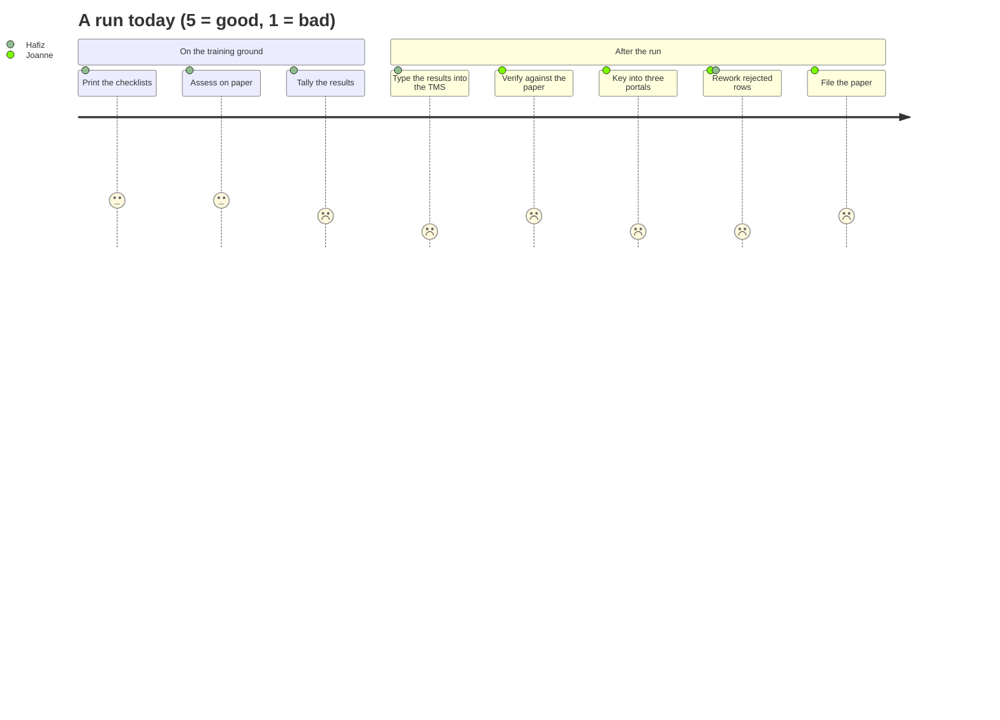
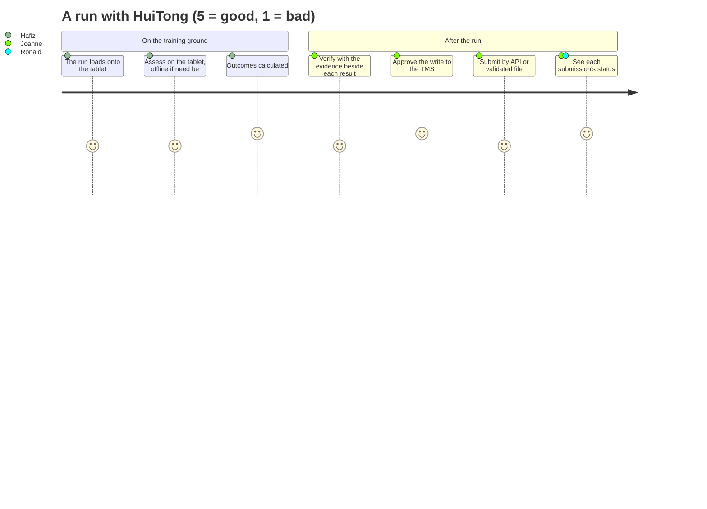

# Journey maps

Three journeys carry most of the pain in Problem Statement #5: a practical assessment run, from the training ground to the agencies; a change to a course's rules; and a submission an agency rejects. Each is mapped twice: as it works today on paper, and as it works with HuiTong. They are lettered D to F, because ids are never reused: journeys A to C belonged to the earlier statements and are kept in the tag `archive/ps7-lesso-solar`.

**Status: Assumed.** The stages come from the brief and desk research. Timings use the brief's figures and our arithmetic ([A-76](../assumptions.md)), and are confirmed or corrected at the briefing call ([Q-74](../client/questions-for-client.md), [Q-76](../client/questions-for-client.md), [Q-77](../client/questions-for-client.md)).

People: Hafiz Rahman (assessor), Joanne Lim (operations executive), Priya Nair (training manager), Ronald Seah (head of training operations) and Tan Wei Jie (a trainee). See [personas.md](personas.md).

---

## Journey D: a run, from the training ground to the agencies

### D.1 Current state

| #   | Stage                | Who             | What happens                                                                                                                                          | Systems                                         | Hand-off                        | Time (assumed)                                    | Feeling             | Pain points  |
| --- | -------------------- | --------------- | ----------------------------------------------------------------------------------------------------------------------------------------------------- | ----------------------------------------------- | ------------------------------- | ------------------------------------------------- | ------------------- | ------------ |
| 1   | Prepare the run      | Hafiz           | Prints a checklist per trainee from the course's current documents                                                                                    | Paper, the TMS's class list                     |                                 | 15 min                                            | Routine             | PP-23        |
| 2   | Assess               | Hafiz, trainees | Watches each trainee carry out the practical tasks and ticks the paper checklist, often in gloves and safety gear, sometimes where there is no signal | Paper                                           |                                 | The run itself                                    | Focused, encumbered | PP-16, PP-24 |
| 3   | Work out the results | Hafiz           | Tallies each trainee's criteria against the outcome rule and the critical items                                                                       | Paper, calculator                               |                                 | Part of the hour                                  | Error-prone         | PP-17        |
| 4   | Type into the TMS    | Hafiz           | Types every result into the TMS at a shared desktop                                                                                                   | The TMS                                         | Assessor to operations          | ~1 h a run, ~60% of the work after the assessment | Tedious             | PP-18        |
| 5   | Verify               | Joanne          | Checks the TMS entries against the paper, and calls the assessor about mismatches                                                                     | The TMS, paper, phone                           | Operations back to the assessor | ~10 min a run (10%)                               | Detective work      | PP-19        |
| 6   | Submit               | Joanne          | Keys or uploads the results into each agency's portal; builds a file where a portal takes no API                                                      | The MOM, SSG/WSDA and ITE portals, spreadsheets | Operations to each agency       | ~20 min a run (20%)                               | Repetitive          | PP-20        |
| 7   | Rework               | Joanne, Hafiz   | Fixes results and rows that come back wrong                                                                                                           | The portals, the TMS                            | Agency back to operations       | ~5 min a run (5%)                                 | Frustrated          | PP-21, PP-26 |
| 8   | File                 | Joanne          | Files the paper so it can be found when an agency checks                                                                                              | Filing cabinets                                 |                                 | ~5 min a run (5%)                                 | Low value           | PP-22        |
| 9   | Wait                 | Wei Jie         | Waits for his result to reach the agency before he is certified                                                                                       |                                                 |                                 | Unknown (Q-76)                                    | Uncertain           | PP-25        |

The work after the assessment takes about **1 hour 40 minutes a run** (our arithmetic: the brief's hour is the 60% share), and every result is written once and typed at least once more.

### D.2 Future state with HuiTong

| #   | Stage                | Who                    | What happens                                                                                                                                                                                         | Capability | Pain points removed |
| --- | -------------------- | ---------------------- | ---------------------------------------------------------------------------------------------------------------------------------------------------------------------------------------------------- | ---------- | ------------------- |
| 1   | Prepare the run      | Automatic              | HuiTong reads the run and its trainees from the TMS, with the course's approved rule version, and loads them onto Hafiz's tablet                                                                     | A, B, D    | PP-23               |
| 2   | Assess on the tablet | Hafiz                  | Marks each criterion on the tablet as he watches; the checklist keeps working without a signal and syncs when it finds one                                                                           | C          | PP-16, PP-24        |
| 3   | Competency           | Automatic              | HuiTong calculates each outcome from the course's rules; a trainee cannot be finished with a critical item unmarked                                                                                  | D          | PP-17               |
| 4   | Verify               | Joanne                 | Verifies the run in a queue, with the evidence beside each result; corrects one result with a reason, keeping the original. The verification assistant flags unusual records for her to look at      | C, E       | PP-19, PP-26        |
| 5   | Into the TMS         | Joanne, then automatic | After a preview, she approves the write; the verified results reach the TMS without re-typing (a mock in the PoC, labelled)                                                                          | A          | PP-18               |
| 6   | Submit               | Joanne, then automatic | One agency gets the results through its API, with an acknowledgement; another gets a file rendered from its template and validated before delivery. Each agency receives only its allowlisted fields | A, D, F    | PP-20, PP-21        |
| 7   | Track                | Joanne, Ronald         | The run's status shows per agency, with deadlines and any rejection                                                                                                                                  | C, D       | PP-21, PP-25        |
| 8   | Evidence             | Automatic              | Every result, correction and submission is in the tamper-evident audit trail, kept for the agreed period                                                                                             | F          | PP-22               |

Targets: consolidation and TMS entry **under 5 minutes** a run (SM-12), **no result typed by hand** after the assessment (SM-13), **100%** of rule-defined outcomes calculated (SM-14), **no record lost** by an offline sync (SM-19). See [success-metrics.md](success-metrics.md).

---

## Journey E: a course's rules change

### E.1 Current state

| #   | Stage                 | Who   | What happens                                                                   | Time (assumed) | Pain points  |
| --- | --------------------- | ----- | ------------------------------------------------------------------------------ | -------------- | ------------ |
| 1   | A requirement changes | Priya | An agency changes a course's requirements, or a new course is added            |                |              |
| 2   | Rewrite the plan      | Priya | Updates the assessment plan and rewrites the checklist by hand                 | Hours to days  | PP-23        |
| 3   | Tell the assessors    | Priya | Emails the assessors and prints new checklists                                 |                | PP-23        |
| 4   | Old checklists linger | Hafiz | An old checklist turns up in a run; assessors interpret the change differently |                | PP-17, PP-23 |
| 5   | Decide                | Priya | Finds the mismatch later and decides whether the run's results stand           |                | PP-26        |

### E.2 Future state with HuiTong

| #   | Stage   | Who                                | What happens                                                                                                                                                                     | Capability | Pain points removed |
| --- | ------- | ---------------------------------- | -------------------------------------------------------------------------------------------------------------------------------------------------------------------------------- | ---------- | ------------------- |
| 1   | Draft   | Priya, the rule-drafting assistant | Uploads the new assessment plan; the AI drafts the criteria, critical items and outcome rule, each with a confidence and a rationale, labelled "Mock AI" on the default provider | E          | PP-23               |
| 2   | Approve | Priya                              | Corrects the draft and approves it as a new rule version; nothing is used before she approves                                                                                    | D, E       | PP-23               |
| 3   | Use     | Automatic                          | The next run uses the new version with no code change; runs already started keep theirs                                                                                          | D          | PP-17, PP-23        |
| 4   | Show    | Priya, Grace (auditor)             | Any result shows the rule version it was assessed against                                                                                                                        | D, F       | PP-26               |

---

## Journey F: an agency rejects a submission

### F.1 Current state

| #   | Stage                 | Who           | What happens                                                                      | Time (assumed) | Pain points  |
| --- | --------------------- | ------------- | --------------------------------------------------------------------------------- | -------------- | ------------ |
| 1   | The rejection arrives | Joanne        | An email or a portal report says a row was rejected, days after the submission    | Days later     | PP-21        |
| 2   | Find the evidence     | Joanne        | Pulls the paper from the cabinet and finds the run in the TMS                     | 15 to 30 min   | PP-22        |
| 3   | Fix and resubmit      | Joanne, Hafiz | Corrects the result or the format, resubmits, and hopes nothing else was affected | Varies         | PP-21, PP-26 |

### F.2 Future state with HuiTong

| #   | Stage                   | Who       | What happens                                                                                                                                                           | Capability | Pain points removed |
| --- | ----------------------- | --------- | ---------------------------------------------------------------------------------------------------------------------------------------------------------------------- | ---------- | ------------------- |
| 1   | Caught early            | Automatic | A file is validated against the agency's rules before delivery; the portal mock's validation report or the API's acknowledgement comes back to the submission's status | A, D       | PP-21               |
| 2   | Corrected with a reason | Joanne    | A correction after submission goes back through verification, keeps the original value and records the reason                                                          | C, F       | PP-26               |
| 3   | Resubmitted once        | Automatic | The resubmission carries an idempotency key, so the agency never receives a duplicate                                                                                  | A          | PP-21               |

---

## Pain-point register

Severity is an assumption until the participants rank the pain points at the briefing call (see [README.md](README.md)). The "In the brief" column gives the number of the pain point in [problem-statement.md, section 2.2](../problem-statement.md#22-current-state-pain-points). Ids continue from PP-16: PP-01 to PP-15 belonged to the earlier statements.

| ID    | Pain point                                                                                           | Journey (stage) | Felt by                  | In the brief                             | Severity (assumed) | Addressed by                                 |
| ----- | ---------------------------------------------------------------------------------------------------- | --------------- | ------------------------ | ---------------------------------------- | ------------------ | -------------------------------------------- |
| PP-16 | Paper checklists in the training environment: ticks missed, smudged or lost                          | D2              | Hafiz, trainees          | 1. Paper checklists                      | High               | C tablet checklist                           |
| PP-17 | Competency is tallied by hand, so a missed critical item or a different sum gives a different result | D3, E4          | Hafiz, Priya, trainees   | 2. Competency by hand                    | High               | D course rules and competency calculation    |
| PP-18 | Every result is typed into the TMS after the run: about an hour a run                                | D4              | Hafiz                    | 3. Re-typed into the TMS                 | High               | A TMS connector, C capture                   |
| PP-19 | Verification needs the paper beside the screen, and a mismatch means chasing the assessor            | D5              | Joanne, Hafiz            | 4. Checked against the paper             | Medium             | C verification queue                         |
| PP-20 | Three portals, three formats, some without an API: the same results keyed or uploaded again          | D6              | Joanne                   | 5. Submissions to three agencies         | High               | A agency connectors, D submission files      |
| PP-21 | Rejections come back late, and fixing one means retracing the run                                    | D7, F1, F3      | Joanne, Hafiz            | 6. Rework                                | Medium             | D validated files, A submission status       |
| PP-22 | Paper is filed for audits and is slow to find when an agency checks                                  | D8, F2          | Joanne, compliance       | 6. Filing                                | Medium             | F tamper-evident audit trail                 |
| PP-23 | Course rules live in documents, and a change spreads unevenly                                        | D1, E2, E3, E4  | Priya, Hafiz             | Our analysis (2. Competency by hand)     | High               | D versioned rules, E rule-drafting assistant |
| PP-24 | Parts of the training environment have no signal                                                     | D2              | Hafiz                    | Our analysis ([A-67](../assumptions.md)) | High               | C offline checklist                          |
| PP-25 | Nobody can see at a glance where a run stands                                                        | D9              | Ronald, Joanne, trainees | Our inference, to confirm                | Medium             | D dashboards, C run status                   |
| PP-26 | A correction after verification or submission is hard to trace                                       | D7, E5, F3      | Joanne, auditors         | Our analysis                             | Medium             | C corrections with reasons, F audit trail    |

## Moments that matter

- **Ticking a criterion** (D2): the one moment a result is born; captured once here, it never needs typing again.
- **A critical item** (D3): a single unmarked item changes the outcome, so the checklist must make it impossible to skip.
- **Typing into the TMS** (D4): the single biggest cost, and the source of most errors.
- **The portal without an API** (D6): where a generated, validated file saves the most rework.
- **A rule change** (E2-E3): where consistency is won or lost across every assessor.

These moments drive the prioritised How-Might-We statements in [how-might-we.md](how-might-we.md).
