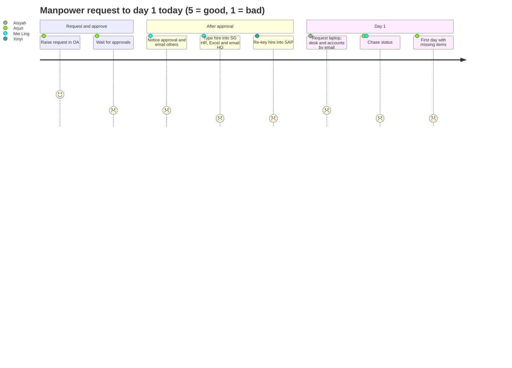
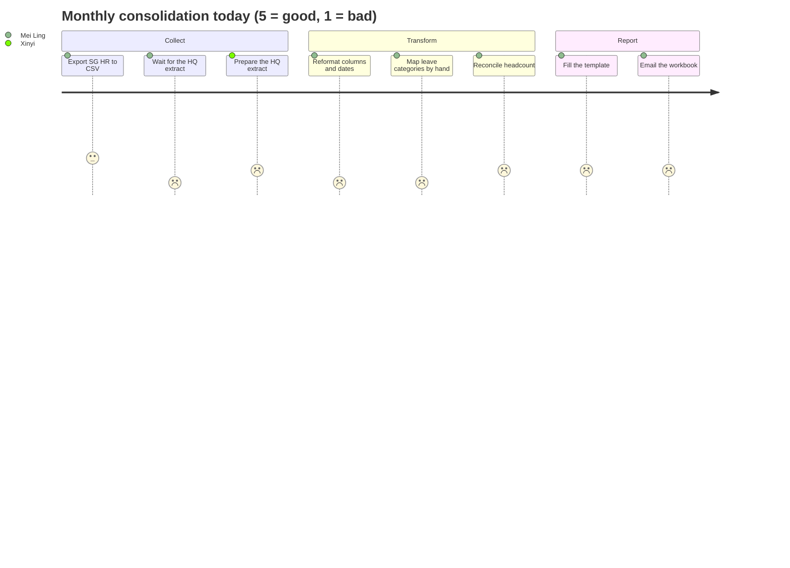

# Journey maps

Two journeys carry most of the pain in Problem Statement #17: a manpower request that ends with a new hire's first day, and the monthly attendance and leave consolidation. Each is mapped twice: as it works today, and as it works with HuiTong.

**Status: Assumed.** The stages come from the problem statement and desk research. Timings use the assumed baselines in [A-12](../assumptions.md) and are confirmed or corrected at the first client meeting ([Q-33](../client/questions-for-client.md), [Q-48](../client/questions-for-client.md)). Feelings are described in words and come from the "Feelings" paragraph of the statement.

People: Tan Mei Ling (SG HR executive), Zhou Xinyi 周欣怡 (China HQ HR partner), Arjun Menon (hiring manager), Nur Aisyah (admin operations), Farhan Ismail (IT). See [personas.md](personas.md).

---

## Journey A: manpower request to day-1 onboarding

### A.1 Current state

| #   | Stage                   | Who                                                                                         | What happens                                                                                      | Systems                      | Hand-off                     | Time (assumed)                | Feeling                      | Pain points                |
| --- | ----------------------- | ------------------------------------------------------------------------------------------- | ------------------------------------------------------------------------------------------------- | ---------------------------- | ---------------------------- | ----------------------------- | ---------------------------- | -------------------------- |
| 1   | Raise the request       | Arjun                                                                                       | Fills in the manpower request form: role, headcount, budget, start date                           | OA                           | Arjun to approvers           | 30 min                        | Routine                      |                            |
| 2   | Approvals               | Department head, Mei Ling, country head, HQ for unplanned roles ([A-10](../assumptions.md)) | Each approver opens OA and approves in turn                                                       | OA, email reminders          | Between approvers            | 3-10 working days             | Impatient                    |                            |
| 3   | Hand-off after approval | Mei Ling                                                                                    | Notices the approval, emails or messages Admin Ops, IT and HQ that a hire is coming               | OA, Outlook, Teams, WeChat   | HR to admin, IT and HQ       | 1-2 working days              | Easy to drop                 | PP-02, PP-12               |
| 4   | Recruit                 | Mei Ling, Arjun                                                                             | Advertising, interviews and offer happen outside HuiTong ([A-38](../assumptions.md))              | Job portals, agencies, email |                              | Weeks                         | Busy                         | PP-03                      |
| 5   | Record the hire         | Mei Ling                                                                                    | Types the new hire into SG HR, then into the Excel master, then sends HQ the same details for SAP | SG HR, Excel, email to HQ    | HR to HQ                     | 1-2 h per hire                | Tedious, error-prone         | PP-01, PP-05, PP-10, PP-11 |
| 6   | Mirror at HQ            | Xinyi                                                                                       | Re-keys the Singapore hire into SAP with HQ's codes and Chinese fields                            | SAP, WeChat                  | HQ back to HR with questions | 1-3 working days              | Frustrated by missing fields | PP-01, PP-05, PP-09        |
| 7   | Prepare for day 1       | Nur Aisyah, Farhan                                                                          | Laptop, desk, access card and accounts are requested by email; status lives in inboxes            | Email, IT ticket queue       | Admin and IT back to HR      | 2-5 working days              | Rushed                       | PP-04                      |
| 8   | Chase                   | Arjun, Mei Ling                                                                             | Arjun asks HR for status; HR asks admin and IT                                                    | Teams, DingTalk, phone       | Everyone to everyone         | 30 min a day in the last week | Anxious                      | PP-03, PP-12               |
| 9   | Day 1                   | New hire                                                                                    | Some items are missing on day 1 (laptop, account, desk)                                           |                              |                              |                               | Poor first impression        | PP-04                      |

Approval to an onboarding checklist that anyone can see: **3-5 working days**, and the checklist is an email thread. Each new-hire field is typed about **three times** (OA, SG HR, Excel), plus once more at HQ.

### A.2 Future state with HuiTong

| #   | Stage                     | Who                      | What happens                                                                                                                                                                                                  | Systems                           | Time (target)          | Feeling       | Capability |
| --- | ------------------------- | ------------------------ | ------------------------------------------------------------------------------------------------------------------------------------------------------------------------------------------------------------- | --------------------------------- | ---------------------- | ------------- | ---------- |
| 1   | Raise and approve         | Arjun, approvers         | Unchanged: OA stays the system for approvals                                                                                                                                                                  | OA                                | Unchanged              | Routine       |            |
| 2   | Approval reaches HuiTong  | Automatic                | OA sends a signed `approval.completed` webhook; HuiTong verifies the HMAC signature, stores the event once and starts the workflow                                                                            | OA, HuiTong                       | Seconds                | Nothing to do | A, C       |
| 3   | Requisition and checklist | Automatic, then Mei Ling | A recruitment requisition and an onboarding checklist appear on the Workflows board with owners and due dates                                                                                                 | HuiTong                           | < 5 min after approval | In control    | C          |
| 4   | Recruit                   | Mei Ling, Arjun          | Still outside HuiTong; Arjun follows the stage on the board instead of asking                                                                                                                                 | Job portals, HuiTong board        | Weeks                  | Informed      | C          |
| 5   | Record the hire once      | Mei Ling                 | Confirms the hire; fields from the OA request carry over. HuiTong creates a draft (`PRE_HIRE`) record in the master and, after Mei Ling approves a preview, the new hire in SG HR ([A-21](../assumptions.md)) | HuiTong, SG HR                    | 10 min                 | Relieved      | B, C       |
| 6   | HQ view                   | Xinyi                    | Sees the new Singapore hire in the master in HQ's structure, with only the fields HQ may hold (masking, cross-border register)                                                                                | HuiTong                           | Same day               | Trusting      | B, F       |
| 7   | Prepare for day 1         | Nur Aisyah, Farhan       | Admin preparation tasks (laptop, desk, accounts) are created with SLAs; reminders and escalations go to Teams or DingTalk                                                                                     | HuiTong, Teams, DingTalk (mocked) | Before the start date  | Calm          | C          |
| 8   | Day 1                     | New hire                 | Everything is ready. With the onboarding milestones met and the verified SG HR record in, the draft becomes active; the workflow closes and the audit trail records each step                                 | HuiTong                           |                        | Welcomed      | C, F       |

Targets: **< 5 minutes** from approval to checklist (SM-03), **≥ 95%** of hires fully prepared by day 1 (SM-04), each field typed **once** (SM-05). See [success-metrics.md](success-metrics.md).

---

## Journey B: monthly attendance and leave consolidation

### B.1 Current state

| #   | Stage                     | Who                   | What happens                                                                                                                                                                       | Systems                   | Hand-off         | Time (assumed)              | Feeling                  | Pain points  |
| --- | ------------------------- | --------------------- | ---------------------------------------------------------------------------------------------------------------------------------------------------------------------------------- | ------------------------- | ---------------- | --------------------------- | ------------------------ | ------------ |
| 1   | Export Singapore data     | Mei Ling              | Exports attendance and leave to CSV from SG HR                                                                                                                                     | SG HR, Excel              |                  | 30 min                      | Routine                  | PP-06        |
| 2   | Ask HQ for China data     | Mei Ling              | Messages Xinyi for the HQ extract                                                                                                                                                  | WeChat, DingTalk, email   | HR to HQ         | 1-2 working days of waiting | Dependent                | PP-08, PP-12 |
| 3   | Receive the HQ file       | Xinyi                 | Sends an Excel file with Chinese headers, `YYYY/MM/DD` dates and SAP codes, sometimes GBK-encoded                                                                                  | SAP export, email         | HQ to HR         | 1 h                         | Doing someone else's job | PP-05, PP-11 |
| 4   | Reformat and map          | Mei Ling              | Renames columns, fixes dates and encodings, maps categories by hand (年假 to Annual Leave, 病假 to Sick Leave, 调休 to Time-off in lieu); asks what to do with 探亲假 (home leave) | Excel                     |                  | 5-6 h                       | Tedious                  | PP-05, PP-07 |
| 5   | Reconcile headcount       | Mei Ling              | Checks joiners and leavers against the Excel master; finds mismatches between systems                                                                                              | Excel, SG HR, email to HQ | HR to HQ         | 3-4 h                       | Worried about accuracy   | PP-09, PP-10 |
| 6   | Fill the company template | Mei Ling              | Pastes into the reporting template, checks formulas and totals                                                                                                                     | Excel                     |                  | 3 h                         | Careful                  | PP-06        |
| 7   | Review and correct        | Mei Ling, her manager | Corrections loop back to step 4                                                                                                                                                    | Excel, email              |                  | 2 h                         | Pressured                | PP-13        |
| 8   | Send to management        | Mei Ling              | Emails the workbook; it contains personal data and sometimes crosses borders                                                                                                       | Outlook                   | HR to management | 15 min                      | Uneasy                   | PP-11, PP-13 |

Total: about **16 HR hours a month** spread over **about two working days** of elapsed time ([A-12](../assumptions.md)).

### B.2 Future state with HuiTong

| #   | Stage                | Who                   | What happens                                                                                                                     | Systems            | Time (target) | Feeling           | Capability |
| --- | -------------------- | --------------------- | -------------------------------------------------------------------------------------------------------------------------------- | ------------------ | ------------- | ----------------- | ---------- |
| 1   | Pull both sources    | Automatic or Mei Ling | Connectors pull attendance and leave from SG HR and CN HQ on a schedule or on demand                                             | HuiTong connectors | Minutes       | Nothing to chase  | A, D       |
| 2   | Map categories       | Automatic             | Approved, versioned leave-category rules translate both lists to canonical categories (年假 to ANNUAL, 调休 to TIME_OFF_IN_LIEU) | HuiTong            | Seconds       | Confident         | D          |
| 3   | Validate             | Automatic             | Checks produce an exception list: unmapped categories (探亲假), overlapping leave, missing attendance, unknown employees         | HuiTong            | Seconds       | Focused           | D          |
| 4   | Clear exceptions     | Mei Ling              | Works only the exceptions, each with its source record; decisions are audited                                                    | HuiTong            | ≤ 1 h         | In control        | D, F       |
| 5   | Preview the template | Mei Ling              | Sees the company template rendered from canonical data before export                                                             | HuiTong            | 15 min        | Reassured         | D          |
| 6   | Export and publish   | Mei Ling              | Exports the .xlsx and publishes the management report; recipients open it in HuiTong instead of an email attachment              | HuiTong            | 15 min        | Done the same day | D, F       |

Targets: **≤ 2 HR hours** a month (SM-01), report final **the same day** (SM-07), records consistent across systems **≥ 98%** (SM-02).

---

## Pain-point register

Severity is an assumption until the participants rank the pain points at the first client meeting (see [README.md](README.md)).

| ID    | Pain point                                                                                   | Journey (stage) | Felt by                     | Barrier in PS #17                                  | Severity (assumed)     | Addressed by                               |
| ----- | -------------------------------------------------------------------------------------------- | --------------- | --------------------------- | -------------------------------------------------- | ---------------------- | ------------------------------------------ |
| PP-01 | Each new-hire field is typed into OA, SG HR, the Excel master and again at HQ                | A5, A6          | Mei Ling, Xinyi             | Repeated entering and exporting                    | High                   | B master, C workflow                       |
| PP-02 | An approval in OA does not trigger the follow-up work; someone has to notice it              | A3              | Mei Ling                    | Approvals in OA, follow-up elsewhere               | High                   | A OA connector, C workflow                 |
| PP-03 | After approval, the hiring manager cannot see where a hire stands                            | A4, A8          | Arjun                       | Approvals in OA, follow-up elsewhere               | Medium                 | C workflow board                           |
| PP-04 | Laptop, desk and accounts are requested late by email, so day 1 is not ready                 | A7, A9          | Aisyah, Farhan, Arjun       | Follow-up in other systems                         | High                   | C admin tasks with SLAs                    |
| PP-05 | Singapore and HQ data differ in structure, language, date formats and codes                  | A5, A6, B3, B4  | Mei Ling, Xinyi             | Different data structures and formats              | High                   | A connectors, mapping engine               |
| PP-06 | The same CSV and Excel exports and imports are repeated every month                          | B1, B6          | Mei Ling                    | Repeated Excel/CSV export and import               | High                   | A connectors, D consolidation              |
| PP-07 | Leave categories are mapped by hand, and some have no counterpart (探亲假)                   | B4              | Mei Ling                    | Manual consolidation of categories                 | High                   | D category mapping rules                   |
| PP-08 | Waiting for HQ data that has to be requested person to person, through a different chat tool | B2              | Mei Ling                    | Limited system-to-system integration               | Medium                 | A CN HQ connector                          |
| PP-09 | Records disagree across SG HR, HQ SAP and the Excel master, and nobody knows which is right  | A6, B5          | Mei Ling, Xinyi             | Inconsistent employee records                      | High                   | B source of truth and conflict queue       |
| PP-10 | The Excel master is the only consolidated view, kept up by hand                              | A5, B5          | Mei Ling, management        | Master data maintained in Excel                    | High                   | B canonical master                         |
| PP-11 | Spreadsheets with pay and bank data travel by email, sometimes across borders                | A5, B3, B8      | Mei Ling, Xinyi, compliance | Access control and data protection across entities | High                   | F masking, register, audit                 |
| PP-12 | Notifications are split between Teams in Singapore and DingTalk or WeChat at HQ              | A3, A8, B2      | Everyone                    | Different collaboration tools                      | Medium                 | C notifications (mocked)                   |
| PP-13 | Management reporting waits for the manual consolidation                                      | B7, B8          | Management, Mei Ling        | Delayed management reporting                       | Medium                 | D reports from authorised sources          |
| PP-14 | Each new overseas market adds another isolated, locally compliant system                     | (future)        | HQ IT, HR                   | Every new operation adds a data environment        | Medium now, high later | A connector framework, E mapping assistant |

## Moments that matter

- **The minute after approval** (A2-A3): today it depends on someone noticing; with HuiTong it is the start of a tracked workflow.
- **Typing the hire** (A5): the single biggest source of duplicate work and of later inconsistencies.
- **Mapping 年假 to Annual Leave** (B4): small per row, large per month, and a frequent source of errors.
- **Sending the workbook** (B8): the point where data protection is most at risk.

These moments drive the prioritised How-Might-We statements in [how-might-we.md](how-might-we.md).
