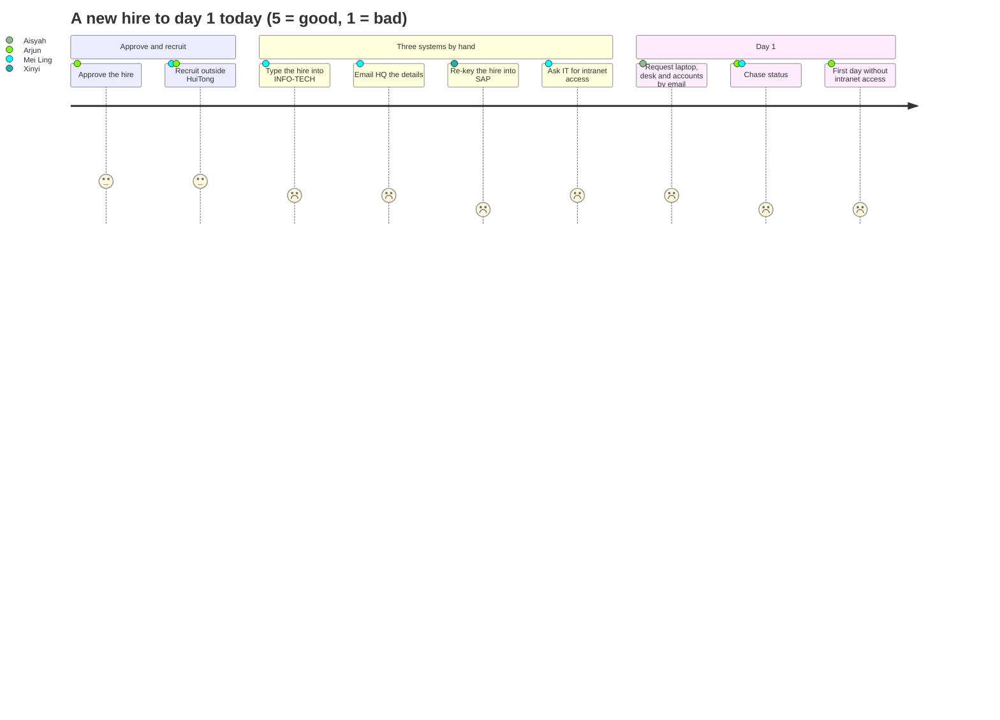
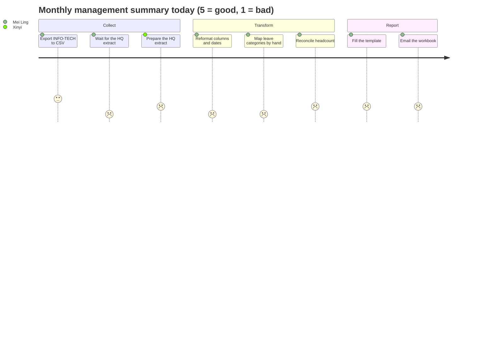

# Journey maps

Three journeys carry most of the pain in Problem Statement #7: a new hire onboarded into INFO-TECH, SAP and the intranet; the monthly management summary; and a claim that needs HQ Treasury's extra approval. Each is mapped twice: as it works today, and as it works with HuiTong.

**Status: Assumed.** The stages come from the brief and desk research. Timings use the assumed baselines in [A-12](../assumptions.md) and are confirmed or corrected at the briefing call ([Q-33](../client/questions-for-client.md), [Q-48](../client/questions-for-client.md), [Q-59](../client/questions-for-client.md), [Q-60](../client/questions-for-client.md)). Feelings are our reading of the brief, to be checked with the participants.

People: Tan Mei Ling (SG HR executive), Zhou Xinyi 周欣怡 (China HQ HR partner), Arjun Menon (hiring manager), Nur Aisyah (admin operations), Farhan Ismail (IT) and an HQ Treasury approver. See [personas.md](personas.md).

---

## Journey A: a new hire, from one entry to day 1

### A.1 Current state

| #   | Stage                     | Who                                          | What happens                                                                                                | Systems                      | Hand-off                     | Time (assumed)                | Feeling                      | Pain points         |
| --- | ------------------------- | -------------------------------------------- | ----------------------------------------------------------------------------------------------------------- | ---------------------------- | ---------------------------- | ----------------------------- | ---------------------------- | ------------------- |
| 1   | Approve the hire          | Arjun, approvers ([A-10](../assumptions.md)) | The hire is approved, in the intranet or elsewhere                                                          | Intranet, email              | Approvers to HR              | Varies                        | Impatient                    | PP-03               |
| 2   | Recruit                   | Mei Ling, Arjun                              | Advertising, interviews and the offer happen outside HuiTong ([A-38](../assumptions.md))                    | Job portals, agencies, email |                              | Weeks                         | Busy                         | PP-03               |
| 3   | Record the hire           | Mei Ling                                     | Types the new hire into INFO-TECH: the record, leave entitlement and payroll details                        | INFO-TECH                    |                              | 1 h per hire                  | Tedious                      | PP-01, PP-05        |
| 4   | Ask HQ for the SAP record | Mei Ling                                     | Emails HQ HR the same details in a spreadsheet, with Singapore codes and dates                              | Email, Excel                 | HR to HQ                     | Same day                      | Easy to drop                 | PP-01, PP-02, PP-11 |
| 5   | Create the SAP record     | Xinyi                                        | Re-keys the hire into SAP with HQ's codes and Chinese fields, and asks about the fields that are missing    | SAP, WeChat                  | HQ back to HR with questions | 1-2 working days              | Frustrated by missing fields | PP-01, PP-05, PP-09 |
| 6   | Request intranet access   | Mei Ling, Farhan                             | Once HQ confirms the SAP record, HR asks IT for the new hire's intranet account, which IT types in again    | Email, IT ticket queue       | HR to IT                     | 1 working day                 | Waiting                      | PP-01, PP-02        |
| 7   | Prepare for day 1         | Nur Aisyah, Farhan                           | Laptop, desk, access card and accounts are requested by email; status lives in inboxes                      | Email, IT ticket queue       | Admin and IT back to HR      | 2-5 working days              | Rushed                       | PP-04               |
| 8   | Chase                     | Arjun, Mei Ling                              | Arjun asks HR for status; HR asks HQ, admin and IT                                                          | Chat tools, email, phone     | Everyone to everyone         | 30 min a day in the last week | Anxious                      | PP-03, PP-12        |
| 9   | Day 1                     | New hire                                     | Some items are missing (laptop, intranet account), so the new hire cannot read the policies or file a claim |                              |                              |                               | Poor first impression        | PP-04               |

From a new hire's entry to their intranet access: **2-3 working days**, with the SAP-before-intranet order held together by email. Each new-hire field is typed about **three times** (INFO-TECH, SAP, intranet).

### A.2 Future state with HuiTong

| #   | Stage                      | Who                             | What happens                                                                                                                                                                                                                                                                  | Systems                                 | Time (target)         | Feeling          | Capability |
| --- | -------------------------- | ------------------------------- | ----------------------------------------------------------------------------------------------------------------------------------------------------------------------------------------------------------------------------------------------------------------------------- | --------------------------------------- | --------------------- | ---------------- | ---------- |
| 1   | Approve and recruit        | Arjun, approvers, Mei Ling      | Unchanged: approvals and recruiting stay where they are                                                                                                                                                                                                                       | Intranet, job portals                   | Unchanged             | Routine          |            |
| 2   | Enter the hire once        | Mei Ling                        | Enters the new hire once in HuiTong, prefilled from the approval where the intranet sends one. HuiTong creates a draft (`PRE_HIRE`) record in the master                                                                                                                      | HuiTong                                 | 10 min                | Relieved         | B, C       |
| 3   | Write to SAP and INFO-TECH | Mei Ling, Xinyi, then automatic | Each system's data steward approves a preview of the write into it: Xinyi for SAP, Mei Ling for INFO-TECH. HuiTong then creates both records, each write audited ([A-21](../assumptions.md), [A-62](../assumptions.md)). In the PoC both systems are mocks, labelled as mocks | HuiTong, SAP, INFO-TECH (mocked)        | Minutes of review     | In control       | A, C, F    |
| 4   | HQ view                    | Xinyi                           | Sees the new hire in the master in HQ's structure, with only the fields HQ may hold (masking, cross-border register), instead of re-keying them                                                                                                                               | HuiTong                                 | Same day              | Trusting         | B, F       |
| 5   | Intranet access            | Automatic, then Farhan          | Only once SAP confirms the record does HuiTong request the intranet account: the rule is enforced, not remembered                                                                                                                                                             | HuiTong, intranet (mocked)              | Same day as the entry | Nothing to chase | A, C       |
| 6   | Prepare for day 1          | Nur Aisyah, Farhan              | Admin preparation tasks (laptop, desk, accounts) are created with SLAs; reminders and escalations go to Lark/Feishu or DingTalk                                                                                                                                               | HuiTong, Lark/Feishu, DingTalk (mocked) | Before the start date | Calm             | C          |
| 7   | Day 1                      | New hire                        | Everything is ready. With the onboarding milestones met and the verified INFO-TECH record in, the draft becomes active; the workflow closes and the audit trail records each step                                                                                             | HuiTong                                 |                       | Welcomed         | C, F       |

Targets: the **same day** from entry to intranet access (SM-03), **100%** of SAP records before intranet access (SM-10), **≥ 95%** of hires fully prepared by day 1 (SM-04), each field typed **once** (SM-05). See [success-metrics.md](success-metrics.md).

---

## Journey B: the monthly management summary

### B.1 Current state

| #   | Stage                     | Who                   | What happens                                                                                                                                                                       | Systems                       | Hand-off         | Time (assumed)              | Feeling                  | Pain points  |
| --- | ------------------------- | --------------------- | ---------------------------------------------------------------------------------------------------------------------------------------------------------------------------------- | ----------------------------- | ---------------- | --------------------------- | ------------------------ | ------------ |
| 1   | Export Singapore data     | Mei Ling              | Exports leave and payroll summaries to CSV or Excel from INFO-TECH                                                                                                                 | INFO-TECH, Excel              |                  | 30 min                      | Routine                  | PP-06        |
| 2   | Ask HQ for China data     | Mei Ling              | Messages Xinyi for the HQ extract                                                                                                                                                  | Chat tools, email             | HR to HQ         | 1-2 working days of waiting | Dependent                | PP-08, PP-12 |
| 3   | Receive the HQ file       | Xinyi                 | Sends an Excel file with Chinese or SAP-coded headers, `YYYY/MM/DD` dates and SAP codes, sometimes GBK-encoded                                                                     | SAP export, email             | HQ to HR         | 1 h                         | Doing someone else's job | PP-05, PP-11 |
| 4   | Reformat and map          | Mei Ling              | Renames columns, fixes dates and encodings, maps categories by hand (年假 to Annual Leave, 病假 to Sick Leave, 调休 to Time-off in lieu); asks what to do with 探亲假 (home leave) | Excel                         |                  | 5-6 h                       | Tedious                  | PP-05, PP-07 |
| 5   | Reconcile headcount       | Mei Ling              | Checks joiners and leavers across INFO-TECH and SAP; finds mismatches between systems                                                                                              | Excel, INFO-TECH, email to HQ | HR to HQ         | 3-4 h                       | Worried about accuracy   | PP-09, PP-10 |
| 6   | Fill the company template | Mei Ling              | Pastes into the reporting template, checks formulas and totals                                                                                                                     | Excel                         |                  | 3 h                         | Careful                  | PP-06        |
| 7   | Review and correct        | Mei Ling, her manager | Corrections loop back to step 4                                                                                                                                                    | Excel, email                  |                  | 2 h                         | Pressured                | PP-13        |
| 8   | Send to management        | Mei Ling              | Emails the workbook; it contains personal data and sometimes crosses borders                                                                                                       | Email                         | HR to management | 15 min                      | Uneasy                   | PP-11, PP-13 |

Total: about **16 HR hours a month** spread over **about two working days** of elapsed time ([A-12](../assumptions.md)).

### B.2 Future state with HuiTong

| #   | Stage                  | Who                   | What happens                                                                                                                                                  | Systems            | Time (target) | Feeling           | Capability |
| --- | ---------------------- | --------------------- | ------------------------------------------------------------------------------------------------------------------------------------------------------------- | ------------------ | ------------- | ----------------- | ---------- |
| 1   | Pull every source      | Automatic or Mei Ling | Connectors pull leave, payroll summaries and headcount from INFO-TECH and SAP on a schedule or on demand                                                      | HuiTong connectors | Minutes       | Nothing to chase  | A, D       |
| 2   | Map categories         | Automatic             | Approved, versioned rules translate both lists to canonical categories (年假 to ANNUAL, 调休 to TIME_OFF_IN_LIEU)                                             | HuiTong            | Seconds       | Confident         | D          |
| 3   | Validate               | Automatic             | Checks produce an exception list: unmapped categories (探亲假), overlapping leave, unknown employees, records that disagree                                   | HuiTong            | Seconds       | Focused           | D          |
| 4   | Clear exceptions       | Mei Ling              | Works only the exceptions, each with its source record; decisions are audited                                                                                 | HuiTong            | ≤ 1 h         | In control        | D, F       |
| 5   | Review the single view | Mei Ling, management  | Dashboards show headcount, joiners and leavers, leave and payroll summaries and data-consistency measures, with provenance; cross-entity views are aggregates | HuiTong            | 15 min        | Reassured         | D, F       |
| 6   | Export and publish     | Mei Ling              | Exports the company template as .xlsx where one is still needed; management reads the same numbers in HuiTong instead of an email attachment                  | HuiTong            | 15 min        | Done the same day | D, F       |

Targets: **≤ 2 HR hours** a month (SM-01), the summary final **the same day** (SM-07), records consistent across systems **≥ 98%** (SM-02).

---

## Journey C: a claim above the Treasury threshold

### C.1 Current state

| #   | Stage                     | Who                         | What happens                                                                                                    | Systems           | Hand-off             | Time (assumed)   | Feeling        | Pain points  |
| --- | ------------------------- | --------------------------- | --------------------------------------------------------------------------------------------------------------- | ----------------- | -------------------- | ---------------- | -------------- | ------------ |
| 1   | Submit the claim          | Arjun                       | Submits a claim with its receipts in the intranet                                                               | Intranet          |                      | 15 min           | Routine        |              |
| 2   | Usual approvals           | Department head, SG finance | Approve in the intranet in turn ([A-63](../assumptions.md))                                                     | Intranet          | Between approvers    | 1-3 working days | Waiting        |              |
| 3   | Treasury's extra approval | HQ Treasury                 | Above the threshold, Treasury must approve as well; nobody in Singapore can see that the claim is waiting there | Intranet, email   | Singapore to HQ      | Unknown (Q-60)   | Uncertain      | PP-15        |
| 4   | Chase                     | Arjun, Mei Ling             | Arjun asks finance or HR where the claim is; they ask HQ by message                                             | Chat tools, email | Everyone to everyone | Unknown          | Frustrated     | PP-12, PP-15 |
| 5   | Payment                   | SG finance                  | Pays once every approval is in, checked by hand against the threshold                                           | Payment system    |                      |                  | Relieved, late | PP-15        |

### C.2 Future state with HuiTong

| #   | Stage                     | Who            | What happens                                                                                                                                 | Systems                          | Time (target)  | Feeling       | Capability |
| --- | ------------------------- | -------------- | -------------------------------------------------------------------------------------------------------------------------------------------- | -------------------------------- | -------------- | ------------- | ---------- |
| 1   | Submit the claim          | Arjun          | Unchanged, in the intranet                                                                                                                   | Intranet                         | 15 min         | Routine       |            |
| 2   | The claim reaches HuiTong | Automatic      | The intranet sends a signed event; HuiTong verifies it, stores it once and checks the amount against the configured threshold                | Intranet (mocked), HuiTong       | Seconds        | Nothing to do | A, C       |
| 3   | Route                     | Automatic      | Below the threshold the usual approvals suffice; above it, an HQ Treasury approval step follows them                                         | HuiTong                          | Seconds        | Certain       | C          |
| 4   | Treasury decides          | HQ Treasury    | Sees only the claims and payments that need it, with what it needs to decide; the decision is audited                                        | HuiTong or the intranet (mocked) | Within the SLA | In control    | C, F       |
| 5   | Status and payment        | Arjun, finance | The claimant and HR see where the claim stands on the workflow board; nothing above the threshold is marked payable before Treasury approves | HuiTong                          |                | Informed      | C, F       |

Targets: **100%** of payments above the threshold approved by Treasury before payment (SM-11), and replayed events create no duplicate approvals (GR-06).

---

## Pain-point register

Severity is an assumption until the participants rank the pain points at the briefing call (see [README.md](README.md)). The "In the brief" column gives the number of the pain point in [problem-statement.md, section 2.2](../problem-statement.md#22-current-state-pain-points).

| ID    | Pain point                                                                                     | Journey (stage) | Felt by                                | In the brief                                       | Severity (assumed)     | Addressed by                                                     |
| ----- | ---------------------------------------------------------------------------------------------- | --------------- | -------------------------------------- | -------------------------------------------------- | ---------------------- | ---------------------------------------------------------------- |
| PP-01 | Each new-hire field is typed into INFO-TECH, SAP and the intranet                              | A3, A4, A5, A6  | Mei Ling, Xinyi, Farhan                | 1. Duplicate entry                                 | High                   | B master, C workflow                                             |
| PP-02 | The SAP-before-intranet order is carried by people: HR waits for HQ's SAP record, then asks IT | A4, A5, A6      | Mei Ling, Farhan, new hires            | 2. SAP before intranet                             | High                   | A connectors, C workflow                                         |
| PP-03 | After approval, the hiring manager cannot see where a hire stands                              | A1, A2, A8      | Arjun                                  | Our analysis                                       | Medium                 | C workflow board                                                 |
| PP-04 | Laptop, desk, accounts and intranet access are requested late, so day 1 is not ready           | A7, A9          | Aisyah, Farhan, Arjun                  | 2. SAP before intranet                             | High                   | C admin tasks with SLAs                                          |
| PP-05 | Singapore and HQ data differ in structure, language, date formats and codes                    | A3, A5, B3, B4  | Mei Ling, Xinyi                        | 4. Different structures                            | High                   | A connectors, mapping engine                                     |
| PP-06 | The same CSV and Excel exports and imports are repeated every month                            | B1, B6          | Mei Ling                               | 1. Duplicate entry                                 | High                   | A connectors, D single view                                      |
| PP-07 | Leave categories are mapped by hand, and some have no counterpart (探亲假)                     | B4              | Mei Ling                               | 4. Different structures                            | High                   | D category mapping rules                                         |
| PP-08 | Waiting for HQ data that has to be requested person to person                                  | B2              | Mei Ling                               | 5. No single view                                  | Medium                 | A CN HQ connector                                                |
| PP-09 | Records disagree across INFO-TECH, SAP and spreadsheet copies, and nobody knows which is right | A5, B5          | Mei Ling, Xinyi                        | 1. Duplicate entry                                 | High                   | B source of truth and conflict queue                             |
| PP-10 | No single view: the consolidated picture is a spreadsheet kept up by hand                      | B5              | Mei Ling, management                   | 5. No single view                                  | High                   | B canonical master, D single view                                |
| PP-11 | Spreadsheets with pay and bank data travel by email, sometimes across borders                  | A4, B3, B8      | Mei Ling, Xinyi, compliance            | 6. Data moves between Singapore and China          | High                   | F masking, register, audit                                       |
| PP-12 | Messages and status are split across chat tools and email, in Singapore and at HQ              | A8, B2, C4      | Everyone                               | Our analysis (the brief suggests Lark or DingTalk) | Medium                 | C notifications (mocked)                                         |
| PP-13 | Management reporting waits for the manual summary                                              | B7, B8          | Management, Mei Ling                   | 5. No single view                                  | Medium                 | D single view and dashboards                                     |
| PP-14 | Each new market, or another company, adds another isolated, locally compliant system           | (future)        | HQ IT, HR, other companies             | 7. Reuse                                           | Medium now, high later | A connector framework, tenant configuration, E mapping assistant |
| PP-15 | Payments above the threshold wait on an HQ Treasury approval that nobody in Singapore can see  | C3, C4, C5      | Claimants, finance, Mei Ling, Treasury | 3. Treasury approval                               | High                   | C Treasury step (area 2)                                         |

## Moments that matter

- **The SAP record** (A4-A5): today it depends on an email and a re-keying at HQ; with HuiTong it is a previewed, approved write in a tracked workflow, and the intranet waits for it.
- **Typing the hire** (A3): the single biggest source of duplicate work and of later inconsistencies.
- **Mapping 年假 to Annual Leave** (B4): small per row, large per month, and a frequent source of errors.
- **Sending the workbook** (B8): the point where data protection is most at risk.
- **A claim over the threshold** (C3): the point where a payment either waits visibly for Treasury or slips through unseen.

These moments drive the prioritised How-Might-We statements in [how-might-we.md](how-might-we.md).
