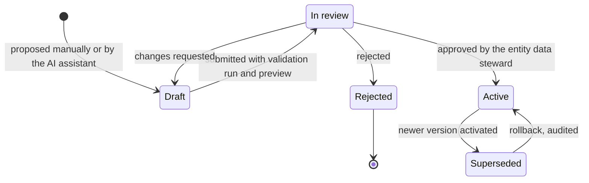
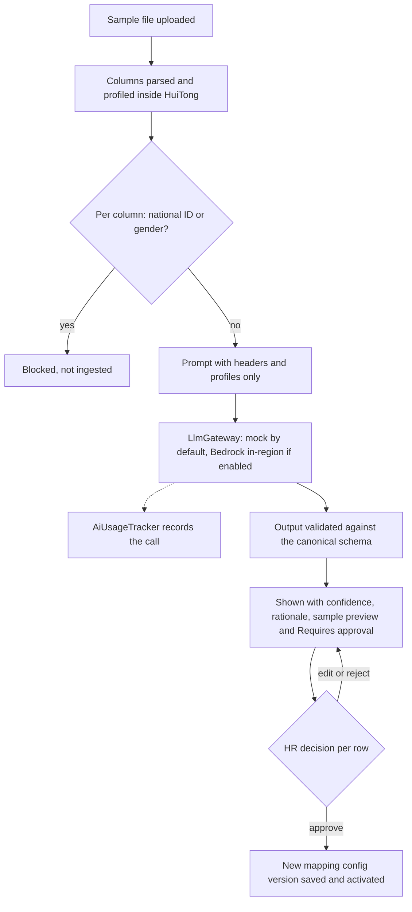

# GRS by design: governance, risk and sustainability

HuiTong 汇通 · LESSO Solar · Problem Statement #7

- **Requirement:** M2, GRS by design ([CLAUDE.md](../../CLAUDE.md) section 2). Also supports M4 (security and testing) and M6 (monitoring).
- **Capabilities:** A–G. Most controls live in F (governance and compliance) and G (monitoring).
- **Status:** draft v0.2, 22 Oct 2026: written before the briefing call, and retargeted to statement #7 ([ADR 0022](../adr/0022-final-statement-7-lesso-solar.md)).
- **Owner:** ownership area 4 (governance, security and monitoring). Richie (team lead) maintains it until area 4 is assigned.
- **Data:** the PoC uses synthetic data only. No real personal data is processed or crosses a border.

> Statements about LESSO Solar's systems, contracts and compliance arrangements beyond the brief are assumptions until the briefing call. Assumptions are logged in [../assumptions.md](../assumptions.md) (A-xx) and open points in [../client/questions-for-client.md](../client/questions-for-client.md) (Q-xx). Regulatory content is a set of design considerations, not legal advice (section 5).

**Contents:** [1. Purpose and approach](#1-purpose-and-approach) · [2. Governance](#2-governance) · [3. Risk register](#3-risk-register) · [4. Sustainability](#4-sustainability) · [5. Compliance considerations](#5-compliance-considerations) · [6. Related documents](#6-related-documents)

---

## 1. Purpose and approach

LESSO Solar's employee data already moves between its Singapore hub and China HQ, but by hand: the same data is entered in several systems and spreadsheets travel by email, with no record of who sent which fields, on what basis, or which copy is current ([problem statement, section 2.2](../problem-statement.md#22-current-state-pain-points)). HuiTong automates those flows, so it must also govern them: removing the re-keying must not create a faster, larger privacy risk. This document sets out how governance, risk and sustainability are designed into the data model, the server code and the UI. It is the control baseline for capabilities A–G.

### 1.1 Three layers

| Layer       | Principle                                                                                                | Examples                                                                                                                                                                                        |
| ----------- | -------------------------------------------------------------------------------------------------------- | ----------------------------------------------------------------------------------------------------------------------------------------------------------------------------------------------- |
| Data model  | Governance facts are stored as data, so they can be enforced and reported on                             | Classification tag on every canonical field; per-field provenance; versioned mapping configs with their approver; cross-border transfer register; retention policy per data category and entity |
| Server code | Controls run in the API, so no UI path can bypass them                                                   | Deny-by-default RBAC guard; field-masking interceptor; append-only, hash-chained audit writer; HMAC webhook verification; rate limits; zod validation at every boundary                         |
| UI          | Users can see why the system behaves as it does (Nielsen: visibility of system status, error prevention) | Classification badges; "Why is this hidden?" tooltips; approval steppers; AI confidence and "Requires approval"; sync previews; "Synthetic demo data" label                                     |

Rules that run through every section:

1. **Least privilege, scoped by entity:** SG01 and CN01 now, other entities and joining companies later.
2. **Minimise:** ingest only what the master needs. No national ID numbers, no gender, and bank details as bank name plus last four digits only.
3. **People approve meaning:** mappings, conflict decisions, cross-border flows and AI proposals need a named human approver.
4. **Preview before write:** nothing changes a record without a visible diff first.
5. **Audit every write:** the target is 100% of writes ([../design-thinking/success-metrics.md](../design-thinking/success-metrics.md)).
6. **Configuration, not code,** for each new entity or joining company (a tenant configuration).

### 1.2 Controls and where they show

API paths are relative to `apps/api/src/` and web paths to `apps/web/src/`. They are the planned homes from CLAUDE.md section 6 and [../team/module-ownership.md](../team/module-ownership.md). [../requirements-traceability.md](../requirements-traceability.md) records the concrete files and evidence (tests, screenshots, metrics) as each control lands.

| Control                                     | Where it lives in the product                                                                                                                                                                                                                                                     | How it is visible in the UI                                                                                                                                                               | Built by                                     |
| ------------------------------------------- | --------------------------------------------------------------------------------------------------------------------------------------------------------------------------------------------------------------------------------------------------------------------------------- | ----------------------------------------------------------------------------------------------------------------------------------------------------------------------------------------- | -------------------------------------------- |
| RBAC: 7 roles, scoped by entity             | API: deny-by-default RBAC guard and role decorators in `common/`; role enum in `packages/shared`. Web: access matrix in `features/governance`                                                                                                                                     | Navigation and actions appear only for permitted roles; the permission-denied state names the role needed; access matrix tab at `/governance`                                             | Area 1 (guard), area 4 (matrix)              |
| Field-level masking                         | API: field-masking interceptor in `common/` applies role clearance and entity scope from the shared field catalogue before a response leaves the server; each masked value carries a reason                                                                                       | Masked value with a lock icon and a "Why is this hidden?" tooltip: the classification, the clearance needed and, for SG01 RESTRICTED fields viewed by `HR_HQ`, the missing transfer entry | Area 1 (baseline), area 4 (administration)   |
| Data-classification badges                  | Shared field catalogue tags each canonical field PUBLIC, INTERNAL, CONFIDENTIAL or RESTRICTED; the tag drives masking, export rules and retention                                                                                                                                 | Badge beside each field in the employee drawer, mapping wizard and export dialog; classification tab at `/governance`                                                                     | Area 1 (catalogue), area 4 (UI)              |
| Append-only audit log with hash chain       | API: audit writer in `infrastructure/`, called in the same transaction as each change; a database trigger rejects UPDATE, DELETE and TRUNCATE; each event stores the previous event's hash                                                                                        | "Audit trail" link on records; history tab in the employee drawer; audit viewer at `/governance/audit` with a chain-verification result                                                   | Area 1 (writer), area 4 (viewer)             |
| Explicit approval steps                     | Approval state, approver and time on mapping configs, conflict decisions, transfer entries and workflow tasks, Treasury approvals among them                                                                                                                                      | Stepper (Draft → In review → Active) with names and timestamps; approve actions only for eligible roles; pending approvals listed on `/overview`                                          | Areas 1, 2 and 4                             |
| AI suggestions labelled                     | API: mapping assistant in `modules/mapping` and `modules/ai`, called through `LlmGateway`; proposals stored as drafts and validated against the canonical schema                                                                                                                  | "AI suggestion" label, confidence score with a High/Medium/Low band, rationale and a "Requires approval" badge on every row; nothing is saved until HR approves                           | Area 1                                       |
| Preview before any sync writes              | Sync job (Template Method) runs extract → map → validate as a dry run and stores the planned changes; load runs only after confirmation                                                                                                                                           | "Run sync" opens a preview of creates, updates, skips and conflicts with field-level diffs; confirm is the single primary action                                                          | Area 1                                       |
| Cross-border transfer register              | API: register in `modules/governance`; the masking interceptor and the sync allow-lists read approved entries                                                                                                                                                                     | Register tab at `/governance`; "Cross-border" badge on flows and fields that leave an entity; the masked-field tooltip cites the missing entry                                            | Area 4 (register), area 1 (enforcement)      |
| Retention settings                          | API: policy per data category and entity in `modules/governance`; scheduled purge or anonymisation job on BullMQ; every run audited                                                                                                                                               | Retention tab at `/governance`; purge history in the audit viewer                                                                                                                         | Area 4                                       |
| Synthetic-data label                        | Web: app shell in `app/`; report and export renderer                                                                                                                                                                                                                              | Persistent "Synthetic demo data" label in the top bar and on every exported sheet                                                                                                         | Area 1 (shell), area 3 (exports)             |
| HMAC-verified webhooks                      | API: intranet webhook ingestion (the `oa` connector) in `modules/connectors` checks `X-OA-Signature` (HMAC-SHA256 of `timestamp + "." + rawBody`) with a constant-time compare, a 5-minute replay window and `X-OA-Event-Id` de-duplication, then stores an `InboundWebhookEvent` | Connector detail lists received events as verified, rejected (signature), rejected (replay) or duplicate                                                                                  | Area 1                                       |
| Rate limiting                               | API: `@nestjs/throttler` globally, with tighter limits on sign-in, AI and export endpoints                                                                                                                                                                                        | "Too many requests, try again in N seconds" message with the traceId                                                                                                                      | Area 1                                       |
| Consent-aware clickstream                   | Web: `AnalyticsTracker` in `lib/` batches events to `POST /api/v1/analytics/events`; it sends route patterns, never raw URLs, input values or personal data, and honours a consent toggle and Global Privacy Control                                                              | Consent toggle in `/settings`; analytics shows aggregates only                                                                                                                            | Area 1 (tracker, ingest), area 4 (analytics) |
| Data minimisation and national-ID block     | The canonical model has no field for national ID numbers or gender; bank details kept as name and last four digits; the mapping assistant blocks ID-like columns                                                                                                                  | Blocked columns shown as "Not ingested: national ID" in the mapping wizard                                                                                                                | Area 1                                       |
| AI usage tracking                           | API: every `LlmGateway` call passes through `AiUsageTracker` (tokens in/out, model, latency, cost estimate, feature, user, outcome)                                                                                                                                               | AI usage tab at `/analytics`                                                                                                                                                              | Area 1 (tracker), area 4 (dashboard)         |
| Session and transport security              | API: argon2id hashing; httpOnly, Secure, SameSite=Strict cookies; refresh-token rotation with reuse detection; CSRF double-submit token; helmet with a strict CSP; CORS allow-list                                                                                                | Session-expiry prompt; a "signed out for security" message when a reused refresh token revokes the session                                                                                | Area 1                                       |
| One validation contract, one error envelope | zod schemas in `@huitong/shared` validate web forms and API input and generate Swagger; errors use `{ error: { code, message, details, traceId } }`                                                                                                                               | Inline field errors; error states offer a retry and show the traceId                                                                                                                      | Area 1                                       |

---

## 2. Governance

### 2.1 Roles and responsibilities

**System roles (RBAC).** Demo users are synthetic people seeded for the PoC.

| Role             | Demo user          | Responsibilities in HuiTong                                                                                                 | Clearance (baseline masking)                                                                      | Limits that enforce segregation of duties                                                                                    |
| ---------------- | ------------------ | --------------------------------------------------------------------------------------------------------------------------- | ------------------------------------------------------------------------------------------------- | ---------------------------------------------------------------------------------------------------------------------------- |
| `SYSTEM_ADMIN`   | Farhan Ismail      | Connectors, users and roles, platform configuration, retention jobs                                                         | Up to CONFIDENTIAL                                                                                | Cannot see RESTRICTED values; cannot approve mappings, conflict decisions or transfer entries; cannot change their own roles |
| `HR_SG`          | Tan Mei Ling       | Data steward for SG01: approves SG01 mappings, decides SG01 conflicts, approves transfer entries for SG01 data              | RESTRICTED for SG01; CONFIDENTIAL otherwise                                                       | No write access to CN01 records                                                                                              |
| `HR_HQ`          | Zhou Xinyi 周欣怡  | Data steward for CN01: approves CN01 mappings, decides CN01 conflicts, requests SG01 RESTRICTED fields through the register | RESTRICTED for CN01; CONFIDENTIAL for SG01 (SG01 RESTRICTED only with an approved transfer entry) | Cannot approve its own transfer requests                                                                                     |
| `HIRING_MANAGER` | Arjun Menon        | Follows each hire from entry to day 1                                                                                       | INTERNAL                                                                                          | No pay, bank or birth-date data                                                                                              |
| `ADMIN_OPS`      | Nur Aisyah         | Completes admin preparation (laptop, desk, accounts)                                                                        | INTERNAL                                                                                          | Task data only                                                                                                               |
| `MANAGEMENT`     | Li Guoqiang 李国强 | Reads the single view, dashboards and management reports                                                                    | INTERNAL, read-only                                                                               | No write actions; cross-entity reports use aggregates by default                                                             |
| `AUDITOR`        | Grace Lim          | Reads the full audit log, verifies the hash chain, reviews access                                                           | INTERNAL, read-only                                                                               | Cannot change data or configuration                                                                                          |

**Organisational roles.** These are not RBAC roles in the PoC; their decisions are recorded as references on the relevant entries.

| Role                                          | Who (assumed, [A-24](../assumptions.md))                                      | Accountable for                                           | How HuiTong supports it                                                     |
| --------------------------------------------- | ----------------------------------------------------------------------------- | --------------------------------------------------------- | --------------------------------------------------------------------------- |
| Data owner, SG01                              | Head of HR, Singapore hub                                                     | Purposes, sharing and retention of SG01 employee data     | Register entries and retention policies name the owner                      |
| Data owner, CN01                              | HR director, China HQ                                                         | The same for CN01                                         | As above                                                                    |
| Data steward                                  | `HR_SG` for SG01, `HR_HQ` for CN01; for a joining entity, named at onboarding | Data quality, mapping approval, conflict decisions        | Conflict queue, approvals, consistency metric                               |
| Data Protection Officer, SG01                 | Appointed by SG01 (PDPA s.11(3))                                              | PDPA compliance, transfer basis, breach assessment        | DPO reference on register entries; audit and export logs for breach scoping |
| Personal information protection officer, CN01 | Appointed where PIPL Art. 52 applies                                          | PIPL compliance, impact assessments, cross-border filings | Assessment and filing references on register entries                        |
| System owners                                 | Client IT for INFO-TECH, HQ's SAP and the intranet                            | Credentials, API scopes, change notices                   | Connector configuration, health and schema-drift alerts                     |
| Delivery team                                 | Richie, Iok Teck, Azri, Angelyn                                               | Building and operating the PoC controls in areas 1–4      | Module ownership, PR review, this register                                  |

Whether production needs a DPO role inside HuiTong, and who approves transfers on the client side, are open questions ([Q-40](../client/questions-for-client.md)).

### 2.2 Classification and masking baseline

| Level        | Canonical fields                                                                                                                                                                                 | Visible to (baseline)              |
| ------------ | ------------------------------------------------------------------------------------------------------------------------------------------------------------------------------------------------ | ---------------------------------- |
| PUBLIC       | None in the employee model; reference data only (for example department names)                                                                                                                   | Everyone                           |
| INTERNAL     | `employeeNo`, names, `workEmail`, `departmentCode`, `jobTitle`, `entityCode`, `workLocation`, `employmentType`, `employmentStatus`, `hireDate`, `managerEmployeeNo`, `terminationDate` (assumed) | All roles                          |
| CONFIDENTIAL | `workPhone`, `dateOfBirth`, `jobGrade`, `costCenter`                                                                                                                                             | `SYSTEM_ADMIN`, `HR_SG`, `HR_HQ`   |
| RESTRICTED   | `baseSalary`, `bankName`, `bankAccountLast4`                                                                                                                                                     | `HR_SG` for SG01; `HR_HQ` for CN01 |

- Masking is applied on the server, so masked values never reach the browser. Each masked value carries a reason (clearance too low, other entity, or no approved transfer entry) that the "Why is this hidden?" tooltip explains.
- Never ingested: NRIC/FIN, PRC resident ID numbers, other national ID numbers, gender and full bank account numbers. Full account numbers stay in the payroll system of record.
- **Across entities, the register decides too (default deny).** A field of another entity's record reaches a user only when an ACTIVE entry of the cross-border transfer register shares it with the user's own entity, whatever the role's clearance. The seed shares identity, job, work contact, grade and cost centre between SG01 and HQ, but not dates of birth or pay. Opening another entity's record that withholds fields is audited with the entry versions (story B-7, [ADR 0010 amendment](../adr/0010-auth-sessions-rbac-masking.md#amendment-21-oct-2026-a-per-destination-field-allowlist-default-deny)). The client confirms which fields each entity needs ([Q-08, Q-39](../client/questions-for-client.md)).

### 2.3 Approval points

| Decision                       | Raised by                                           | Approved by                                                                                             | Control rule                                                                                                                                                        | Effect of approval                                                                            |
| ------------------------------ | --------------------------------------------------- | ------------------------------------------------------------------------------------------------------- | ------------------------------------------------------------------------------------------------------------------------------------------------------------------- | --------------------------------------------------------------------------------------------- |
| Mapping config version, manual | `SYSTEM_ADMIN` or HR                                | Data steward of the connector's entity                                                                  | Maker-checker: the author cannot approve; a validation run and an impact preview are attached                                                                       | Becomes the only active version; the previous version is kept for rollback                    |
| AI mapping proposal            | AI assistant (draft), started by HR                 | HR data steward, row by row                                                                             | The AI is the maker and never an approver; each row is accepted, edited or rejected; low-confidence rows are never pre-selected                                     | Saved as a new mapping config version, linked to its AI usage record                          |
| Conflict decision              | Sync engine opens a conflict                        | HR of the employee's entity                                                                             | Reason required; the master keeps the last approved value meanwhile                                                                                                 | Value applied with provenance "HR decision"; it holds until a source changes that field again |
| Cross-border transfer entry    | HR of the receiving entity                          | Data steward of the exporting entity, with the DPO's reference                                          | The requester cannot approve; a review date is required                                                                                                             | Listed fields may flow until the review date; expiry fails closed                             |
| Onboarding step (area 2)       | HR's one new-hire entry, after the hire is approved | Step owner (HR, hiring manager, admin ops); a write into SAP or INFO-TECH by that system's data steward | The hire's approval is the authority, and its reference is recorded; intranet access waits for the SAP record                                                       | Step completed and audited; each write is previewed first                                     |
| Treasury approval (area 2)     | A claim or payment above the configured threshold   | HQ Treasury                                                                                             | The threshold is configuration that only an authorised role can change, with an audit event; the rule runs on the server; claimants cannot approve their own claims | The claim or payment may proceed to payment; until then it stays blocked                      |
| Role assignment                | `SYSTEM_ADMIN`                                      | Detective control: `AUDITOR` access review                                                              | No self-assignment                                                                                                                                                  | Audited and listed in the next access review                                                  |
| Retention policy change        | `SYSTEM_ADMIN`                                      | Data owner (reference recorded)                                                                         | Shortening a period first previews what will be purged                                                                                                              | The next purge run uses the new period                                                        |

Every approval stores who, when, what (a diff) and why (a reason), and writes an audit event. Approvals are made by named users, never by service accounts. Pending approvals and open conflicts appear on `/overview` and in notifications, so they are not lost in email.

### 2.4 Audit

**What is logged**

| Event family  | Examples                                                                                                                                  |
| ------------- | ----------------------------------------------------------------------------------------------------------------------------------------- |
| Data changes  | Employee created or updated (per field, with provenance); conflict opened or decided; sync run reverted                                   |
| Integration   | Sync run started, completed or failed (counts, mapping version used); webhook received or rejected                                        |
| Configuration | Connector added, changed or paused; mapping version proposed, approved, activated or rolled back; role assigned; retention policy changed |
| Governance    | Transfer entry requested, approved or expired; retention purge run                                                                        |
| Access        | Sign-in, sign-out, failed sign-in, refresh-token reuse, permission denied, RESTRICTED record viewed, export downloaded                    |
| AI            | Proposal generated (linked to its `AiUsageTracker` record); proposal approved or rejected                                                 |

Each event records: event id, time (UTC), actor (user and role, or service and job id), action code (UPPER_SNAKE, from `@huitong/shared`), entity code, target (type and id), the names of changed fields, reason or approval reference, `traceId`, outcome, the previous event's hash and its own hash.

**No sensitive values in the log.** Values of CONFIDENTIAL and RESTRICTED fields are not copied into audit events. The event points to the change-history entry, which is masked like any other read. The `AUDITOR` can therefore read the whole log with INTERNAL clearance, and the log never becomes a second copy of pay or bank data.

**Append-only at the database level**

- The audit repository exposes append and query methods only; there is no update or delete path in code.
- A PostgreSQL trigger rejects UPDATE, DELETE and TRUNCATE on the audit table for every role, so neither a bug nor a manual SQL session can rewrite history silently.
- Production hardening: the runtime database role gets INSERT and SELECT only on the audit table, and migrations run under a separate owner role.

**Hash chain for tamper evidence**

- `hash = SHA-256(previousHash + canonical JSON of the event)`. The first event uses a fixed genesis value.
- Inserts are serialised (a PostgreSQL advisory lock inside the insert transaction), so the chain has a single order.
- The `AUDITOR`'s "Verify chain" action recomputes every hash and reports the first broken link.
- Limit: someone with database-owner rights could rebuild the whole chain. Production therefore anchors the latest hash outside the database at intervals (for example in S3 with Object Lock), so a rebuilt chain no longer matches its anchors.

**Retention.** Audit events are kept for a placeholder 7 years (section 2.8); the client sets the real period. Because events hold no sensitive values and identify people only by `employeeNo`, they can outlive the record they describe. Old segments are archived, never edited: an archive event records the last archived hash, so verification continues across the boundary. A China-hosted component must keep network logs for at least six months under the Cybersecurity Law, which this exceeds.

**Who can read it**

| Reader           | Scope                                                             |
| ---------------- | ----------------------------------------------------------------- |
| `AUDITOR`        | Full log, filters, export, chain verification                     |
| `HR_SG`, `HR_HQ` | History of the records they can see, in context (employee drawer) |
| `SYSTEM_ADMIN`   | Read-only, for troubleshooting                                    |
| Other roles      | None                                                              |

Nobody can edit or delete events. Queries and exports of the audit log are themselves audited.

### 2.5 Change management for mappings

Mapping configs translate each source system's fields into the canonical model, so one bad mapping can corrupt many records at once. They are treated like code changes: versioned, reviewed, tested and reversible.

- Versions are immutable. Editing creates a new draft.
- A connector has exactly one active version, and sync uses only that version.
- Submitting for review requires a validation run on the latest sample (every mapped column transforms without error, required canonical fields are covered, no blocked fields) and an impact preview on current records.
- Every sync run records the mapping version it used, and every field's provenance records source system, source record, mapping version and sync run. A bad version can be traced to exactly the values it produced.
- Rollback re-activates the previous version and, if needed, reverts the affected sync runs from change history, after a preview.
- Kill switch: `SYSTEM_ADMIN` can pause a connector at once without approval, because pausing only reduces risk. Resuming runs the normal checks.
- Leave-category mappings (area 3) and report templates follow the same lifecycle.

### 2.6 AI governance

HuiTong uses AI in two places only: the schema-mapping assistant and the discrepancy explainer (capability E).

| Principle                      | How HuiTong applies it                                                                                                                                                                                                                                                                                                                                                                                                                                                                                                         |
| ------------------------------ | ------------------------------------------------------------------------------------------------------------------------------------------------------------------------------------------------------------------------------------------------------------------------------------------------------------------------------------------------------------------------------------------------------------------------------------------------------------------------------------------------------------------------------ |
| Human in the loop              | AI output is a draft. A mapping proposal becomes a config only after HR approval, and the explainer has no write path. AI never writes to a system of record.                                                                                                                                                                                                                                                                                                                                                                  |
| Narrow purpose                 | No AI decisions about individuals (hiring, pay, performance). This also keeps HuiTong clear of automated individual decision-making (PIPL Art. 24).                                                                                                                                                                                                                                                                                                                                                                            |
| Prompt and data minimisation   | Mapping prompts carry column headers and column profiles computed inside HuiTong (type, format pattern, fill rate), not cell values. National-ID and gender columns are removed before the prompt is built, and a category column whose header names a person (a department head, an approver) shows no values. Explainer prompts carry no employee identifier at all, not even the employee number: values above INTERNAL, and values that identify a person (names, work email and phone, a manager's number), are withheld. |
| Untrusted input                | Uploaded content is data, never instructions: it sits in delimited fields of a fixed prompt, the model has no tools, and output must pass validation.                                                                                                                                                                                                                                                                                                                                                                          |
| Validated output               | Responses must parse against a zod schema (target is a canonical field, confidence is 0–1, rationale is length-capped), followed by type-compatibility and duplicate-target checks. Invalid rows are dropped and the outcome is recorded.                                                                                                                                                                                                                                                                                      |
| Transparency                   | Every suggestion shows "AI suggestion", a confidence band, the rationale and "Requires approval". An approved config records that it was AI-assisted and who approved it.                                                                                                                                                                                                                                                                                                                                                      |
| Provider control               | No employee identifier or sensitive HR data goes to a third-party AI service without the client's written permission (story E-5, adopted from Azri's integrated plan). `mock` is the default: deterministic, no key, and no data leaves the API. `bedrock` is opt-in by configuration and is invoked in the deployment region without cross-region inference. `openai` stays off for client data unless the client approves it in writing.                                                                                     |
| Usage, model and cost tracking | `AiUsageTracker` records tokens in and out, model, latency, cost estimate, feature, user and outcome for every call. It stores usage metadata, not prompt or completion text. Area 4 adds budgets and alerts.                                                                                                                                                                                                                                                                                                                  |
| No training on client data     | HuiTong does not train or fine-tune models on client data, and the provider's data-use terms are checked before Bedrock is enabled. Improvement is deterministic: approved mappings can be kept as synonym rules (for example 入职日期 → `hireDate`) that are reviewed like any mapping.                                                                                                                                                                                                                                       |
| Measured quality               | Targets: at least 80% of suggestions accepted without edits, and none applied without approval.                                                                                                                                                                                                                                                                                                                                                                                                                                |

Confidence bands are placeholders to tune against the acceptance rate: High ≥ 0.85, Medium 0.60–0.84, Low < 0.60. Low-confidence rows start unselected and need an explicit choice.

### 2.7 Data ownership and source of truth

Systems of record stay authoritative. The canonical master (capability B) is a governed, consolidated copy in which each field value carries its provenance: source system, source record, mapping version, sync run and time.

| Field group                  | Fields                                                                                                                                                                     | SG01 employees                                   | CN01 employees                   |
| ---------------------------- | -------------------------------------------------------------------------------------------------------------------------------------------------------------------------- | ------------------------------------------------ | -------------------------------- |
| Identifier                   | `employeeNo` (HQ-assigned, `E1xxxxx`)                                                                                                                                      | Match key in both systems; never changed by sync | Match key; never changed by sync |
| Payroll and personal         | `baseSalary`, `bankName`, `bankAccountLast4`, `dateOfBirth`, `workPhone`                                                                                                   | INFO-TECH                                        | SAP                              |
| HQ structure                 | `jobGrade`, `costCenter`                                                                                                                                                   | SAP                                              | SAP                              |
| Shared, no single owner      | `jobTitle`, `departmentCode`, `workEmail`, `hireDate`                                                                                                                      | A disagreement opens a conflict; `HR_SG` decides | SAP                              |
| Names and employment details | `familyName`, `givenName`, `fullNameLatin`, `fullNameLocal`, `preferredName`, `employmentType`, `employmentStatus`, `terminationDate`, `workLocation`, `managerEmployeeNo` | INFO-TECH (assumed, [A-06](../assumptions.md))   | SAP                              |

1. **Owned field, sources disagree:** the owner's value wins automatically and the difference is listed as a discrepancy, so the other system can be corrected at its source. No conflict is opened.
2. **Unowned field, sources disagree:** an OPEN conflict is raised. The master keeps the last approved value until HR picks a source or enters a value with a reason. The decision is audited.
3. **Decisions stick:** a decision holds until a source changes that field again, so the same conflict does not reopen on every sync.
4. **Manual values** are recorded with the source "HR decision" and a reason, and should also be corrected in the source system.
5. **New hires start as drafts.** The onboarding workflow creates a draft (`PRE_HIRE`) record from HR's one new-hire entry. It becomes active only after the agreed onboarding milestones and the verified INFO-TECH record, and then the table above applies. Intranet access is requested only once the SAP record exists ([A-62](../assumptions.md)).
6. **Write-back** to a system of record happens only through an explicit, audited approval after a preview, for example the new-hire record into SAP or INFO-TECH, approved by that system's data steward. Against the client's real systems it is out of scope until the client agrees ([Q-17](../client/questions-for-client.md)); until then the mocks demonstrate it, labelled as mocks.

### 2.8 Retention defaults

HuiTong holds copies; statutory record-keeping is the job of the systems of record (INFO-TECH, which also runs payroll, and HQ's SAP). That lets HuiTong keep its copies for shorter periods. The values below are placeholders for the retention settings screen, not a statement of the legally required periods ([A-29](../assumptions.md)).

| Data                                      | PoC default (placeholder)                                                                   | Note                                                                              |
| ----------------------------------------- | ------------------------------------------------------------------------------------------- | --------------------------------------------------------------------------------- |
| Employee record, active                   | While employed                                                                              | —                                                                                 |
| Employee record, after termination        | CONFIDENTIAL and RESTRICTED fields cleared after 90 days; the rest anonymised after 2 years | Employment, tax and PRC labour-record rules set minimums in the systems of record |
| Source-record snapshots and sync payloads | 90 days                                                                                     | Long enough to investigate a sync                                                 |
| Inbound webhook bodies                    | 30 days after processing                                                                    | Event id and outcome stay in the audit log                                        |
| Uploaded sample files (mapping assistant) | Deleted when the proposal is approved or rejected, and after 7 days at most                 | Only the approved mapping is kept                                                 |
| Audit events                              | 7 years                                                                                     | Archived in segments; no sensitive values inside                                  |
| Clickstream events                        | 13 months raw; aggregates kept                                                              | No personal data                                                                  |
| AI usage records                          | 2 years                                                                                     | Metadata only                                                                     |

---

## 3. Risk register

### 3.1 Scoring

| Score | Likelihood (L), within the PoC or the first year of production use | Impact (I)                                                                                                      |
| ----- | ------------------------------------------------------------------ | --------------------------------------------------------------------------------------------------------------- |
| 1     | Rare                                                               | Negligible: cosmetic, no data affected                                                                          |
| 2     | Unlikely                                                           | Minor: local rework, no personal data exposed                                                                   |
| 3     | Possible                                                           | Moderate: wrong records or a missed deadline, recoverable                                                       |
| 4     | Likely                                                             | Major: personal data seen by unauthorised people, or a failure a regulator would care about                     |
| 5     | Almost certain                                                     | Severe: reportable breach or unlawful cross-border transfer, with regulatory and reputational harm to the group |

Score = L × I. Bands: **Low** 1–4, **Medium** 5–9, **High** 10–16, **Critical** 20–25. Inherent scores assume production use with real data and none of HuiTong's controls; residual scores assume the designed controls are in place. Because the PoC uses synthetic data only, its actual privacy exposure is far lower than these scores.

### 3.2 Register

Owner is the ownership area (1–4) that builds the control, or the client where only the client can act.

| ID   | Risk                                                                                                                         | Category          | Cause                                                                                                                                                           | L   | I   | Score    | Mitigations (where they live)                                                                                                                                                                                                                                                                                                                                                                                                                                                                                                                                                                                                                                                                                                                                                                     | Owner                                | Residual                    |
| ---- | ---------------------------------------------------------------------------------------------------------------------------- | ----------------- | --------------------------------------------------------------------------------------------------------------------------------------------------------------- | --- | --- | -------- | ------------------------------------------------------------------------------------------------------------------------------------------------------------------------------------------------------------------------------------------------------------------------------------------------------------------------------------------------------------------------------------------------------------------------------------------------------------------------------------------------------------------------------------------------------------------------------------------------------------------------------------------------------------------------------------------------------------------------------------------------------------------------------------------------- | ------------------------------------ | --------------------------- |
| R-01 | SG01 employee data transferred to China without a valid PDPA basis                                                           | Compliance        | HQ needs SG data (SAP holds SG01 staff as overseas staff); flows today go by email and Excel; automation makes transfers routine                                | 3   | 5   | 15 High  | Transfer register entries name the fields each destination may receive; the access policy withholds every other field of SG01 records from CN01 users, in the API, the record drawer, the conflict queues and exports, and audits each withholding with the entry versions (story B-7, `modules/access`); outbound syncs, when built, send only allowlisted fields; mechanism reference on every entry (section 3.4)                                                                                                                                                                                                                                                                                                                                                                              | Area 4; client DPO                   | 2 × 4 = 8 Medium            |
| R-02 | CN01 data, or HQ-generated data about SG01 staff, leaves China without a PIPL mechanism, notice or required separate consent | Compliance        | Group reporting and SG-side access; hosting region undecided; reach of the 2024 HR-management exemption unconfirmed                                             | 3   | 5   | 15 High  | Register entry per flow recording the basis, any exemption relied on, the impact-assessment reference and notice status; the same default-deny allowlist governs CN01 records read from SG01 (story B-7); aggregates by default in cross-entity reports; no personal data in AI prompts                                                                                                                                                                                                                                                                                                                                                                                                                                                                                                           | Area 4; client PI protection officer | 2 × 4 = 8 Medium            |
| R-03 | Data breach: employee pay, bank or birth-date data accessed or exfiltrated                                                   | Security          | Stolen credentials, OWASP Top 10 flaws, cloud misconfiguration, leaked exports                                                                                  | 3   | 5   | 15 High  | Minimisation (bank last four digits, no national IDs); server-side masking; argon2id, httpOnly cookies, token rotation, CSRF token; strict CSP, CORS allow-list, rate limits; Secrets Manager; encryption in transit and at rest; CI dependency audit; RESTRICTED-view and export audit for scoping; breach runbook (section 3.4)                                                                                                                                                                                                                                                                                                                                                                                                                                                                 | Areas 1 and 4; client                | 2 × 4 = 8 Medium            |
| R-04 | Wrong mapping overwrites correct data                                                                                        | Data integrity    | Misread date format (`YYYY/MM/DD` against ISO), wrong department-code map, unmapped SAP code (雇佣状态 "3"), transformer bug                                    | 4   | 4   | 16 High  | Approved, versioned mappings (section 2.5); validation stage; preview diff and mass-change guard before load; per-field provenance and change history to revert a run (`modules/connectors`, `modules/employees`)                                                                                                                                                                                                                                                                                                                                                                                                                                                                                                                                                                                 | Area 1                               | 2 × 3 = 6 Medium            |
| R-05 | Duplicate or wrongly merged employee records                                                                                 | Data integrity    | Inconsistent identifiers across INFO-TECH, SAP and spreadsheets; job retries; webhook redelivery                                                                | 4   | 3   | 12 High  | Match on the group `employeeNo` only; look-alike names (including romanisations of different Chinese names) are shown to HR as possible matches and never merged, and a work email another employee already has is refused as a sync error (story B-5); idempotency keys on jobs and `Idempotency-Key` on POSTs; `X-OA-Event-Id` de-duplication; unique constraints on entity + `employeeNo` and on source system + source record id                                                                                                                                                                                                                                                                                                                                                              | Area 1                               | 1 × 3 = 3 Low               |
| R-06 | Partial sync failure leaves systems inconsistent                                                                             | Operational       | Source timeouts, network loss, a job crash mid-run                                                                                                              | 4   | 3   | 12 High  | BullMQ retries with exponential backoff; per-record transactions; idempotent upserts so reruns are safe; sync-run and sync-error records with retry; failed runs surfaced on the overview                                                                                                                                                                                                                                                                                                                                                                                                                                                                                                                                                                                                         | Area 1                               | 2 × 2 = 4 Low               |
| R-07 | AI proposes a wrong mapping and it is approved                                                                               | AI                | Ambiguous headers (部门 against 部门编码), model error, reviewer over-trust                                                                                     | 3   | 4   | 12 High  | Confidence and rationale per row; low-confidence rows never pre-selected; schema and type validation; transformed-sample preview; approval gate; versioned configs with rollback; acceptance-rate metric (`modules/mapping`, `modules/ai`)                                                                                                                                                                                                                                                                                                                                                                                                                                                                                                                                                        | Area 1                               | 2 × 3 = 6 Medium            |
| R-08 | Prompt injection through an uploaded file                                                                                    | AI, security      | Instructions planted in the headers or cells of a sample export                                                                                                 | 2   | 3   | 6 Medium | Only headers, computed profiles and the distinct codes of category columns reach the prompt, in delimited data fields; strict output schema; no tools or write path for the model; approval still required; `.csv` and `.xlsx` only, with size and row limits; output rendered as plain text                                                                                                                                                                                                                                                                                                                                                                                                                                                                                                      | Area 1                               | 1 × 2 = 2 Low               |
| R-09 | Employee personal data exposed to an LLM provider                                                                            | AI, privacy       | Prompts built from whole records; provider retention; processing in another region or country                                                                   | 3   | 4   | 12 High  | `mock` provider by default; profiles, not values; no employee identifiers (number, names, contact details) and nothing above INTERNAL in prompts; Bedrock in-region without cross-region inference; `openai` off for client data; provider and model recorded per call (`AiUsageTracker`)                                                                                                                                                                                                                                                                                                                                                                                                                                                                                                         | Areas 1 and 4                        | 1 × 3 = 3 Low               |
| R-10 | Vendor API or schema change breaks a connector                                                                               | Integration       | INFO-TECH upgrades, HQ SAP customisations, intranet changes, with little notice                                                                                 | 4   | 3   | 12 High  | Adapter isolation behind `SystemConnector`; zod validation turns drift into sync errors, not silent nulls; contract tests per connector in CI; versioned mappings; drift and health alerts; kill switch                                                                                                                                                                                                                                                                                                                                                                                                                                                                                                                                                                                           | Area 1; area 4 (monitoring)          | 2 × 2 = 4 Low               |
| R-11 | Access-control misconfiguration                                                                                              | Security          | Four developers adding endpoints; masking done only in the UI; demo login left on                                                                               | 3   | 4   | 12 High  | Deny-by-default guard; server-side masking from the field catalogue; a test fails any route without a role declaration; an auth-failure integration test per module; startup refuses `DEMO_MODE=true` in production; `AUDITOR` access reviews                                                                                                                                                                                                                                                                                                                                                                                                                                                                                                                                                     | Areas 1 and 4                        | 2 × 3 = 6 Medium            |
| R-12 | An authorised user misuses access (browsing pay data, bulk export)                                                           | Insider           | Broad HR access; the habit of exporting whole spreadsheets                                                                                                      | 2   | 4   | 8 Medium | Entity-scoped least privilege; RESTRICTED views and every export audited; exports labelled with user and time; export rate limits; `SYSTEM_ADMIN` cannot see RESTRICTED; `AUDITOR` review                                                                                                                                                                                                                                                                                                                                                                                                                                                                                                                                                                                                         | Area 4; client HR policy             | 2 × 3 = 6 Medium            |
| R-13 | National ID numbers ingested by mistake                                                                                      | Privacy           | INFO-TECH holds NRIC/FIN for statutory filings; SAP and spreadsheets hold PRC resident ID numbers; a joining company's export may hold its country's ID numbers | 4   | 4   | 16 High  | No canonical field can hold them; connectors read allow-listed fields only; the mapping assistant blocks ID-like columns by header and by value pattern; ID-shaped values rejected in free-text fields; uploads deleted after the decision                                                                                                                                                                                                                                                                                                                                                                                                                                                                                                                                                        | Area 1                               | 1 × 3 = 3 Low               |
| R-14 | Audit trail incomplete or altered                                                                                            | Governance        | A write path that skips the audit writer; direct database edits                                                                                                 | 2   | 4   | 8 Medium | Audit event written in the same transaction as the change; a test that every write endpoint emits an event; trigger blocks UPDATE, DELETE and TRUNCATE; hash chain with verification; external anchoring in production                                                                                                                                                                                                                                                                                                                                                                                                                                                                                                                                                                            | Areas 1 and 4                        | 1 × 3 = 3 Low               |
| R-15 | CN–SG network link unavailable or slow                                                                                       | Operational       | Cross-border latency and filtering; some services unreachable from mainland China                                                                               | 3   | 3   | 9 Medium | Queue-based, retryable, resumable sync; no runtime dependency on services blocked in mainland China (self-hosted fonts, no third-party CDNs); per-connector health checks; production link chosen by client IT (for example a carrier private line, or China-side hosting with ICP filing and MLPS grading)                                                                                                                                                                                                                                                                                                                                                                                                                                                                                       | Area 1; client IT                    | 2 × 2 = 4 Low               |
| R-16 | Client systems differ from the mocks                                                                                         | Delivery          | The brief names the systems, but their interfaces, volumes and fields are unknown until the briefing call                                                       | 5   | 3   | 15 High  | Adapters isolate each system; the `file-import` connector covers systems without APIs; mappings are configuration; prepared client questions ([Q-01 to Q-03, Q-12, Q-58](../client/questions-for-client.md)); assumptions logged ([A-20](../assumptions.md))                                                                                                                                                                                                                                                                                                                                                                                                                                                                                                                                      | Area 1; client                       | 4 × 2 = 8 Medium            |
| R-17 | React Bits Pro licence breached                                                                                              | Legal             | Repository made public while it holds Pro code; licence key committed or pasted into docs or logs                                                               | 3   | 3   | 9 Medium | Repository stays private while Pro code is present; key only in git-ignored `.env.local` files (CLAUDE.md wants `apps/web/.env.local` only; the owner also keeps a root copy, see BUILD_REPORT manual steps); a pre-commit guard that refuses any commit adding the key; secrets sweep of the repository and its history before submission; Pro code removed before any publication. Status on 20 Oct 2026: the team lead decided on 20 Oct 2026 to keep the GitHub repository public with the licensed React Bits skill and the Pro block `auth-4` in it, and accepted the licence risk ([ADR 0017 amendment](../adr/0017-ui-component-registries.md#amendment-20-oct-2026-a-public-repository)). The key controls still apply, plus a history scan before every push and GitHub secret scanning | Area 1                               | 3 × 3 = 9 Medium (accepted) |
| R-18 | Scope creep beyond team capacity                                                                                             | Delivery          | Seven capabilities, four students, one semester; requests to add other intranet processes                                                                       | 4   | 3   | 12 High  | PoC scope fixed to capabilities A–G; other intranet approval types received as events only; changes go through the team lead and are recorded as ADRs or assumptions; priorities set against assessment dates                                                                                                                                                                                                                                                                                                                                                                                                                                                                                                                                                                                     | Team lead (area 1)                   | 3 × 2 = 6 Medium            |
| R-19 | Key-person dependency                                                                                                        | Delivery          | Platform base and integration core built by one person; areas 2–4 not yet assigned                                                                              | 3   | 4   | 12 High  | Module ownership and an implementation guide per area; ADRs; cross-area PR reviews; CI runs everything from a clean clone; mocks remove dependence on client access                                                                                                                                                                                                                                                                                                                                                                                                                                                                                                                                                                                                                               | Team lead (area 1)                   | 2 × 3 = 6 Medium            |
| R-20 | A member cannot explain code they submit                                                                                     | Delivery          | AI-assisted coding without understanding; 85% of marks are individual                                                                                           | 3   | 4   | 12 High  | Owners write their own core domain logic; every PR is reviewed by another member and passes CI; significant AI-assisted work is logged with a human reviewer (`docs/ai/ai-usage-log.md`)                                                                                                                                                                                                                                                                                                                                                                                                                                                                                                                                                                                                          | Each area owner                      | 2 × 3 = 6 Medium            |
| R-21 | A claim or payment above the threshold is paid without HQ Treasury's approval                                                | Financial control | A misconfigured or bypassed threshold; an amount in another currency; one claim split into several below the threshold                                          | 3   | 4   | 12 High  | The threshold rule runs on the server and is unit-tested at, below and above the threshold; the threshold is configuration that only an authorised role can change, with an audit event; amounts are compared in SGD with the rate recorded; nothing above the threshold is marked payable before Treasury approves; one claimant's claims that pass the threshold together within a short period are flagged for review; a replayed event cannot approve twice                                                                                                                                                                                                                                                                                                                                   | Area 2; client finance               | 1 × 4 = 4 Low               |
| R-22 | A new hire gets intranet access before their SAP record exists                                                               | Process control   | Manual steps out of order; a retried job or an out-of-order event; an override under time pressure                                                              | 3   | 3   | 9 Medium | The onboarding state machine makes the intranet step wait for the SAP connector's confirmation and checks the SAP record before it runs; idempotent jobs; every step and any override audited; SM-10 reports the order for every hire                                                                                                                                                                                                                                                                                                                                                                                                                                                                                                                                                             | Area 2, with area 1                  | 1 × 3 = 3 Low               |

### 3.3 Heat maps

Each cell shows its score; bold cells hold risks. Bands: Low 1–4, Medium 5–9, High 10–16, Critical 20–25.

**Inherent**

| Impact / likelihood | 1 Rare | 2 Unlikely        | 3 Possible                                 | 4 Likely                       | 5 Almost certain |
| ------------------- | ------ | ----------------- | ------------------------------------------ | ------------------------------ | ---------------- |
| **5 Severe**        | 5      | 10                | **15:** R-01, R-02, R-03                   | 20                             | 25               |
| **4 Major**         | 4      | **8:** R-12, R-14 | **12:** R-07, R-09, R-11, R-19, R-20, R-21 | **16:** R-04, R-13             | 20               |
| **3 Moderate**      | 3      | **6:** R-08       | **9:** R-15, R-17, R-22                    | **12:** R-05, R-06, R-10, R-18 | **15:** R-16     |
| **2 Minor**         | 2      | 4                 | 6                                          | 8                              | 10               |
| **1 Negligible**    | 1      | 2                 | 3                                          | 4                              | 5                |

**Residual**

| Impact / likelihood | 1 Rare                              | 2 Unlikely                                | 3 Possible  | 4 Likely    | 5 Almost certain |
| ------------------- | ----------------------------------- | ----------------------------------------- | ----------- | ----------- | ---------------- |
| **5 Severe**        | 5                                   | 10                                        | 15          | 20          | 25               |
| **4 Major**         | **4:** R-21                         | **8:** R-01, R-02, R-03                   | 12          | 16          | 20               |
| **3 Moderate**      | **3:** R-05, R-09, R-13, R-14, R-22 | **6:** R-04, R-07, R-11, R-12, R-19, R-20 | **9:** R-17 | 12          | 15               |
| **2 Minor**         | **2:** R-08                         | **4:** R-06, R-10, R-15                   | **6:** R-18 | **8:** R-16 | 10               |
| **1 Negligible**    | 1                                   | 2                                         | 3           | 4           | 5                |

Inherent: 16 High, 6 Medium. Residual: 0 High, 12 Medium, 10 Low. The remaining Medium risks depend on decisions only the client can make (transfer mechanisms, hosting, HR policy) or on the team's delivery, so they stay on the briefing-call and team agendas.

### 3.4 Mitigation detail for the priority risks

#### Cross-border transfer (R-01, R-02)

HuiTong treats any access to one entity's personal data from the other country as a transfer, wherever HuiTong is hosted. Hosting and data residency per entity are still open ([Q-37](../client/questions-for-client.md); PoC hosting assumption in [A-49](../assumptions.md)).

Assumed flows, to confirm with the client:

| Flow                                                 | Direction              | Data                                                              | Basis to confirm with the client                                                                                                   |
| ---------------------------------------------------- | ---------------------- | ----------------------------------------------------------------- | ---------------------------------------------------------------------------------------------------------------------------------- |
| SG01 staff records into HQ SAP and HQ views          | SG → CN                | INTERNAL and CONFIDENTIAL; RESTRICTED only with an approved entry | PDPA s.26: the recipient bound by legally enforceable obligations, for example an intra-group agreement or binding corporate rules |
| HQ-assigned job grade and cost centre for SG01 staff | CN → SG                | CONFIDENTIAL                                                      | PIPL Arts. 38–39; possible exemptions under the 2024 CAC Provisions (HR management; data collected abroad and sent back)           |
| CN01 data in group reports or seen by SG roles       | CN → SG                | Aggregates by default; named data only with an entry              | Anonymised aggregates are not personal information (PIPL Art. 4); named data needs a mechanism or an exemption                     |
| A joining entity or company (future)                 | Its country → SG or CN | Per approved mapping                                              | That country's rules, confirmed at onboarding                                                                                      |

Controls:

1. **One register entry per flow:** direction; source and destination entities; field allow-list; purpose; legal mechanism and reference (contract, binding corporate rules, CAC filing, or the exemption relied on and why it fits); impact-assessment reference; notice and consent status; approver; DPO reference; review date.
2. **Enforcement:** the sync engine sends only allow-listed fields, and the masking interceptor hides fields that have no approved entry for the viewer's entity.
3. **Minimisation:** RESTRICTED fields are excluded from cross-border flows unless an entry names them. Cross-entity reports default to aggregates, with small counts (for example below 5) suppressed.
4. **Fail closed:** an entry past its review date stops authorising its flow until renewed; owners are reminded beforehand.
5. **Evidence:** each sync run records the register entry it relied on, giving the DPO a record of what moved, when and on what basis.
6. **Gap to close before real data:** the baseline lets HR roles see the other entity's data up to CONFIDENTIAL without an entry (section 2.2). The client decides whether those views also need entries.

#### Data breach (R-03)

**Prevent**

- Less to lose: bank name and last four digits only; no national IDs or gender; uploaded samples deleted after the proposal is decided.
- Server-side masking: masked values never reach the browser.
- Authentication: argon2id; a 15-minute access cookie; refresh tokens rotated on every use, with the whole token family revoked on reuse; CSRF token. Production uses the client's SSO with MFA ([Q-44, Q-45](../client/questions-for-client.md)).
- Hardening: helmet with a strict CSP, CORS allow-list, rate limits, zod validation, parameterised queries only (Prisma), and a checklist against the OWASP Top 10 and OWASP API Security Top 10 (`docs/grs/security-checklist.md`, planned).
- Secrets in environment variables locally and in AWS Secrets Manager in production; TLS in transit; RDS and S3 encryption at rest with KMS.
- Dependency audit in CI.

**Detect (area 4):** alerts on failed sign-in spikes, refresh-token reuse, bursts of permission-denied responses and unusual export volumes, from structured logs and metrics (CloudWatch in AWS).

**Respond.** The client's incident process leads; HuiTong supplies the evidence.

| Step               | Singapore (PDPA Part 6A)                                                                                                              | China (PIPL Art. 57)                                                                                                                   | HuiTong support                                                                     |
| ------------------ | ------------------------------------------------------------------------------------------------------------------------------------- | -------------------------------------------------------------------------------------------------------------------------------------- | ----------------------------------------------------------------------------------- |
| Contain            | At once                                                                                                                               | Remedial measures at once                                                                                                              | Pause connectors; revoke sessions; rotate secrets                                   |
| Assess             | Reasonably and expeditiously; PDPC guidance expects this within 30 calendar days                                                      | —                                                                                                                                      | Audit and export logs show which records and fields were accessed, by whom and when |
| Notify regulator   | PDPC within 3 calendar days of assessing that the breach is notifiable (significant harm likely, or 500 or more individuals affected) | The authorities responsible for personal information protection; other Chinese incident-reporting rules can set much shorter deadlines | Incident summary from the audit log                                                 |
| Notify individuals | Affected individuals where significant harm is likely                                                                                 | Affected individuals, unless the measures taken effectively avoid harm                                                                 | Affected people listed by entity                                                    |

#### Sync errors (R-04 to R-06)

Controls at each stage of the base sync job (Template Method):

| Stage    | Controls                                                                                                                                                                                                        |
| -------- | --------------------------------------------------------------------------------------------------------------------------------------------------------------------------------------------------------------- |
| Extract  | Source payloads validated with zod at the boundary; schema drift fails the record, not the run; paginated with checkpoints so a run can resume                                                                  |
| Map      | Active, approved mapping version only; Strategy transformers (date format, name order, department code, enum map, phone) under unit test                                                                        |
| Validate | Business rules: plausible dates, known department codes, E.164 phone numbers, no ID-shaped values; failures become sync errors                                                                                  |
| Preview  | Planned creates, updates, skips and conflicts with field diffs; a mass-change guard stops a run that would change an unusual share of records (configurable, for example 20%)                                   |
| Load     | Idempotency key per run and record; upsert, change history and audit event in one transaction; conflicts to the conflict queue; look-alike records listed in the preview as possible matches, never auto-merged |
| Audit    | Run summary: mapping version, counts, duration, outcome                                                                                                                                                         |
| Recover  | BullMQ retries with exponential backoff; reruns are safe; a run can be reverted from change history after a preview                                                                                             |

#### AI errors (R-07 to R-09)

Every gate below is enforced on the server: the wizard cannot save a config the validator rejected, and HR approval is a separate, audited request.

- **Wrong mappings (R-07):** confidence bands and rationale per row (section 2.6), a preview of transformed sample rows, and rollback through versioning.
- **Prompt injection (R-08):** no personal cell value reaches the model; headers, value shapes and the codes of category columns sit in a delimited data block marked untrusted; the model has no tools; output that does not fit the schema is dropped.
- **Data exposure (R-09):** the `mock` provider is the default; prompts carry no employee identifiers and nothing above INTERNAL; Bedrock is used in-region only; no prompt text is stored.
- **National IDs:** NRIC/FIN (S, T, F, G or M, seven digits, a check letter), PRC resident IDs (17 digits and a check character, digit or X) and MyKad numbers (12 digits) are detected by header and value pattern. A false positive is fixed by an approved change to the detection rules, not by an override in the wizard.

#### Vendor API changes (R-10)

- **Adapter isolation:** each system sits behind its own `SystemConnector`, created by `ConnectorFactory` from configuration. A vendor change touches one adapter, not the canonical model or other connectors.
- **Contract tests:** each connector is tested against recorded vendor responses (from the mocks now, from client samples after the briefing call) in CI, so a changed contract fails the build rather than production.
- **Boundary validation:** zod schemas for each source turn unknown, missing or re-typed fields into schema-drift sync errors instead of silent nulls.
- **Versioned mappings:** a renamed vendor field becomes a new mapping version through the normal approval.
- **Monitoring:** per-connector success rate, latency and drift counts as metrics (`/metrics`; CloudWatch in AWS, area 4), with alerts and the kill switch.
- **Client process:** ask system owners for sandbox access and advance change notices ([Q-14, Q-15](../client/questions-for-client.md)).

### 3.5 Review

- The register is reviewed at the W3 project plan, the W5 proposal, after the briefing call, at the W13 technical review and before the W18 final presentation. It is also reviewed whenever a connector, tenant, data flow or AI feature is added.
- The area 4 owner keeps the register (Richie until assigned); each risk owner updates their own rows.
- Any residual High or Critical risk, and any risk waiting on a client decision, goes on the agenda for the next client check-in.

---

## 4. Sustainability

Sustainability here covers effort and resources saved for LESSO Solar, efficient use of compute, and a solution that the group can extend and the team can maintain.

### 4.1 Manual effort removed

Baselines are assumptions to validate with the client ([A-12](../assumptions.md), [Q-47, Q-48](../client/questions-for-client.md)); see [../design-thinking/success-metrics.md](../design-thinking/success-metrics.md).

| Activity                                   | Assumed baseline                                     | Target                                    | What removes the effort                                                                                                              |
| ------------------------------------------ | ---------------------------------------------------- | ----------------------------------------- | ------------------------------------------------------------------------------------------------------------------------------------ |
| Leave and payroll summaries for management | ~16 h per month                                      | ≤ 2 h per month                           | Automatic pull from INFO-TECH and SAP, leave-category mapping (年假 ↔ Annual Leave), the single view and .xlsx export (capability D) |
| Re-keying new-hire data                    | Each field typed ~3 times (INFO-TECH, SAP, intranet) | Once                                      | One entry creates the draft record, then the SAP and INFO-TECH records after approved previews (capability C)                        |
| A new hire's entry to intranet access      | 2–3 working days                                     | Same day                                  | The workflow requests intranet access as soon as the SAP record exists, instead of hand-offs by email                                |
| Monthly management summary                 | ~2 working days                                      | Same day                                  | Dashboards and reports drawn from authorised sources instead of a consolidated spreadsheet                                           |
| Connecting another company's HR export     | Weeks of custom work                                 | < 1 day                                   | A tenant configuration, the AI mapping assistant and HR approval                                                                     |
| Records consistent across systems          | ~85% (unmeasured)                                    | ≥ 98%, measured by the sync engine        | Conflict detection and a per-field source of truth replace manual reconciliation                                                     |
| Chasing Treasury approvals                 | Unknown                                              | None: the status is on the workflow board | The threshold rule routes claims to Treasury and shows where each one stands (capability C)                                          |

The monthly summary alone returns about 14 hours a month, roughly 168 hours a year, at the assumed baseline.

### 4.2 Less Excel and paper

- One governed master and a single view replace the emailed spreadsheets. Where an Excel master exists, the `excel-master` connector imports it once and is then retired; it fades out on the integration map.
- Every emailed spreadsheet is an uncontrolled copy of personal data and a version-control problem. Fewer copies mean less storage, less email traffic and a smaller breach surface.
- Approvals and claims stay digital in the intranet, and HuiTong carries the approved data onward instead of printouts or re-typed forms. Onboarding checklists and admin preparation are tracked on the workflow board.
- Exports are produced on demand in the company template, labelled and logged, rather than kept as standing copies.
- Indicator: file imports and exports per month, counted from audit events, should fall after go-live.

### 4.3 Compute efficiency

| Lever          | Design choice                                                                                                                                                                                                                                                                                                                                                                                                                        |
| -------------- | ------------------------------------------------------------------------------------------------------------------------------------------------------------------------------------------------------------------------------------------------------------------------------------------------------------------------------------------------------------------------------------------------------------------------------------ |
| AI calls       | The `mock` provider is the default for development, CI and demos, so they use no model compute. Mapping is a small classification task, so a small, low-cost model is used when Bedrock is enabled. All columns of a file go in one batched request; an identical header set reuses the earlier proposal; approved mappings resolve known headers without a model call. Tokens and cost per feature are tracked by `AiUsageTracker`. |
| Data movement  | Incremental sync where a source offers change cursors; otherwise unchanged records are skipped by comparing a hash of each source record with the last one loaded. Batched upserts; pagination on every list endpoint (`pageSize` ≤ 100); a database index for every query path.                                                                                                                                                     |
| Front end      | Route-level code splitting; 3D and charts lazy-loaded. The 3D scene pauses off-screen and in hidden tabs, clamps DPR to [1, 2], adapts quality and shows a static frame under reduced motion. GLB assets total ≤ 1.5 MB (Draco and WebP). TanStack Query caching avoids repeat requests.                                                                                                                                             |
| Budgets        | Initial JS ≤ 250 KB gzip (excluding the lazy 3D chunk), LCP < 2.5 s, Lighthouse ≥ 90 for Performance, Accessibility and Best Practices on the main pages.                                                                                                                                                                                                                                                                            |
| Infrastructure | Static web on S3 and CloudFront, with no always-on web server; right-sized Fargate tasks, on ARM64 (Graviton) where dependencies allow; scheduled scale-down of the demo environment outside demo windows; CloudWatch log retention set per log type.                                                                                                                                                                                |

### 4.4 Reuse by other companies

The brief asks for a solution other Chinese companies in Singapore could reuse. Another company, or a new LESSO entity, joins through configuration and mappings, not new code: a tenant configuration holds its company name, connector set, field mappings and theme tokens ([ADR 0022](../adr/0022-final-statement-7-lesso-solar.md)). The demo's joining company is hypothetical; until the tenant configuration lands, its sample is the `MY01` export. The steps:

1. Register the tenant (company name, entities, currency, time zone) and name its data steward.
2. Add connectors from configuration, using existing types such as `file-import` for an HR export. New code is needed only for a genuinely new protocol, and then only as a new adapter behind `SystemConnector`.
3. Upload a sample export. The AI mapping assistant proposes mappings for its mixed English and 简体中文 headers, HR approves them, and a versioned mapping config becomes active.
4. Classification, masking and audit apply automatically, because they are attached to canonical fields, not to connectors.
5. Add register entries for any flows to or from its HQ, and retention policies for the tenant, reflecting the laws of the countries involved (the PDPA in Singapore; PIPL for a China HQ), to be confirmed with that company at the time.
6. Map leave categories to the canonical list (area 3) through the same approved-mapping lifecycle.
7. Apply its theme tokens if it wants its colours, without code changes. No company's theme or brand is added without its permission.

Target: less than one day, instead of weeks of custom work. The same pattern extends to other functions: the intranet mock already emits OFFICE_RENTAL, EXPENSE_CLAIM, IT_ASSET_PURCHASE and PAYMENT_APPROVAL events. Claims and payments get their workflow with the Treasury step (area 2); the others can follow without changing the connector hub.

### 4.5 Social sustainability

- **Time back for people work:** HR moves from checking data, chasing approvals and reconciling records to workforce planning and employee development.
- **Employee experience:** accurate records and pay inputs, and new hires prepared by day 1 (target ≥ 95%).
- **Language equity:** a bilingual UI (English and 简体中文, switchable at runtime) lets SG and CN colleagues use the same tool in their working language; leave categories and departments appear in both (for example 人力资源部 / Human Resources).
- **Accessibility:** WCAG 2.2 AA (contrast ≥ 4.5:1, visible focus, full keyboard use, reduced motion), checked with axe in Playwright.
- **Familiar tools stay:** notifications reach staff in the tools they already use (Lark/Feishu or DingTalk, to confirm, [Q-61](../client/questions-for-client.md)); nobody is moved onto the other office's tools.
- **Trust:** employee data is visible only to those who need it, masking explains itself, and AI assists HR without deciding about people.

### 4.6 Maintainability

- Four ownership areas with clean module boundaries ([../team/module-ownership.md](../team/module-ownership.md)) and one concept per file.
- One contract: zod schemas in `@huitong/shared` drive web forms, API validation and Swagger.
- Patterns used only where they earn their place (Adapter, Factory, Strategy, Template Method, Observer, Repository), documented with file references in [../architecture/patterns.md](../architecture/patterns.md).
- Decisions recorded as ADRs ([../adr/README.md](../adr/README.md)).
- Tests: unit tests for domain logic with ≥ 80% line coverage; API integration tests per module (happy path and auth failure); a Playwright smoke test with axe checks; all run in CI.
- Pinned dependency versions, a dependency audit in CI, Conventional Commits and PR review.
- Observability: structured logs with correlation ids, health checks and metrics, so problems are found from data rather than reported by users.

---

## 5. Compliance considerations

> **Not legal advice.** These are design considerations that shaped HuiTong's controls. The client's legal and compliance teams, its DPO and its personal information protection officer must confirm what applies, which transfer mechanisms and exemptions are used, and what the retention periods are, before any real data is processed. The PoC processes synthetic data only.

### 5.1 Singapore

| Consideration                                                                            | What it means for HuiTong                                                                                                                                                                                                                              | HuiTong control                                                                                                                                                                                                                                                                                                                        |
| ---------------------------------------------------------------------------------------- | ------------------------------------------------------------------------------------------------------------------------------------------------------------------------------------------------------------------------------------------------------ | -------------------------------------------------------------------------------------------------------------------------------------------------------------------------------------------------------------------------------------------------------------------------------------------------------------------------------------- |
| PDPA: consent and the employment exception                                               | Collection, use and disclosure that is reasonable for managing or terminating the employment relationship does not need consent, but the employer must tell employees that purpose (s.20(4))                                                           | Purpose recorded per flow and per retention policy, so the employee notice can be accurate; no use outside HR management                                                                                                                                                                                                               |
| Purpose limitation and notification (ss.18, 20)                                          | Use data only for purposes a reasonable person would consider appropriate and that were notified                                                                                                                                                       | Purpose field on register entries; AI limited to mapping and explanation; clickstream carries no personal data                                                                                                                                                                                                                         |
| Accuracy (s.23)                                                                          | Reasonable effort to keep data accurate and complete when it is used for decisions about the person or disclosed to another organisation                                                                                                               | Per-field source of truth, conflict detection and provenance; consistency target ≥ 98%                                                                                                                                                                                                                                                 |
| Protection (s.24)                                                                        | Reasonable security arrangements                                                                                                                                                                                                                       | RBAC, masking, encryption, audit, rate limits and security testing                                                                                                                                                                                                                                                                     |
| Retention limitation (s.25)                                                              | Stop retaining personal data once no business or legal purpose needs it; employment and tax record-keeping rules set minimums                                                                                                                          | Retention per category and entity, with scheduled purge (section 2.8)                                                                                                                                                                                                                                                                  |
| Transfer limitation (s.26)                                                               | Data sent out of Singapore must keep a standard of protection comparable to the PDPA, through legally enforceable obligations on the recipient (for example contracts or binding corporate rules, under the Personal Data Protection Regulations 2021) | Transfer register, field allow-lists, and masking of SG01 RESTRICTED fields for `HR_HQ` without an entry                                                                                                                                                                                                                               |
| Business contact information (s.4(5))                                                    | Names, job titles and work contact details used for business purposes are largely outside the PDPA's main obligations                                                                                                                                  | Still classified INTERNAL or higher; PIPL has no equivalent exclusion, so CN-side flows are governed in full                                                                                                                                                                                                                           |
| Access and correction (ss.21–22)                                                         | Employees may ask what is held about them and how it was used, and ask for corrections                                                                                                                                                                 | Provenance shows which systems hold each field and where it went; corrections flow through the source of truth                                                                                                                                                                                                                         |
| Data breach notification (Part 6A)                                                       | Assess; notify the PDPC within 3 calendar days of assessing a breach notifiable; tell affected individuals where significant harm is likely                                                                                                            | Audit and export logs for scoping; runbook support (section 3.4)                                                                                                                                                                                                                                                                       |
| Accountability and DPO (ss.11–12)                                                        | Designate a DPO; keep policies and practices that show compliance                                                                                                                                                                                      | This document, the register and the audit trail; DPO reference on register entries                                                                                                                                                                                                                                                     |
| PDPC advisory guidelines on NRIC numbers (in force since 1 Sep 2019)                     | Collect NRIC numbers only where required by law or needed to verify identity to a high degree of fidelity                                                                                                                                              | NRIC/FIN never stored; `employeeNo` is the match key; statutory filings stay in INFO-TECH                                                                                                                                                                                                                                              |
| Cybersecurity good practice (the CSA's voluntary Cyber Essentials and Cyber Trust marks) | Not a legal duty for a company outside the regulated sectors, but the client's IT security team may expect least privilege with access reviews, secure configuration, secure development and testing, incident response and administrator MFA          | Security by design (this document, ADRs); segregation of duties (`SYSTEM_ADMIN` cannot see RESTRICTED); `AUDITOR` access reviews; CI tests and dependency audit; health checks and retries; SSO with MFA ([Q-45](../client/questions-for-client.md)); the AWS deployment and any Bedrock use reviewed by the client's IT security team |
| AI governance references (the PDPC and IMDA Model AI Governance Framework)               | Human oversight in proportion to risk; fairness, ethics, accountability and transparency                                                                                                                                                               | Human approval of every AI proposal; confidence and rationale shown; usage tracked; no AI decisions about people                                                                                                                                                                                                                       |

### 5.2 China

| Consideration                                                                   | What it means for HuiTong                                                                                                                                                                                                                                                                                                                                                                           | HuiTong control                                                                                                                                                                       |
| ------------------------------------------------------------------------------- | --------------------------------------------------------------------------------------------------------------------------------------------------------------------------------------------------------------------------------------------------------------------------------------------------------------------------------------------------------------------------------------------------- | ------------------------------------------------------------------------------------------------------------------------------------------------------------------------------------- |
| PIPL lawful basis (Art. 13)                                                     | Besides consent, processing necessary for human-resources management under lawfully made labour rules and collective contracts is a lawful basis (Art. 13, item 2)                                                                                                                                                                                                                                  | Basis recorded per flow in the register; HuiTong processes only HR-management data                                                                                                    |
| Notice (Art. 17)                                                                | Employees must be told the handler, purposes, methods, categories, retention period and how to exercise their rights, whatever the basis                                                                                                                                                                                                                                                            | Purposes and retention recorded per flow and category, so the client's employee notice can match what HuiTong does                                                                    |
| Sensitive personal information (Arts. 28–29)                                    | Financial accounts are listed as sensitive: processing needs a specific purpose, sufficient necessity and strict protection, and separate consent where consent is the basis                                                                                                                                                                                                                        | Bank name and last four digits only; full numbers stay in payroll; bank and salary data RESTRICTED and masked; PRC resident ID numbers, commonly treated as sensitive, never ingested |
| Sharing with another handler (Art. 23)                                          | CN01 and SG01 are separate handlers, so intra-group sharing needs notice of the recipient and, where consent is the basis, separate consent                                                                                                                                                                                                                                                         | Register records the recipient entity, purpose, and notice or consent status                                                                                                          |
| Cross-border transfer (Arts. 38–39)                                             | A mechanism (CAC security assessment, standard contract filing or certification), notice about the overseas recipient, and separate consent where required                                                                                                                                                                                                                                          | Register entry per flow with mechanism and filing reference; field allow-lists; entries fail closed at their review date                                                              |
| CAC Provisions on Promoting and Regulating Cross-Border Data Flows (March 2024) | Among other cases, they exempt from the three mechanisms: cross-border HR management that is truly necessary under lawful labour rules and collective contracts; data collected abroad, processed in China and sent back without adding domestic personal information; and small volumes of non-sensitive data. Notice, any required consent, the impact assessment and security duties still apply | The register records which exemption is relied on and why it fits; to be confirmed by the client ([Q-39](../client/questions-for-client.md))                                          |
| Impact assessment (Arts. 55–56)                                                 | A personal information protection impact assessment is required before processing sensitive data, sharing with another handler or transferring abroad; records are kept for at least three years                                                                                                                                                                                                    | Register entry links the assessment reference; the field catalogue and flow list give the data inventory the assessment needs                                                         |
| Security measures (Art. 51)                                                     | Internal procedures, classified management of personal information, encryption and de-identification, access permissions, training and incident plans                                                                                                                                                                                                                                               | Classification tags, masking, RBAC, audit, encryption; this document                                                                                                                  |
| Automated decision-making (Art. 24)                                             | Transparency and fairness duties, and a right to refuse decisions made solely by automated means that significantly affect the person                                                                                                                                                                                                                                                               | No automated decisions about people; AI output is reviewed by HR                                                                                                                      |
| Retention and deletion (Arts. 19, 47)                                           | Keep data only as long as necessary; delete it when the purpose is achieved or the retention period ends                                                                                                                                                                                                                                                                                            | Retention settings and purge jobs per entity                                                                                                                                          |
| Breach (Art. 57)                                                                | Remedial measures, and notification of the authorities and, unless harm is effectively avoided, the individuals                                                                                                                                                                                                                                                                                     | Runbook support (section 3.4)                                                                                                                                                         |
| Critical information infrastructure (PIPL Art. 40; Cybersecurity Law)           | If HQ is designated a critical information infrastructure operator (energy is among the sectors the 2021 CII regulations name), personal information collected in China must be stored there and transfers need a CAC security assessment                                                                                                                                                           | Entity-scoped storage keeps CN components separable; CII status is a client question ([Q-38](../client/questions-for-client.md))                                                      |
| Data Security Law (2021)                                                        | Data classification and grading (Art. 21); full-process data security management (Art. 27); data stored in China not provided to foreign judicial or law-enforcement bodies without approval (Art. 36). Sector data-grading rules, for example for industrial data, may also apply                                                                                                                  | Four-level classification on every field; audit; requests from foreign authorities routed to the client's legal team                                                                  |
| Cybersecurity Law and MLPS                                                      | Network operators follow the Multi-Level Protection Scheme, so a China-hosted component would need MLPS grading and filing; network logs are kept for at least six months                                                                                                                                                                                                                           | Audit retention well above six months; the deployment stays modular so a CN component can be graded on its own                                                                        |
| Generative AI and prompts                                                       | China's generative AI service rules target services offered to the public. Sending CN personal data in a prompt to a model hosted abroad would itself be a cross-border transfer                                                                                                                                                                                                                    | Prompts carry headers and profiles, not personal data; the `mock` provider is the default                                                                                             |

### 5.3 Before real data is used

1. The client's legal and compliance teams confirm the basis and mechanism for every flow in the register, including whether the HR-management exemption applies, and the expected data volumes ([Q-39](../client/questions-for-client.md), [Q-19, Q-20](../client/questions-for-client.md)).
2. Employee notices are updated (PDPA s.20(4), PIPL Art. 17), and any separate consent is collected by the employer.
3. Impact assessments are done: a PIPL impact assessment for CN01 flows, and a data protection impact assessment for SG01 (recommended by the PDPC).
4. Hosting and data residency are agreed per entity, with MLPS grading and ICP filing for any China-hosted component.
5. The client's IT security team reviews the AWS deployment and any Bedrock use.
6. The client sets retention periods and they are loaded into the retention settings.
7. Demo login is disabled (`DEMO_MODE=false`) and SSO with MFA is in place ([Q-44, Q-45](../client/questions-for-client.md)).
8. The security checklist is passed and an independent penetration test is completed.
9. Synthetic data is removed, and real data is loaded only through approved mappings.

---

## 6. Related documents

- [../problem-statement.md](../problem-statement.md): the brief for statement #7 and its analysis, with the superseded #17 in an appendix
- [../assumptions.md](../assumptions.md): assumption log (A-xx)
- [../client/questions-for-client.md](../client/questions-for-client.md): questions for the client (Q-xx)
- [../requirements-traceability.md](../requirements-traceability.md): requirement → control → code → evidence
- [../design-thinking/success-metrics.md](../design-thinking/success-metrics.md): baselines and targets
- [../team/module-ownership.md](../team/module-ownership.md): ownership areas and the files each owns
- [../adr/README.md](../adr/README.md): architecture decision records
- [../architecture/patterns.md](../architecture/patterns.md): design patterns with file references
- Planned: `docs/grs/security-checklist.md` (OWASP checklist)
