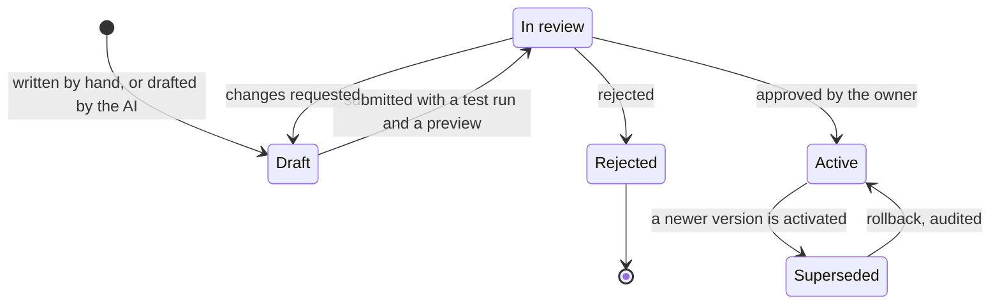
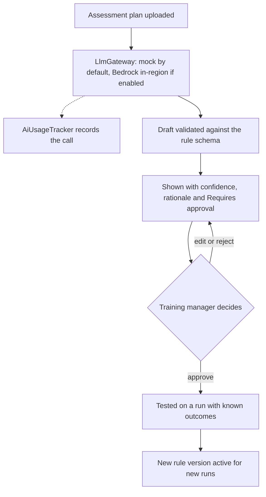

# GRS by design: governance, risk and sustainability

HuiTong 汇通 · ASPRI-IPI · Problem Statement #5 (the team's first choice)

- **Requirement:** M2, GRS by design ([CLAUDE.md](../../CLAUDE.md) section 2). Also supports M4 (security and testing) and M6 (monitoring).
- **Capabilities:** A–G. Most controls live in F (governance and compliance) and G (monitoring).
- **Status:** draft v0.3, 24 Oct 2026: written before the briefing call, and retargeted to statement #5 ([ADR 0023](../adr/0023-retarget-ps5-aspri-ipi.md)).
- **Owner:** ownership area 4 (governance, security and monitoring, Angelyn) keeps the risk register current; each risk owner updates their own rows.
- **Data:** the PoC uses synthetic data only. No real personal data is processed.

> Statements about ASPRI-IPI's systems, contracts and compliance arrangements beyond the brief are assumptions until the briefing call. Assumptions are logged in [../assumptions.md](../assumptions.md) (A-xx) and open points in [../client/questions-for-client.md](../client/questions-for-client.md) (Q-xx). Regulatory content is a set of design considerations, not legal advice (section 5). Risk ids are never reused: the risks that still hold keep their ids, the new ones start at R-23, and the earlier statements' other risks are kept in the tag `archive/ps7-lesso-solar`.

**Contents:** [1. Purpose and approach](#1-purpose-and-approach) · [2. Governance](#2-governance) · [3. Risk register](#3-risk-register) · [4. Sustainability](#4-sustainability) · [5. Compliance considerations](#5-compliance-considerations) · [6. Related documents](#6-related-documents)

---

## 1. Purpose and approach

Today a trainee's result is written on paper, worked out by hand, typed into the TMS, checked against the paper and keyed again into each agency's portal ([problem statement, section 2.2](../problem-statement.md#22-current-state-pain-points)). Each copy is a chance for an error, and the paper is the only evidence an agency can check. HuiTong captures the result once and carries it onward, so it must also govern those flows: who may see a trainee's data, which rules decided an outcome, who verified and corrected it, what each agency received, and the evidence for all of it.

### 1.1 Three layers

| Layer       | Principle                                                                                                | Examples                                                                                                                                                                                                                   |
| ----------- | -------------------------------------------------------------------------------------------------------- | -------------------------------------------------------------------------------------------------------------------------------------------------------------------------------------------------------------------------- |
| Data model  | Governance facts are stored as data, so they can be enforced and reported on                             | A classification tag on every field; versioned course rules and mappings with their approver; a per-agency allowlist; each result's rule version, assessor, verifier and corrections; retention policies per data category |
| Server code | Controls run in the API, so no UI path can bypass them                                                   | Deny-by-default RBAC guard; field-masking interceptor; append-only, hash-chained audit writer; the allowlist check on every submission; idempotency keys; rate limits; zod validation at every boundary                    |
| UI          | Users can see why the system behaves as it does (Nielsen: visibility of system status, error prevention) | Classification badges; "Why is this hidden?" tooltips; approval steps; AI confidence and "Requires approval"; previews before writes; the sync state on the tablet; the "Synthetic demo data" label                        |

Rules that run through every section:

1. **Least privilege:** an assessor sees their own runs; operations, training managers, management and auditors see what their work needs.
2. **Minimise:** keep only what the work needs. No national ID numbers, no gender, and only the current run on a tablet.
3. **People decide:** a training manager approves every rule version, operations verify every result, and the AI only proposes.
4. **Preview before write:** nothing reaches the TMS or an agency without a visible preview and an approval.
5. **Audit every write:** every result, correction, rule approval and submission ([../design-thinking/success-metrics.md](../design-thinking/success-metrics.md), SM-08).
6. **Configuration, not code,** for each new course, agency format or training provider (rule versions, templates, mappings, a tenant configuration).

### 1.2 Controls and where they show

API paths are relative to `apps/api/src/` and web paths to `apps/web/src/`. Some controls exist today; the #5 ones are planned, and [../requirements-traceability.md](../requirements-traceability.md) records the concrete files and evidence as each lands.

| Control                                     | Where it lives in the product                                                                                                                                                              | How it is visible                                                                                 |
| ------------------------------------------- | ------------------------------------------------------------------------------------------------------------------------------------------------------------------------------------------ | ------------------------------------------------------------------------------------------------- |
| RBAC: the six roles                         | API: deny-by-default RBAC guard and role decorators in `common/`; role enum in `packages/shared`                                                                                           | Navigation and actions show only what the role may do; a permission-denied state otherwise        |
| Field-level masking                         | API: field-masking interceptor in `common/` applies the role's clearance from the shared field catalogue before a response leaves the server; each masked value carries a reason           | A masked value with "Why is this hidden?"                                                         |
| Data-classification badges                  | The shared field catalogue tags each field PUBLIC, INTERNAL, CONFIDENTIAL or RESTRICTED; the tag drives masking, export rules and retention                                                | A badge beside each field                                                                         |
| Append-only audit log with hash chain       | API: audit writer in `infrastructure/`, called in the same transaction as each change; a database trigger rejects UPDATE, DELETE and TRUNCATE; each event stores the previous event's hash | "Audit trail" on each result and run; the auditor's chain verification                            |
| Approval steps                              | Approval state, approver and time on rule versions, mappings, write previews, corrections and allowlist entries                                                                            | Steps shown explicitly, with who approved and when                                                |
| AI suggestions labelled                     | API: the rule-drafting, mapping and verification assistants, called through `LlmGateway`; drafts validated against their schema                                                            | "AI suggestion", confidence, rationale and "Requires approval"; "Mock AI" on the default provider |
| Preview before any write                    | The sync job (Template Method) plans its changes as a dry run; the write to the TMS or a submission runs only after approval                                                               | A preview of what will be written, then an approval                                               |
| Per-agency allowlist                        | API: the allowlist (the cross-entity allowlist mechanism, reused) checked on every submission, by API and by file                                                                          | Each agency's entry, its fields, its purpose and its version                                      |
| Offline capture, protected                  | Web: the checklist keeps only the current run on the device, encrypted, and clears it once synced; every record carries an idempotency key                                                 | The tablet shows the sync state of each record                                                    |
| Retention settings                          | API: a policy per data category in `modules/governance`; a scheduled purge job on BullMQ; every run audited                                                                                | Retention settings for area 4                                                                     |
| Synthetic-data label                        | Web: app shell in `app/`; report and file renderers                                                                                                                                        | A persistent "Synthetic demo data" label                                                          |
| Rate limiting                               | API: `@nestjs/throttler` globally, with tighter limits on sign-in, AI and export endpoints                                                                                                 | "Too many requests" with a retry time                                                             |
| Consent-aware clickstream                   | Web: `AnalyticsTracker` in `lib/` sends route patterns, never raw URLs, input values or personal data, and honours a consent toggle and Global Privacy Control                             | A consent toggle in the settings                                                                  |
| Data minimisation and national-ID block     | No field can hold a national ID number or gender; ID-shaped columns are refused on import; generated files carry the internal trainee ID ([A-69](../assumptions.md))                       | A refused column, with the reason                                                                 |
| AI usage tracking                           | API: every `LlmGateway` call passes through `AiUsageTracker` (tokens in and out, model, latency, cost estimate, feature, user, outcome)                                                    | AI usage on the analytics pages                                                                   |
| Session and transport security              | API: argon2id hashing; httpOnly, Secure, SameSite=Strict cookies; refresh-token rotation with reuse detection; CSRF double-submit token; helmet with a strict CSP; CORS allow-list         | Session-expiry handling                                                                           |
| One validation contract, one error envelope | zod schemas in `@huitong/shared` validate web forms and API input and generate Swagger; errors use `{ error: { code, message, details, traceId } }`                                        | Inline field errors; a trace id on every error                                                    |

---

## 2. Governance

### 2.1 Roles and responsibilities

**System roles (RBAC).** Demo users are synthetic people, seeded when the #5 roles reach the code ([../design-thinking/personas.md](../design-thinking/personas.md)).

| Role               | Demo user     | Responsibilities in HuiTong                                                                                                              | Clearance (baseline masking)                                    | Limits that enforce segregation of duties                                         |
| ------------------ | ------------- | ---------------------------------------------------------------------------------------------------------------------------------------- | --------------------------------------------------------------- | --------------------------------------------------------------------------------- |
| `ASSESSOR`         | Hafiz Rahman  | Records the assessments of their own runs on a tablet                                                                                    | CONFIDENTIAL for the trainees of their own runs; nothing else   | Cannot verify, correct after verification, write to the TMS or submit             |
| `OPERATIONS`       | Joanne Lim    | Verifies results, corrects them with a reason, approves the writes to the TMS and the submissions to each agency, tracks the submissions | Up to RESTRICTED (a date of birth, where a submission needs it) | Cannot change course rules; cannot approve a correction to a result they assessed |
| `TRAINING_MANAGER` | Priya Nair    | Owns the courses and their rules; approves rule versions, AI drafts included                                                             | INTERNAL, plus the results of their courses                     | Cannot verify or submit results                                                   |
| `MANAGEMENT`       | Ronald Seah   | Reads the dashboards and reports                                                                                                         | INTERNAL, read-only; aggregates by default                      | No write actions                                                                  |
| `AUDITOR`          | Grace Lim     | Reads the full audit trail, verifies the hash chain, reviews access                                                                      | INTERNAL, read-only                                             | Cannot change data or configuration                                               |
| `SYSTEM_ADMIN`     | Farhan Ismail | Connectors, users and roles, platform configuration, retention jobs                                                                      | Up to CONFIDENTIAL                                              | Cannot approve rules, verify results or submit                                    |

**Organisational roles.** These are not RBAC roles in the PoC; their decisions are recorded as references on the relevant entries.

| Role                                  | Who (assumed, [A-79](../assumptions.md))                 | Accountable for                                                          | How HuiTong supports it                                                            |
| ------------------------------------- | -------------------------------------------------------- | ------------------------------------------------------------------------ | ---------------------------------------------------------------------------------- |
| Organisation responsible for the data | ASPRI-IPI                                                | Purposes, sharing and retention of trainees' personal data               | Allowlist entries and retention policies name the owner                            |
| Data Protection Officer               | Appointed by ASPRI-IPI (PDPA s.11(3))                    | PDPA compliance, the purposes shared with each agency, breach assessment | The DPO's reference on allowlist entries; audit and export logs for breach scoping |
| Course owners                         | Training managers                                        | The rules that decide each course's outcomes                             | Rule versions, approvals and their history                                         |
| System owners                         | Client IT for the TMS; each agency for its portal or API | Credentials, API scopes, change notices                                  | Connector configuration, health and validation reports                             |
| Delivery team                         | Richie, Azri, Iok Teck, Angelyn                          | Building and operating the PoC controls in areas 1–4                     | Module ownership, PR review, this register                                         |

Whether production needs a DPO role inside HuiTong is an open question ([Q-40](../client/questions-for-client.md)).

### 2.2 Classification and masking baseline

The fields below are the #5 data model as planned (capability B and areas 2 and 3). A field joins the shared field catalogue with its tag when it is built.

| Level        | Fields                                                                                                                  | Visible to (baseline)                                                                 |
| ------------ | ----------------------------------------------------------------------------------------------------------------------- | ------------------------------------------------------------------------------------- |
| PUBLIC       | None about people; reference data only (course titles, agency names)                                                    | Everyone                                                                              |
| INTERNAL     | The internal trainee ID, the trainee's name, course and run, the assessment date, the run's status, the assessor's name | All roles                                                                             |
| CONFIDENTIAL | The trainee's contact details, each criterion's mark, the outcome, corrections and their reasons                        | `ASSESSOR` (own runs), `OPERATIONS`, `TRAINING_MANAGER` (own courses), `SYSTEM_ADMIN` |
| RESTRICTED   | The trainee's date of birth                                                                                             | `OPERATIONS`                                                                          |

- Masking is applied on the server, so masked values never reach the browser. Each masked value carries a reason (clearance too low, or not one of the user's own runs) that the "Why is this hidden?" tooltip explains.
- **Never stored:** NRIC and FIN numbers, other national ID numbers and gender. If an agency needs the ID, how it gets one without HuiTong keeping it is an open question ([A-69](../assumptions.md), [Q-69](../client/questions-for-client.md)).
- **Each agency sees only its allowlist (default deny).** A field reaches an agency, by API or in a file, only when an ACTIVE allowlist entry for that agency shares it, with its purpose. A change to an entry raises its version and is audited ([A-81](../assumptions.md)).

### 2.3 Approval points

| Decision                                        | Raised by                                                    | Approved by                                                                          | Control rule                                                                                                                                    |
| ----------------------------------------------- | ------------------------------------------------------------ | ------------------------------------------------------------------------------------ | ----------------------------------------------------------------------------------------------------------------------------------------------- |
| A course's rule version                         | A training manager, or the rule-drafting assistant (a draft) | The course's training manager                                                        | The AI is the maker and never an approver; a version is tested on a run with known outcomes before use; a run keeps the version it started with |
| A mapping version (TMS export, agency template) | `SYSTEM_ADMIN`, or the mapping assistant (a draft)           | The data steward for that system                                                     | Maker-checker: the author cannot approve; a validation run and a preview are attached                                                           |
| A result's verification                         | The run, once captured                                       | Operations                                                                           | A result leaves HuiTong only after verification; the assessor cannot verify their own run                                                       |
| A correction                                    | Operations                                                   | Operations, with a reason; another operations user if the corrector assessed the run | The original value is kept; a correction after submission goes back through verification                                                        |
| A write to the TMS                              | Operations, after verification                               | Operations, after a preview                                                          | Against the client's real TMS, out of scope until the client approves it; the mock may demonstrate it, labelled                                 |
| A submission to an agency                       | Operations, after verification                               | Operations, after a preview                                                          | Checked against the agency's ACTIVE allowlist entry; idempotent per run and agency                                                              |
| An allowlist entry or its change                | `SYSTEM_ADMIN` or area 4's administration                    | The DPO's reference recorded                                                         | A review date is required; a new version is audited                                                                                             |
| Role assignment                                 | `SYSTEM_ADMIN`                                               | Detective control: the `AUDITOR`'s access review                                     | No self-assignment                                                                                                                              |
| Retention policy change                         | `SYSTEM_ADMIN`                                               | The organisation's owner (reference recorded)                                        | Shortening a period first previews what will be purged                                                                                          |

Every approval stores who, when, what (a diff) and why (a reason), and writes an audit event. Approvals are made by named users, never by service accounts.

### 2.4 Audit

The audit trail is the evidence an agency checks in place of the paper file: for any result, who assessed it, against which rule version, who verified it, every correction and its reason, and what each agency received.

**What is logged**

| Event family       | Examples                                                                                                                                                                        |
| ------------------ | ------------------------------------------------------------------------------------------------------------------------------------------------------------------------------- |
| Assessment         | A result captured (and synced, with its device receipt); an outcome calculated (with the rule version); a result verified; a correction, with its reason and the original value |
| Rules and mappings | A rule version drafted, approved, activated or superseded; a mapping version proposed, approved or rolled back                                                                  |
| Integration        | A sync with the TMS started, completed or failed; a write to the TMS; a submission sent, acknowledged, validated or rejected                                                    |
| Configuration      | A connector added, changed or paused; a role assigned; an allowlist entry or retention policy changed                                                                           |
| Access             | Sign-in, sign-out, failed sign-in, refresh-token reuse, permission denied, a RESTRICTED value viewed, an export downloaded                                                      |
| AI                 | A draft generated (linked to its `AiUsageTracker` record); a draft approved, edited or rejected                                                                                 |

Each event records: event id, time (UTC), actor (user and role, or service and job id), action code (UPPER_SNAKE, from `@huitong/shared`), target (type and id), the names of changed fields, reason or approval reference, `traceId`, outcome, the previous event's hash and its own hash.

**No sensitive values in the log.** Values of CONFIDENTIAL and RESTRICTED fields are not copied into audit events. The event points to the change-history entry, which is masked like any other read, so the `AUDITOR` can read the whole log with INTERNAL clearance.

**Append-only at the database level**

- The audit repository exposes append and query methods only; there is no update or delete path in code.
- A PostgreSQL trigger rejects UPDATE, DELETE and TRUNCATE on the audit table for every role, so neither a bug nor a manual SQL session can rewrite history silently.
- Production hardening: the runtime database role gets INSERT and SELECT only on the audit table, and migrations run under a separate owner role.

**Hash chain for tamper evidence**

- `hash = SHA-256(previousHash + canonical JSON of the event)`. The first event uses a fixed genesis value.
- Inserts are serialised (a PostgreSQL advisory lock inside the insert transaction), so the chain has a single order.
- The `AUDITOR`'s "Verify chain" action recomputes every hash and reports the first broken link.
- Limit: someone with database-owner rights could rebuild the whole chain. Production therefore anchors the latest hash outside the database at intervals (for example in S3 with Object Lock), so a rebuilt chain no longer matches its anchors.

**Retention.** Audit events are kept for as long as an agency may check the records ([A-80](../assumptions.md), [Q-79](../client/questions-for-client.md)); section 2.8 holds the placeholder. Old segments are archived, never edited: an archive event records the last archived hash, so verification still works across segments.

**Who can read it**

| Reader                           | Scope                                                         |
| -------------------------------- | ------------------------------------------------------------- |
| `AUDITOR`                        | Full log, filters, export, chain verification                 |
| `OPERATIONS`, `TRAINING_MANAGER` | The history of the results and rules they can see, in context |
| `SYSTEM_ADMIN`                   | Read-only, for troubleshooting                                |
| Other roles                      | None                                                          |

Nobody can edit or delete events. Queries and exports of the audit log are themselves audited.

### 2.5 Change management for rules, mappings and templates

Course rules decide outcomes, and mappings and templates decide what reaches the TMS and each agency, so one bad version can affect many trainees at once. They are treated like code changes: versioned, reviewed, tested and reversible.

- Versions are immutable. Editing creates a new draft.
- A course has one active rule version for new runs; a run keeps the version it started with ([A-75](../assumptions.md)).
- Submitting a rule version requires a test run with known outcomes; submitting a mapping or a template requires a validation run on the latest sample and a preview.
- Every result records the rule version that decided it, and every write records the mapping or template version it used, so a bad version can be traced to exactly the results it touched.
- Kill switch: `SYSTEM_ADMIN` can pause a connector at once without approval, because pausing only reduces risk. Resuming runs the normal checks.

### 2.6 AI governance

HuiTong uses AI in three places (capability E): the rule-drafting assistant, the mapping assistant and the verification assistant.

| Principle                      | How HuiTong applies it                                                                                                                                                                                                                                                                                                                               |
| ------------------------------ | ---------------------------------------------------------------------------------------------------------------------------------------------------------------------------------------------------------------------------------------------------------------------------------------------------------------------------------------------------- |
| Human in the loop              | AI output is a draft or a flag. A rule draft becomes a version only after a training manager approves it, a mapping only after its data steward approves it, and a flag only points operations at a record. The AI never changes a result and never writes to a system of record.                                                                    |
| Narrow purpose                 | No AI decision about a trainee's competency: outcomes come from approved rules, and verification from a person. This keeps people, not models, accountable for results, as Singapore's Model AI Governance Framework advises for decisions that affect people.                                                                                       |
| Prompt and data minimisation   | The rule-drafting assistant reads a course's assessment plan, which holds no personal data. Mapping prompts carry column headers, value shapes and the codes of category columns, not personal values. The verification assistant works on features computed inside HuiTong, never on identifiers sent to a third party ([A-17](../assumptions.md)). |
| Untrusted input                | Uploaded content is data, never instructions: it sits in delimited fields of a fixed prompt, the model has no tools, and output must pass validation.                                                                                                                                                                                                |
| Validated output               | Responses must parse against a zod schema (a rule's criteria, critical items and outcome rule; a mapping's targets), followed by consistency checks. Invalid output is dropped and the outcome recorded.                                                                                                                                             |
| Transparency                   | Every suggestion shows "AI suggestion", a confidence band, the rationale and "Requires approval"; the default provider's output is labelled "Mock AI". An approved version records that it was AI-assisted and who approved it.                                                                                                                      |
| Provider control               | No trainee identifier or result goes to a third-party AI service without the client's written permission. `mock` is the default: deterministic, no key, and no data leaves the API. `bedrock` is opt-in by configuration and runs in the deployment region; `openai` stays off for client data.                                                      |
| Usage, model and cost tracking | `AiUsageTracker` records tokens in and out, model, latency, cost estimate, feature, user and outcome for every call. It stores usage metadata, not prompt or completion text. Area 4 adds budgets and alerts.                                                                                                                                        |
| No training on client data     | HuiTong does not train or fine-tune models on client data, and the provider's data-use terms are checked before Bedrock is enabled.                                                                                                                                                                                                                  |
| Measured quality               | Targets: every AI draft approved before use, none used unapproved; the share approved without edits is reported (SM-09).                                                                                                                                                                                                                             |

### 2.7 Data ownership and source of truth

The TMS stays the system of record for courses, runs, trainees and results. HuiTong holds the capture evidence (each criterion's mark, the device receipt, the rule version, the verification and every correction) and the record of what each agency received.

| Data                                                          | Source of truth                              | HuiTong's role                                                                                      |
| ------------------------------------------------------------- | -------------------------------------------- | --------------------------------------------------------------------------------------------------- |
| Courses, runs, enrolled trainees                              | The TMS                                      | Read daily and before a run ([A-50](../assumptions.md)); each field keeps its provenance            |
| The trainee's identity                                        | The TMS trainee ID                           | The only match key; a look-alike name is shown for review, never merged ([A-68](../assumptions.md)) |
| A course's rules                                              | The training manager's approved rule version | Stored and versioned in HuiTong (area 3)                                                            |
| Each criterion's mark, the outcome, verification, corrections | HuiTong, until written to the TMS            | Captured once, verified by operations, then written to the TMS                                      |
| What each agency received, and its response                   | HuiTong's submission record                  | Kept with the agency's acknowledgement or validation report                                         |

1. **Verified before it leaves:** a result goes to the TMS or an agency only after operations verify it.
2. **Corrections keep history:** a correction records the reason and keeps the original; after submission it goes back through verification and is resubmitted once.
3. **Write-back needs approval:** a write to the TMS or a submission to an agency happens only after an explicit, audited approval of a preview. Against the client's real systems it is out of scope until the client agrees; until then the mocks demonstrate it, labelled.

### 2.8 Retention defaults

The values below are placeholders for the retention settings, not a statement of the legally required periods; the client sets them ([A-80](../assumptions.md), [Q-79](../client/questions-for-client.md)).

| Data                                                                         | PoC default (placeholder)                                                   | Note                                             |
| ---------------------------------------------------------------------------- | --------------------------------------------------------------------------- | ------------------------------------------------ |
| Assessment records (marks, outcome, rule version, verification, corrections) | Until the client states the period an agency may check them                 | The evidence that replaces the paper file        |
| Data on a tablet                                                             | Cleared once the run has synced                                             | Only the current run is kept on a device         |
| Submission records and agency responses                                      | As assessment records                                                       | The proof of what each agency received           |
| Source-record snapshots and sync payloads                                    | 90 days                                                                     | Long enough to investigate a sync                |
| Uploaded samples (mapping and rule-drafting assistants)                      | Deleted when the proposal is approved or rejected, and after 7 days at most | Only the approved version is kept                |
| Audit events                                                                 | As assessment records, at least                                             | Archived in segments; no sensitive values inside |
| Clickstream events                                                           | 13 months raw; aggregates kept                                              | No personal data                                 |
| AI usage records                                                             | 2 years                                                                     | Metadata only                                    |

---

## 3. Risk register

### 3.1 Scoring

| Score | Likelihood (L), within the PoC or the first year of production use | Impact (I)                                                                                  |
| ----- | ------------------------------------------------------------------ | ------------------------------------------------------------------------------------------- |
| 1     | Rare                                                               | Negligible: cosmetic, no data affected                                                      |
| 2     | Unlikely                                                           | Minor: local rework, no personal data exposed                                               |
| 3     | Possible                                                           | Moderate: wrong records or a missed deadline, recoverable                                   |
| 4     | Likely                                                             | Major: personal data seen by unauthorised people, or a wrong result that reaches an agency  |
| 5     | Almost certain                                                     | Severe: a reportable breach, or wrong certifications, with regulatory and reputational harm |

Score = L × I. Bands: **Low** 1–4, **Medium** 5–9, **High** 10–16, **Critical** 20–25. Inherent scores assume production use with real data and none of HuiTong's controls; residual scores assume the designed controls are in place. Because the PoC uses synthetic data only, its actual privacy exposure is low.

### 3.2 Register

Owner is the ownership area (1–4) that builds the control, or the client where only the client can act.

| ID   | Risk                                                                             | Category                | Cause                                                                                                                | L   | I   | Inherent | Controls                                                                                                                                                                                                                                                                                                                                                                                                                                                                                                                                                                                                                                                                                                                                                                                          | Owner                                 | Residual                    |
| ---- | -------------------------------------------------------------------------------- | ----------------------- | -------------------------------------------------------------------------------------------------------------------- | --- | --- | -------- | ------------------------------------------------------------------------------------------------------------------------------------------------------------------------------------------------------------------------------------------------------------------------------------------------------------------------------------------------------------------------------------------------------------------------------------------------------------------------------------------------------------------------------------------------------------------------------------------------------------------------------------------------------------------------------------------------------------------------------------------------------------------------------------------------- | ------------------------------------- | --------------------------- |
| R-03 | Data breach: trainees' personal data or results accessed or exfiltrated          | Security                | Stolen credentials, OWASP Top 10 flaws, cloud misconfiguration, a lost tablet, leaked exports                        | 3   | 5   | 15 High  | Minimisation (no national IDs; only the current run on a tablet); server-side masking; argon2id, httpOnly cookies, token rotation, CSRF token; strict CSP, CORS allow-list, rate limits; Secrets Manager; encryption in transit and at rest; CI dependency audit and image scans; breach runbook (section 3.4)                                                                                                                                                                                                                                                                                                                                                                                                                                                                                    | Areas 1 and 4; client                 | 2 × 4 = 8 Medium            |
| R-04 | A wrong mapping or template writes wrong data into the TMS or an agency file     | Data integrity          | A misread date format or code, a wrong field mapping for a TMS export or an agency template, a transformer bug       | 4   | 4   | 16 High  | Mappings and templates versioned and approved; a preview before every write; files validated against each agency's rules before delivery; transformers under unit test                                                                                                                                                                                                                                                                                                                                                                                                                                                                                                                                                                                                                            | Area 1 (mappings), area 3 (templates) | 2 × 3 = 6 Medium            |
| R-05 | Duplicate or wrongly merged trainee records                                      | Data integrity          | Matching on names; a trainee enrolled twice; job retries                                                             | 3   | 4   | 12 High  | Match on the TMS trainee ID only ([A-68](../assumptions.md)); look-alike names shown for review, never merged; idempotency keys                                                                                                                                                                                                                                                                                                                                                                                                                                                                                                                                                                                                                                                                   | Area 1                                | 1 × 4 = 4 Low               |
| R-06 | A partial sync leaves HuiTong, the TMS and the agencies out of step              | Operational             | A TMS or portal timeout, a network loss, a job crashing mid-run                                                      | 3   | 3   | 9 Medium | Queued, retried, idempotent jobs; per-record status; a run's state on the status board                                                                                                                                                                                                                                                                                                                                                                                                                                                                                                                                                                                                                                                                                                            | Areas 1 and 2                         | 2 × 2 = 4 Low               |
| R-07 | The AI proposes a wrong rule or mapping and it is approved                       | AI                      | An ambiguous assessment plan or header, a model error, reviewer over-trust                                           | 3   | 4   | 12 High  | Confidence and rationale per proposal, and "Requires approval"; the training manager approves every rule version; a new version is tested on a run with known outcomes before use; mock provider by default                                                                                                                                                                                                                                                                                                                                                                                                                                                                                                                                                                                       | Areas 1 and 3                         | 2 × 3 = 6 Medium            |
| R-08 | Prompt injection through an uploaded assessment plan or sample                   | AI, security            | Instructions planted in a document's text or a sample's headers                                                      | 2   | 3   | 6 Medium | Uploaded content marked untrusted in a fixed prompt; output validated against a zod schema; the AI only proposes and has no tools                                                                                                                                                                                                                                                                                                                                                                                                                                                                                                                                                                                                                                                                 | Area 1                                | 1 × 2 = 2 Low               |
| R-09 | Trainees' personal data exposed to an LLM provider                               | AI, privacy             | Prompts built from records; provider retention; processing outside Singapore                                         | 3   | 4   | 12 High  | No trainee identifiers or results in prompts; the rule-drafting assistant reads assessment plans only; mock provider by default; Bedrock only in-region and with the client's written permission ([A-17](../assumptions.md))                                                                                                                                                                                                                                                                                                                                                                                                                                                                                                                                                                      | Areas 1, 3 and 4                      | 1 × 3 = 3 Low               |
| R-10 | A TMS or agency interface or file format changes and breaks a connector          | Integration             | A vendor upgrade; an agency changing its format, codes or validation rules                                           | 4   | 3   | 12 High  | Adapters behind `SystemConnector`; mappings and templates as configuration; contract tests against recorded responses; validation reports and failed acknowledgements watched                                                                                                                                                                                                                                                                                                                                                                                                                                                                                                                                                                                                                     | Area 1, with area 3                   | 2 × 2 = 4 Low               |
| R-11 | Access-control misconfiguration                                                  | Security                | Four developers adding endpoints; masking done only in the UI; demo login left on                                    | 3   | 4   | 12 High  | Deny-by-default RBAC guard on every endpoint; server-side masking; an auth-failure test per module; `DEMO_MODE` off in production                                                                                                                                                                                                                                                                                                                                                                                                                                                                                                                                                                                                                                                                 | Areas 1 and 4                         | 2 × 3 = 6 Medium            |
| R-12 | An authorised user misuses access (browsing trainees' data, bulk export)         | Insider                 | Broad access; the habit of exporting whole lists                                                                     | 2   | 4   | 8 Medium | Least privilege by role (an assessor sees only their own runs); exports and RESTRICTED views audited; access reviews                                                                                                                                                                                                                                                                                                                                                                                                                                                                                                                                                                                                                                                                              | Area 4                                | 2 × 3 = 6 Medium            |
| R-13 | National ID numbers ingested or stored                                           | Privacy                 | Agencies identify learners by NRIC or FIN, so TMS exports and samples may carry them                                 | 4   | 4   | 16 High  | No field can hold them; ID-shaped columns refused on import; generated files carry the internal trainee ID until the client decides ([A-69](../assumptions.md))                                                                                                                                                                                                                                                                                                                                                                                                                                                                                                                                                                                                                                   | Area 1                                | 1 × 3 = 3 Low               |
| R-14 | The audit trail is incomplete or altered                                         | Governance              | A write path that skips the audit writer; direct database edits                                                      | 2   | 5   | 10 High  | Hash-chained, append-only audit events; a database trigger rejects changes to them; one audit assertion per write in the integration tests                                                                                                                                                                                                                                                                                                                                                                                                                                                                                                                                                                                                                                                        | Area 4, with area 1                   | 1 × 4 = 4 Low               |
| R-16 | The client's systems differ from the mocks                                       | Delivery                | The brief names a TMS and the portals, but their interfaces, formats and volumes are unknown until the briefing call | 5   | 3   | 15 High  | Adapters isolate each system; mappings and templates are configuration; three sample packs requested first; assumptions logged ([A-84](../assumptions.md))                                                                                                                                                                                                                                                                                                                                                                                                                                                                                                                                                                                                                                        | Area 1; client                        | 4 × 2 = 8 Medium            |
| R-17 | React Bits Pro licence breached                                                  | Legal                   | Repository made public while it holds Pro code; licence key committed or pasted into docs or logs                    | 3   | 3   | 9 Medium | Repository stays private while Pro code is present; key only in git-ignored `.env.local` files (CLAUDE.md wants `apps/web/.env.local` only; the owner also keeps a root copy, see BUILD_REPORT manual steps); a pre-commit guard that refuses any commit adding the key; secrets sweep of the repository and its history before submission; Pro code removed before any publication. Status on 20 Oct 2026: the team lead decided on 20 Oct 2026 to keep the GitHub repository public with the licensed React Bits skill and the Pro block `auth-4` in it, and accepted the licence risk ([ADR 0017 amendment](../adr/0017-ui-component-registries.md#amendment-20-oct-2026-a-public-repository)). The key controls still apply, plus a history scan before every push and GitHub secret scanning | Area 1                                | 3 × 3 = 9 Medium (accepted) |
| R-18 | Scope creep beyond the team's capacity                                           | Delivery                | Seven capabilities, four students, one semester; requests for more courses, agencies or features                     | 4   | 3   | 12 High  | MoSCoW priorities in the backlog; the brief's priorities first (capture, competency rules, the TMS output); one agency by API and one by file in the PoC                                                                                                                                                                                                                                                                                                                                                                                                                                                                                                                                                                                                                                          | Team lead                             | 3 × 2 = 6 Medium            |
| R-19 | Key-person dependency                                                            | Delivery                | The platform and the integration core built by one person; backup owners not yet named                               | 3   | 4   | 12 High  | Owners named for every area; backups agreed at the W3 plan ([A-44](../assumptions.md)); a guide per area; reviews across areas                                                                                                                                                                                                                                                                                                                                                                                                                                                                                                                                                                                                                                                                    | Team lead                             | 2 × 3 = 6 Medium            |
| R-20 | A member cannot explain code they submit                                         | Delivery                | AI-assisted coding without understanding; 85% of the marks are individual                                            | 3   | 4   | 12 High  | Owners write their own core logic; prompts and reviews logged; a W7 rehearsal                                                                                                                                                                                                                                                                                                                                                                                                                                                                                                                                                                                                                                                                                                                     | All                                   | 2 × 3 = 6 Medium            |
| R-23 | An agency receives fields it does not need, or a result reaches the wrong agency | Privacy, compliance     | A template copied between agencies; a mapping error; no field-level control on files                                 | 3   | 4   | 12 High  | A per-agency allowlist that denies by default ([A-81](../assumptions.md)); every submission checked against an ACTIVE entry, by API and by file; files validated before delivery; every submission audited                                                                                                                                                                                                                                                                                                                                                                                                                                                                                                                                                                                        | Areas 1 and 4                         | 1 × 4 = 4 Low               |
| R-24 | A misconfigured or outdated course rule gives a wrong outcome                    | Data integrity          | A rule entered wrongly; an old version used; a critical item left out                                                | 3   | 5   | 15 High  | Rule versions approved by the training manager ([A-75](../assumptions.md)); each run keeps the version it started with; a new version tested on a run with known outcomes before use; operations verify every result                                                                                                                                                                                                                                                                                                                                                                                                                                                                                                                                                                              | Area 3, with area 2                   | 2 × 4 = 8 Medium            |
| R-25 | A tablet holding trainees' data is lost or stolen                                | Security, privacy       | Shared tablets carried around the training environments                                                              | 3   | 3   | 9 Medium | Only the current run on the device, encrypted, and cleared once it has synced ([A-82](../assumptions.md)); sign-in per assessor with short sessions; sign-out from the server                                                                                                                                                                                                                                                                                                                                                                                                                                                                                                                                                                                                                     | Area 2, with area 1                   | 2 × 2 = 4 Low               |
| R-26 | An offline sync loses or duplicates a result, or two edits conflict              | Data integrity          | A connection dropping mid-sync; the same record changed on two devices                                               | 3   | 4   | 12 High  | An idempotency key on every record; sync receipts checked against stored results; a conflict shown to a person, never overwritten silently                                                                                                                                                                                                                                                                                                                                                                                                                                                                                                                                                                                                                                                        | Area 2                                | 1 × 4 = 4 Low               |
| R-27 | A submission is rejected or misses an agency's deadline                          | Operational, compliance | Format errors; late verification; no view of deadlines                                                               | 3   | 4   | 12 High  | Files validated before delivery; acknowledgements and validation reports tracked; SLA reminders counted from the assessment date ([A-77](../assumptions.md)); a status board                                                                                                                                                                                                                                                                                                                                                                                                                                                                                                                                                                                                                      | Areas 1, 2 and 3                      | 2 × 3 = 6 Medium            |
| R-28 | A duplicate submission reaches an agency                                         | Data integrity          | A retry, a resubmission after a timeout, two people submitting                                                       | 2   | 4   | 8 Medium | An idempotency key per run and agency; the submission's status checked before sending; the agency's acknowledgement stored                                                                                                                                                                                                                                                                                                                                                                                                                                                                                                                                                                                                                                                                        | Area 1                                | 1 × 4 = 4 Low               |
| R-29 | A result is changed improperly                                                   | Integrity, insider      | Pressure to pass a trainee; a correction without cause                                                               | 2   | 5   | 10 High  | A correction needs a reason and keeps the original; only operations correct, after verification; every correction audited and visible to auditors; the AI never changes a result                                                                                                                                                                                                                                                                                                                                                                                                                                                                                                                                                                                                                  | Areas 2 and 4                         | 1 × 5 = 5 Medium            |

### 3.3 Heat maps

Each cell shows its score; bold cells hold risks. Bands: Low 1–4, Medium 5–9, High 10–16, Critical 20–25.

**Inherent**

| Impact / likelihood | 1 Rare | 2 Unlikely         | 3 Possible                                                   | 4 Likely           | 5 Almost certain |
| ------------------- | ------ | ------------------ | ------------------------------------------------------------ | ------------------ | ---------------- |
| **5 Severe**        | 5      | **10:** R-14, R-29 | **15:** R-03, R-24                                           | 20                 | 25               |
| **4 Major**         | 4      | **8:** R-12, R-28  | **12:** R-05, R-07, R-09, R-11, R-19, R-20, R-23, R-26, R-27 | **16:** R-04, R-13 | 20               |
| **3 Moderate**      | 3      | **6:** R-08        | **9:** R-06, R-17, R-25                                      | **12:** R-10, R-18 | **15:** R-16     |
| **2 Minor**         | 2      | 4                  | 6                                                            | 8                  | 10               |
| **1 Negligible**    | 1      | 2                  | 3                                                            | 4                  | 5                |

**Residual**

| Impact / likelihood | 1 Rare                              | 2 Unlikely                                      | 3 Possible  | 4 Likely    | 5 Almost certain |
| ------------------- | ----------------------------------- | ----------------------------------------------- | ----------- | ----------- | ---------------- |
| **5 Severe**        | **5:** R-29                         | 10                                              | 15          | 20          | 25               |
| **4 Major**         | **4:** R-05, R-14, R-23, R-26, R-28 | **8:** R-03, R-24                               | 12          | 16          | 20               |
| **3 Moderate**      | **3:** R-09, R-13                   | **6:** R-04, R-07, R-11, R-12, R-19, R-20, R-27 | **9:** R-17 | 12          | 15               |
| **2 Minor**         | **2:** R-08                         | **4:** R-06, R-10, R-25                         | **6:** R-18 | **8:** R-16 | 10               |
| **1 Negligible**    | 1                                   | 2                                               | 3           | 4           | 5                |

Inherent: 18 High, 6 Medium. Residual: 13 Medium, 11 Low. The remaining Medium risks depend on decisions only the client can make (its systems, its devices, its AI policy) or on the team's delivery, and are reviewed at each checkpoint (section 3.5).

### 3.4 Mitigation detail for the priority risks

#### Data breach (R-03)

**Prevent**

- Less to lose: no national IDs or gender; only the current run on a tablet, encrypted and cleared once synced.
- Server-side masking: masked values never reach the browser.
- Authentication: argon2id; a 15-minute access cookie; refresh tokens rotated on every use, with the whole token family revoked on reuse; CSRF token. Production uses the client's SSO with MFA ([Q-44, Q-45](../client/questions-for-client.md)).
- Hardening: helmet with a strict CSP, a CORS allow-list, rate limits, zod validation, parameterised queries only (Prisma), and a checklist against the OWASP Top 10 and OWASP API Security Top 10.
- Secrets in environment variables locally and in AWS Secrets Manager in production; TLS in transit; RDS and S3 encryption at rest with KMS.
- A dependency audit and image scans in CI.

**Detect (area 4):** alerts on failed sign-in spikes, refresh-token reuse, bursts of permission-denied responses and unusual export volumes, from structured logs and metrics (CloudWatch in AWS).

**Respond.** The client's incident process leads; HuiTong supplies the evidence.

| Step               | Singapore (PDPA Part 6A)                                          | HuiTong support                                                         |
| ------------------ | ----------------------------------------------------------------- | ----------------------------------------------------------------------- |
| Contain            | At once                                                           | Pause connectors; revoke sessions; sign out tablets; rotate secrets     |
| Assess             | Reasonably and expeditiously                                      | Audit and export logs show which records were touched, by whom and when |
| Notify the PDPC    | Within 3 calendar days of assessing that the breach is notifiable | An incident summary from the audit log                                  |
| Notify individuals | Where significant harm is likely                                  | The affected trainees listed from the audit trail                       |

#### Tablets and offline capture (R-25, R-26)

- **Device data:** only the current run, encrypted at rest on the device and cleared once its records have synced (GR-10); sign-in per assessor, with short sessions and sign-out from the server.
- **Sync without loss:** every record carries an idempotency key; the server returns a receipt per record, and the tablet keeps a record until its receipt arrives, so a dropped connection loses nothing and a retry duplicates nothing (SM-19).
- **Conflicts:** the same record changed in two places is shown to a person to decide, never overwritten silently.

#### Course rules and the AI (R-24, R-07 to R-09)

Every gate below is enforced on the server: the rule editor cannot activate a version the validator rejected, and the training manager's approval is a separate, audited request.

- **Wrong rules (R-24):** a test run with known outcomes before a version is used; every result keeps its rule version; operations verify every result.
- **Wrong AI drafts (R-07):** confidence and rationale per rule, the test run, and rollback through versioning.
- **Prompt injection (R-08):** the plan sits in a delimited data block marked untrusted; the model has no tools; output that does not fit the schema is dropped.
- **Data exposure (R-09):** the `mock` provider is the default; prompts carry no trainee identifiers or results; Bedrock is used in-region only; no prompt text is stored.

#### Submissions (R-23, R-27, R-28)

- **Only what each agency needs (R-23):** each submission, by API or file, is checked against the agency's ACTIVE allowlist entry; anything else is withheld and the attempt audited.
- **Accepted, on time (R-27):** files are rendered from the agency's template and validated against its rules before delivery; acknowledgements and validation reports update each submission's status; SLA reminders count from the assessment date.
- **Never twice (R-28):** an idempotency key per run and agency, and the submission's status checked before sending.

#### Result integrity (R-29, R-14)

- A correction needs a reason, keeps the original value and is audited; a correction after submission goes back through verification.
- Operations correct only after verification, and a correction to a result the corrector assessed needs another operations user.
- The hash-chained audit trail makes a silent change detectable (section 2.4); the AI has no route that changes a result.

#### Sync errors (R-04 to R-06)

Controls at each stage of the base sync job (Template Method):

| Stage    | Controls                                                                                                                                       |
| -------- | ---------------------------------------------------------------------------------------------------------------------------------------------- |
| Extract  | Source payloads validated with zod at the boundary; schema drift fails the record, not the run; paginated with checkpoints so a run can resume |
| Map      | The active, approved mapping version only; Strategy transformers (date format, codes, name order) under unit test                              |
| Validate | Business rules: plausible dates, known course and run codes, no ID-shaped values; failures become sync errors                                  |
| Preview  | Planned writes shown before any write to the TMS or an agency; a mass-change guard stops a run that would change an unusual share of records   |
| Load     | Idempotency key per run and record; upsert, change history and audit event in one transaction                                                  |
| Audit    | Run summary: mapping version, counts, duration, outcome                                                                                        |
| Recover  | BullMQ retries with exponential backoff; reruns are safe                                                                                       |

#### Vendor and agency changes (R-10)

- **Adapter isolation:** each system sits behind its own `SystemConnector`, created by `ConnectorFactory` from configuration. A vendor or agency change touches one adapter or template, not the rest.
- **Contract tests:** each connector is tested in CI against recorded responses: from the mocks now, and after the briefing call from synthetic fixtures built to the structure of the client's samples, never the samples themselves.
- **Boundary validation:** zod schemas for each source turn unknown, missing or re-typed fields into schema-drift errors instead of silent nulls.
- **Monitoring:** per-connector success rate, latency and rejected submissions as metrics (`/metrics`; CloudWatch in AWS, area 4), with alerts and the kill switch.

### 3.5 Review

- The register is reviewed at the W3 project plan, the W5 proposal, after the briefing call, at the W13 technical review and before the W18 final presentation. It is also reviewed whenever a connector, agency, course rule type or AI feature is added.
- The area 4 owner keeps the register; each risk owner updates their own rows.
- Any residual High or Critical risk, and any risk waiting on a client decision, goes on the agenda for the next client check-in.

---

## 4. Sustainability

Sustainability here covers the effort and paper saved for ASPRI-IPI, efficient use of compute, and a solution other training providers can reuse and the team can maintain.

### 4.1 Manual effort removed

Baselines come from the brief and our arithmetic on its shares ([A-76](../assumptions.md), [Q-76](../client/questions-for-client.md)); see [../design-thinking/success-metrics.md](../design-thinking/success-metrics.md).

| Activity                    | Baseline per run    | Target          | What removes the effort                                                       |
| --------------------------- | ------------------- | --------------- | ----------------------------------------------------------------------------- |
| Consolidation and TMS entry | ~1 hour (the brief) | Under 5 minutes | Capture on the tablet and an approved write to the TMS (capabilities A and C) |
| Portal submissions          | ~20 minutes         | Under 5 minutes | Delivery by API or a validated file per agency (capabilities A and D)         |
| Verification                | ~10 minutes         | ~5 minutes      | A queue with the evidence beside each result (capability C)                   |
| Rework                      | ~5 minutes          | ≤ 2% of results | Rules applied the same way, and files validated before delivery               |
| Filing                      | ~5 minutes          | None            | The audit trail is the record (capability F)                                  |

At about 2,000 runs a year, removing the re-typing alone returns some 1,800 assessor hours a year (our arithmetic: about 55 of the 60 minutes a run).

### 4.2 Less paper

- Paper checklists, printed per trainee for every run, are replaced by the tablet: some 2,000 to 2,400 trainees a month, each with a checklist today.
- The paper file kept for audits gives way to the audit trail, which can be searched and exported.
- Fewer copies of trainees' data mean less storage, less email and a smaller breach surface.
- Indicator: checklists printed per month, which should fall towards none after go-live.

### 4.3 Compute efficiency

| Lever          | Design choice                                                                                                                                                                                                                                                 |
| -------------- | ------------------------------------------------------------------------------------------------------------------------------------------------------------------------------------------------------------------------------------------------------------- |
| AI calls       | The `mock` provider is the default for development, CI and demos, so they use no model compute. Drafting rules and proposing mappings are small tasks for a small, low-cost model when Bedrock is enabled; an identical input reuses the earlier proposal.    |
| Data movement  | A daily read of runs and trainees instead of continuous polling; unchanged records skipped by comparing a hash; batched writes; pagination on every list endpoint (`pageSize` ≤ 100); a database index for every query path.                                  |
| Front end      | Route-level code splitting; 3D and charts lazy-loaded; the checklist works offline, so it does not retry the network constantly. The 3D scene pauses off-screen and shows a static frame under reduced motion. TanStack Query caching avoids repeat requests. |
| Budgets        | Initial JS ≤ 250 KB gzip (excluding the lazy 3D chunk), LCP < 2.5 s, Lighthouse ≥ 90 for Performance, Accessibility and Best Practices on the main pages.                                                                                                     |
| Infrastructure | Static web on S3 and CloudFront; right-sized Fargate tasks, on ARM64 (Graviton) where dependencies allow; scheduled scale-down of the demo environment outside demo windows; CloudWatch log retention set per log type.                                       |

### 4.4 Reuse by other training providers

Another training provider joins through configuration, not new code: a tenant configuration holds its name, connector set, field mappings, course rules and theme tokens ([ADR 0023](../adr/0023-retarget-ps5-aspri-ipi.md)).

1. Register the tenant (name, time zone) and name its data steward.
2. Add connectors from configuration: its TMS, and each agency by API or by file. New code is needed only for a genuinely new protocol, and then only as a new adapter behind `SystemConnector`.
3. Upload a sample TMS export; the mapping assistant proposes mappings, and the data steward approves a versioned mapping.
4. Load its courses' rules, drafted from their assessment plans and approved by its training managers.
5. Classification, masking, the allowlists and audit apply automatically, because they are attached to fields, not to connectors.
6. Apply its theme tokens if it wants its colours, without code changes. No provider's theme or brand is added without its permission.

### 4.5 Social sustainability

- **Time back for training:** assessors spend their time watching and coaching trainees, not typing; operations spend theirs on exceptions, not keying.
- **Fairer results:** every assessor applies the same approved rules, and a missed critical item cannot slip through.
- **Faster certification:** results reach the agencies sooner, so trainees wait less for their certificates.
- **Accessibility:** WCAG 2.2 AA (contrast, visible focus, full keyboard use, reduced motion), with large touch targets on the checklist for gloves and bright light, checked with axe in Playwright.
- **Language:** English and 简体中文 for now, to be confirmed at the briefing call ([Q-80](../client/questions-for-client.md)).
- **Trust:** trainees' data is visible only to those who need it, each agency receives only what it needs, and AI assists people without deciding about anyone.

### 4.6 Maintainability

- Four ownership areas with clean module boundaries ([../team/module-ownership.md](../team/module-ownership.md)) and one concept per file.
- One contract: zod schemas in `@huitong/shared` drive web forms, API validation and Swagger.
- Patterns used only where they earn their place (Adapter, Factory, Strategy, Template Method, Observer, Repository, and area 2's State machine), documented with file references in [../architecture/patterns.md](../architecture/patterns.md).
- Decisions recorded as ADRs ([../adr/README.md](../adr/README.md)).
- Tests: unit tests for domain logic with ≥ 80% line coverage; API integration tests per module (happy path and auth failure); a Playwright smoke test with axe checks; all run in CI.
- Pinned dependency versions, a dependency audit in CI, Conventional Commits and PR review.
- Observability: structured logs with correlation ids, health checks and metrics, so problems are found from data rather than reported by users.

---

## 5. Compliance considerations

> **Not legal advice.** These are design considerations that shaped HuiTong's controls. ASPRI-IPI's compliance team, its DPO and the agencies themselves must confirm what applies, and what the retention periods are, before any real data is processed.

### 5.1 Singapore

| Consideration                                                                            | What it means for HuiTong                                                                                                                                                                           |
| ---------------------------------------------------------------------------------------- | --------------------------------------------------------------------------------------------------------------------------------------------------------------------------------------------------- |
| PDPA: consent and notification (ss.13–20)                                                | Trainees are told at enrolment what their data is used for, including submission to the agencies for certification; each agency's allowlist entry records its purpose ([A-79](../assumptions.md))   |
| Purpose limitation (s.18)                                                                | Use data only for purposes a reasonable person would consider appropriate and that were notified                                                                                                    |
| Accuracy (s.23)                                                                          | Reasonable effort to keep data accurate and complete when it is used for decisions about the person or disclosed to another organisation, such as an agency                                         |
| Protection (s.24)                                                                        | Reasonable security arrangements, on the server and on the tablets                                                                                                                                  |
| Retention limitation (s.25)                                                              | Stop retaining personal data once no business or legal purpose needs it; the agencies' audit periods set minimums                                                                                   |
| Transfer limitation (s.26)                                                               | Data sent out of Singapore must keep a standard of protection comparable to the PDPA; hosting in Singapore, and no trainee data to an AI service outside it without the client's written permission |
| Access and correction (ss.21–22)                                                         | Trainees may ask what is held about them and how it was used, and ask for corrections                                                                                                               |
| Data breach notification (Part 6A)                                                       | Assess; notify the PDPC within 3 calendar days of assessing a breach notifiable; tell affected individuals where significant harm is likely                                                         |
| Accountability and DPO (ss.11–12)                                                        | Designate a DPO; keep policies and practices that show compliance                                                                                                                                   |
| PDPC advisory guidelines on NRIC numbers                                                 | Collect NRIC numbers only where required by law or needed to verify identity to a high degree of fidelity; HuiTong stores none ([A-69](../assumptions.md))                                          |
| Cybersecurity good practice (the CSA's voluntary Cyber Essentials and Cyber Trust marks) | Not a legal duty for most organisations, but the client's IT team may expect least privilege, secure configuration, managed devices, incident response and administrator MFA                        |
| AI governance references (the PDPC and IMDA Model AI Governance Framework)               | Human oversight in proportion to risk; fairness, ethics, accountability and transparency                                                                                                            |

### 5.2 The agencies' requirements

| Consideration                    | What it means for HuiTong (to confirm with the client)                                                                                                                                                         |
| -------------------------------- | -------------------------------------------------------------------------------------------------------------------------------------------------------------------------------------------------------------- |
| Each agency's channel and format | MOM (AMS), SSG/WSDA and ITE (STEP) each take results by API or as an uploaded file in their own format ([A-65](../assumptions.md), [A-66](../assumptions.md); [Q-66, Q-67](../client/questions-for-client.md)) |
| Deadlines                        | An agency may expect results within a set time of the assessment, so SLA reminders count from the assessment date ([A-77](../assumptions.md))                                                                  |
| Records an agency checks         | An agency may check the training provider's assessment records, so each result keeps its evidence and history for the agreed period ([A-80](../assumptions.md); [Q-79](../client/questions-for-client.md))     |
| Identifiers                      | An agency may require a trainee's national ID number in a submission; HuiTong stores none, and the route for it is decided with the client ([Q-69](../client/questions-for-client.md))                         |

### 5.3 Before real data is used

1. The client's compliance team confirms the purposes and the fields shared with each agency, and the notices trainees receive ([Q-78](../client/questions-for-client.md)).
2. A data protection impact assessment is done, as the PDPC recommends.
3. Hosting in Singapore is agreed, and the client's IT security team reviews the AWS deployment, the tablets and any Bedrock use ([Q-54](../client/questions-for-client.md)).
4. The client sets retention periods and they are loaded into the retention settings ([Q-79](../client/questions-for-client.md)).
5. How national ID numbers reach an agency is decided ([Q-69](../client/questions-for-client.md)).
6. Demo login is disabled (`DEMO_MODE=false`) and SSO with MFA is in place ([Q-44, Q-45](../client/questions-for-client.md)).
7. The security checklist is passed and an independent penetration test is completed.
8. Synthetic data is removed, and real data is loaded only through approved mappings.
9. Real writes to the TMS and real submissions to the agencies start only with the client's approval and the agencies' credentials.

---

## 6. Related documents

- [../problem-statement.md](../problem-statement.md): the brief for statement #5 and its analysis
- [../assumptions.md](../assumptions.md): assumption log (A-xx)
- [../client/questions-for-client.md](../client/questions-for-client.md): questions for the client (Q-xx)
- [../requirements-traceability.md](../requirements-traceability.md): requirement → control → code → evidence
- [../design-thinking/success-metrics.md](../design-thinking/success-metrics.md): baselines, targets and guardrails
- [../team/module-ownership.md](../team/module-ownership.md): ownership areas and the files each owns
- [../adr/README.md](../adr/README.md): architecture decision records
- [../architecture/patterns.md](../architecture/patterns.md): design patterns with file references
- Planned: `docs/grs/security-checklist.md` (OWASP checklist)
