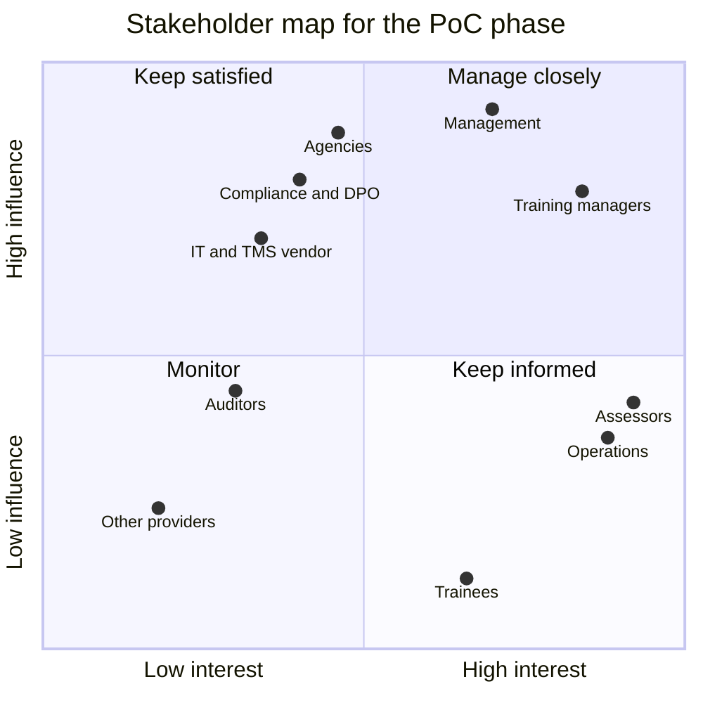

# Problem statement and analysis

Problem Statement #5 · ASPRI-IPI (the training arm of the Association of Process Industry) · SCCCI x NYP AI Innovation Challenge · IT2134 IT Innovation Project, AY2026 Semester 2

> **Status:** v0.3, 24 Oct 2026. #5 is the team's first choice after statement #7 was withdrawn; the final allocation is announced on 26 Oct 2026 ([ADR 0023](adr/0023-retarget-ps5-aspri-ipi.md)). Section 1 summarises the brief in our own words; the brief itself, and any client sample data, is never committed to this public repository. Everything in section 2 beyond the brief is an assumption until the briefing call in the week of 2 Nov 2026 (W3). Assumptions are logged in [assumptions.md](assumptions.md) (A-xx), and the questions that will confirm or correct them are in [client/questions-for-client.md](client/questions-for-client.md) (Q-xx).

## Contents

1. [The brief](#1-the-brief)
2. [Structured analysis](#2-structured-analysis)
   - [2.1 Stakeholders](#21-stakeholders)
   - [2.2 Current-state pain points](#22-current-state-pain-points)
   - [2.3 Root cause](#23-root-cause)
   - [2.4 Constraints](#24-constraints)
   - [2.5 Scope](#25-scope)
   - [2.6 Success metrics](#26-success-metrics)
   - [2.7 Open questions](#27-open-questions)

---

## 1. The brief

A summary in our own words. Interpretation belongs in section 2.

**The client.** ASPRI-IPI is the training arm of the Association of Process Industry. It runs about 40 assessment runs a week with more than 30 trainers and assessors, and assesses 2,000 to 2,400 trainees a month. About 80% of its courses are WSQ, half of those regulated by MOM, and the other 20% are ITE courses.

**Today.** Practical assessments are observed in real training environments, and every step after that is done by hand:

| Step         | What happens                                                                                   |
| ------------ | ---------------------------------------------------------------------------------------------- |
| Assessment   | The assessor ticks a paper checklist while watching each trainee                               |
| Competency   | The assessor works out each trainee's competency by hand from the detailed criteria            |
| TMS entry    | The results are re-typed into the Training Management System (TMS)                             |
| Verification | Operations staff check the TMS entries against the paper records                               |
| Submission   | The results go to the government portals: MOM (AMS), SSG/WSDA and ITE (STEP). Some have no API |
| Filing       | The paper records are filed                                                                    |

**Where the effort goes.** Of the work after an assessment:

| Activity                    | Share |
| --------------------------- | ----- |
| Consolidation and TMS entry | ~60%  |
| Portal submissions          | ~20%  |
| Verification                | ~10%  |
| Rework                      | ~5%   |
| Filing                      | ~5%   |

At about one hour per run, that is roughly 2,000 assessor hours a year before verification and submission.

**What a good solution does.** Assessors record results on tablet-based digital checklists during the assessment. Competency is calculated automatically from each course's assessment rules. Results flow straight into the TMS, which becomes the single source of truth. Submissions go through an agency's API where one exists, and otherwise as agency-specific submission files.

**Priorities.** Capture, the competency rules and the TMS output come first, because that is where most of the time is lost. Generating submission files is the safer route where a portal has no API.

**Next step.** A briefing call with ASPRI-IPI in the week of 2 Nov 2026. Sample data, if any, arrives through the team's data folder.

---

## 2. Structured analysis

**The problem in one sentence.** ASPRI-IPI's assessors record practical assessments on paper and work out competency by hand, so every result is re-typed into the TMS, checked against the paper and keyed again into each agency's portal; that costs about 2,000 assessor hours a year before verification and submission, and lets an error in at every hand-off.

**Our response.** HuiTong 汇通 captures each result once and carries it to every system that needs it. The assessor records the run on a tablet checklist, which keeps working through a dropped connection and syncs afterwards. HuiTong calculates each trainee's competency from the course's approved rules. Operations verify the results in a queue, correcting any with a reason, and the verified results flow into the TMS, the system of record. Each agency then receives them through its API where it has one, and otherwise as a validated, agency-specific file, with the status of every submission tracked. An agency receives only the fields its allowlist shares, every result and correction is in a tamper-evident audit trail, and the AI drafts course rules and flags unusual records for a person to decide on, but never changes a result. A tenant configuration lets another training provider reuse the same layer. Capabilities A to G are defined in [CLAUDE.md](../CLAUDE.md) section 4 and summarised in [2.5 Scope](#25-scope).

### 2.1 Stakeholders

Demo users in the PoC stand in for people we have not met yet. Influence and interest describe the PoC phase and will be revisited after the briefing call.

| Stakeholder                                         | Role and interest                                                                                                                                                    | Influence | Interest                        | What they need from HuiTong                                                                                                                                             | PoC role                      |
| --------------------------------------------------- | -------------------------------------------------------------------------------------------------------------------------------------------------------------------- | --------- | ------------------------------- | ----------------------------------------------------------------------------------------------------------------------------------------------------------------------- | ----------------------------- |
| **Assessors** (primary users)                       | More than 30 trainers and assessors who observe practical assessments in real training environments                                                                  | Medium    | High                            | A fast checklist on a tablet that works without a signal; critical items they cannot miss; competency worked out for them; no re-typing afterwards                      | `ASSESSOR`                    |
| **Operations executives** (primary users)           | Check the TMS entries against the paper records; we assume they also submit the results to the agencies, handle rework and file the records ([A-83](assumptions.md)) | Medium    | High                            | A verification queue with the evidence beside each result; corrections with a reason; TMS entries that already match the verified results; submission status per agency | `OPERATIONS`                  |
| **Training managers**                               | Own the courses, their assessment plans and the criteria; keep them in line with each agency's requirements                                                          | High      | High                            | Course rules kept as versioned configuration; a first draft of the rules from the assessment plan, which they approve or change; a rule change that needs no code       | `TRAINING_MANAGER`            |
| **Management** (ASPRI-IPI leadership)               | Throughput, pass rates, the submission backlog and the cost of administration                                                                                        | High      | High                            | One view of runs, results and submissions, with dashboards; the hours saved, measured; read-only access                                                                 | `MANAGEMENT`                  |
| **Trainees** (secondary persona; data subjects)     | 2,000 to 2,400 a month, whose certification depends on their results reaching the agencies                                                                           | Low       | High                            | Accurate results, recorded once; certification without delay; their personal data protected and shared only as each agency requires                                     | None; operations act for them |
| **Government agencies** (MOM, SSG/WSDA, ITE)        | Receive results through their portals or APIs; regulate or fund the courses                                                                                          | High      | Medium                          | Complete, valid submissions in their own format, on time; only the fields they require                                                                                  | None; mocked                  |
| **IT and the TMS vendor**                           | Own the TMS, the tablets and the accounts; would run HuiTong in production                                                                                           | High      | Medium                          | Supported interfaces only; the TMS stays the system of record; managed tablets; least-privilege service accounts; health checks, logs and metrics                       | `SYSTEM_ADMIN`                |
| **Compliance and the DPO**                          | Accountable for PDPA and for audit readiness when an agency checks the records                                                                                       | High      | Medium (PoC), High (production) | Data minimisation; classification and retention; an allowlist per agency; evidence of who changed what and why                                                          | None; reviews the GRS design  |
| **Auditors** (internal, and the agencies' auditors) | Test that results were recorded, verified and submitted as the rules require                                                                                         | Medium    | Medium                          | A tamper-evident trail of every result, correction and submission; read-only access; exportable evidence                                                                | `AUDITOR`                     |
| **Other training providers**                        | Face the same paper-to-portal problem with their own TMS                                                                                                             | Low       | Low                             | Joining through configuration, field mappings and course rules, not custom code                                                                                         | Demo scenario                 |

- **Manage closely** (training managers, management): the briefing call, a regular check-in, and a review of each prototype.
- **Keep satisfied** (the agencies, compliance, IT): their formats, rules and controls shape the design; confirm them with the client before the W13 technical review.
- **Keep informed** (assessors, operations, trainees): try the tablet checklist and the verification queue with real assessors and operations staff, if the client agrees.
- **Monitor** (auditors, other providers): design for them through the audit trail and configuration-driven connectors.

### 2.2 Current-state pain points

Each point in the brief, translated into what it costs someone on an ordinary working day. The effects are working hypotheses until the client confirms them.

| #   | Pain point (from the brief)                          | Concrete effect (hypothesis)                                                                                                                                                    | Who feels it                 | Addressed by |
| --- | ---------------------------------------------------- | ------------------------------------------------------------------------------------------------------------------------------------------------------------------------------- | ---------------------------- | ------------ |
| 1   | Paper checklists in real training environments       | Ticks can be missed, smudged or illegible, and a page can go missing between the plant and the office. Nothing is checked while the trainee is still there                      | Assessors, trainees          | C            |
| 2   | Competency worked out by hand from detailed criteria | Each trainee's result is added up by hand against the criteria; a missed critical item or a sum done differently gives two assessors different answers for the same performance | Assessors, training managers | D            |
| 3   | Results re-typed into the TMS                        | About 60% of the work after an assessment: every tick becomes a keystroke, about an hour a run, and each copy can carry a typo                                                  | Assessors, operations        | A, B, C      |
| 4   | TMS entries checked against the paper                | About 10%: operations need the paper beside the screen, and a mismatch means chasing the assessor                                                                               | Operations                   | C            |
| 5   | Submissions to three agencies, some without an API   | About 20%: each portal has its own fields and format, so the same results are keyed or uploaded again, agency by agency                                                         | Operations                   | A, D         |
| 6   | Rework and filing                                    | About 10% together: a rejected submission or a correction goes round again, and the paper is filed so it can be found when an agency checks                                     | Operations, compliance       | C, D, F      |

**Our inference, to confirm.** Nobody can see at a glance which runs are captured, verified, in the TMS or submitted, so backlogs and missed deadlines may show up late. The brief does not say this; capability D's dashboards answer it if the client confirms it.

**Why it matters.** Re-typing is the largest cost and the source of most errors; every hand-off between paper, the TMS and the portals adds delay to a trainee's certification; and the knowledge of how competency is decided sits in documents and in assessors' heads, so it is applied unevenly and is hard to show to an auditor.

### 2.3 Root cause

**Problem observed:** the same assessment results are written, calculated, typed, checked and keyed again by hand, from the training ground to the agencies.

| Why?                                                                     | Because                                                                                                                                             | Evidence in the brief                              |
| ------------------------------------------------------------------------ | --------------------------------------------------------------------------------------------------------------------------------------------------- | -------------------------------------------------- |
| 1. Why are results typed more than once?                                 | The result is born on paper, so every system after it needs someone to key it in                                                                    | Paper checklists; results re-typed into the TMS    |
| 2. Why is it born on paper?                                              | Assessments happen in real training environments, away from a desk, where a laptop is impractical and a connection may not be reliable              | Assessments observed in real training environments |
| 3. Why is competency worked out by hand?                                 | Each course's rules (criteria, critical items, what makes a pass) live in its documents, not in a system that could apply them                      | Competency worked out from the detailed criteria   |
| 4. Why are the agencies keyed separately?                                | Each agency has its own portal and format, and some have no API, so the TMS cannot pass the results on                                              | Some portals have no API                           |
| 5. Why has nothing joined these up? (hypothesis to test with the client) | The TMS records results but does not capture them in the field, and the agencies each define their own interface, so the gaps fall between products | To confirm at the briefing call                    |

**Root cause.** The assessment is captured on paper, and the rules that turn it into a result exist only as documents, so every later step re-keys and re-checks it. What is missing is a layer that (1) captures the result once, at the source, even without a connection; (2) applies each course's rules to it as approved configuration; and (3) carries the verified result into the TMS and on to each agency in the agency's own format, with an audit trail at every step. It also explains why replacing the TMS is not the answer: the TMS stays the system of record, and HuiTong feeds it.

### 2.4 Constraints

#### Regulatory

> **Not legal advice.** These are design considerations drawn from public texts. ASPRI-IPI's compliance team and its DPO, and the agencies themselves, must confirm what applies.

| Regime                                                           | Design consideration                                                                                                                                                              | HuiTong response                                                                                                                                                      |
| ---------------------------------------------------------------- | --------------------------------------------------------------------------------------------------------------------------------------------------------------------------------- | --------------------------------------------------------------------------------------------------------------------------------------------------------------------- |
| **Singapore PDPA 2012**                                          | Trainees are told the purposes their data is used for, and data is used only for those purposes                                                                                   | Each agency's allowlist entry records the purpose of the fields it shares                                                                                             |
|                                                                  | Protection (s.24) and Retention Limitation (s.25) Obligations                                                                                                                     | RBAC, field masking by role, encryption in transit and at rest, retention settings per record type                                                                    |
|                                                                  | Transfer Limitation Obligation (s.26): personal data sent outside Singapore needs comparable protection                                                                           | Hosting in Singapore assumed; any AI service outside Singapore receives no trainee data without the client's written permission                                       |
|                                                                  | Data breach notification (Part 6A): notify the PDPC within 3 calendar days of assessing a breach as notifiable                                                                    | The audit trail and access logs support a fast assessment                                                                                                             |
| **PDPC advisory guidelines on NRIC numbers**                     | Collecting NRIC numbers is restricted to cases required by law or needed to establish identity to a high degree; agency submissions may be such a case, which the client confirms | HuiTong never stores NRIC or FIN numbers and uses internal trainee IDs; how an agency file gets the number it requires is a client question (Q-69)                    |
| **The agencies' requirements** (WSQ, MOM-regulated courses, ITE) | Each agency sets what is submitted, in which format and by when, and may check the training provider's assessment records                                                         | Submission files rendered from each agency's template and validated before delivery; a tamper-evident trail of every result and correction, kept for an agreed period |
| **Singapore's Model AI Governance Framework** (guidance)         | Decisions that affect people deserve human oversight in proportion to their impact                                                                                                | AI drafts rules and flags records; a training manager approves every rule, operations decide on every flag, and no AI changes a result                                |

#### Technical

| Constraint                                       | Why it matters                                                                                                     | Design response                                                                                                                                                           |
| ------------------------------------------------ | ------------------------------------------------------------------------------------------------------------------ | ------------------------------------------------------------------------------------------------------------------------------------------------------------------------- |
| An unknown TMS                                   | The brief names a TMS but not its product, API or export options                                                   | One adapter per system behind `SystemConnector`, built by `ConnectorFactory` from configuration; a TMS mock with an API and CSV exports until the client's samples arrive |
| Portals with and without APIs                    | Some agencies take an API call, others only an uploaded file, each in its own format                               | A connector per agency: an API client where one exists, otherwise a file rendered from the agency's template, validated, delivered and tracked                            |
| Connectivity in training environments            | A plant or workshop may have no reliable signal, and an assessment cannot wait for one                             | An offline-first checklist that keeps every record on the tablet until it syncs, with conflicts shown to a person rather than overwritten                                 |
| Rules that differ by course and change over time | Criteria, critical items and outcomes differ per course, and an agency may change its requirements                 | Course rules as versioned configuration: a run uses the version it started with, and a new version needs no code                                                          |
| One trainee, several systems                     | The TMS, the tablets and the agencies must agree on who a trainee is                                               | Trainees matched on the TMS trainee ID, never on names alone                                                                                                              |
| Volumes and peaks                                | About 40 runs a week and 2,000 to 2,400 trainees a month, so roughly a dozen trainees a run (our arithmetic)       | Queued, idempotent jobs for the TMS and the agencies; pagination and indexes on every list                                                                                |
| Systems of record must stay stable               | A bad write to the TMS or a portal damages the record people trust, and a duplicate submission is hard to withdraw | A preview before any write, idempotency keys on every submission, and every write audited                                                                                 |
| Shared tablets                                   | Tablets may be shared between assessors and could be lost                                                          | Sign-in per assessor, only the current run's data kept on the device, and the local copy cleared once it has synced                                                       |

#### Organisational

- **Assessors are also trainers.** Their time is short, so the checklist has to be faster than paper, not just tidier.
- **Two teams carry the work after an assessment.** Assessors do the consolidation and the TMS entry, about 2,000 hours a year (from the brief); operations staff verify, and we assume they also submit, handle rework and file ([A-83](assumptions.md)). The gains are measured in both teams' hours, the largest in the assessors'.
- **The agencies set the formats.** A format change must be absorbed by configuration, not by a release.
- **Audit culture.** Results may be checked long after the run, so every result needs its evidence and history.

#### Project

- **Team and time.** Four Year-2 students and one semester, 19 Oct 2026 to Feb 2027: proposal in W5, technical review in W13, final presentation in W18.
- **Individual ownership.** 85% of the marks are individual, so the work splits into four ownership areas with clean boundaries, each with its owner: Richie, Azri, Iok Teck and Angelyn ([team/module-ownership.md](team/module-ownership.md)).
- **Synthetic data only.** No real personal data and no NRIC or FIN numbers; the UI labels all data "Synthetic demo data". Client samples, when they arrive through the team's data folder, are never committed to this public repository.
- **Everything external is mocked** until the client's samples arrive, each mock labelled as one, and every assumption is logged in [assumptions.md](assumptions.md).
- **No access to client systems** is assumed for the semester ([A-84](assumptions.md)).
- **No client branding** until the client gives permission.
- **Cost.** The mock LLM provider is the default, so the demo needs no paid API key; cloud resources are sized for a demo.
- **The allocation.** #5 is the team's first choice until 26 Oct 2026; if it is not allocated, the work stops after the step in progress ([ADR 0023](adr/0023-retarget-ps5-aspri-ipi.md)).

### 2.5 Scope

#### In scope (PoC, this semester)

| In scope                                                                                                                                                                                         | Capability | Owner                                                    |
| ------------------------------------------------------------------------------------------------------------------------------------------------------------------------------------------------ | ---------- | -------------------------------------------------------- |
| Tablet checklist for a run, which keeps working through a dropped connection and syncs afterwards                                                                                                | C          | Area 2                                                   |
| The run's lifecycle from planned to submitted; operations' verification queue; corrections with a reason; SLA reminders and notifications                                                        | C          | Area 2                                                   |
| Course rules (criteria, critical items, outcomes) as versioned configuration, and automatic competency calculation                                                                               | D          | Area 3                                                   |
| Agency submission files rendered from templates, and dashboards and insights for management and operations                                                                                       | D          | Area 3                                                   |
| Connectors: the TMS, agency APIs, and the delivery of agency files with their submission status                                                                                                  | A          | Area 1                                                   |
| Master data: trainees, assessors, courses and course runs, with each field's source of truth and its history                                                                                     | B          | Area 1                                                   |
| The mapping engine and its AI assistant for TMS exports and agency templates                                                                                                                     | A, E       | Area 1                                                   |
| AI with a human in the loop: a rule-drafting assistant (area 3) and a verification assistant that flags unusual records (area 2, to agree with Azri); nothing is used until a person approves it | E          | Areas 2 and 3, through area 1's `LlmGateway`             |
| Governance: RBAC for six roles, masking, the audit trail and its viewer, PDPA, classification and retention, and the administration of each agency's field allowlist                             | F          | Area 4 (baseline RBAC, masking and audit writer: area 1) |
| Monitoring: structured logs, traces, metrics and health checks; first-party clickstream analytics; AI token usage and cost; AWS deployment with CloudWatch                                       | G          | Area 4                                                   |
| Reuse: a tenant configuration, so another training provider can join without code changes                                                                                                        | A          | Area 1                                                   |
| A UI in English and 简体中文 (to confirm at the briefing call), light and dark themes, WCAG 2.2 AA, with the checklist designed for tablets                                                      | All        | Area 1 (app shell); each area for its screens            |

#### Out of scope

| Out of scope                           | Why                                                                         | Later path                                                                          |
| -------------------------------------- | --------------------------------------------------------------------------- | ----------------------------------------------------------------------------------- |
| Replacing the TMS                      | The brief makes the TMS the single source of truth                          | None: a non-goal                                                                    |
| Submitting to the real agency portals  | A real submission needs the client's approval and the agencies' credentials | The mocks demonstrate it, labelled; real submissions only after the client approves |
| Storing NRIC or FIN numbers            | Restricted, and not needed for a PoC on synthetic data                      | Decided with the client (Q-69)                                                      |
| Real personal data                     | Synthetic data only, shaped by the client's formats                         | A pilot only after compliance sign-off                                              |
| Scanning old paper checklists          | The brief asks to replace paper, not to digitise its archive                | A later import, if the client asks                                                  |
| Scheduling runs and enrolling trainees | The TMS does this; HuiTong reads runs and trainees from it                  | None                                                                                |
| Course funding and fee claims          | A separate process from assessment results                                  | Another connector, if the client asks                                               |
| A native tablet app                    | A web app that works offline covers the checklist                           | A packaged app if the tablets require one                                           |
| Production SSO                         | The PoC uses local demo accounts and a demo role switcher                   | OIDC or SAML behind the existing auth module                                        |
| Legal determinations                   | HuiTong supplies controls and evidence                                      | Decided by ASPRI-IPI's compliance team and the agencies                             |

### 2.6 Success metrics

The baseline comes from the brief: about one hour per run of consolidation and TMS entry, the 60% share of the work after an assessment. On that basis the whole post-assessment effort is about 1 hour 40 minutes a run, and some 3,300 hours a year across about 2,000 runs (our arithmetic, to confirm). Every metric is measured by HuiTong itself, as laboratory estimates on synthetic data until the client gives real baselines.

| Metric                                                   | Baseline (brief or assumed)     | Target                                                   | Owner               |
| -------------------------------------------------------- | ------------------------------- | -------------------------------------------------------- | ------------------- |
| Consolidation and TMS entry per run                      | ~1 hour                         | Under 5 minutes: results reach the TMS without re-typing | Areas 1 and 2       |
| Results typed by hand after the assessment               | Every result, at least once     | 0                                                        | Areas 1 and 2       |
| Competency calculated from approved course rules         | 0% (by hand)                    | 100% of rule-defined outcomes                            | Area 3              |
| Verification time per run                                | ~10 minutes (10% of the effort) | Halved, with the evidence beside each result             | Area 2              |
| Submission effort per run                                | ~20 minutes (20% of the effort) | Under 5 minutes, by API or a generated file              | Areas 1 and 3       |
| Submissions accepted first time                          | Unknown                         | ≥ 95%                                                    | Area 3              |
| Rework                                                   | ~5% of the effort               | ≤ 2%                                                     | Areas 2 and 3       |
| Records lost or duplicated by an offline sync            | n/a                             | 0                                                        | Area 2              |
| Results and corrections in the audit trail               | Paper only                      | 100%                                                     | Area 4, with area 1 |
| AI rule drafts approved by a training manager before use | n/a                             | 100%, with none used unapproved                          | Area 3, with area 4 |

Each metric is traced in [requirements-traceability.md](requirements-traceability.md) as it is built.

### 2.7 Open questions

Section 2 rests on assumptions. These would change the design most; the briefing call asks their P1 questions first, and the rest follow in writing:

- **The TMS:** which product, and whether it offers an API, scheduled exports or neither; its fields for courses, runs, trainees and results (Q-64, Q-65).
- **Each agency's channel:** which of MOM (AMS), SSG/WSDA and ITE (STEP) take an API call and which only a file, in which format, what each validates, and by when (Q-66, Q-67, Q-77).
- **How competency is decided today:** sample checklists for two or three courses, with their criteria, critical items and outcomes, and who approves a change (Q-72, Q-73, Q-75).
- **Trainee identity:** which identifier each agency requires, and whether NRIC or FIN numbers must appear in a submission (Q-68, Q-69).
- **Verification:** who verifies, what they check, and what happens when a result is corrected after verification (Q-74).
- **Tablets and connectivity:** which devices, whether they are shared, and where in the training environments the signal drops (Q-70, Q-71).
- **Records:** how long assessment records must be kept, and in what form an agency checks them (Q-79).
- **Today's baselines:** the effort per run and per agency, the rework rate, and the turnaround to certification (Q-76).
- **Languages:** whether 中文 helps the client's staff, or another language would (Q-80).
