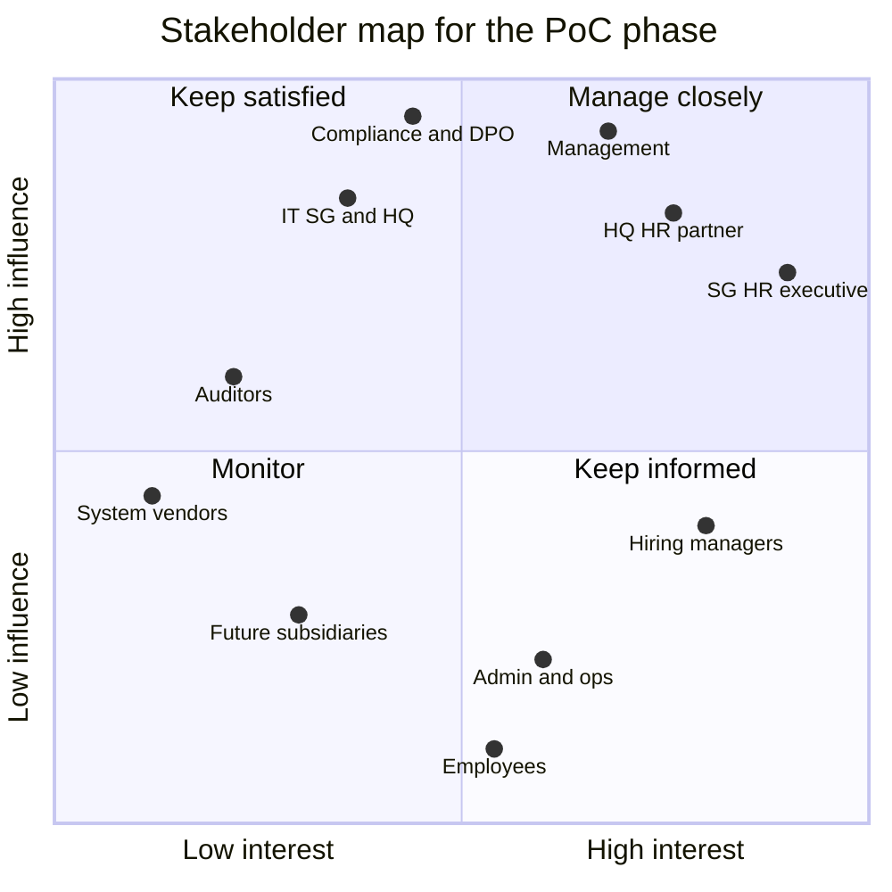

# Problem statement and analysis

Problem Statement #17 · Organisation E (Financial Services) · SCCCI x NYP AI Innovation Challenge · IT2134 IT Innovation Project, AY2026 Semester 2

> **Status:** v0.1, 20 Oct 2026, written before the first client meeting (W2/W3). Section 1 is the client's own text. Everything in section 2 about Organisation E's real systems, volumes and processes is an assumption until that meeting. Assumptions are logged in [assumptions.md](assumptions.md) (A-xx), and the questions that will confirm or correct them are in [client/questions-for-client.md](client/questions-for-client.md) (Q-xx).

## Contents

1. [Original problem statement (verbatim)](#1-original-problem-statement-verbatim)
2. [Structured analysis](#2-structured-analysis)
   - [2.1 Stakeholders](#21-stakeholders)
   - [2.2 Current-state pain points](#22-current-state-pain-points)
   - [2.3 Root cause](#23-root-cause)
   - [2.4 Constraints](#24-constraints)
   - [2.5 Scope](#25-scope)
   - [2.6 Success metrics](#26-success-metrics)
   - [2.7 Open questions](#27-open-questions)

---

## 1. Original problem statement (verbatim)

Reproduced exactly as issued for the challenge. Do not edit this section; interpretation belongs in section 2.

**Project 17: Cross-platform HR and administration data integration and workflow automation for overseas operations**
Organisation: E · Industry: Financial Service

**Customer/audience:** An HR professional supporting an overseas business operation, managing employee information and coordinating HR and admin processes across multiple platforms. An internal OA platform handles workflows and approvals (manpower/hiring requests, office rental, out-of-pocket expenses, IT and fixed-asset purchases, payment approvals). Singapore HR uses locally compliant software for attendance, leave and payroll, while China HQ uses different HR and enterprise systems. Overseas teams use Microsoft Office, Teams and OneDrive; China colleagues use WeChat, DingTalk and Chinese office apps. Excel remains the intermediary for consolidating information between systems.

**Desired outcome:** HR and admin information flows accurately between systems, departments and locations without repeated entering, exporting, reformatting and reconciling. For example, employee data in the Singapore HR system is also needed by HQ; attendance and leave must be consolidated into the company's reporting format; an approved manpower request in OA should trigger recruitment, onboarding, employee-record creation and admin preparation. Information approved at one stage should trigger or update downstream processes without manual intervention.

**Barriers:**

- Different data structures and formats between Singapore and China systems.
- Limited or inconsistent system-to-system integration.
- Repeated exporting and importing of Excel/CSV files.
- Manual consolidation of attendance and leave categories into company-specific reporting templates.
- Employee master data maintained in Excel because it gives management a consolidated view not available from individual systems.
- Approvals processed in OA while subsequent activities happen in other systems.
- Overseas teams use Microsoft Office, Teams, OneDrive and CRM; China colleagues rely on WeChat, DingTalk and Chinese office apps.
- The need for appropriate access control and data protection when employee information is shared across entities and countries.

**Root cause:** Not the absence of digital systems - many processes are already digitalised. The systems operate as separate digital environments, so task-level digitalisation has not produced end-to-end automation. The problem is how existing platforms can securely exchange approved data and trigger workflows while each operation keeps systems suited to local requirements.

**Feelings:** Frustrating to have multiple digital systems yet still rely on Excel and manual work to connect them. Concern about whether data in different locations stays consistent and up to date. HR spends time checking data, chasing approvals and reconciling records instead of workforce planning and employee development.

**Impact:** Duplicated work and a higher chance of inconsistent employee records. Manual transfer consumes HR and admin resources and can delay management reporting. Each new overseas market may add another locally compliant system; without a scalable integration approach, every new operation could create another isolated data environment.

**Future state / success:** Not replacing all systems with one global platform, but an intelligent integration and automation layer that lets local and HQ systems communicate securely. Approved employee data changes update other approved systems or a central employee master dataset; approved manpower requests trigger recruitment or onboarding workflows; attendance and leave consolidate automatically into the required format; management reports draw from multiple authorised sources. A scalable model lets future subsidiaries connect to HQ through standardised data interfaces and workflow automation, with access control, data protection and local compliance. The goal: move from systems connected by people and spreadsheets to systems connected by secure, intelligent workflows.

**Requires company data:** Yes

**Systems for the PoC:** Unsure; in China they use ERP and SAP, including some customised IT features.

**Remarks:** Thanks SCCCI for the programme and sees wider relevance for Chinese enterprises going global, which face similar HQ-to-subsidiary integration challenges. The challenge is the growing number of systems across countries and functions, not a lack of digital tools. Interested in a practical, scalable approach that connects existing systems rather than replacing them, with secure data exchange, synchronisation and consolidation. Open to API integration, workflow automation, RPA, data analytics or AI - the priority is understanding a feasible future solution, not prescribing technology. Would appreciate a PoC architecture extendable to other functions and subsidiaries. Happy to work closely with the team to explain workflows, identify sample processes and give feedback.

---

## 2. Structured analysis

**The problem in one sentence.** HR staff supporting Organisation E's Singapore operation need approved employee, hiring, attendance and leave data to move between the Singapore HR system, China HQ's ERP/SAP-based HR systems and the OA platform without re-keying, because today people and Excel are the only interface between those systems; that costs HR hours every month, delays management reporting and lets records drift apart.

**Our response.** HuiTong 汇通 is an integration and workflow-automation layer that leaves every existing system in place. Connectors translate each local schema into one canonical employee model, approvals in OA become events that start the downstream work, and governance controls (role-based access, field masking, an append-only audit log and a cross-border transfer register) apply to every flow. Capabilities A to G are defined in [CLAUDE.md](../CLAUDE.md) section 4 and summarised in [2.5 Scope](#25-scope).

### 2.1 Stakeholders

Demo users in the PoC stand in for people we have not met yet; the personas in [design-thinking/personas.md](design-thinking/personas.md) build on three of them. Influence and interest describe the PoC phase and will be revisited after the first meeting.

| Stakeholder                                                                                                | Role and interest                                                                                                                    | Influence | Interest                        | What they need from HuiTong                                                                                                                                                                             | PoC role (demo user)                                                        |
| ---------------------------------------------------------------------------------------------------------- | ------------------------------------------------------------------------------------------------------------------------------------ | --------- | ------------------------------- | ------------------------------------------------------------------------------------------------------------------------------------------------------------------------------------------------------- | --------------------------------------------------------------------------- |
| **SG HR executive** (primary user)                                                                         | Runs SG01 HR operations (records, attendance, leave, payroll inputs); maintains the Excel master; prepares the monthly consolidation | High      | High                            | Enter data once; approved changes reach HQ and the master without files; a conflict queue with sources side by side; one-step consolidation into the company template; a preview before any sync writes | `HR_SG`: Tan Mei Ling                                                       |
| **China HQ HR partner**                                                                                    | HQ counterpart for overseas entities; keeps SG staff records in HQ's systems; applies group HR policy and reporting                  | High      | High                            | SG data in HQ's structure (Chinese field names, SAP codes) without chasing spreadsheets; only the fields HQ is authorised to see; a 中文 interface; a clear source of truth per field                   | `HR_HQ`: Zhou Xinyi 周欣怡                                                  |
| **Hiring managers**                                                                                        | Raise manpower requests in OA; need new hires productive from day 1                                                                  | Medium    | High                            | Approval starts recruitment automatically; status without chasing HR; laptop, desk and accounts ready on day 1; no sight of other people's pay or bank data                                             | `HIRING_MANAGER`: Arjun Menon, Head of Wealth Management SG                 |
| **Admin and operations**                                                                                   | Prepare laptops, desks, access and accounts; run office logistics                                                                    | Low       | Medium                          | Preparation tasks created automatically with the start date and an SLA; notifications in their own channel; only the personal data each task needs                                                      | `ADMIN_OPS`: Nur Aisyah                                                     |
| **Management** (SG country management, HQ leadership)                                                      | Use headcount, attendance and leave reports; approve manpower budgets; sponsor change                                                | High      | High                            | Same-day consolidated reports from authorised sources, with provenance; one set of numbers across SG and HQ; read-only access                                                                           | `MANAGEMENT`: Li Guoqiang 李国强                                            |
| **IT** (SG and HQ)                                                                                         | Own systems, networks, accounts and vendor contracts; review security; would run HuiTong in production                               | High      | Medium                          | Supported, documented interfaces; no changes inside systems of record; least-privilege service accounts and managed secrets; health checks, logs and metrics; container-based deployment                | `SYSTEM_ADMIN`: Farhan Ismail                                               |
| **Compliance, legal and DPO**                                                                              | Accountable for PDPA, PIPL and MAS expectations; approve cross-border flows                                                          | High      | Medium (PoC), High (production) | Data minimisation; a classification on every field; a cross-border transfer register with purpose, lawful basis and mechanism per flow; retention settings; audit evidence                              | None; reviews the GRS design ([grs/grs-by-design.md](grs/grs-by-design.md)) |
| **Employees**, including new hires (data subjects)                                                         | Their data is copied across entities and borders; errors hit their pay, leave and first day                                          | Low       | Medium                          | Accurate records; only necessary data shared; strong protection for pay, bank and health-related data; transparency about where data goes; errors corrected quickly                                     | None; HR acts for them                                                      |
| **Auditors** (internal audit, external auditors, regulators on inspection)                                 | Test controls over employee data and changes                                                                                         | Medium    | Low                             | An append-only trail of every write, approval and conflict resolution; evidence of who can see restricted fields; read-only access; exportable evidence                                                 | `AUDITOR`: Grace Lim                                                        |
| **Future subsidiaries** (for example `MY01` Organisation E Malaysia Sdn. Bhd.)                             | Next entities to connect, each with its own locally compliant system                                                                 | Low       | Low                             | Connection through configuration and field mappings, not custom code; their local system stays; connected in under a day with the AI mapping assistant and HR approval                                  | Demo scenario for the AI mapping assistant                                  |
| **External system vendors** (SG HR software, SAP/ERP partner, OA vendor, Microsoft, DingTalk, WeChat Work) | Provide APIs, exports, sandboxes and support; control product roadmaps                                                               | Medium    | Low                             | Use of supported interfaces only, within rate limits and licence terms; no unsupported customisation of their products                                                                                  | None                                                                        |

- **Manage closely** (SG HR, HQ HR, management): the first meeting, a regular check-in (Q-52) and a review of each prototype.
- **Keep satisfied** (IT, compliance, auditors): consult on the GRS design and security evidence before the W13 technical review (Q-40, Q-54).
- **Keep informed** (hiring managers, admin and operations, employees): test the onboarding journey and screens with the client's subject-matter experts (Q-51).
- **Monitor** (future subsidiaries, vendors): design for them through configuration-driven connectors and supported interfaces.

### 2.2 Current-state pain points

Each barrier in the statement, translated into what it costs someone on an ordinary working day. The effects are working hypotheses: examples such as `SG-COMP` or `50001030` come from our mocked schemas, not from client data, and the hours and days are assumed baselines (section 2.6, Q-48).

| #   | Barrier (from the statement)                                                                                                    | Concrete daily effect (hypothesis)                                                                                                                                                                                                                                                  | Who feels it                                                                                | Addressed by                            |
| --- | ------------------------------------------------------------------------------------------------------------------------------- | ----------------------------------------------------------------------------------------------------------------------------------------------------------------------------------------------------------------------------------------------------------------------------------- | ------------------------------------------------------------------------------------------- | --------------------------------------- |
| 1   | Different data structures and formats between Singapore and China systems                                                       | Every hand-off means renaming columns (入职日期 → hire date), reformatting dates (`2026/03/02` → `2026-03-02`), translating department codes (`SG-COMP` ↔ `50001030`) and reordering names; ambiguous dates and codes slip through unnoticed                                        | SG HR executive, HQ HR partner                                                              | A (connectors, transformers), B         |
| 2   | Limited or inconsistent system-to-system integration                                                                            | People are the integration: a new hire's details are typed into OA, SG HR and the Excel master (about three times per field), then sent to HQ; IT handles ad hoc extract requests                                                                                                   | SG HR, HQ HR, IT                                                                            | A, C                                    |
| 3   | Repeated exporting and importing of Excel/CSV files                                                                             | Recurring exports travel by email and shared drives, leaving uncontrolled copies of personal data; files break on encoding (GBK vs UTF-8) and date formats                                                                                                                          | SG HR, HQ HR, compliance and DPO                                                            | A, F                                    |
| 4   | Manual consolidation of attendance and leave categories into company-specific reporting templates                               | Every month HR exports both sides, maps categories by hand (年假 → Annual Leave, 调休 → Time-off in lieu), decides what to do with categories that have no counterpart (探亲假, home leave) and pastes the result into the template: about 16 hours a month, while the report waits | SG HR executive, HQ HR partner, management                                                  | D                                       |
| 5   | Employee master data maintained in Excel because it gives management a consolidated view                                        | The only consolidated view is a spreadsheet: out of date once saved, several versions in circulation, no field-level access control or change history, possibly holding pay and bank data                                                                                           | SG HR (maintains it), management (relies on it), compliance and auditors (cannot verify it) | B, F                                    |
| 6   | Approvals processed in OA while subsequent activities happen in other systems                                                   | After a manpower request is approved, HR re-keys it to start recruitment and again at hire; admin hears about start dates by email; 3–5 working days pass before an onboarding checklist exists, and new hires can arrive without a laptop or accounts                              | Hiring managers, admin and operations, SG HR, new hires                                     | C                                       |
| 7   | Overseas teams use Microsoft Office, Teams, OneDrive and CRM; China colleagues rely on WeChat, DingTalk and Chinese office apps | No shared place for tasks and status: HR relays messages between Teams and DingTalk or WeChat, and files between OneDrive and Chinese office apps; status lives in people's inboxes                                                                                                 | SG HR, HQ HR, hiring managers, admin and operations                                         | C (notifications), A (channel adapters) |
| 8   | The need for appropriate access control and data protection when employee information is shared across entities and countries   | Sharing is all or nothing: a whole spreadsheet crosses the border, including fields the recipient does not need, and nobody can list what was sent, under which mechanism, or who opened it                                                                                         | Compliance and DPO, employees, HR (accountable for each transfer)                           | F, B (provenance)                       |

**Why it matters.** The statement names the cost: duplicated work, a higher chance of inconsistent employee records, delayed management reporting, and a model that does not scale, because each new overseas market adds another isolated system. HR time goes into checking data, chasing approvals and reconciling records instead of workforce planning and employee development.

### 2.3 Root cause

**Problem observed:** HR re-keys and reconciles employee, attendance and leave data between Singapore and China HQ by hand, and records still drift apart.

| Why?                                                                          | Because                                                                                                                                                                                                                                     | Evidence in the statement                                                                                                       |
| ----------------------------------------------------------------------------- | ------------------------------------------------------------------------------------------------------------------------------------------------------------------------------------------------------------------------------------------- | ------------------------------------------------------------------------------------------------------------------------------- |
| 1. Why is data re-keyed and reconciled by hand?                               | The only route between SG HR, HQ's ERP/SAP and OA is export, reformat in Excel, then import or retype                                                                                                                                       | "Repeated exporting and importing of Excel/CSV files"                                                                           |
| 2. Why does Excel sit in the middle?                                          | The systems use different structures, languages and codes, nothing translates between them, and Excel is the one tool every office can open                                                                                                 | "Different data structures and formats between Singapore and China systems"                                                     |
| 3. Why does nothing translate between them?                                   | There is no shared data model and little system-to-system integration: each system was chosen to digitalise a local task well (Singapore statutory payroll and leave, HQ enterprise processes, OA approvals)                                | "Limited or inconsistent system-to-system integration"; "systems suited to local requirements"                                  |
| 4. Why do approvals not start the next steps?                                 | Each system stops at its own boundary: OA records the decision, but no event leaves OA to start recruitment, onboarding or admin preparation, so people carry every hand-off                                                                | "Approvals processed in OA while subsequent activities happen in other systems"                                                 |
| 5. Why has nobody connected the systems? (hypothesis to test with the client) | End-to-end, cross-entity processes have no single system owner, and moving employee data across countries needs access control and data protection that ad hoc links could not demonstrate, so person-to-person transfer became the default | "The need for appropriate access control and data protection when employee information is shared across entities and countries" |

**Root cause.** The systems are digital but isolated: task-level digitalisation never became end-to-end automation. What is missing is a secure layer that (1) translates each local data model into one canonical model, (2) turns approvals into events that start the downstream work, and (3) applies access control, minimisation and audit to every flow between entities. This matches the statement's own diagnosis. It also explains why replacing systems is not the answer: each local system carries local compliance (for example Singapore payroll and CPF, or China's social insurance and individual income tax), which one global platform would have to rebuild.

### 2.4 Constraints

#### Regulatory

> **Not legal advice.** These are design considerations drawn from the public texts of each law or guideline. Organisation E's compliance and legal teams, including its DPO, must confirm which rules apply and which mechanisms are already in place (Q-37 to Q-43). Section and article numbers refer to the Singapore Personal Data Protection Act 2012 (PDPA) and the PRC Personal Information Protection Law (PIPL).

| Regime                                                                                                                    | Design consideration                                                                                                                                                                                                                                                                                | HuiTong response                                                                                                                                                                                                                              |
| ------------------------------------------------------------------------------------------------------------------------- | --------------------------------------------------------------------------------------------------------------------------------------------------------------------------------------------------------------------------------------------------------------------------------------------------- | --------------------------------------------------------------------------------------------------------------------------------------------------------------------------------------------------------------------------------------------- |
| **Singapore PDPA 2012** (SG01 data)                                                                                       | Employee data may be used without consent where reasonable to manage the employment relationship, but employees must be told the purposes                                                                                                                                                           | Each flow in the cross-border transfer register records its purpose                                                                                                                                                                           |
|                                                                                                                           | Protection (s.24) and Retention Limitation (s.25) Obligations                                                                                                                                                                                                                                       | RBAC, field masking by role, encryption in transit, retention settings per record type                                                                                                                                                        |
|                                                                                                                           | Transfer Limitation Obligation (s.26): personal data sent outside Singapore needs protection comparable to the PDPA, typically through legally enforceable obligations such as an intra-group agreement or binding corporate rules                                                                  | SG01 RESTRICTED fields reach HQ users only through an approved register entry                                                                                                                                                                 |
|                                                                                                                           | Data breach notification (Part 6A): notify the PDPC within 3 calendar days of assessing a breach as notifiable (likely significant harm, or 500 or more individuals affected), and notify affected individuals where significant harm is likely                                                     | The append-only audit log and access logs support a fast assessment                                                                                                                                                                           |
|                                                                                                                           | PDPC guidance restricts the collection of NRIC numbers                                                                                                                                                                                                                                              | HuiTong never stores NRIC/FIN numbers; they stay in SG HR for statutory filings                                                                                                                                                               |
| **China PIPL 2021** (CN01 data, and any personal information processed in mainland China, including SG01 data held at HQ) | Art. 13: human resources management under lawfully formulated labour rules and collective contracts is a lawful basis besides consent                                                                                                                                                               | The register records each flow's lawful basis                                                                                                                                                                                                 |
|                                                                                                                           | Art. 28–29: sensitive personal information (including financial accounts and medical health) needs a specific purpose, sufficient necessity and strict protection, and Art. 29 requires separate consent                                                                                            | Bank data cut to bank name and last 4 digits (RESTRICTED); leave records hold category and dates only, never diagnoses or certificates                                                                                                        |
|                                                                                                                           | Art. 38–39: sending personal information out of China needs a mechanism (CAC security assessment, certification or the CAC standard contract), notice of the overseas recipient and the individual's separate consent                                                                               | The register records mechanism, notice and consent status per flow                                                                                                                                                                            |
|                                                                                                                           | Art. 55: an impact assessment before processing sensitive data, providing data to another processor or sending it abroad                                                                                                                                                                            | Each register entry links to its assessment                                                                                                                                                                                                   |
|                                                                                                                           | Art. 24: individuals may refuse decisions made solely by automated means that significantly affect them                                                                                                                                                                                             | HuiTong's AI only proposes; a person approves every AI proposal before it is used                                                                                                                                                             |
| **CAC Provisions on Promoting and Regulating Cross-Border Data Flows** (March 2024)                                       | Transfers truly necessary for cross-border HR management under lawfully formulated labour rules and collective contracts are exempt from the security assessment, the standard contract and certification                                                                                           | HQ receives only the fields it needs, so necessity is easy to show (Q-08)                                                                                                                                                                     |
|                                                                                                                           | Personal information collected outside China that is processed there and sent back out is also exempt, provided no China-collected personal information or important data is added                                                                                                                  | `entityCode` and field provenance keep SG-origin and China-origin data distinguishable                                                                                                                                                        |
|                                                                                                                           | The exemptions lift the filing mechanisms; other PIPL duties such as notice, separate consent and the impact assessment are generally understood to remain                                                                                                                                          | The register tracks those duties for exempt flows too                                                                                                                                                                                         |
| **China Data Security Law 2021 and Cybersecurity Law 2017**                                                               | Data must be classified and graded, with stronger protection for "important data"                                                                                                                                                                                                                   | Every canonical field carries a level (PUBLIC, INTERNAL, CONFIDENTIAL, RESTRICTED), to be mapped onto the group's scheme (Q-41)                                                                                                               |
|                                                                                                                           | Multi-level protection scheme (MLPS); network logs kept for at least six months; critical information infrastructure operators keep personal information and important data collected in China inside China                                                                                         | Log and audit retention configurable to six months or more; a production deployment in China would need MLPS grading; CIIO status is asked (Q-38)                                                                                             |
| **MAS Technology Risk Management Guidelines** (2021), if SG01 is MAS-regulated (Q-38)                                     | Technology risk governance, secure software development, least privilege and segregation of duties, strong authentication for privileged access, logging and monitoring, change management, third-party and cloud risk                                                                              | Seven-role RBAC; human approval of AI proposals and conflict resolutions; pull-request reviews with CI tests and a dependency audit; versioned mapping configs; logs, metrics and health checks; hosting documented for an outsourcing review |
|                                                                                                                           | MAS FEAT principles (2018) for the use of AI and data analytics in finance                                                                                                                                                                                                                          | AI suggestions show confidence and rationale and need approval; `AiUsageTracker` records every call                                                                                                                                           |
| **Data residency** (all regimes together)                                                                                 | Where the master lives decides what each record triggers: a hub in Singapore makes every CN01 record a PIPL cross-border transfer, and a hub in China makes every SG01 record a PDPA s.26 transfer. AWS's China regions are a separate partition with separate accounts, operated by local partners | PoC: one deployment, synthetic data only. Production: one hub or regional data planes with minimised cross-border flows, decided in an ADR once Q-37 is answered                                                                              |

#### Technical

| Constraint                                      | Why it matters                                                                                                                                                                                                         | Design response                                                                                                                                                                    |
| ----------------------------------------------- | ---------------------------------------------------------------------------------------------------------------------------------------------------------------------------------------------------------------------- | ---------------------------------------------------------------------------------------------------------------------------------------------------------------------------------- |
| Heterogeneous vendors, unknown interfaces       | The SG HR product, HQ's ERP/SAP set-up and customisations, and the OA product are all unconfirmed (Q-01 to Q-03, Q-12)                                                                                                 | One adapter per system behind `SystemConnector`, built by `ConnectorFactory` from configuration; mocks with deliberately different schemas until real contracts arrive             |
| Chinese and English schemas                     | HQ data uses Chinese keys (员工编号, 姓名, 部门编码, 入职日期), `YYYY/MM/DD` dates, SAP-style status codes and 8-digit org-unit codes; CSV saved from Chinese-locale Excel is GBK-encoded by default, not UTF-8 (Q-18) | Strategy transformers for dates, name order, department codes, enums and phone numbers; UTF-8 end to end, with GBK/GB18030 handled on import; canonical labels in English and 中文 |
| Naming conventions across cultures              | Chinese names put the family name first; many Malay names have no family name (bin/binti patronymics); Indian naming varies                                                                                            | The canonical model keeps family name, given name, Latin and local full names and a preferred name; no source splits names on spaces without an explicit rule                      |
| Network separation between China and Singapore  | HQ systems probably sit on an internal network; cross-border links use the group WAN or carrier leased lines, with higher latency and occasional outages (Q-16)                                                        | Asynchronous, queue-based sync (BullMQ) with retries and idempotency keys; no user action waits on a cross-border call; outbound connections from the China side preferred         |
| Google services unreachable from mainland China | Google Fonts, Google Analytics, reCAPTCHA and Google Maps fail for HQ users, and third-party CDNs weaken the content security policy                                                                                   | Self-hosted fonts (Geist and Noto Sans SC via Fontsource); first-party clickstream; no third-party runtime dependencies                                                            |
| Same time zone, different calendars             | Singapore and Shanghai are both UTC+8, but public holidays differ and China shifts working days around its public holidays                                                                                             | Per-entity working calendars in consolidation; dates stored as dates, timestamps in UTC                                                                                            |
| Two collaboration ecosystems                    | Teams and OneDrive in Singapore; DingTalk and WeChat Work in China                                                                                                                                                     | One notification adapter per channel, mocked in the PoC                                                                                                                            |
| Excel stays in the picture                      | Management trusts the Excel master, and the reporting template is a spreadsheet                                                                                                                                        | Excel/CSV import connector and .xlsx export; Excel retires as the master but stays an output format                                                                                |
| Systems of record must stay stable              | Vendors cap request rates, and a bad write damages the record people trust                                                                                                                                             | Read-mostly connectors, a preview before any sync writes, rate limits respected, every write audited                                                                               |

#### Organisational

- **Approval culture.** OA approvals are the control point, probably with several levels up to HQ (Q-32). HuiTong starts work only on an approved event, shows approval steps explicitly and never bypasses OA.
- **Two HR teams.** Singapore HR works in English under the Singapore Employment Act; HQ HR works in 中文 under PRC labour law and city-level rules. Leave policies, processes and reporting lines differ, so both teams must agree field ownership and mapping rules, and the UI is bilingual.
- **Trust in Excel.** Management relies on the Excel view today. HuiTong must reproduce that view, with provenance, before Excel can retire; a parallel run is the safe path.
- **Group-level decisions.** Data standards, cross-border mechanisms and IT changes are probably set or approved at HQ, so decisions are written as ADRs that HQ IT can review ([adr/README.md](adr/README.md)).
- **IT change control on both sides.** Any real connection needs a security review, service accounts and a change window (Q-54).

#### Project

- **Team and time.** Four Year-2 students (Richie, Iok Teck, Azri, Angelyn) and one semester, 19 Oct 2026 to Feb 2027: proposal in W5, technical review in W13, final presentation in W18.
- **Individual ownership.** 85% of the marks are individual, so the work splits into four ownership areas with clean module boundaries ([team/module-ownership.md](team/module-ownership.md)).
- **Synthetic data only.** No real personal data and no NRIC/FIN or PRC resident ID numbers; the UI labels all data "Synthetic demo data". This is how we meet the statement's "Requires company data: Yes": we ask for structures (field lists, code lists, blank templates), not people (Q-50).
- **Everything external is mocked** until the client meeting (`mock-sg-hr`, `mock-cn-hq`, `mock-oa`), and every assumption is logged in [assumptions.md](assumptions.md).
- **No access to client systems or networks** is assumed for the semester; a sandbox would let us test real contracts (Q-15).
- **Cost.** The mock LLM provider is the default, so the demo needs no paid API key; cloud resources are sized for a demo.
- **Licensing.** The repository stays private while it holds React Bits Pro code or client material.

### 2.5 Scope

#### In scope (PoC, this semester)

| In scope                                                                                                                                                                                                                                          | Capability | Owner                                                    |
| ------------------------------------------------------------------------------------------------------------------------------------------------------------------------------------------------------------------------------------------------- | ---------- | -------------------------------------------------------- |
| Connector hub: adapters for the mocked SG HR, China HQ (SAP-like) and OA systems, HMAC-verified OA webhooks, legacy Excel/CSV import, and mocked Teams and DingTalk notifications; a new system plugs in through configuration and field mappings | A          | Area 1                                                   |
| Canonical employee master: per-field source of truth and provenance, change history, conflict detection, and HR-led resolution recorded in the audit log                                                                                          | B          | Area 1                                                   |
| SG ↔ CN sync with a preview before writes, retries and idempotency keys                                                                                                                                                                           | A, B       | Area 1                                                   |
| AI schema-mapping assistant (demo: the Malaysian subsidiary `MY01`) and a discrepancy explainer in English or 中文; nothing is used until a person approves it                                                                                    | E          | Area 1                                                   |
| Workflow automation: OA manpower approval → recruitment requisition → hire → onboarding checklist → employee record in the master and SG HR → admin preparation → notifications, with SLA reminders and escalation                                | C          | Area 2                                                   |
| Attendance and leave consolidation: ingestion from both sides, leave-category mapping, validation and exception reports, the company reporting template and .xlsx export; management reports from several authorised sources                      | D          | Area 3                                                   |
| Governance: RBAC for seven roles, field-level masking with reasons, an audit-log viewer, data classification, the cross-border transfer register and retention settings                                                                           | F          | Area 4 (baseline RBAC, masking and audit writer: area 1) |
| Monitoring: structured logs, traces, metrics and health checks; first-party clickstream analytics; AI token usage and cost; AWS deployment with CloudWatch                                                                                        | G          | Area 4                                                   |
| Bilingual UI (English and 简体中文), light and dark themes, WCAG 2.2 AA                                                                                                                                                                           | All        | Area 1 (app shell); each area for its screens            |

#### Out of scope

| Out of scope                                                                                                            | Why                                                                                   | Later path                                                                                         |
| ----------------------------------------------------------------------------------------------------------------------- | ------------------------------------------------------------------------------------- | -------------------------------------------------------------------------------------------------- |
| Replacing any system of record (SG HR, HQ ERP/SAP, OA, CRM)                                                             | The client wants an integration layer, and each local system carries local compliance | None: a non-goal                                                                                   |
| Payroll calculation (CPF in Singapore; social insurance and individual income tax in China)                             | Stays in the locally compliant payroll systems                                        | Pass approved payroll inputs; never calculate pay                                                  |
| Real personal data                                                                                                      | Synthetic data only, shaped by the client's structures (Q-50)                         | A pilot only after compliance sign-off and a production deployment in an approved location         |
| Production SSO (Microsoft Entra ID, Active Directory, DingTalk login)                                                   | The PoC uses local demo accounts and a demo role switcher                             | OIDC or SAML behind the existing auth module (Q-44)                                                |
| Native mobile apps                                                                                                      | Desktop-first web app, usable on tablets                                              | Notifications already reach phones through Teams and DingTalk                                      |
| RPA of desktop applications                                                                                             | Brittle and hard to audit; APIs and file exports come first                           | Fallback for a system with neither: wrap the bot as one more `SystemConnector` adapter             |
| Automating the other OA approval types (office rental, expense claims, IT and fixed-asset purchases, payment approvals) | The PoC proves the pattern on manpower request → onboarding                           | The connector hub already receives every OA approval event; new workflows reuse the pattern (Q-36) |
| A full applicant-tracking system (sourcing, interviews, offers)                                                         | HuiTong tracks the requisition and the hire event only                                | Connect an existing applicant-tracking system as another connector                                 |
| Live Teams, DingTalk and WeChat Work integrations                                                                       | Notifications are mocked in the PoC                                                   | Replace the mock channel adapters with real ones (Q-10)                                            |
| CRM integration                                                                                                         | No HR data flow from the CRM identified yet                                           | Add an adapter if one is confirmed (Q-11)                                                          |
| Time-clock devices, biometric and location data                                                                         | Attendance arrives as daily records from the HR systems                               | None: HuiTong never ingests biometric or location data                                             |
| Employee self-service                                                                                                   | Employees keep using their local HR systems; HR corrects records on their behalf      | Possible later through the same API                                                                |
| Legal determinations                                                                                                    | HuiTong supplies controls and evidence                                                | Decided by Organisation E's compliance and legal teams                                             |

### 2.6 Success metrics

Baselines are assumptions until the client confirms them (Q-48), and which metrics matter most to the client is still open (Q-47). Every metric is measured by HuiTong itself, so progress is visible in the product rather than claimed.

| Metric                                                         | Assumed baseline      | Target                                                | How HuiTong measures it in-product                                                                                                                                                                                                     | Owner                              |
| -------------------------------------------------------------- | --------------------- | ----------------------------------------------------- | -------------------------------------------------------------------------------------------------------------------------------------------------------------------------------------------------------------------------------------- | ---------------------------------- |
| HR hours per month on attendance and leave consolidation       | ~16 h                 | ≤ 2 h                                                 | Each consolidation run records its start, finish and time spent clearing exceptions; first-party clickstream adds active time on the consolidation screens                                                                             | Area 3, with area 4                |
| Employee records consistent across SG HR, CN HQ and the master | ~85% (unmeasured)     | ≥ 98%                                                 | After every sync run, the sync engine compares matched records field by field; a record is consistent when it has no open conflict. The synthetic data seeds discrepancies in 10–15% of SG01 employees, so the PoC starts below target | Area 1                             |
| Lead time from OA manpower approval to onboarding checklist    | 3–5 working days      | < 5 minutes (automatic trigger)                       | Approval time in the signed OA webhook compared with the creation time of the onboarding checklist on the workflow instance                                                                                                            | Area 2                             |
| New hires fully prepared (laptop, desk, accounts) by day 1     | Unknown               | ≥ 95%                                                 | Share of onboarding instances whose preparation tasks are all complete before the start date                                                                                                                                           | Area 2                             |
| Times each new-hire field is typed by hand                     | ~3 (OA, SG HR, Excel) | 1 (entered once at the source)                        | Field provenance records whether a value was typed by a person or arrived through a connector; typed entries are counted per field per hire                                                                                            | Area 1, with area 2                |
| Effort to connect a new subsidiary's HR export                 | Weeks of custom work  | < 1 day with the AI mapping assistant and HR approval | Time from the sample upload in the mapping wizard to the approved, versioned mapping config (demo: `MY01`)                                                                                                                             | Area 1                             |
| Monthly management report preparation                          | ~2 working days       | Same day                                              | Time from the start of the consolidation run to the report being marked final in Reports                                                                                                                                               | Area 3                             |
| Writes covered by the audit log                                | Partial               | 100%                                                  | Integration tests assert an audit event for every write route and job; the audit log is append-only                                                                                                                                    | Area 4, with area 1 (audit writer) |
| AI mapping suggestions accepted without edits                  | n/a                   | ≥ 80%, with 0 applied without approval                | `AiUsageTracker` records each suggestion's outcome (accepted, edited, rejected); the API refuses to activate a mapping config without an approver, and a test proves it                                                                | Area 1, with area 4                |

Targets are PoC targets measured on synthetic data; real benefits can only be shown in a pilot. Definitions and measurement detail are in [design-thinking/success-metrics.md](design-thinking/success-metrics.md), and the evidence for each metric is traced in [requirements-traceability.md](requirements-traceability.md).

### 2.7 Open questions

Section 2 rests on assumptions. These would change the design most, and the first client meeting tests them:

- **Which systems exist and which interfaces they offer** (Q-01 to Q-03, Q-12, Q-13): decides every connector, and whether events or polling start workflows.
- **Whether a shared employee number exists, and whether SG staff also sit in HQ's system** (Q-04, Q-05): decides matching and conflict detection.
- **Where data may live, and which cross-border mechanisms are in place** (Q-37 to Q-39): decides the production deployment and the register's defaults.
- **The real reporting template and leave category lists** (Q-23, Q-28): decide the consolidation rules.
- **Today's baselines** (Q-48): turn the targets above into a measurable business case.
