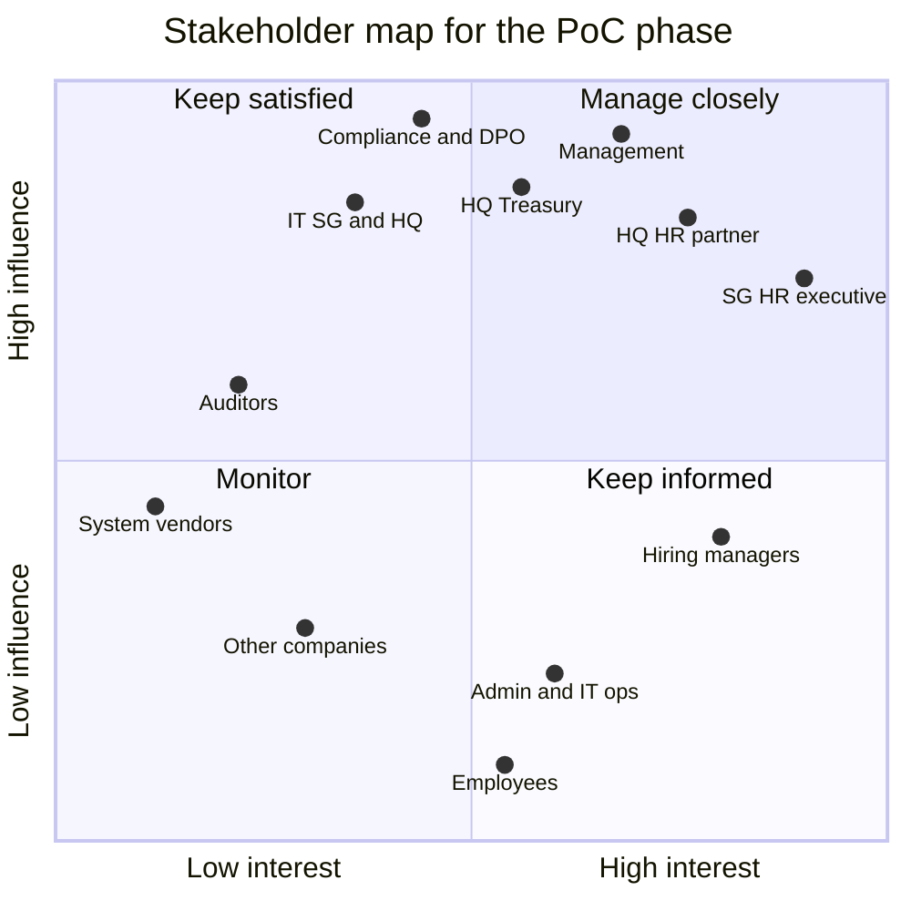

# Problem statement and analysis

Problem Statement #7 · LESSO Solar (solar and renewable energy, part of LESSO Group) · SCCCI x NYP AI Innovation Challenge · IT2134 IT Innovation Project, AY2026 Semester 2

> **Status:** v0.2, 22 Oct 2026. The team was allocated statement #7, which replaces #17 (Organisation E, financial services); what changed is summarised in [Appendix A](#appendix-a-the-superseded-statement-17). Section 1 summarises the brief in our own words; the brief itself, and any client sample data, is never committed to this public repository. Everything in section 2 about LESSO Solar's real systems, volumes and processes beyond the brief is an assumption until the briefing call in the week of 2 Nov 2026 (W3). Assumptions are logged in [assumptions.md](assumptions.md) (A-xx), and the questions that will confirm or correct them are in [client/questions-for-client.md](client/questions-for-client.md) (Q-xx).

## Contents

1. [The brief](#1-the-brief)
2. [Structured analysis](#2-structured-analysis)
   - [2.1 Stakeholders](#21-stakeholders)
   - [2.2 Current-state pain points](#22-current-state-pain-points)
   - [2.3 Root cause](#23-root-cause)
   - [2.4 Constraints](#24-constraints)
   - [2.5 Scope](#25-scope)
   - [2.6 Success metrics](#26-success-metrics)
   - [2.7 Open questions](#27-open-questions)
3. [Appendix A: the superseded statement #17](#appendix-a-the-superseded-statement-17)

---

## 1. The brief

A summary in our own words. Interpretation belongs in section 2.

**The client.** LESSO Solar is the solar division of LESSO Group, a Hong Kong-listed building-materials manufacturer, and runs a regional hub in Singapore. Like many Chinese companies expanding overseas, it keeps its China HQ systems while using local HR and finance tools for Singapore compliance.

**The challenge.** The two sides run different systems:

| Side      | Systems                                                                            |
| --------- | ---------------------------------------------------------------------------------- |
| Singapore | **INFO-TECH** for employee records, leave and payroll                              |
| China HQ  | A **customised SAP**, and an **intranet** for news, policies, claims and approvals |

The same employee and transaction data is entered in several of these systems. Two rules from the brief shape the work:

- A new employee is created in HQ's SAP **before** they are given intranet access.
- Some payments need an **extra approval from HQ Treasury**.

**What a good solution does.** It integrates or consolidates data across the local and HQ systems; it gives a single view of the relevant information, with dashboards and insights; it minimises duplicate data entry; and it could be reused by other Chinese companies operating in Singapore.

**Good to know.** The suggested starting point is to prove one flow, for example onboarding a new hire into both systems, using mock data exports. A Lark/Feishu or DingTalk connector is a possible extension. The next step is a briefing call with the company in the week of 2 Nov 2026; sample data, where available, comes through the team's data folder.

---

## 2. Structured analysis

**The problem in one sentence.** HR at LESSO Solar's Singapore hub enters the same employee and transaction data into INFO-TECH, HQ's customised SAP and the intranet by hand, in an order the rules require (a new hire's SAP record before their intranet access), because the systems do not exchange data; that duplicates work, lets records drift apart, and leaves management without a single view across the systems.

**Our response.** HuiTong 汇通 is an integration and workflow layer that leaves every existing system in place. Connectors translate each system's schema into one canonical employee model; a new hire is entered once and reaches both INFO-TECH and SAP, with intranet access only after the SAP record exists; claims and payments above a threshold route through HQ Treasury's extra approval; and one view brings the systems' data together with dashboards and insights. Governance controls (role-based access, field masking, an append-only audit log and a cross-border transfer register) apply to every flow, and a tenant configuration lets another Chinese company in Singapore reuse the same layer. Capabilities A to G are defined in [CLAUDE.md](../CLAUDE.md) section 4 and summarised in [2.5 Scope](#25-scope).

### 2.1 Stakeholders

Demo users in the PoC stand in for people we have not met yet; the personas in [design-thinking/personas.md](design-thinking/personas.md) build on three of them. Influence and interest describe the PoC phase and will be revisited after the briefing call.

| Stakeholder                                                                                   | Role and interest                                                                                                           | Influence | Interest                        | What they need from HuiTong                                                                                                                                                               | PoC role (demo user)                                                        |
| --------------------------------------------------------------------------------------------- | --------------------------------------------------------------------------------------------------------------------------- | --------- | ------------------------------- | ----------------------------------------------------------------------------------------------------------------------------------------------------------------------------------------- | --------------------------------------------------------------------------- |
| **SG HR executive** (primary user)                                                            | Runs the Singapore hub's HR in INFO-TECH (records, leave, payroll inputs); keys the same new hire into SAP and the intranet | High      | High                            | Enter a new hire once; the SAP record and then intranet access follow in the right order; a conflict queue with sources side by side; a preview before any sync writes                    | `HR_SG`: Tan Mei Ling                                                       |
| **China HQ HR partner**                                                                       | HQ counterpart for overseas staff; keeps Singapore staff in HQ's SAP; applies group HR policy and reporting                 | High      | High                            | Singapore data in SAP's structure (Chinese headers, SAP codes) without chasing spreadsheets; only the fields HQ is authorised to see; a 中文 interface; a clear source of truth per field | `HR_HQ`: Zhou Xinyi 周欣怡                                                  |
| **HQ Treasury**                                                                               | Gives the extra approval some payments need                                                                                 | High      | Medium                          | Only the claims and payments above the threshold, with what they need to decide; nothing paid without their approval                                                                      | Approver in the claims and payments workflow (area 2)                       |
| **Hiring managers**                                                                           | Request new hires; need them productive from day 1                                                                          | Medium    | High                            | One request starts the onboarding; status without chasing HR; system access ready on day 1; no sight of other people's pay or bank data                                                   | `HIRING_MANAGER`: Arjun Menon                                               |
| **Admin and IT operations**                                                                   | Prepare laptops, accounts and intranet access; run office logistics                                                         | Low       | Medium                          | Preparation tasks created automatically with the start date and an SLA; intranet access granted only once the SAP record exists; only the personal data each task needs                   | `ADMIN_OPS`: Nur Aisyah                                                     |
| **Management** (Singapore hub management, HQ leadership)                                      | Use headcount, leave and payroll summaries; approve hiring budgets; sponsor change                                          | High      | High                            | A single view across INFO-TECH, SAP and the intranet, with dashboards, insights and provenance; one set of numbers; read-only access                                                      | `MANAGEMENT`: Li Guoqiang 李国强                                            |
| **IT** (Singapore and HQ)                                                                     | Own the systems, networks, accounts and vendor contracts; review security; would run HuiTong in production                  | High      | Medium                          | Supported, documented interfaces; no changes inside systems of record; least-privilege service accounts and managed secrets; health checks, logs and metrics; container-based deployment  | `SYSTEM_ADMIN`: Farhan Ismail                                               |
| **Compliance, legal and DPO**                                                                 | Accountable for PDPA and PIPL; approve cross-border flows                                                                   | High      | Medium (PoC), High (production) | Data minimisation; a classification on every field; a cross-border transfer register with purpose, lawful basis and mechanism per flow; retention settings; audit evidence                | None; reviews the GRS design ([grs/grs-by-design.md](grs/grs-by-design.md)) |
| **Employees**, including new hires (data subjects)                                            | Their data is copied across systems, entities and borders; errors hit their pay, leave and first day                        | Low       | Medium                          | Accurate records; only necessary data shared; strong protection for pay and bank data; transparency about where data goes; errors corrected quickly                                       | None; HR acts for them                                                      |
| **Auditors** (internal and external)                                                          | Test controls over employee data, changes and approvals                                                                     | Medium    | Low                             | An append-only trail of every write, approval and conflict resolution; evidence of who can see restricted fields; read-only access; exportable evidence                                   | `AUDITOR`: Grace Lim                                                        |
| **Other Chinese companies in Singapore**                                                      | Face the same HQ-to-overseas split; would reuse the layer                                                                   | Low       | Low                             | Connection through configuration and field mappings, not custom code; their own systems stay; an export mapped in under a day with the AI mapping assistant and HR approval               | Demo scenario for the AI mapping assistant                                  |
| **System vendors** (INFO-TECH, the SAP partner, the intranet's vendor, Lark/Feishu, DingTalk) | Provide APIs, exports, sandboxes and support; control product roadmaps                                                      | Medium    | Low                             | Use of supported interfaces only, within rate limits and licence terms; no unsupported customisation of their products                                                                    | None                                                                        |

- **Manage closely** (SG HR, HQ HR, management, HQ Treasury): the briefing call, a regular check-in (Q-52) and a review of each prototype, ideally with one or two HR staff trying it (Q-63).
- **Keep satisfied** (IT, compliance, auditors): consult on the GRS design and security evidence before the W13 technical review (Q-40, Q-54).
- **Keep informed** (hiring managers, admin and IT operations, employees): test the onboarding journey and screens with the client's subject-matter experts (Q-51).
- **Monitor** (other companies, vendors): design for them through configuration-driven connectors and supported interfaces.

### 2.2 Current-state pain points

Each point in the brief, translated into what it costs someone on an ordinary working day. The effects are working hypotheses: the formats come from our mocked exports, not from client data, and the hours and days are assumed baselines (section 2.6, Q-48).

| #   | Pain point (from the brief)                                           | Concrete daily effect (hypothesis)                                                                                                                                                                                                         | Who feels it                              | Addressed by                            |
| --- | --------------------------------------------------------------------- | ------------------------------------------------------------------------------------------------------------------------------------------------------------------------------------------------------------------------------------------ | ----------------------------------------- | --------------------------------------- |
| 1   | The same employee and transaction data is entered in several systems  | A new hire's details are typed into INFO-TECH, then SAP, then the intranet: about three times per field. Each copy can carry a different typo, and nobody can say which is right                                                           | SG HR executive, HQ HR partner            | A (connectors), B, C                    |
| 2   | A new employee must exist in HQ's SAP before they get intranet access | The order is enforced by people: HR waits for HQ to create the SAP record, then asks for intranet access. A delay at any step leaves the new hire without access to news, policies or claims on day 1                                      | New hires, SG HR, HQ HR, admin and IT     | C                                       |
| 3   | Some payments need an extra HQ Treasury approval                      | A claim or payment above the threshold waits on an approval that lives in another system; the claimant and HR chase it by message, and nobody sees which payments are waiting on Treasury                                                  | Claimants, SG HR and finance, HQ Treasury | C, F (audit)                            |
| 4   | The local and HQ systems use different data structures                | INFO-TECH exports carry English headers and Singapore dates; SAP exports carry Chinese or SAP-coded headers, `YYYY/MM/DD` dates and possibly GBK encoding. Every hand-off means renaming columns, reformatting dates and translating codes | SG HR, HQ HR                              | A (mapping engine, transformers)        |
| 5   | No single view across the systems                                     | Headcount, leave and payroll summaries are assembled by hand from several exports before management can see them, so the numbers are late and may disagree with each system                                                                | Management, SG HR, HQ HR                  | D (single view), B                      |
| 6   | Employee data moves between Singapore and China                       | Sharing is all or nothing: whole files cross the border, including fields the recipient does not need, and nobody can list what was sent, under which mechanism, or who opened it                                                          | Compliance and DPO, employees, HR         | F, B (provenance)                       |
| 7   | Other Chinese companies in Singapore face the same split              | Each company, and each new market, builds its own spreadsheets and hand-offs; nothing carries over                                                                                                                                         | Future adopters                           | A (configuration), tenant configuration |

**Why it matters.** Duplicate entry costs HR hours and makes records inconsistent; the SAP-before-intranet rule, done by hand, delays a new hire's first day; payments wait on approvals nobody can see; and management decides without a single, current view. Each new market or company repeats the same problem unless the layer can be reused.

### 2.3 Root cause

**Problem observed:** HR re-enters employee and transaction data between INFO-TECH, SAP and the intranet by hand, and records still drift apart.

| Why?                                                                          | Because                                                                                                                                                                                                 | Evidence in the brief                                                                            |
| ----------------------------------------------------------------------------- | ------------------------------------------------------------------------------------------------------------------------------------------------------------------------------------------------------- | ------------------------------------------------------------------------------------------------ |
| 1. Why is data entered more than once?                                        | Each system needs the same employee, and nothing passes it from one system to the next                                                                                                                  | The same data is entered in several systems                                                      |
| 2. Why does nothing pass it on?                                               | The systems were chosen for their own side: INFO-TECH for Singapore records, leave and payroll compliance; SAP and the intranet for HQ's processes. They use different structures, languages and codes  | Local tools for Singapore compliance; HQ systems kept as they are                                |
| 3. Why do rules such as SAP before intranet need people?                      | The rule spans two systems, and neither system knows about the other, so a person carries the order between them                                                                                        | A new employee is created in SAP before getting intranet access                                  |
| 4. Why are approvals slow to see?                                             | An approval in one system does not reach the next: the Treasury step lives in HQ's systems while the claim and the people waiting on it are in Singapore                                                | Some payments need an extra HQ Treasury approval                                                 |
| 5. Why has nobody connected the systems? (hypothesis to test with the client) | Cross-entity, cross-border processes have no single system owner, and moving employee data between Singapore and China needs access control and data protection that ad hoc links could not demonstrate | Data protection is implied by the HQ-to-overseas setting; to confirm at the briefing call (Q-39) |

**Root cause.** The systems are digital but isolated: each side digitalised its own tasks, but no layer connects them, so people carry the data, the order of steps and the approvals between systems. What is missing is a secure layer that (1) translates each system's data model into one canonical model, (2) turns an entry or an approval in one system into the next step in another, in the order the rules require, and (3) applies access control, minimisation and audit to every flow between entities. It also explains why replacing systems is not the answer: INFO-TECH carries Singapore compliance (for example CPF in payroll), and HQ's SAP carries group processes, which one platform would have to rebuild.

### 2.4 Constraints

#### Regulatory

> **Not legal advice.** These are design considerations drawn from the public texts of each law. LESSO Solar's compliance and legal teams, including its DPO, must confirm which rules apply and which mechanisms are already in place (Q-37 to Q-43). Section and article numbers refer to the Singapore Personal Data Protection Act 2012 (PDPA) and the PRC Personal Information Protection Law (PIPL).

| Regime                                                                                                                    | Design consideration                                                                                                                                                                                                                                                                                | HuiTong response                                                                                                                                                 |
| ------------------------------------------------------------------------------------------------------------------------- | --------------------------------------------------------------------------------------------------------------------------------------------------------------------------------------------------------------------------------------------------------------------------------------------------- | ---------------------------------------------------------------------------------------------------------------------------------------------------------------- |
| **Singapore PDPA 2012** (SG01 data)                                                                                       | Employee data may be used without consent where reasonable to manage the employment relationship, but employees must be told the purposes                                                                                                                                                           | Each flow in the cross-border transfer register records its purpose                                                                                              |
|                                                                                                                           | Protection (s.24) and Retention Limitation (s.25) Obligations                                                                                                                                                                                                                                       | RBAC, field masking by role, encryption in transit, retention settings per record type                                                                           |
|                                                                                                                           | Transfer Limitation Obligation (s.26): personal data sent outside Singapore needs protection comparable to the PDPA, typically through legally enforceable obligations such as an intra-group agreement or binding corporate rules                                                                  | SG01 fields reach HQ users only through an approved register entry                                                                                               |
|                                                                                                                           | Data breach notification (Part 6A): notify the PDPC within 3 calendar days of assessing a breach as notifiable (likely significant harm, or 500 or more individuals affected), and notify affected individuals where significant harm is likely                                                     | The append-only audit log and access logs support a fast assessment                                                                                              |
|                                                                                                                           | PDPC guidance restricts the collection of NRIC numbers                                                                                                                                                                                                                                              | HuiTong never stores NRIC/FIN numbers; they stay in INFO-TECH for statutory filings                                                                              |
| **China PIPL 2021** (CN01 data, and any personal information processed in mainland China, including SG01 data held at HQ) | Art. 13: human resources management under lawfully formulated labour rules and collective contracts is a lawful basis besides consent                                                                                                                                                               | The register records each flow's lawful basis                                                                                                                    |
|                                                                                                                           | Art. 28–29: sensitive personal information (including financial accounts and medical health) needs a specific purpose, sufficient necessity and strict protection, and Art. 29 requires separate consent                                                                                            | Bank data cut to bank name and last 4 digits (RESTRICTED); leave records hold category and dates only, never diagnoses or certificates                           |
|                                                                                                                           | Art. 38–39: sending personal information out of China needs a mechanism (CAC security assessment, certification or the CAC standard contract), notice of the overseas recipient and the individual's separate consent                                                                               | The register records mechanism, notice and consent status per flow                                                                                               |
|                                                                                                                           | Art. 55: an impact assessment before processing sensitive data, providing data to another processor or sending it abroad                                                                                                                                                                            | Each register entry links to its assessment                                                                                                                      |
|                                                                                                                           | Art. 24: individuals may refuse decisions made solely by automated means that significantly affect them                                                                                                                                                                                             | HuiTong's AI only proposes; a person approves every AI proposal before it is used                                                                                |
| **CAC Provisions on Promoting and Regulating Cross-Border Data Flows** (March 2024)                                       | Transfers truly necessary for cross-border HR management under lawfully formulated labour rules and collective contracts are exempt from the security assessment, the standard contract and certification                                                                                           | HQ receives only the fields it needs, so necessity is easy to show (Q-08)                                                                                        |
|                                                                                                                           | Personal information collected outside China that is processed there and sent back out is also exempt, provided no China-collected personal information or important data is added                                                                                                                  | `entityCode` and field provenance keep SG-origin and China-origin data distinguishable                                                                           |
|                                                                                                                           | The exemptions lift the filing mechanisms; other PIPL duties such as notice, separate consent and the impact assessment are generally understood to remain                                                                                                                                          | The register tracks those duties for exempt flows too                                                                                                            |
| **China Data Security Law 2021 and Cybersecurity Law 2017**                                                               | Data must be classified and graded, with stronger protection for "important data"                                                                                                                                                                                                                   | Every canonical field carries a level (PUBLIC, INTERNAL, CONFIDENTIAL, RESTRICTED), to be mapped onto the group's scheme (Q-41)                                  |
|                                                                                                                           | Multi-level protection scheme (MLPS); network logs kept for at least six months; critical information infrastructure operators keep personal information and important data collected in China inside China                                                                                         | Log and audit retention configurable to six months or more; a production deployment in China would need MLPS grading; CIIO status is asked (Q-38)                |
| **Data residency** (all regimes together)                                                                                 | Where the master lives decides what each record triggers: a hub in Singapore makes every CN01 record a PIPL cross-border transfer, and a hub in China makes every SG01 record a PDPA s.26 transfer. AWS's China regions are a separate partition with separate accounts, operated by local partners | PoC: one deployment, synthetic data only. Production: one hub or regional data planes with minimised cross-border flows, decided in an ADR once Q-37 is answered |

The analysis of statement #17 also weighed the MAS Technology Risk Management Guidelines and the FEAT principles, because Organisation E was a financial-services group. LESSO Solar is not, so they no longer apply; the controls they prompted (least privilege, human approval of AI proposals, change management through reviewed pull requests) stay, because the PDPA, PIPL and good practice ask for them too.

#### Technical

| Constraint                                      | Why it matters                                                                                                                                                                       | Design response                                                                                                                                                            |
| ----------------------------------------------- | ------------------------------------------------------------------------------------------------------------------------------------------------------------------------------------ | -------------------------------------------------------------------------------------------------------------------------------------------------------------------------- |
| Known products, unknown interfaces              | The brief names INFO-TECH, a customised SAP and an intranet, but not their versions, APIs or export options, nor how SAP is customised (Q-01 to Q-03, Q-12, Q-58)                    | One adapter per system behind `SystemConnector`, built by `ConnectorFactory` from configuration; mocks that emulate realistic exports until the client's samples arrive    |
| Chinese and English schemas                     | HQ data uses Chinese keys (员工编号, 姓名, 部门编码, 入职日期), `YYYY/MM/DD` dates, SAP-style codes; CSV saved from Chinese-locale Excel is GBK-encoded by default, not UTF-8 (Q-18) | Strategy transformers for dates, name order, codes, enums and phone numbers; UTF-8 end to end, with GBK/GB18030 handled on import; canonical labels in English and 中文    |
| Exports before APIs                             | The brief suggests mock data exports as the starting point, and INFO-TECH's API options are unknown                                                                                  | Every importer reads a documented export format through the mapping engine, so a real export replaces a mock one with only a mapping change                                |
| A rule that spans two systems                   | The SAP record must exist before intranet access, so the two systems' steps cannot run independently                                                                                 | The onboarding workflow orders the steps and checks the SAP record before it asks for intranet access                                                                      |
| Naming conventions across cultures              | Chinese names put the family name first; many Malay names have no family name (bin/binti patronymics); Indian naming varies                                                          | The canonical model keeps family name, given name, Latin and local full names and a preferred name; no source splits names on spaces without an explicit rule              |
| Network separation between China and Singapore  | HQ systems probably sit on an internal network; cross-border links use the group WAN or the internet, with higher latency and occasional outages (Q-16)                              | Asynchronous, queue-based sync (BullMQ) with retries and idempotency keys; no user action waits on a cross-border call; outbound connections from the China side preferred |
| Google services unreachable from mainland China | Google Fonts, Google Analytics, reCAPTCHA and Google Maps fail for HQ users, and third-party CDNs weaken the content security policy                                                 | Self-hosted fonts (Geist and Noto Sans SC via Fontsource); first-party clickstream; no third-party runtime dependencies                                                    |
| Same time zone, different calendars             | Singapore and China are both UTC+8, but public holidays differ and China shifts working days around its public holidays                                                              | Per-entity working calendars; dates stored as dates, timestamps in UTC                                                                                                     |
| Messaging tools to confirm                      | The brief suggests Lark/Feishu or DingTalk as an extension; which one the company uses is open (Q-61)                                                                                | One notification adapter per channel, mocked and labelled in the PoC                                                                                                       |
| Systems of record must stay stable              | Vendors cap request rates, and a bad write damages the record people trust                                                                                                           | Read-mostly connectors, a preview before any sync writes, rate limits respected, every write audited                                                                       |

#### Organisational

- **Approval culture.** Approvals run in HQ's intranet, and some payments need HQ Treasury's extra approval (the threshold is Q-60). HuiTong starts work only on an approved event, shows approval steps explicitly and never bypasses the intranet.
- **Two HR teams.** Singapore HR works in English under the Singapore Employment Act; HQ HR works in 中文 under PRC labour law. Processes and reporting lines differ, so both teams must agree field ownership and mapping rules, and the UI is bilingual.
- **Group-level decisions.** Data standards, cross-border mechanisms and IT changes are probably set or approved at HQ, so decisions are written as ADRs that HQ IT can review ([adr/README.md](adr/README.md)).
- **IT change control on both sides.** Any real connection needs a security review, service accounts and a change window (Q-54).

#### Project

- **Team and time.** Four Year-2 students (Richie, Iok Teck, Azri, Angelyn) and one semester, 19 Oct 2026 to Feb 2027: proposal in W5, technical review in W13, final presentation in W18.
- **Individual ownership.** 85% of the marks are individual, so the work splits into four ownership areas with clean module boundaries ([team/module-ownership.md](team/module-ownership.md)).
- **Synthetic data only.** No real personal data and no NRIC/FIN or PRC resident ID numbers; the UI labels all data "Synthetic demo data". Client sample exports, when they arrive through the team's data folder, are never committed to this public repository.
- **Everything external is mocked** until the client's samples arrive, each mock labelled as one, and every assumption is logged in [assumptions.md](assumptions.md).
- **No access to client systems or networks** is assumed for the semester; a sandbox would let us test real contracts (Q-15).
- **No client branding yet.** LESSO's logo, brand assets and colours stay out of the prototype until the client gives permission (Q-62).
- **Cost.** The mock LLM provider is the default, so the demo needs no paid API key; cloud resources are sized for a demo.
- **Licensing.** The repository is public by the team lead's decision of 20 Oct 2026, so no client material is ever committed, and React Bits Pro code stays only if its licence allows a public repository (ADR 0017).

### 2.5 Scope

#### In scope (PoC, this semester)

| In scope                                                                                                                                                                                                                                                                            | Capability | Owner                                                    |
| ----------------------------------------------------------------------------------------------------------------------------------------------------------------------------------------------------------------------------------------------------------------------------------- | ---------- | -------------------------------------------------------- |
| Connector hub: adapters for mocked INFO-TECH, SAP and intranet systems, the intranet's signed approval events, imports of each system's documented export format, and mocked Lark/Feishu and DingTalk notifications; a new system plugs in through configuration and field mappings | A          | Area 1                                                   |
| Canonical employee master: per-field source of truth and provenance, change history, conflict detection, and HR-led resolution recorded in the audit log                                                                                                                            | B          | Area 1                                                   |
| SG ↔ CN sync with a preview before writes, retries and idempotency keys                                                                                                                                                                                                             | A, B       | Area 1                                                   |
| AI schema-mapping assistant (demo: another company's HR export) and a discrepancy explainer in English or 中文; nothing is used until a person approves it                                                                                                                          | E          | Area 1                                                   |
| Onboarding and approval workflows: a new hire entered once reaches INFO-TECH and SAP, intranet access follows the SAP record, and preparation tasks and notifications run with SLAs; claims and payments above a threshold get HQ Treasury's extra approval                         | C          | Area 2                                                   |
| A single view across the systems, with dashboards and insights: leave and payroll summaries from INFO-TECH, data-consistency and duplicate-entry measures, and management insights; leave consolidation is one part of it                                                           | D          | Area 3                                                   |
| Governance: RBAC for seven roles, field-level masking with reasons, an audit-log viewer, data classification, the cross-border transfer register and retention settings                                                                                                             | F          | Area 4 (baseline RBAC, masking and audit writer: area 1) |
| Monitoring: structured logs, traces, metrics and health checks; first-party clickstream analytics; AI token usage and cost; AWS deployment with CloudWatch                                                                                                                          | G          | Area 4                                                   |
| Reuse: a tenant configuration (company name, connector set, field mappings, theme tokens), so another Chinese company in Singapore can join without code changes                                                                                                                    | A          | Area 1                                                   |
| Bilingual UI (English and 简体中文), light and dark themes, WCAG 2.2 AA                                                                                                                                                                                                             | All        | Area 1 (app shell); each area for its screens            |

#### Out of scope

| Out of scope                                                                                | Why                                                                                           | Later path                                                                                 |
| ------------------------------------------------------------------------------------------- | --------------------------------------------------------------------------------------------- | ------------------------------------------------------------------------------------------ |
| Replacing any system of record (INFO-TECH, SAP, the intranet)                               | The brief asks to integrate or consolidate, and each system carries its own compliance        | None: a non-goal                                                                           |
| Payroll calculation (CPF in Singapore; social insurance and individual income tax in China) | Stays in INFO-TECH and HQ's systems                                                           | Read payroll summaries; never calculate pay                                                |
| Writing to the client's real systems                                                        | A write to a system of record needs the client's approval; the mocks demonstrate it, labelled | Real writes only after the client approves them (Q-17)                                     |
| Real personal data                                                                          | Synthetic data only, shaped by the client's export formats                                    | A pilot only after compliance sign-off and a production deployment in an approved location |
| Production SSO (an identity provider, Lark or DingTalk login)                               | The PoC uses local demo accounts and a demo role switcher                                     | OIDC or SAML behind the existing auth module (Q-44)                                        |
| Native mobile apps                                                                          | Desktop-first web app, usable on tablets                                                      | Notifications reach phones through the messaging channel                                   |
| RPA of desktop applications                                                                 | Brittle and hard to audit; APIs and file exports come first                                   | Fallback for a system with neither: wrap the bot as one more `SystemConnector` adapter     |
| A full applicant-tracking system (sourcing, interviews, offers)                             | HuiTong starts from the confirmed hire                                                        | Connect an existing applicant-tracking system as another connector                         |
| Live Lark/Feishu and DingTalk integrations                                                  | Notifications are mocked in the PoC                                                           | Replace the mock channel adapters with real ones (Q-61)                                    |
| LESSO branding                                                                              | No permission yet                                                                             | A tenant theme, through the tenant configuration, once the client agrees (Q-62)            |
| Legal determinations                                                                        | HuiTong supplies controls and evidence                                                        | Decided by LESSO Solar's compliance and legal teams                                        |

### 2.6 Success metrics

Baselines are assumptions until the client confirms them (Q-48), and which metrics matter most to the client is still open (Q-47). Every metric is measured by HuiTong itself, so progress is visible in the product rather than claimed. The ids and definitions are in [design-thinking/success-metrics.md](design-thinking/success-metrics.md).

| Metric                                                                | Assumed baseline              | Target                                                | Owner               |
| --------------------------------------------------------------------- | ----------------------------- | ----------------------------------------------------- | ------------------- |
| Times each new-hire field is typed by hand                            | ~3 (INFO-TECH, SAP, intranet) | 1 (entered once)                                      | Area 1, with area 2 |
| New hires whose SAP record exists before their intranet access        | Unknown                       | 100%, enforced by the workflow                        | Area 2              |
| Lead time from a new hire's entry to their intranet access            | 2–3 working days              | Same day                                              | Area 2              |
| New hires fully prepared (laptop, desk, accounts, intranet) by day 1  | Unknown                       | ≥ 95%                                                 | Area 2              |
| Payments above the threshold approved by HQ Treasury before payment   | Unknown                       | 100%, with none paid without it                       | Area 2              |
| Employee records consistent across INFO-TECH, SAP and the master      | ~85% (unmeasured)             | ≥ 98%                                                 | Area 1              |
| HR hours a month preparing leave and payroll summaries for management | ~16 h                         | ≤ 2 h                                                 | Area 3, with area 4 |
| Monthly management summary preparation                                | ~2 working days               | Same day                                              | Area 3              |
| Effort to connect another company's HR export                         | Weeks of custom work          | < 1 day with the AI mapping assistant and HR approval | Area 1              |
| Writes covered by the audit log                                       | Partial                       | 100%                                                  | Area 4, with area 1 |
| AI mapping suggestions accepted without edits                         | n/a                           | ≥ 80%, with 0 applied without approval                | Area 1, with area 4 |

Targets are PoC targets measured on synthetic data; real benefits can only be shown in a pilot. The evidence for each metric is traced in [requirements-traceability.md](requirements-traceability.md).

### 2.7 Open questions

Section 2 rests on assumptions. These would change the design most, and the briefing call in the week of 2 Nov tests them first:

- **INFO-TECH's export and API options, and how SAP is customised** (Q-01, Q-02, Q-12, Q-58): decides every connector and import format.
- **The exact onboarding steps and their order across INFO-TECH, SAP and the intranet** (Q-59): decides the hero journey and its rules.
- **Which payments need HQ Treasury approval, and the threshold** (Q-60): decides the claims and payments workflow.
- **Whether a shared employee number exists across INFO-TECH and SAP** (Q-04, Q-05): decides matching and conflict detection.
- **Where data may live, and which cross-border mechanisms are in place** (Q-37 to Q-39): decides the production deployment and the register's defaults.
- **Lark/Feishu or DingTalk, the use of their brand, and whether HR staff can try the prototype** (Q-61 to Q-63).
- **Today's baselines** (Q-48): turn the targets above into a measurable business case.

---

## Appendix A: the superseded statement #17

The team first worked on Problem Statement #17: Organisation E, an anonymised financial-services group with a Singapore operation and a China HQ. Its HR professional worked across an OA platform for approvals (manpower requests among them), a locally compliant Singapore HR system, HQ's ERP and SAP systems, Microsoft Teams in Singapore and DingTalk or WeChat in China, with an Excel employee master as the only consolidated view.

On 22 Oct 2026 the team was allocated statement #7 instead ([ADR 0022](adr/0022-final-statement-7-lesso-solar.md)). Most of the analysis carried over, because both statements describe the same pattern: a China-headquartered company whose Singapore operation keeps local systems, so people re-key data between them. What changed:

- **The client and its systems are named.** INFO-TECH, a customised SAP and the intranet replace the unknown Singapore HR system, ERP and OA platform.
- **The hero flow.** Onboarding a new hire into both systems, with the SAP record before intranet access, replaces the OA manpower request that triggered onboarding.
- **New rules.** HQ Treasury's extra approval for some payments, and a single view with dashboards and insights.
- **Reuse.** Another Chinese company in Singapore joining replaces a new subsidiary of the same group.
- **Regulation.** The financial-services rules (MAS) no longer apply; PDPA and PIPL stay.

The full #17 analysis is in this file's history, before this version.
