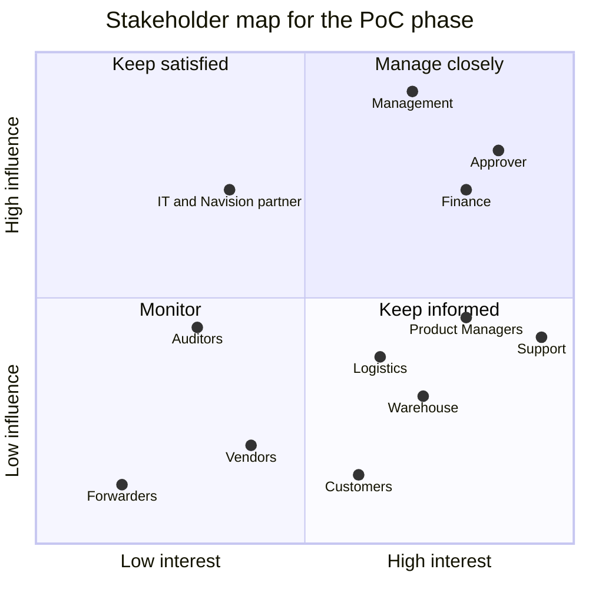

# Problem statement and analysis

Problem Statement #11 · Spectra Innovations (a Singapore distributor of IT products and computer peripherals) · SCCCI x NYP AI Innovation Challenge · IT2134 IT Innovation Project, AY2026 Semester 2

> **Status:** v0.4, 27 Oct 2026. #11 was allocated on 26 Oct 2026, and the allocation is final ([ADR 0024](adr/0024-final-statement-11-spectra.md)). Section 1 summarises the brief, the client's own proposal and its process slides in our own words; none of them, and no client sample, is committed to this public repository. Everything in section 2 beyond the brief is an assumption until the briefing call in the week of 2 Nov 2026 (W3). Assumptions are logged in [assumptions.md](assumptions.md), and the questions that will confirm or correct them are in [client/questions-for-client.md](client/questions-for-client.md).

## Contents

1. [The brief](#1-the-brief)
2. [Structured analysis](#2-structured-analysis)
   - [2.1 Stakeholders](#21-stakeholders)
   - [2.2 Current-state pain points](#22-current-state-pain-points)
   - [2.3 Root cause](#23-root-cause)
   - [2.4 Constraints](#24-constraints)
   - [2.5 Scope](#25-scope)
   - [2.6 Success metrics](#26-success-metrics)
   - [2.7 Open questions](#27-open-questions)

---

## 1. The brief

A summary in our own words. Interpretation belongs in section 2.

**The client.** Spectra Innovations, based in Singapore, distributes IT products and computer peripherals, and is the master distributor for some brands. Its customers are in South Asia (India, Sri Lanka, Bangladesh and Pakistan) and the Middle East, and most of them pay before their goods are shipped. Its ERP is Microsoft Dynamics Navision.

**Today.** Every purchase and sales order is handled by hand and passed between six teams: the Product Managers, the approver, Support, the warehouse, Finance and Logistics. Staff key the same data again from purchase orders (POs), proforma invoices (PIs), invoices, packing lists and shipping documents (air waybills and bills of lading, AWB/BL), and spend their time chasing approvals, payments and shipping papers.

**The sales flow,** from the client's process slides:

| Step                        | What happens                                                                                                                                          |
| --------------------------- | ----------------------------------------------------------------------------------------------------------------------------------------------------- |
| 1. Customer PO              | The customer sends a PO with part numbers, quantities and unit prices in USD                                                                          |
| 2. Stock check              | The stock is checked, and the SPR (Sales Purchase Requisition) process follows; when an SPR is needed is still to confirm ([2.7](#27-open-questions)) |
| 3. Proforma invoice         | Support generates a PI from Navision, with the bank details for the payment                                                                           |
| 4. Payment and packing      | Once the customer pays, the PI goes to the warehouse for packing                                                                                      |
| 5. Invoice and packing list | The invoice and the packing list are prepared                                                                                                         |
| 6. Shipment date            | The PI goes to the customer with the shipment date                                                                                                    |
| 7. Release                  | The goods are released to the forwarder under the shipping terms                                                                                      |
| 8. Shipping details         | The shipping details go to the customer                                                                                                               |
| 9. Follow-up                | The AWB/BL and the import permit are followed up                                                                                                      |

The client has flagged the order of steps 3 to 6 to confirm: when the PI goes to the warehouse, and when it goes to the customer.

**The purchase flow:**

| Step             | What happens                                                                         |
| ---------------- | ------------------------------------------------------------------------------------ |
| 1. Requisition   | A Product Manager raises an SPR with part numbers, quantities and unit prices in USD |
| 2. Approval      | The approver reviews and approves it                                                 |
| 3. Vendor PO     | Support creates the vendor PO in Navision                                            |
| 4. Vendor PI     | The vendor sends a PI with our PO number and their bank details                      |
| 5. Forwarder     | A forwarder is arranged under the shipping terms                                     |
| 6. Goods check   | The warehouse checks the goods against the invoice, the packing list and the AWB/BL  |
| 7. Goods receipt | The goods are received into Navision from the vendor's invoice                       |
| 8. Customer      | The customer is told                                                                 |
| 9. Payment       | Finance pays the vendor on the due date                                              |

**What a good solution does.** The brief asks for four things, here in our words:

- It pulls the part numbers, quantities, prices and shipping details out of the documents that customers and vendors send.
- It compares those documents with one another, and raises any disagreement for a person to look at.
- It sends each approval and task to the team that owns it, and reminds people when something is late.
- It puts every order on one dashboard: where it stands, who has it, what is still to do and what has gone wrong.

**Good to know.** The brief suggests starting small: a single workflow, most likely sales, running from the customer's PO to an order-status tracker, while staff go on posting into Navision themselves. People must still make the approvals, and the financial controls must not be weakened.

**The client's own proposal.** Four capabilities: AI document processing, an AI workflow agent, Navision integration and an order dashboard. Its principle is that the AI reads documents and handles what varies, while a workflow engine enforces the business rules, the approval limits and the order of the steps, so the AI makes no unrestricted decisions. It plans four phases: (1) capture, extraction, validation, approval notifications and order tracking, with Navision posting and money kept under staff control; (2) Navision integration; (3) logistics and Finance coordination; (4) measurement. Its measures are order-processing time, manual touches per order, the data-entry error rate, approval turnaround and overdue orders. Its own open questions: can Navision be integrated, how do orders arrive, and is the pilot the purchase flow, the sales flow or both?

**Next step.** A briefing call with Spectra in the week of 2 Nov 2026. Samples, if any, arrive through the team's data folder.

---

## 2. Structured analysis

**The problem in one sentence.** Spectra's order data arrives in customer and vendor documents that no system reads, so six teams re-type it into Navision, check it against the other documents by eye and chase each approval, payment and shipping paper by hand; every hand-off adds delay and a chance of error, and nobody sees an order's whole status in one place.

**Our response.** OrderPilot, built on the HuiTong 汇通 platform, works to one line: **AI reads, rules decide, people approve.** (The name and the tagline are adopted from Angelyn's OrderPilot proposal.) It reads each document once and carries its data to every team and system that needs it. Documents arrive by email or upload; the AI tells each one's type and extracts its fields through an approved mapping of its layout, and every field keeps its confidence and a link to its source, with anything uncertain waiting for a person. The documents are checked against each other, against the order and against Navision's stock and prices, and each mismatch goes to an exceptions queue with an explanation. The sales and purchase workflows route each approval and task to the right team, within the approval limits, with reminders and escalations. One order tracker shows where each order stands, who has it, what is still to do and what has gone wrong. Staff keep posting into Navision; a write-back from OrderPilot comes later, only if Spectra wants it, and would need a preview and an audited approval. The financial controls stay: segregation of duties, approval limits, a hold on any payment whose bank details have changed, masking of bank details and prices, and a tamper-evident audit trail. The AI reads, suggests and drafts; it never posts to Navision, approves, releases goods or pays. Capabilities A to G are defined in [CLAUDE.md](../CLAUDE.md) section 4 and summarised in [2.5 Scope](#25-scope).

**Where we use AI, and where we don't** (adopted from Angelyn's OrderPilot proposal):

| Task                                                       | Approach                                              |
| ---------------------------------------------------------- | ----------------------------------------------------- |
| Reading the fields of POs, PIs, invoices and packing lists | AI extraction with confidence scores and human review |
| Telling document types apart                               | AI classification                                     |
| Comparing quantities, prices and PO references             | Fixed rules                                           |
| SPR routing and limits                                     | Workflow rules; a person approves                     |
| Releasing packing after payment                            | A rule plus Finance's confirmation                    |
| Explaining an exception                                    | An AI summary; the logs stay the source of truth      |
| Drafting customer or vendor emails                         | An AI draft; a person sends it                        |

### 2.1 Stakeholders

Demo users in the PoC stand in for people we have not met yet. Influence and interest describe the PoC phase and will be revisited after the briefing call.

| Stakeholder                                    | Role and interest                                                                                                                                               | Influence | Interest | What they need from OrderPilot                                                                                                                                                              | PoC role          |
| ---------------------------------------------- | --------------------------------------------------------------------------------------------------------------------------------------------------------------- | --------- | -------- | ------------------------------------------------------------------------------------------------------------------------------------------------------------------------------------------- | ----------------- |
| **Support executives** (primary users)         | Receive customers' and vendors' documents, keep the orders in Navision, generate PIs, invoices and packing lists, create vendor POs and keep customers informed | Medium    | High     | Documents read for them, with only the uncertain fields to confirm; PIs and invoices generated from the order; one list of what waits on them; customer updates drafted for them to approve | `SUPPORT`         |
| **Product Managers**                           | Own their brands and their stock, and raise an SPR when stock is short                                                                                          | Medium    | High     | An SPR prefilled from a sales order's shortage; its approval status without chasing; their brands' orders and stock in one place                                                            | `PRODUCT_MANAGER` |
| **The approver**                               | Reviews and approves SPRs                                                                                                                                       | High      | High     | Each request with its checks done and its documents beside it; only requests within their limit, and escalation of the rest; reminders that do not pile up                                  | `APPROVER`        |
| **Warehouse staff**                            | Pack and release paid sales orders, and check incoming goods against the invoice, the packing list and the AWB/BL                                               | Medium    | High     | A packing task only once the payment is confirmed; the documents to check against, side by side, with mismatches flagged; a quick record of what arrived                                    | `WAREHOUSE`       |
| **Finance**                                    | Confirms customers' payments and pays vendors on the due date                                                                                                   | High      | High     | Each order's payment status; the vendor payments due, with the bank details verified against the vendor master; a changed bank detail held for a second approver                            | `FINANCE`         |
| **Logistics**                                  | Arranges forwarders under the shipping terms, and follows shipment dates, AWB/BL and import permits                                                             | Medium    | High     | Shipments by status; reminders for a missing AWB/BL or permit; shipping details sent to the customer without re-typing                                                                      | `LOGISTICS`       |
| **Management** (Spectra's leadership)          | Throughput, overdue orders, errors and the cost of administration                                                                                               | High      | High     | One view of every order and its exceptions; the client's five measures, measured; read-only access                                                                                          | `MANAGEMENT`      |
| **Customers** (South Asia and the Middle East) | Send POs, pay in advance, and need their goods and shipping papers on time                                                                                      | Low       | High     | Accurate PIs and invoices; timely shipment updates; the documents their import permits need                                                                                                 | None; mocked      |
| **Vendors and brands**                         | Send PIs, invoices and packing lists, and are paid on the due date                                                                                              | Low       | Medium   | POs that match their PIs; payment on time, to the right account                                                                                                                             | None; mocked      |
| **Forwarders**                                 | Collect the goods and issue the AWB/BL                                                                                                                          | Low       | Low      | Complete shipping documents and a clear release                                                                                                                                             | None; mocked      |
| **IT and the Navision partner**                | Own Navision and the accounts, and would run OrderPilot in production                                                                                           | High      | Medium   | Supported interfaces only; Navision stays the system of record; least-privilege service accounts; health checks, logs and metrics                                                           | `SYSTEM_ADMIN`    |
| **Auditors** (internal and external)           | Test that approvals, payments and changes followed the controls                                                                                                 | Medium    | Medium   | A tamper-evident trail of every action; evidence of segregation of duties; read-only access; exportable evidence                                                                            | `AUDITOR`         |

- **Manage closely** (the approver, Finance, management): the briefing call, a regular check-in, and a review of each prototype.
- **Keep satisfied** (IT and the Navision partner): Navision's interfaces and controls shape the design; confirm them with the client before the W13 technical review.
- **Keep informed** (Support, the Product Managers, the warehouse, Logistics, customers): try the prototype with one or two staff, if the client agrees.
- **Monitor** (auditors, vendors, forwarders): design for them through the audit trail and the documents' formats.

### 2.2 Current-state pain points

Each point in the brief, translated into what it costs someone on an ordinary working day. The effects are working hypotheses until the client confirms them.

| #   | Pain point (from the brief)                                     | Concrete effect (hypothesis)                                                                                                                                                                                                       | Who feels it                   | Addressed by |
| --- | --------------------------------------------------------------- | ---------------------------------------------------------------------------------------------------------------------------------------------------------------------------------------------------------------------------------- | ------------------------------ | ------------ |
| 1   | Data re-typed from POs, PIs, invoices, packing lists and AWB/BL | Every line (part number, quantity, unit price) is keyed into Navision at least once and again into the next document; each copy can carry a typo, and a wrong part number or price ships the wrong goods or bills the wrong amount | Support, warehouse, Finance    | A, B         |
| 2   | Documents compared by eye                                       | A PI that differs from the PO, or a packing list that differs from the invoice, is found late or not at all, so a short shipment or a wrong price reaches the customer                                                             | Support, warehouse, Finance    | D            |
| 3   | Approvals chased by hand                                        | An SPR waits in an inbox, nobody knows who holds it, and the sales order waits for its stock meanwhile                                                                                                                             | Product Managers, the approver | C            |
| 4   | Payments chased by hand                                         | Packing waits until someone hears that the customer has paid, and a vendor's due date can be missed                                                                                                                                | Finance, Support, warehouse    | C, D         |
| 5   | Shipping paperwork chased by hand                               | A missing AWB/BL or import permit holds up the goods at the customer's end, after the customer has paid                                                                                                                            | Logistics, customers           | C, D         |
| 6   | Many hand-offs between six teams                                | Each team sees only its own step, so an order's status, its owner and what is outstanding have to be asked for                                                                                                                     | All six teams, management      | D            |

**Our inference, to confirm.** A vendor's PI carries the bank details to pay, so a PI whose bank details have changed, by mistake or by fraud, can send a payment to the wrong account, and a change checked by eye is easy to miss. The brief does not say this; capability F's bank-detail change control answers it if the client confirms it.

**Why it matters.** Most customers pay in advance, so every delay between their payment and their shipment is felt by a customer who has already paid. Re-typing is the main source of errors. And the knowledge of who approves what, up to which limit, and what must match sits in people's heads and inboxes, so it is applied unevenly and is hard to show to an auditor.

### 2.3 Root cause

**Problem observed:** the same order data is typed, compared and chased by hand, from the customer's PO to the vendor's payment.

| Why?                                                                      | Because                                                                                                                                          | Evidence in the brief                                                                 |
| ------------------------------------------------------------------------- | ------------------------------------------------------------------------------------------------------------------------------------------------ | ------------------------------------------------------------------------------------- |
| 1. Why is order data typed more than once?                                | It arrives in documents (PDFs, scans, Excel) that no system reads, so someone keys it into Navision, and again into each document that follows   | Staff re-type data from POs, PIs, invoices, packing lists and shipping documents      |
| 2. Why are mismatches found late?                                         | Each team checks the documents it receives, by eye, against whichever other document is at hand                                                  | The warehouse checks the goods against the invoice, the packing list and the AWB/BL   |
| 3. Why are approvals, payments and paperwork chased?                      | The order of the steps, and who does each one, lives in people's heads and inboxes, not in a system that could route the work and send reminders | Many manual steps and hand-offs between six teams                                     |
| 4. Why can nobody see an order's status?                                  | Each team works its own step, and nothing joins the steps up into one order                                                                      | The brief asks for one dashboard of status, owner, outstanding actions and exceptions |
| 5. Why has Navision not solved this? (hypothesis to test with the client) | Navision records the orders, but it does not read documents, compare them across parties or route work between teams                             | To confirm at the briefing call                                                       |

**Root cause.** Each order's facts arrive in documents that no system reads, and the rules that tie them together (who approves what, up to which limit, in which order, and what must match) live in people's heads and inboxes. So every hand-off re-types, re-checks and chases. What is missing is a layer that (1) reads each document once, through an approved mapping of its layout, with a person confirming what is uncertain; (2) checks the documents against each other and against Navision, and routes each mismatch, approval and task to the right team under the rules; and (3) shows each order's whole trail in one place, with every action audited. It also explains why replacing Navision is not the answer: Navision stays the system of record, staff keep posting into it, and OrderPilot prepares and checks what they post.

### 2.4 Constraints

#### Regulatory

> **Not legal advice.** These are design considerations drawn from public texts. Spectra's finance team, its auditors and its advisers must confirm what applies. The prototype builds the controls in, on synthetic data; it makes no claim to be PDPA compliant.

| Regime                                                                        | Design consideration                                                                                                                                                                                                                                                                                                        | OrderPilot's response                                                                                                                                                                     |
| ----------------------------------------------------------------------------- | --------------------------------------------------------------------------------------------------------------------------------------------------------------------------------------------------------------------------------------------------------------------------------------------------------------------------- | ----------------------------------------------------------------------------------------------------------------------------------------------------------------------------------------- |
| **Singapore PDPA 2012**                                                       | Most customer and vendor contacts are business contact information (s.2(1)), which s.4(5) takes out of the Act's main obligations. Those obligations do apply to OrderPilot's staff users' own data (their accounts, the audit trail of who did what, first-party analytics) and to any contact given for personal purposes | Every contact gets the same controls as good practice: only what a step needs is collected and shown, classified and masked by role; development uses synthetic data only                 |
|                                                                               | Protection (s.24) and Retention Limitation (s.25) Obligations                                                                                                                                                                                                                                                               | RBAC, masking by role, encryption in transit and at rest, retention settings per record type                                                                                              |
|                                                                               | Transfer Limitation Obligation (s.26): personal data sent outside Singapore needs comparable protection                                                                                                                                                                                                                     | Hosting in Singapore assumed; no client document goes to a third-party AI service without the client's written permission, and then only in an approved region                            |
|                                                                               | Data breach notification (Part 6A): notify the PDPC within 3 calendar days of assessing a breach as notifiable                                                                                                                                                                                                              | The audit trail and access logs support a fast assessment                                                                                                                                 |
| **Record keeping** (the Companies Act, s.199; IRAS)                           | Records that explain each transaction are kept, for at least five years                                                                                                                                                                                                                                                     | Retention settings per record type, agreed with the client; Navision stays the books of record; each document keeps its audit trail                                                       |
| **Exports and imports** (Singapore Customs; each destination's import rules)  | Shipments need their permits and declarations, and some IT products may be controlled as strategic goods                                                                                                                                                                                                                    | OrderPilot tracks each shipment's permits as the client defines them; whether an item is controlled is the client's determination                                                         |
| **Financial controls** (good practice, to confirm with the client's auditors) | Segregation of duties, approval limits and verified changes to bank details prevent error and fraud                                                                                                                                                                                                                         | A requester never approves their own SPR; approval limits per approver; a payment whose bank details changed is held until Finance and a second approver clear it                         |
| **Singapore's Model AI Governance Framework** (guidance)                      | Decisions that affect people and money deserve human oversight in proportion to their impact                                                                                                                                                                                                                                | The AI extracts, maps, explains and drafts; a person confirms uncertain fields and approves mappings and customer updates, and every approval, posting, release and payment is a person's |

#### Technical

| Constraint                         | Why it matters                                                                                                                      | Design response                                                                                                                                                 |
| ---------------------------------- | ----------------------------------------------------------------------------------------------------------------------------------- | --------------------------------------------------------------------------------------------------------------------------------------------------------------- |
| An unknown Navision                | The brief names Navision but not its version or its interfaces (web services, OData or exports)                                     | One adapter per system behind `SystemConnector`, built by `ConnectorFactory` from configuration; an OData-style Navision mock until the client's samples arrive |
| Documents in many layouts          | Each customer and vendor has its own PO, PI or invoice layout, as a PDF, a scan or an Excel file                                    | A mapping version per layout, proposed by the AI and approved before use, so a new layout needs no code                                                         |
| Extraction is never certain        | A misread part number or price is costly, and scans are noisy                                                                       | A confidence score per field, a link to its source, and a person confirming anything below the threshold                                                        |
| One order, several documents       | The PO, PI, invoice, packing list and AWB/BL must agree on part numbers, quantities and prices                                      | Items, customers and vendors matched on their Navision numbers, never on names or descriptions alone; a stated tolerance for each check                         |
| Money and totals                   | Prices are quoted in USD, and freight, rounding and totals differ between documents                                                 | Money as a value object with its currency; checks of totals and currency with stated tolerances                                                                 |
| Email as a channel                 | Documents arrive by email, perhaps twice, forwarded or with several attachments                                                     | A mailbox connector with an HMAC-signed "new mail" webhook; duplicates found by message and document hash                                                       |
| Systems of record must stay stable | A bad write to Navision damages the books people trust, and a duplicate posting is hard to undo                                     | A preview before any write-back, idempotency keys, an audited approval, and the mock only until the client agrees                                               |
| Business rules not yet confirmed   | The SPR trigger in sales, the PI sequence, the approvers and their limits, and delegation while the approver is away are still open | Each is configuration, never hard-coded, until Spectra confirms it (adopted from Angelyn's OrderPilot proposal)                                                 |
| Volumes                            | The numbers of orders and documents a month are unknown                                                                             | Queued, idempotent jobs; pagination and indexes on every list                                                                                                   |

#### Organisational

- **Six teams, one order.** Each team owns a step, so the gains are measured across the hand-offs, not within one team.
- **Staff keep posting into Navision.** OrderPilot prepares and checks; people post. Changing that needs the client's agreement.
- **Money stays under staff control.** Approvals, releases and payments are people's decisions, with segregation of duties and approval limits.
- **Customers abroad who pay in advance.** A customer who has paid waits on every delay before shipment, so the steps after payment matter most.
- **Audit culture.** Approvals and payments may be checked long afterwards, so every action needs its evidence and history.

#### Project

- **Team and time.** Four Year-2 students and one semester, 19 Oct 2026 to Feb 2027: proposal in W5, technical review in W13, final presentation in W18.
- **Individual ownership.** 85% of the marks are individual, so the work splits into four ownership areas with clean boundaries, each with its owner: Richie, Azri, Iok Teck and Angelyn ([team/module-ownership.md](team/module-ownership.md)).
- **Synthetic data only.** Synthetic companies, fictional brands and synthetic documents, with bank details that are obviously fake and prices in USD; the UI labels all data "Synthetic demo data". Client samples, when they arrive through the team's data folder, are never committed to this public repository.
- **Everything external is mocked** until the client's samples arrive, each mock labelled as one, and every assumption is logged in [assumptions.md](assumptions.md).
- **No access to client systems** is assumed for the semester.
- **No client branding** until the client gives permission.
- **Cost.** The mock LLM provider is the default, so the demo needs no paid API key; cloud resources are sized for a demo, and the AI's cost is measured per document.

### 2.5 Scope

MVP first, with MoSCoW priorities (adopted from Angelyn's OrderPilot proposal): one workflow works end to end before the next one starts. The backlog carries the same priorities ([agile/backlog.md](agile/backlog.md)).

#### Must: the sales pilot, for the W4 prototype and the W5 proposal

| Must                                                                                      | Capability | Owner                                      |
| ----------------------------------------------------------------------------------------- | ---------- | ------------------------------------------ |
| PO upload                                                                                 | A          | Area 1                                     |
| AI classification of the document type, then extraction with a confidence score per field | A, E       | Area 1                                     |
| A person checks every low-confidence field before anything moves on                       | A, E       | Area 1                                     |
| Stock lookup in mock Navision                                                             | B          | Area 1                                     |
| Routing and approval, with the SPR raised by a button until its trigger is confirmed      | C          | Area 2                                     |
| The order tracker                                                                         | D          | Area 3                                     |
| One mismatch in the exceptions queue: a packing list whose quantity differs from the PO   | D          | Area 3                                     |
| The server-side permission check                                                          | F          | Area 4 (the policy) and area 1 (the guard) |

#### Should, in this order, by W13

| #   | Should                                                                                                         | Capability | Owner                                      |
| --- | -------------------------------------------------------------------------------------------------------------- | ---------- | ------------------------------------------ |
| 1   | The payment gate: packing is blocked until Finance confirms the payment, because most customers pay in advance | C, F       | Area 2                                     |
| 2   | A PI draft for Support to review and release                                                                   | C          | Area 2, with area 1's template engine      |
| 3   | Full invoice and packing-list matching                                                                         | D          | Area 3                                     |
| 4   | AWB/BL and import-permit follow-ups, with reminders and escalations                                            | C          | Area 2                                     |
| 5   | Email intake and AI-drafted notifications                                                                      | A, C, E    | Area 1 (intake) and area 2 (notifications) |
| 6   | More matching rules                                                                                            | D          | Area 3                                     |

#### Phase 2: the purchase flow, built in W8 to W12 and part of the W18 final

An SPR becomes a vendor PO; the vendor's PI arrives, and its bank details are checked against the vendor master; the goods receipt is matched against the documents; and the payment-due reminders fire. Capabilities C, D and F, in areas 2, 3 and 4, on area 1's documents and master data.

#### Throughout the semester

| Throughout                                                                                                                                                                  | Capability | Owner                                                    |
| --------------------------------------------------------------------------------------------------------------------------------------------------------------------------- | ---------- | -------------------------------------------------------- |
| The mapping of each customer's and vendor's layout, proposed by the AI mapping assistant and approved before use, so that a new layout needs no code                        | A, E       | Area 1                                                   |
| Master data from mock Navision (customers, vendors, items, price lists and stock), with each field's source and history; the canonical order and its documents              | B          | Area 1                                                   |
| The Navision and mailbox mocks, each labelled as a mock                                                                                                                     | A, B       | Area 1                                                   |
| The shared template engine and Excel export, used by area 2's generated documents and area 3's reports                                                                      | C, D       | Area 1                                                   |
| Governance: RBAC for nine roles, segregation of duties and approval limits, masking of bank details and prices, the audit trail and its viewer, retention and AI governance | F          | Area 4 (baseline RBAC, masking and audit writer: area 1) |
| Monitoring: structured logs, traces, metrics and health checks; first-party clickstream analytics; AI token usage and cost per document; AWS deployment with CloudWatch     | G          | Area 4                                                   |
| A UI in English first (the i18n framework and the 中文 strings kept), light and dark themes, WCAG 2.2 AA                                                                    | All        | Area 1 (app shell); each area for its screens            |

#### Later, only if Spectra wants it

Real Navision integration, write-back with controls, and forwarder tracking.

#### Out of scope

| Out of scope                                          | Why                                                              | Later path                                         |
| ----------------------------------------------------- | ---------------------------------------------------------------- | -------------------------------------------------- |
| Replacing Navision                                    | Navision is the system of record, and staff keep posting into it | None: a non-goal                                   |
| Posting financial transactions automatically          | People post, and money stays under their control                 | None                                               |
| Processing real payments                              | Money stays under staff control                                  | None: Finance pays through its own banking channel |
| Sending real emails to customers or vendors           | OrderPilot drafts them; a person sends them                      | A real channel after the client approves it        |
| Booking forwarders or filing permits in their systems | Each forwarder and country has its own system                    | Forwarder tracking, if Spectra wants it            |
| Accounting (the ledger and reconciliations)           | Navision does this                                               | None                                               |
| Real customer, vendor, price or bank data             | Synthetic data only, shaped by the client's formats              | A pilot only after the client's sign-off           |
| Production SSO                                        | The PoC uses local demo accounts and a demo role switcher        | OIDC or SAML behind the existing auth module       |
| Legal, tax and export-control determinations          | OrderPilot supplies controls and evidence                        | Decided by Spectra's finance team and its advisers |

### 2.6 Success metrics

Two sets of measures. The client's own five come first; the brief gives no baselines, so they are laboratory estimates on synthetic data until the client gives real ones. Beside them are measures with a test and a target that the prototype can prove now (adopted from Angelyn's OrderPilot proposal), with the controls that the GRS design needs.

**The client's measures** (lab estimates until the client gives baselines)

| Measure                  | How OrderPilot measures it                                                               | Baseline          |
| ------------------------ | ---------------------------------------------------------------------------------------- | ----------------- |
| Order-processing time    | The time from a PO's arrival to the goods' release, step by step, from the order's trail | To ask            |
| Manual touches per order | Fields typed or corrected by hand, and hand-offs between teams, per order                | To ask            |
| Data-entry error rate    | Values corrected after they were confirmed, per 100 fields                               | To ask            |
| Approval turnaround      | The time from an SPR raised to its decision                                              | To ask            |
| Overdue orders           | Orders past a step's SLA, by step and owner                                              | Not visible today |

**Measures with a test and a target**

| Measure                         | Test                                                         | Target                                                        | Owner               |
| ------------------------------- | ------------------------------------------------------------ | ------------------------------------------------------------- | ------------------- |
| Extraction accuracy             | Correct fields on the synthetic test set                     | At least 95% on the agreed document types                     | Area 1              |
| Mismatch detection              | Seeded mismatches                                            | Every one flagged                                             | Area 3              |
| Duplicate protection            | The same PO submitted twice                                  | No duplicate order                                            | Area 1              |
| Workflow correctness            | Defined test cases                                           | 100% pass                                                     | Area 2              |
| Time and touches per order      | Manual against OrderPilot, timed                             | A measured reduction                                          | Areas 1 and 2       |
| Follow-up visibility            | Overdue payments and AWB/BL                                  | All shown                                                     | Areas 2 and 3       |
| Server-side permissions         | Direct API calls by a role without the right                 | Every one refused and audited                                 | Area 4              |
| Bank-detail change control      | A vendor PI whose bank details differ from the vendor master | The payment held until Finance and a second approver clear it | Area 4              |
| AI cost per document            | Token usage per document and per feature                     | Measured, against a budget agreed with the client             | Area 4, with area 1 |
| AI output used without a person | Every AI suggestion and draft, in the audit trail            | None                                                          | Areas 1 and 4       |

Each metric is traced in [requirements-traceability.md](requirements-traceability.md) as it is built.

### 2.7 Open questions

Section 2 rests on assumptions. These would change the design most. The priority questions go to Spectra in writing before the briefing call, which asks the rest:

- **Navision:** which version, cloud or on-premise, which interfaces (web services, OData or exports), and whether there is a test company to work against.
- **How documents arrive:** by email (to one mailbox or several), by upload or through a portal; in which formats; and how many a month.
- **Samples:** of each document type, the SPR form included, with normal and messy cases.
- **The pilot:** the sales flow, the purchase flow or both, and which step wastes the most time today.
- **The PI sequence** the client flagged: when the PI goes to the warehouse, and when to the customer.
- **The SPR trigger in sales:** always, only when stock is short, or only for items not normally stocked.
- **Approvals:** the rules and limits, who approves what, and what happens while the approver is away.
- **Mismatches:** what counts as one (price tolerance, partial shipments, substitutions), and what happens next.
- **Payments:** how a customer's payment is confirmed, how vendor payments are scheduled, and how a vendor's bank details are checked today.
- **Shipping:** the forwarders, the AWB/BL formats and each destination country's import permits.
- **Today's baselines:** the costliest errors, and baselines for the client's five measures.
- **Channels:** where the teams work (email, Outlook, Teams, WhatsApp or Excel), and whether OrderPilot may send messages or only draft them.
- **AI:** permission to use an AI service, in which region, and whether bank details and customer contacts are off-limits to it.
- **Sign-off:** who signs off the results and the success measures.
- **People:** one or two staff to try the prototype.

The four open business rules (the SPR trigger, the PI sequence, the approvers and their limits, and delegation) stay configurable, never hard-coded, until Spectra answers.

Three items to request first: five to ten anonymised samples of each document type, a Navision export of items, customers and vendors, and the timeline of one real order.
