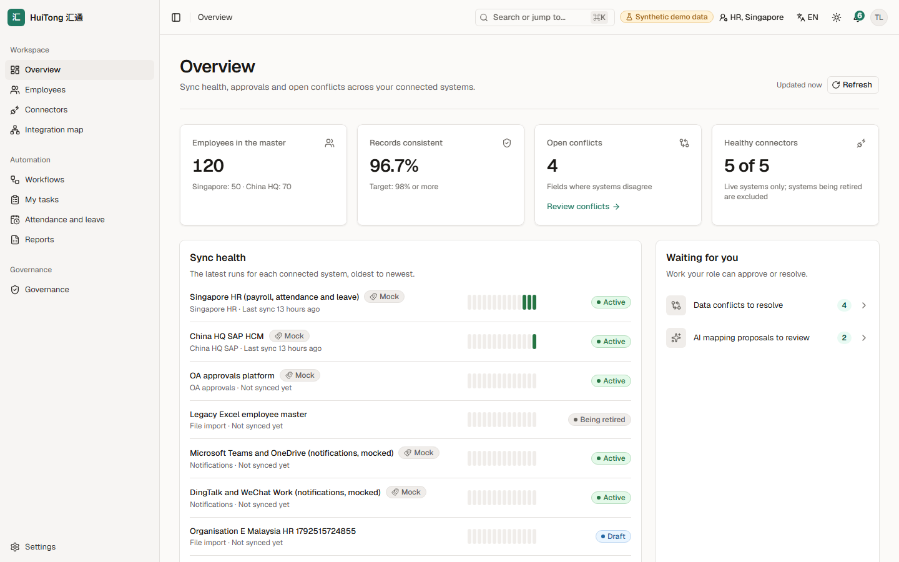
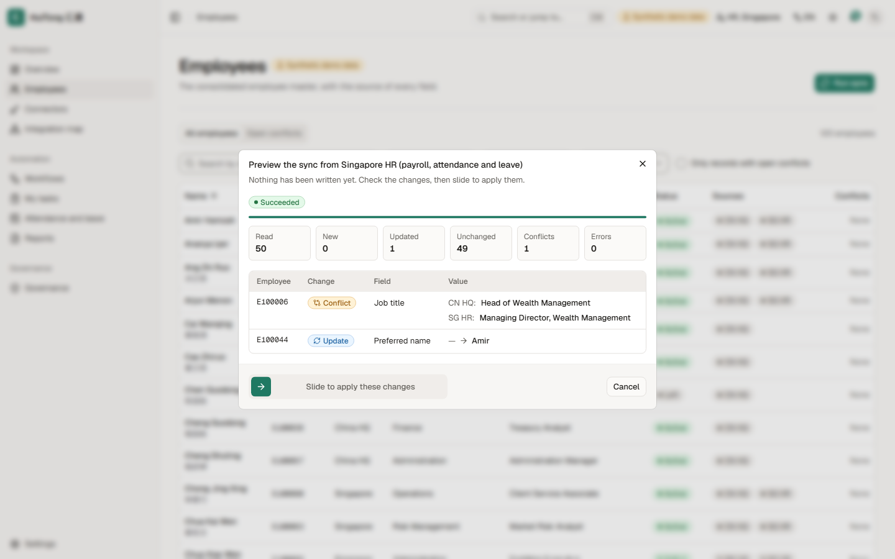
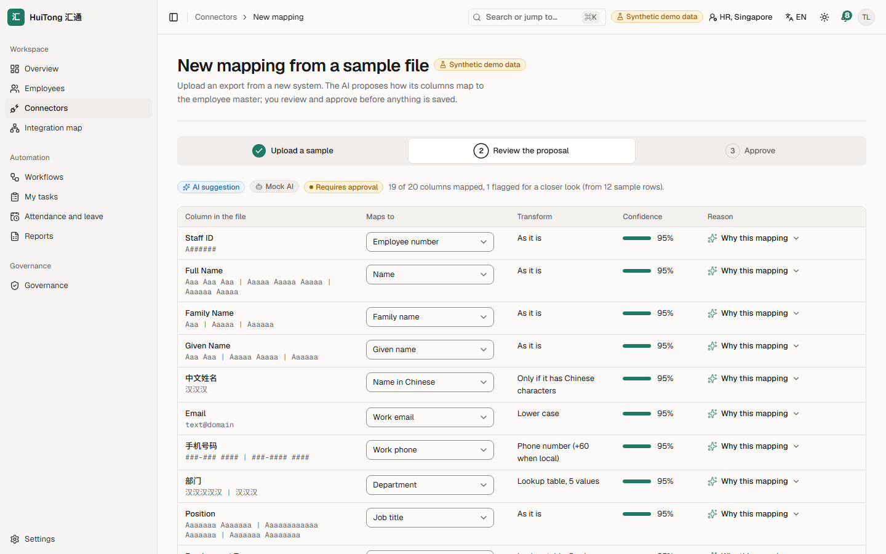
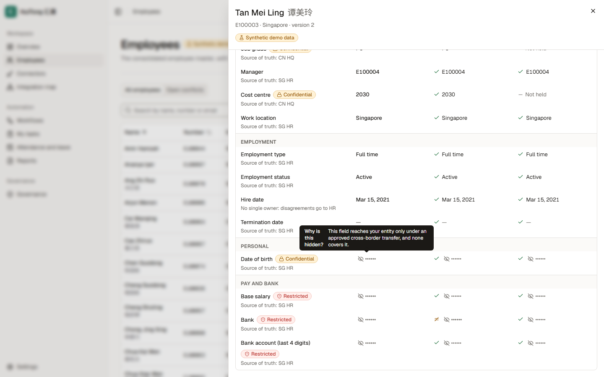
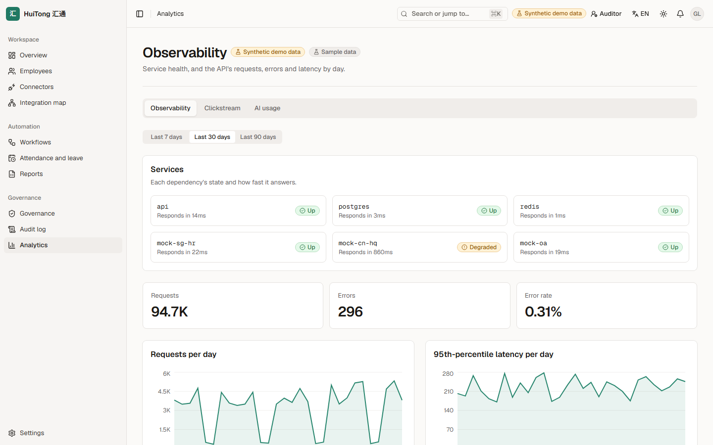
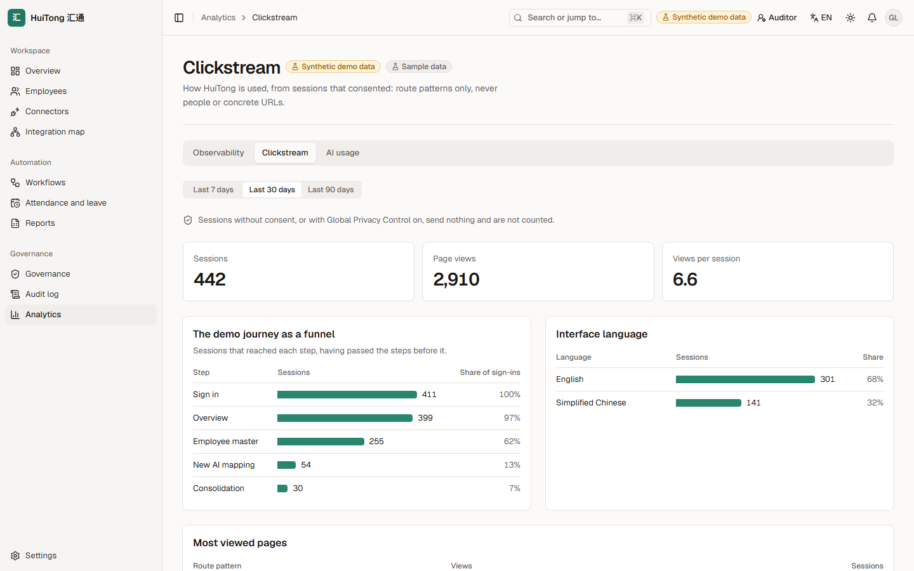
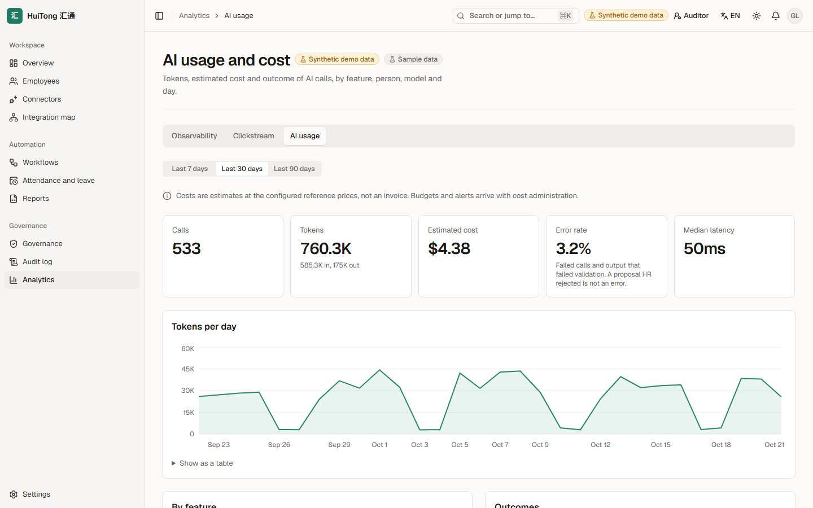

<!-- _class: lead -->
<!-- _paginate: false -->
<!-- _footer: '' -->

SCCCI × NYP AI Innovation Challenge

# HuiTong 汇通

## An integration and workflow layer for Organisation E's HR systems

Richie · Iok Teck · Azri · Angelyn Problem Statement 17 · IT2134 IT Innovation Project Nanyang Polytechnic · AY2026 Semester 2

<!--
Presenter: all, opened by the team lead.

HuiTong, 汇通, means "converge and connect". It is our answer to Problem Statement 17 from Organisation E, a financial-services group with a Singapore operation and a China headquarters.

In one sentence: HuiTong connects the HR systems the group already runs, so approved data flows between them instead of being re-keyed through Excel.

Everything you will see runs on synthetic data, and every system outside HuiTong is a clearly labelled mock until we meet the client's IT team.
-->

---

The problem

# Mei Ling is the integration

## A Singapore HR executive, on the second working day of the month

<ol class="timeline">
<li><time>08:45</time>Copies an approved OA request into her recruitment tracker</li>
<li><time>09:30</time>Keys yesterday's joiner into SG HR, then into the Excel master</li>
<li><time>11:00</time>Works out which job title is right when SAP and SG HR disagree</li>
<li><time>13:30</time>Exports attendance and leave, and asks HQ for theirs on WeChat</li>
<li><time>15:30</time>Fixes HQ's garbled Chinese headers and YYYY/MM/DD dates</li>
<li><time>18:30</time>Leaves with the month's consolidation half done</li>
</ol>

> "We have four systems, and I am still the one connecting them, one spreadsheet at a time."

A proto-persona with an illustrative quote, built from the problem statement and desk research, to be validated with Organisation E.

<!--
Tan Mei Ling is our primary persona: an HR executive supporting the Singapore entity.

Her day is not hard because any one system is bad. It is hard because she is the only link between them: she copies from OA, re-keys into SG HR and the Excel master, and reconciles what the China HQ system says.

Month-end is the worst of it. HQ's file arrives with Chinese headers, a different date format and sometimes a different encoding, and she maps leave categories such as 年假 and 调休 by hand.

Be clear that this is a proto-persona: we test it with the client in the first meeting.
-->

---

Root cause

# Digital, but isolated

## Every system works on its own. Nothing connects them, so people do.

From Problem Statement 17: approvals happen in OA but the follow-up work happens elsewhere, and the Excel master is the only consolidated view.

<!--
The root cause is in the problem statement itself: the group digitalised its tasks, but never connected the systems, so task-level digitalisation never became end-to-end automation.

OA approves a hire, but someone copies it onward. SG HR and China HQ hold the same people in different structures. The Excel master is the only place they meet, HR keeps it alive by hand, and HR consolidates the management reports by hand every month.

The fix is therefore not another system to replace them, but a layer between them.
-->

---

What success looks like

# Enter it once, and let it flow

~16 h → ≤ 2 h

HR hours a month consolidating attendance and leave

3–5 work days → &lt; 5 min

From an OA approval to the onboarding checklist

~3 → 1

Times each new hire's details are typed by hand

Weeks → &lt; 1 day

To connect a new subsidiary's HR export

The baselines are assumptions until we measure them with Organisation E. No gain may cost a guardrail: AI never writes without a person's approval, no national ID numbers are stored, and another entity's data is seen only as the transfer register allows.

<!--
These are the outcomes we commit to measure, from our success metrics.

Monthly consolidation drops from about sixteen hours to two or less. An approved manpower request becomes an onboarding checklist in minutes, not days. A new hire's details are typed once, at the source. And a new subsidiary's export is mapped and approved in a day, through configuration.

Every baseline is an assumption today; the first client meeting is where we measure the real ones. The guardrails matter as much as the gains: speed never comes at the cost of approval, privacy or cross-border rules.
-->

---

<!-- _class: diagram -->

The solution

# An integration layer, not a replacement

## Every system of record stays, behind one adapter each; only the Excel master retires

<!--
The client asked for a feasible architecture that extends to other functions and subsidiaries, not a global platform that replaces everything.

So every system of record stays where it is, each behind one adapter, and HuiTong keeps one employee master that records where every value came from. HR stops re-keying and settles only the exceptions: the conflicts between systems, and the AI's mapping proposals.

What runs today: OA's signed approvals are verified, stored once with an audit record and published from an outbox; SG HR and China HQ sync into the master; and a new subsidiary, such as the Malaysia demo, gets an AI-proposed mapping that HR approves and saves as a version, with no code change. From week 8, area 2's workflow picks up the approvals, with retries, and importing a subsidiary's file through its mapping is the next story, A-5. The dotted parts are designed but not built: the Excel master's one-off import and area 3's consolidated reports.
-->

---

<!-- _class: diagram -->

Architecture

# One web app, one API, the systems around it

<!--
The architecture is deliberately plain. The React 19 app is served by nginx, with a content security policy that allows no inline or third-party scripts, and nginx proxies the API. The NestJS API has a module per domain, each owned by one area, with BullMQ jobs and their retries; PostgreSQL 18 holds the data and Redis the queues. AI calls go through one gateway, with a deterministic mock by default.

The mock systems are separate services with deliberately different schemas, Chinese keys and SAP-like codes for HQ, so the integration problems are real even though the data is not.

Everything runs with one command, docker compose up. The AWS target, with Fargate, RDS and CloudFront, is designed in ADR 0014 and drawn in docs/architecture; area 4 deploys it. All seventeen diagrams, from today's problem to the data model, are explained there, with their sources in docs/diagrams.
-->

---

A key workflow

# One approval, four areas

## Arjun's manpower request for a relationship manager, end to end

<ol class="steps">
<li>OA's signed approval arrives, and is stored once Areas 1 and 2 · Receiving built</li>
<li>The requisition, the onboarding checklist and the preparation tasks appear Area 2</li>
<li>A draft employee record, linked to the request Areas 1 and 2</li>
<li>SG HR's verified record activates the draft Area 1 · Sync built</li>
<li>Reconciled with HQ's record by the group employee number Area 1 · Matching built</li>
<li>Later leave imported and mapped: 年假, 病假, 调休 Area 3</li>
<li>HQ's report holds only the fields HQ may hold Areas 3 and 4 · Area 1's allowlist built</li>
<li>The overview shows the history and any exceptions All areas · Overview built</li>
</ol>

Playwright runs this journey as E2E #1 on every pull request: step 1 runs today, and each other step is marked with its story until that story lands.

<!--
Presenters, as in the hero-journey presenter plan: area 2's owner walks steps 1 to 3, area 1 steps 4 and 5, and area 3's owner steps 6 and 7.

This is the hero journey: one approval followed through all four areas. Arjun, a hiring manager, raises a manpower request in OA, and every approver signs it off.

Area 1 receives the signed approval once; area 2 turns it into tasks with owners and due dates. The master holds only a draft record until the verified record arrives from SG HR, so an approval never creates an active employee. Later, area 3 maps the employee's leave into the group's categories, and HQ's report holds only the fields HQ may hold.

Be precise about what runs. Step 1 runs end to end in E2E #1 today. The green tags name the building blocks that are built: the SG HR sync, matching on the employee number, area 1's allowlist, which E2E #3 already tests, and the overview. Those steps join the journey when the steps before them land. Activation (B-6) and HQ's report (D-4) come in weeks 9 and 10, and the rest is each owner's to build from week 8.
-->

---

The product today

# Built on the real API, with synthetic data

<figure>

<figcaption><strong>The overview</strong>Sync health and the work waiting for HR; every mock is labelled</figcaption></figure>
<figure>

<figcaption><strong>A sync, previewed</strong>Nothing is written until HR has seen the changes and the conflicts</figcaption></figure>

<!--
These are real screenshots of the running product, in English; every screen also works in Chinese, and in a dark theme. Every system outside HuiTong carries a Mock badge.

The overview shows the master's size and consistency, the sync health of each system, and the work waiting for HR: here four data conflicts and two AI mapping proposals.

A sync is previewed before HR applies it. Here SG HR and HQ disagree on a job title, so the preview shows a conflict instead of overwriting either value. HR applies the change with a slide, and the apply writes exactly what the preview showed; if the source has changed since, it writes nothing.
-->

---

AI, with a person in charge

# The AI proposes; HR decides

- **Maps** columns to the master, Chinese headers too
- **Explains** disagreements, in English or 中文
- **HR decides,** and every approval is audited
- **No identifiers** ever reach the model
- **Every call** recorded: tokens, cost, outcome

<!--
AI does two jobs in HuiTong, and both are advisory.

The mapping assistant reads a new system's sample file, Chinese headers included, and proposes how each column maps to the canonical model, with a confidence and a reason. Here it maps 中文姓名 to the name in Chinese and 手机号码 to the work phone, and the whole proposal is labelled Requires approval. The explainer tells HR, in English or Chinese, why two systems disagree about a record.

Three rules hold. The AI never writes to a system of record: HR approves, and the approval is audited. No employee identifier reaches a model: the mapper sees headers, value shapes and category codes, and the explainer sees a system's value only when it identifies no one and is classified Internal or lower. And every call is recorded with its tokens, cost and outcome. By default the model is a deterministic mock, labelled Mock AI, until the client approves a real one.
-->

---

Governance, risk and sustainability

# Controls built in, not bolted on

- **Least privilege:** seven roles, by entity
- **Masked fields** say why they are hidden
- **Preview first:** HR sees a sync before it writes
- **Every write audited,** in a hash chain
- **Cross-border:** default deny, by register

<figure>

<figcaption>Seen by HQ HR: the master, CN HQ and SG HR columns, with each hidden field's reason</figcaption></figure>

<!--
GRS is designed into three layers: the data model stores governance facts, the API enforces them so no screen can bypass them, and the UI shows people why the system behaves as it does.

Each role sees only what it needs, scoped by entity. Here an HQ user opens a Singapore record: the restricted pay fields are masked, and the date of birth is withheld because no active transfer shares it, each with its reason. A sync that a person runs is previewed first, and the server refuses an apply without a recent preview; the one exception is the demo stack's first load. Every write lands in an append-only audit log, chained by hash so tampering shows.

A user in one entity sees another entity's employee values only where an active entry in the cross-border transfer register shares them, with Singapore's PDPA and China's PIPL in mind; every other value is withheld by default, in the API today and in exports when they are built. Where the hub runs, and whether China HQ's data must stay in China, is a question for the client (Q-37 and Q-39).

For sustainability, one governed master replaces the emailed Excel copies, and the 3D map draws only while it is on screen.
-->

---

Deploy and monitor

# Watching it run: health, usage and AI cost

<figure><figcaption><strong>Observability</strong>Requests, errors and the error rate</figcaption>

</figure>
<figure><figcaption><strong>Clickstream</strong>First-party, from consenting sessions only</figcaption>

</figure>
<figure><figcaption><strong>AI usage</strong>Calls, tokens, estimated cost and latency</figcaption>

</figure>

The dashboards show labelled sample data until area 4 builds the aggregations, in weeks 14 to 16.

<!--
Presenter: area 4's owner.

The module asks for observability, clickstream analytics and AI token tracking, each with its own dashboard, and all three screens exist today.

Observability shows service health, request volumes, errors and latency. Clickstream is first-party: it records route patterns, never raw URLs or personal data, and only from sessions that consented. AI usage shows the calls, tokens, estimated cost and outcome of every model call, by feature.

Be clear that the dashboards show labelled sample data for now; area 4 builds the real aggregations, with CloudWatch on AWS, in weeks 14 to 16.
-->

---

Next

# Roadmap, and what we need to ask

<ol class="timeline weeks">
<li><time>W5</time>The proposal, on this prototype</li>
<li><time>W8 to W12</time>Each area builds its core logic</li>
<li><time>W13</time>The technical review</li>
<li><time>W14 to W16</time>Observability, clickstream and AI token tracking</li>
<li><time>W18 and W19</time>The final presentation, then the client check-in</li>
</ol>

### Questions for Organisation E

- Which HR products run in Singapore and at HQ, and what APIs or exports do they offer?
- Which OA product runs the approvals?
- Is there one group employee number in both systems?
- Where may employee data be stored and processed?
- May HuiTong write back to the systems of record?

<!--
The build follows the module's schedule: this prototype for the proposal, each area's core logic from week 8, the technical review in week 13, then monitoring in weeks 14 to 16.

Everything outside HuiTong is mocked until we meet the client, so these questions come first. Which systems and vendors run today, and what interfaces they offer. Whether one employee number links people across systems. Where personal data may be stored and processed. And whether HuiTong may ever write back to a system of record.

The full list, with their priorities, is in docs/client/questions-for-client.md.
-->

---

The team

# Four areas, each owned end to end

Area 1<h3>Integration core and platform</h3>
Connectors, the employee master, mappings and the AI assistant, syncs and conflicts, access enforcement, the platform and the integration map
Richie, team lead

Area 2<h3>Workflow automation</h3>
OA approvals through to onboarding: the state machine, retries, SLAs and notifications
Owner to be named by W3

Area 3<h3>Attendance, leave and reporting</h3>
Both HR systems' attendance and leave, the category mapping, the company template and reports
Owner to be named by W3

Area 4<h3>Governance, security and monitoring</h3>
Administering access and the transfer register, the audit-log viewer, observability, clickstream and AI cost, and the AWS deployment
Owner to be named by W3

Richie, Iok Teck, Azri and Angelyn. From week 8 each member builds the area they own, and explains that code at W13 and W18.

<!--
Presenter: all.

HuiTong is split into four ownership areas, so every member owns, builds and can explain a distinct part of the system.

Area 1 is the integration core and the shared platform, including the enforcement of access and masking. Area 2 automates the workflow from approval to onboarding. Area 3 consolidates attendance and leave into the company's reports. Area 4 administers governance, and owns security monitoring and the AWS deployment.

Replace "Owner to be named by W3" with each owner's name once the team confirms them in the W3 project plan. Thank you; we are happy to take questions.
-->
