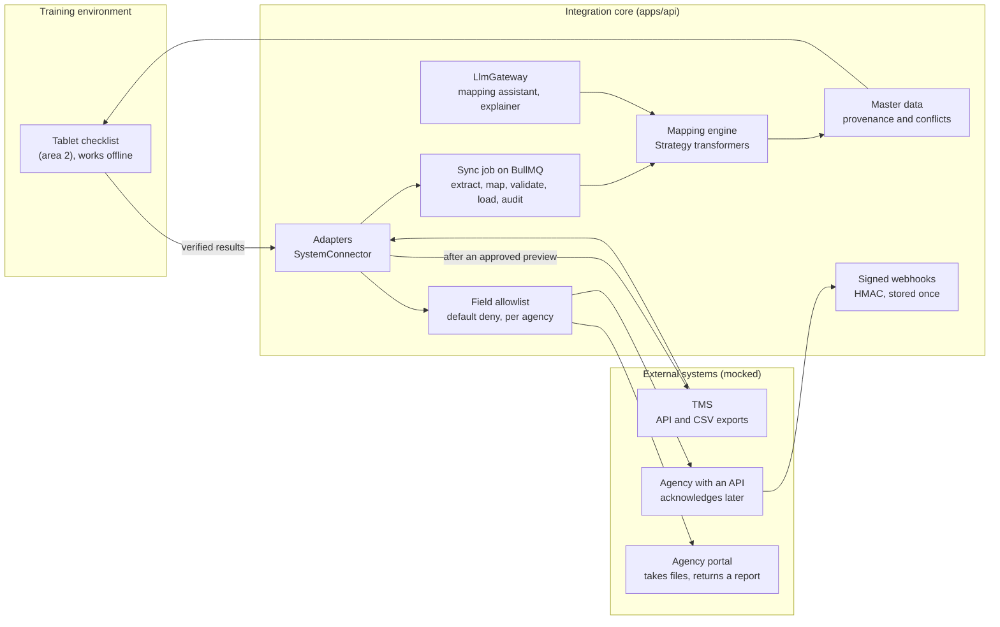

# Area 1: Integration core and platform

This guide explains how area 1 works, the design patterns it uses, what it gives the other areas, and where it goes next for Problem Statement #5: ASPRI-IPI's assessments, captured once on a tablet and carried into the Training Management System (TMS) and on to the agencies, MOM (AMS), SSG/WSDA and ITE (STEP). Area 1 is owned by Richie and covers three capabilities from [CLAUDE.md](../../CLAUDE.md) section 4, besides the shared platform:

| Capability      | What area 1 builds                                                                                                                                                                                                                                                                                         |
| --------------- | ---------------------------------------------------------------------------------------------------------------------------------------------------------------------------------------------------------------------------------------------------------------------------------------------------------- |
| A Connector hub | One adapter per external system behind `SystemConnector`, built by a factory from configuration: the TMS (its API and its CSV exports), each agency's API, and the delivery of agency files to their portals, with the status of every submission; the sync job; signed webhooks; the tenant configuration |
| B Master data   | Trainees, assessors, courses and course runs, with a source of truth and provenance for every field, change history, and conflicts for a person to settle; trainees matched on the TMS trainee ID only; each agency's allowlist enforced                                                                   |
| E AI assistance | The `LlmGateway` that every assistant uses, the mapping assistant for TMS exports and agency layouts, and the discrepancy explainer, all advice that a person must approve                                                                                                                                 |

Everything external is mocked until the client's interfaces are known ([A-84](../assumptions.md)), and every mock is labelled. The rules that shape the design are in the [GRS document](../grs/grs-by-design.md) and the ADRs, above all [0002](../adr/0002-integration-layer-hub-and-spoke.md) (hub and spoke), [0008](../adr/0008-jobs-events-realtime.md) (jobs, events and live updates), [0011](../adr/0011-ai-gateway-human-in-the-loop.md) (AI with a human in the loop) and [0023](../adr/0023-retarget-ps5-aspri-ipi.md) (the retarget to #5).

## Where the code stands

The platform and the mechanisms this guide describes are built and carry over to #5: the connector framework, the sync with its preview and apply, the file import, the mapping engine and its AI assistant, master data with provenance and conflicts, masking, the field allowlist, the AI gateway and the live events. The adapters, the mock systems, the seed data and the master-data pages were built for an earlier statement, around three HR systems (the `sg-hr`, `cn-hq` and `oa` connectors and the `services/mock-*` apps that stand in for them). They are replaced in prompt 005's steps 4 and 5, through these stories:

| Story                                                                                                                                                                                                                                                                                                                                                                           | What it changes                                                                                                                     |
| ------------------------------------------------------------------------------------------------------------------------------------------------------------------------------------------------------------------------------------------------------------------------------------------------------------------------------------------------------------------------------- | ----------------------------------------------------------------------------------------------------------------------------------- |
| [A-13](../agile/backlog.md#a-13-document-the-data-formats-keep-real-samples-out-of-git)                                                                                                                                                                                                                                                                                         | The TMS's and each agency's formats documented; a samples folder git ignores                                                        |
| [A-14](../agile/backlog.md#a-14-tms-mock-courses-runs-trainees-and-results), [A-15](../agile/backlog.md#a-15-agency-mocks-an-api-that-acknowledges-later-and-a-portal-that-validates-files)                                                                                                                                                                                     | The TMS mock, and the agency API and portal mocks, replace the three HR mocks                                                       |
| [A-16](../agile/backlog.md#a-16-read-courses-runs-and-trainees-from-the-tms), [B-8](../agile/backlog.md#b-8-trainees-assessors-courses-and-runs-in-master-data)                                                                                                                                                                                                                 | The TMS connector, and master data for trainees, assessors, courses and runs (the `employees` module renamed)                       |
| [A-17](../agile/backlog.md#a-17-write-verified-results-to-the-tms-after-an-approved-preview) to [A-19](../agile/backlog.md#a-19-deliver-an-agencys-file-and-record-the-portals-validation-report)                                                                                                                                                                               | Verified results written to the TMS, submitted to an agency's API, and delivered as an agency's file                                |
| [B-9](../agile/backlog.md#b-9-each-agency-receives-only-its-allowlisted-fields)                                                                                                                                                                                                                                                                                                 | Each agency becomes a destination of the field allowlist                                                                            |
| [A-20](../agile/backlog.md#a-20-tenant-configuration-another-training-provider-joins-by-configuration), [A-21](../agile/backlog.md#a-21-integration-map-from-the-tablets-to-the-tms-and-the-agencies), [P-10](../agile/backlog.md#p-10-overview-runs-verification-the-tms-and-submissions), [E-6](../agile/backlog.md#e-6-mapping-assistant-for-tms-exports-and-agency-layouts) | The tenant configuration, the integration map and the overview for #5, and the mapping assistant for TMS exports and agency layouts |

Until those land, the sections below name today's adapters where they describe them. This guide is updated in the same pull request as each of those stories.

## The architecture at a glance

The code lives in five API modules and three web features:

| Where                                                                                                             | What                                                                                              |
| ----------------------------------------------------------------------------------------------------------------- | ------------------------------------------------------------------------------------------------- |
| [`modules/connectors`](../../apps/api/src/modules/connectors/)                                                    | Adapters, the factory, the sync pipeline and job, sync runs, file imports, signed webhooks        |
| [`modules/mapping`](../../apps/api/src/modules/mapping/)                                                          | The mapping engine, transformers, versioned mapping configs, the mapping wizard's back end        |
| [`modules/employees`](../../apps/api/src/modules/employees/)                                                      | Master data, the field merge rules, conflicts and their resolution; renamed for trainees with B-8 |
| [`modules/access`](../../apps/api/src/modules/access/)                                                            | The field allowlist: the destination policy and the field masker                                  |
| [`modules/ai`](../../apps/api/src/modules/ai/) and [`infrastructure/llm`](../../apps/api/src/infrastructure/llm/) | The gateway, the providers, usage tracking, and area 1's two AI features                          |
| [`features/employees`](../../apps/web/src/features/employees/)                                                    | The master-data page; renamed with B-8                                                            |
| [`features/connectors`](../../apps/web/src/features/connectors/)                                                  | The connector pages, the Run sync dialog and the mapping wizard                                   |
| [`features/integration-map`](../../apps/web/src/features/integration-map/)                                        | The 3D integration map and its accessible list                                                    |

The contracts both sides share are zod schemas in [`packages/shared/src`](../../packages/shared/src/): `connectors/`, `mapping/`, `employees/`, `events/` and `realtime/`.

## Connectors

Every external system sits behind [`SystemConnector`](../../apps/api/src/modules/connectors/adapters/system-connector.ts) (Adapter). The sync never sees a vendor's API shape, paging or authentication, only the operations the interface names, so replacing a mock with the client's real system means writing one class.

[`ConnectorFactory`](../../apps/api/src/modules/connectors/connector-factory.ts) (Factory) builds the right adapter from a `connectors` row. Settings come from the row; credentials come only from the typed configuration (environment or secret store), so the database never holds a secret. [`HttpJsonClient`](../../apps/api/src/modules/connectors/adapters/http-json-client.ts) validates every response against a zod schema before anyone uses it and retries transient failures, and [`minimise.ts`](../../apps/api/src/modules/connectors/adapters/minimise.ts) cuts a sensitive number down inside the adapter, so the full value is never stored.

For #5 the hub has three kinds of system, each one adapter class behind the same interface:

| System                   | Adapter                                                                                                                | Story      |
| ------------------------ | ---------------------------------------------------------------------------------------------------------------------- | ---------- |
| The TMS                  | Reads courses, runs and trainees through its API or its CSV exports; writes verified results after an approved preview | A-16, A-17 |
| An agency with an API    | Submits verified results with an idempotency key; its signed acknowledgement arrives later by webhook                  | A-18       |
| An agency without an API | Delivers the file area 3 renders to the agency's portal and records the portal's validation report                     | A-19       |

Today's adapters are the earlier statement's: `SgHrRestConnector` and `CnHqSapConnector` (REST and OData readers with different keys, paging and date formats), `OaWebhookConnector` (a system that only pushes signed events), [`FileImportConnector`](../../apps/api/src/modules/connectors/adapters/file-import.connector.ts) (a staged file read through its approved mapping, which the TMS's CSV exports reuse), and `OfflineConnector` (notification stubs with nothing to pull, whose health is counted wrongly until the #5 seed replaces them, [#129](https://github.com/xiu2809xiu-rgb/sccci-innovation-project/issues/129)).

**Mock labels.** A connector's `isMock` column says that a HuiTong mock stands in for the client's system. The connector cards, the connector page and the overview show a "Mock" badge for each, with a tooltip saying the data is synthetic and the system is not the client's live one ([A-8](../agile/backlog.md#a-8-label-mocked-systems-and-the-mock-ai)). Adopted from Azri's integrated plan: a mock is never presented as a live integration. When a connector is pointed at a real system, its `isMock` is set to false in the same change.

## How a sync works

A sync is always previewed first. The person who approves sees what would change, then applies exactly that preview.

1. **Start.** `POST /api/v1/connectors/:connectorId/sync` with `mode: PREVIEW` ([`SyncService`](../../apps/api/src/modules/connectors/sync/sync.service.ts)). The run is queued as a BullMQ job whose id is the run id. The `Idempotency-Key` header maps a repeated request to the same run, and a connector runs one sync at a time.
2. **Run.** [`SyncProcessor`](../../apps/api/src/modules/connectors/sync/sync.processor.ts) runs one job at a time, through [`SyncPipeline`](../../apps/api/src/modules/connectors/sync/sync-pipeline.ts) (Template Method): extract, map, validate, load and audit, always in that order. A concrete pipeline supplies the five steps for its records ([`EmployeeSyncPipeline`](../../apps/api/src/modules/connectors/sync/employee-sync.pipeline.ts) today; one for courses, runs and trainees with A-16). A record that fails a step is reported and dropped; the rest carry on, and the run ends `PARTIAL`.
3. **Progress.** [`SyncProgressReporter`](../../apps/api/src/modules/connectors/sync/sync-progress.reporter.ts) writes progress to the run and publishes `sync.progress` on the live stream. Live messages carry ids, status and counts only, never field values; the browser fetches details through the masked REST endpoints.
4. **Preview.** In `PREVIEW` mode the load step computes what it would create, update or mark as a conflict, and writes nothing. The first 200 changes are kept on the run for the Run sync dialog. The run also stores a fingerprint of all of them: `changeDigest`, from [`change-digest.ts`](../../apps/api/src/modules/connectors/sync/change-digest.ts), which covers each change and the values of each new record.
5. **Apply.** `mode: APPLY` must name a successful or partial preview of the same connector that finished in the last 30 minutes (`PREVIEW_VALID_MINUTES`, checked in [`SyncService`](../../apps/api/src/modules/connectors/sync/sync.service.ts)); the server refuses anything else, whatever the UI does. Before it writes, the apply plans every record again without writing and compares the fingerprint with the preview's. If the source has changed since, it stops with `SOURCE_CHANGED`, writes nothing, and the preview is run again. So an apply writes exactly what was seen.
6. **Retries.** A job that throws is retried by BullMQ, three attempts with backoff, and only the last attempt marks the run `FAILED`. `SOURCE_CHANGED` is not retried, because only a new preview can help. A retry is safe: unchanged records are skipped and every write is an upsert.
7. **Recovery.** A run whose job is gone (for example after Redis was reset) would stay `QUEUED` and block its connector. [`SyncRecovery`](../../apps/api/src/modules/connectors/sync/sync-recovery.ts) settles such a run as `FAILED` with the code `INTERRUPTED` and audits it, so the next sync can start.

The writes #5 adds follow the same rule: a write to the TMS and a submission to an agency each need operations' approval of a preview, are idempotent, and are audited (A-17 to A-19, [GRS](../grs/grs-by-design.md)).

## Importing a file

A file connector has no system to call, so a person brings the data: the whole export, staged on the connector's page and then synced like any other source ([A-5](../agile/backlog.md#a-5-import-a-file-through-its-approved-mapping)). The TMS's CSV exports come in this way when its API is not available.

1. **Stage.** `POST /api/v1/connectors/:connectorId/import-file` (multipart `file`, optional `encoding`) needs an approved mapping, a connector that may sync (not disabled or being retired) and no sync of it running. [`FileImportService`](../../apps/api/src/modules/connectors/imports/file-import.service.ts) reads a `.csv` or `.xlsx` file of up to 5 MB and 20,000 rows with the wizard's reader, so the encodings and the choice made when the encoding is uncertain are the same. A larger file is refused, never cut short, and so is a workbook that unpacks to more than 100 MB, counted as it inflates (the sizes a zip declares are not trusted). Rows of empty cells do not count. Each refusal names its problem (`importProblemSchema`), which the card words in either language.
2. **Minimise.** [`stageRows`](../../apps/api/src/modules/connectors/imports/staged-rows.ts) keeps only the columns the mapping reads. A national-ID or gender column is never kept, and a mapping that reads one is refused. A file that lacks a column the mapping reads is refused, naming the columns. A row is left out, and listed by the line it starts on, never by its values, when its cells do not line up with the headers, when a cell the mapping reads has the shape of a national ID number or holds an impossible date, or when its key is missing, malformed or already used by an earlier row. When no row is left, the file is refused with each reason, its first line and how many rows share it.
3. **Hold.** [`StagedImportStore`](../../apps/api/src/modules/connectors/imports/staged-import.store.ts) keeps the staged rows in Redis for 60 minutes, with the file's SHA-256 and who staged it. `GET` on the same path reads only the summary: rows, the rows and columns left out and why, the mapping version, the expiry. `DELETE` discards the file. Staging, discarding and clearing are audited (`connector.import.staged`, `connector.import.discarded`, `connector.import.cleared`).
4. **Sync.** [`FileImportConnector`](../../apps/api/src/modules/connectors/adapters/file-import.connector.ts) feeds the staged rows into the same pipeline, so the preview, the fingerprinted apply and the audit trail are those of every sync. The change digest includes the SHA-256 of the file a run read, so an apply writes only from the very file its preview read: one staged in between ends the apply with `SOURCE_CHANGED`. A file connector can sync only while a file read by its active mapping version is staged (`IMPORT_FILE_MISSING` and `IMPORT_FILE_OUTDATED` otherwise).
5. **Finish.** When an apply succeeds or partly succeeds, the file it read is deleted, in one step that leaves alone a file staged meanwhile, and a draft connector becomes active (`connector.activated`). Both happen before the run is marked finished.

On the web, [`ImportFileCard`](../../apps/web/src/features/connectors/components/import/import-file-card.tsx) on a file connector's page checks the file's type and size before sending it, words a refused file in the user's language, shows the staged summary, and refreshes the page when the file expires; Sync now in the page header then previews it. The Run sync dialog lists the records a run skips, by reason.

## Mappings

A mapping says how one system's fields become canonical fields: for each target, a source column and a transform. Mappings are configuration, not code, so a new export or a changed agency layout needs a mapping rather than a release.

- **Transforms.** Each `kind` in [`transformSpecSchema`](../../packages/shared/src/mapping/field-mapping.ts) is one Strategy class in [`transformers/`](../../apps/api/src/modules/mapping/transformers/), found through [`TransformerRegistry`](../../apps/api/src/modules/mapping/transformers/transformer-registry.ts): `copy`, `date`, `value-map`, `name-part`, `name-full`, `phone`, `number`, `last-four-digits`, `lowercase`, `contains-script`, `constant` and `rules`. For example, `rules` derives a status from several columns, and `value-map` turns a system's codes into canonical ones.
- **The engine.** [`MappingEngine`](../../apps/api/src/modules/mapping/mapping-engine.ts) runs every field mapping of a record through its transformer. A value that fails is reported, never guessed, and an error message repeats a source value only when the target field's classification allows it.
- **Versions.** [`MappingConfigsRepository`](../../apps/api/src/modules/mapping/mapping-configs.repository.ts) keeps every version; one is active per connector. Each run records the version it used. The baseline mappings are seeded from [`baseline-mappings.ts`](../../apps/api/prisma/seed/baseline-mappings.ts); the TMS's replaces the earlier statement's with A-16.
- **Agency layouts.** For #5 the engine also runs the other way, from canonical result fields to an agency's layout, so area 3's renderers reuse the same transformers for dates and codes (D-11, E-6).

## Master data

One record per person, keyed by an identifier the source system owns, never by a national ID ([A-69](../assumptions.md)). For #5 that identifier is the TMS trainee ID ([A-68](../assumptions.md)), and the records are trainees, assessors, courses and course runs (B-8). Today the module holds the earlier statement's employee records.

- **Identity.** Only the same key confirms that two records are one person. [`possibleMatchReasons`](../../apps/api/src/modules/employees/domain/identity-matcher.ts) finds existing people a new record may duplicate: the same Chinese name, the same name in Latin script (ignoring case, spaces, hyphens and accents), the same names in another order, or the same email in another letter case. The Run sync preview lists the matches under the new record, each linking to the existing record, and the sync still creates the record on its own. Romanisation is never proof: 陈伟 and 陈玮 are both "Chen Wei" (story [B-5](../agile/backlog.md#b-5-possible-matches-for-review-never-name-only-merges), [ADR 0002 amendment](../adr/0002-integration-layer-hub-and-spoke.md#amendment-21-oct-2026-identity-matching)). Adopted from Azri's integrated plan.
- **Provenance.** Every source's value for every field is kept as a source record, so the record drawer can show the master beside what each system holds.
- **Source of truth.** [`FieldSourcePolicy`](../../apps/api/prisma/schema.prisma) rows name, per field, the connector that owns the value, or none. For #5 the TMS owns what it records about courses, runs and trainees.
- **The merge.** [`mergeField`](../../apps/api/src/modules/employees/domain/field-merger.ts) decides each field: an owned field takes the owner's value (or the source a person chose for this record) and never opens a conflict; an unowned field takes the value the sources agree on, and a disagreement opens a conflict while the master keeps what it had. A value a person typed in stands until a source changes. A master change, its provenance, its history line and any conflict commit in one transaction.
- **Conflicts.** [`ConflictsService`](../../apps/api/src/modules/employees/conflicts.service.ts) lists them, and resolves each one by choosing a source (`SOURCE_SELECTED`, which also makes that source the record's owner of the field) or typing the value with a note (`MANUAL_VALUE`). The decision, the master change and the history line commit together and are audited. A conflict the sources settle themselves closes as `DISMISSED`.
- **Masking.** Reads mask every value for the viewer's role. The platform's field-masking interceptor ([`field-masking.interceptor.ts`](../../apps/api/src/common/interceptors/field-masking.interceptor.ts)) applies the shared [`masking-policy.ts`](../../packages/shared/src/governance/masking-policy.ts), and a masked value carries the reason the UI shows as "why is this hidden". For #5, an assessor sees only the trainees of their own runs, and contact details and dates of birth are masked by role.

## The field allowlist, by default deny

A destination receives a field only when an ACTIVE entry of one register shares it, whatever the role's clearance ([`destination-policy.ts`](../../apps/api/src/modules/access/destination-policy.ts), [`FieldMasker`](../../apps/api/src/modules/access/field-masker.ts)). A response that withholds fields writes an `access.fields_withheld` audit event naming the fields and the entry versions, and an export leaves out what `FieldMasker.withheld` names (story [B-7](../agile/backlog.md#b-7-per-destination-field-allowlist-enforced-by-default-deny), [ADR 0010 amendment](../adr/0010-auth-sessions-rbac-masking.md#amendment-21-oct-2026-a-per-destination-field-allowlist-default-deny)). Adopted from Azri's integrated plan.

Today the destinations are the earlier statement's entities. With B-9 each agency becomes a destination: a submission to an agency, by API or by file, holds only the fields its ACTIVE entries share, an agency with no entry gets nothing, and every withholding is audited ([A-81](../assumptions.md), GRS R-23). Area 4 administers the entries and calls `AccessPolicyService.reload()` after a change (F-7).

## AI assistance

Every model call goes through [`LlmGateway`](../../apps/api/src/infrastructure/llm/llm.gateway.ts), which picks the configured provider (Strategy) and records the call, failed ones included, through [`AiUsageTracker`](../../apps/api/src/infrastructure/llm/ai-usage.tracker.ts): tokens in and out, model, latency, estimated cost ([A-52](../assumptions.md)), feature, user and outcome. The gateway never writes to a system of record. Area 3's rule-drafting assistant and area 2's verification assistant use the same gateway.

| Provider                                                                                        | When                                                                                                                     |
| ----------------------------------------------------------------------------------------------- | ------------------------------------------------------------------------------------------------------------------------ |
| [`MockLlmProvider`](../../apps/api/src/infrastructure/llm/providers/mock-llm.provider.ts)       | The default: deterministic, offline, no API key. Each feature registers a responder that gives the answer a model would. |
| [`BedrockLlmProvider`](../../apps/api/src/infrastructure/llm/providers/bedrock-llm.provider.ts) | `LLM_PROVIDER=bedrock`: AWS Bedrock through the Converse API, in `ap-southeast-1` by default                             |
| [`OpenAiLlmProvider`](../../apps/api/src/infrastructure/llm/providers/openai-llm.provider.ts)   | `LLM_PROVIDER=openai` with `OPENAI_API_KEY`                                                                              |

**The mapping assistant.** A sample export (CSV or Excel, up to 1 MB) is uploaded in the mapping wizard. [`SampleFileReader`](../../apps/api/src/modules/mapping/proposals/sample-file-reader.ts) reads the headers and at most 20 rows, evaluates nothing and stores nothing. It decodes a CSV file as UTF-8 (with or without a byte-order mark) or GB18030; when both readings are plausible, the wizard shows the header row both ways and the user chooses ([`text-encoding.ts`](../../apps/api/src/modules/mapping/proposals/text-encoding.ts), [dates, time zones and encodings](../architecture/data-formats.md)). [`buildMappingRequest`](../../apps/api/src/modules/mapping/proposals/mapping-request.builder.ts) tells the model each column's header and the shape of its values. For a category column whose values repeat, it also sends the distinct codes (at most eight), so that the model can propose a value map. A header that names a person is never a category column, and a value shaped like an identifier is never sent. It never sends a personal value ([A-17](../assumptions.md), [ADR 0011](../adr/0011-ai-gateway-human-in-the-loop.md#amendment-21-oct-2026-category-codes-in-the-mapping-prompt)), and columns that hold national ID numbers or gender are left out of the prompt entirely, not even their headers ([`prohibited-columns.ts`](../../apps/api/src/modules/mapping/proposals/prohibited-columns.ts)). [`SchemaMappingAssistant`](../../apps/api/src/modules/ai/schema-mapping/schema-mapping.assistant.ts) re-checks the answer on the server. The proposal shows each column's target, transform, confidence and reasons, labelled "Requires approval". Only an approval by someone with `mappings:approve` saves a new mapping version ([`MappingProposalsService`](../../apps/api/src/modules/mapping/proposals/mapping-proposals.service.ts)); a mapping that reads a national ID column is never saved. For #5 it proposes mappings for TMS exports and agency layouts (E-6).

**The discrepancy explainer.** [`DiscrepancyExplainer`](../../apps/api/src/modules/ai/discrepancy/discrepancy-explainer.ts) explains a conflict in English or 中文 for a person to read before deciding. The model learns the field and each system's value, but never who the record belongs to. Values above `INTERNAL`, and values that identify a person, are withheld ([ADR 0011](../adr/0011-ai-gateway-human-in-the-loop.md#amendment-21-oct-2026-no-employee-identifiers-in-any-prompt)). The answer is advice only: it never changes a record.

**The "Mock AI" label.** With the `mock` provider, the answers come from deterministic rules, not from a model. The wizard's review step and the explainer then show a "Mock AI" badge next to the output, so a hard-coded answer is never presented as working AI. The label follows the provider recorded on each proposal and explanation, so output from a real model carries none.

### Switching the AI provider for a demo

The `mock` provider is the default for development, CI and rehearsals: it needs no key and no data leaves the API. To show a real model:

1. **Check the data first.** Demos use synthetic data only. Prompts never carry a trainee identifier, a result or a value above `INTERNAL`, and client data may reach an outside AI service only with the client's written permission ([GRS R-09](../grs/grs-by-design.md)).
2. **Configure Bedrock** in `.env`, or in the deployment's secrets: `LLM_PROVIDER=bedrock`, `LLM_MODEL` set to a model id enabled in the AWS account, and `BEDROCK_REGION` (default `ap-southeast-1`). AWS credentials come from the standard AWS credential chain (a named profile locally, the task role on AWS), never from the repository. `openai` works the same way with `OPENAI_API_KEY`, but stays off for client data.
3. **Restart the API** (`docker compose up -d api`, or restart `pnpm dev`). The API refuses to start if `LLM_MODEL` is missing.
4. **Check the switch.** Upload a sample in the mapping wizard: the proposal carries no "Mock AI" badge, and its AI usage record shows the real provider, model and token counts.
5. **Switch back** to `LLM_PROVIDER=mock` after the demo.

With a real model, answers vary between runs, take seconds rather than milliseconds, and cost money; every call is still costed by `AiUsageTracker`. Rehearse with the model the demo will use (story [E-4](../agile/backlog.md#e-4-run-the-assistants-on-aws-bedrock)).

## Signed webhooks and the events other areas use

An external system that pushes events calls a webhook. [`OaWebhookService`](../../apps/api/src/modules/connectors/webhooks/oa-webhook.service.ts) verifies the HMAC signature over the raw body with a constant-time comparison and a replay window ([`oa-signature.ts`](../../apps/api/src/modules/connectors/webhooks/oa-signature.ts)), validates the body, stores it once (`(source, eventId)` is unique, so a redelivery is a no-op) and then publishes the domain event. The stored row doubles as the outbox: it becomes `PROCESSED` once a subscriber has taken the event and `FAILED` if a subscriber throws, and [`WebhookOutboxProcessor`](../../apps/api/src/modules/connectors/webhooks/webhook-outbox.processor.ts) republishes events still waiting every two minutes ([A-3](../agile/backlog.md#a-3-receive-signed-webhooks-safely)). Today it receives the earlier statement's approval events; with A-18 it receives each agency's acknowledgements, and the event they publish is named here.

| Event                                                                            | Where                                  | Payload                                           | Who uses it                                               |
| -------------------------------------------------------------------------------- | -------------------------------------- | ------------------------------------------------- | --------------------------------------------------------- |
| `sync.progress`, `sync.run.completed`, `sync.run.failed`                         | The live stream (`GET /api/v1/events`) | Run id, connector, mode, status, stage and counts | The Run sync dialog, the connector pages and the overview |
| `conflict.detected`, `conflict.resolved`, `mapping.proposed`, `mapping.approved` | The live stream                        | Ids (and a conflict's field name), never values   | The master-data and connector pages refetch               |

**For areas 2 and 3.** Subscribe with `@OnEvent(...)`, validate the payload with its shared schema, ignore an event id you have already handled (the outbox may deliver an event again), and enqueue the durable work on a BullMQ queue. Keep the handler thin, and throw only when the event could not be accepted: the handler runs after area 1's transaction has committed, and a throw marks the stored event `FAILED`.

## The web UI

- **Master data** ([`employees-page.tsx`](../../apps/web/src/features/employees/employees-page.tsx), renamed with B-8): the list keeps its search, filters, sort and page in the URL; the record drawer shows the master beside each source, with masked values explained, the record's conflicts and its history, and links to its audit trail. A conflict is settled in a dialog that takes a deliberate press and hold (HoldButton), and the explainer runs from the same dialog (ThoughtLine).
- **Run sync** ([`run-sync-dialog.tsx`](../../apps/web/src/features/connectors/components/sync/run-sync-dialog.tsx)): preview, then apply with a slide or two taps (SlideCommit). The dialog follows the run live and polls when the live stream is down, and its description follows the outcome: in sync, applied, partly applied or failed, with errors translated by code.
- **Connectors** ([`connector-list-page.tsx`](../../apps/web/src/features/connectors/pages/connector-list-page.tsx), [`connector-detail-page.tsx`](../../apps/web/src/features/connectors/pages/connector-detail-page.tsx)): each system's status, health, last sync and mapping version, its settings and its sync history, and for a file connector the import of its staged file.
- **The mapping wizard** ([`mapping-wizard-page.tsx`](../../apps/web/src/features/connectors/pages/mapping-wizard-page.tsx)): upload a sample, review the proposal, then approve it for a new or an existing file connector, or reject it with a reason. The proposal's id is in the URL, so a review can be resumed or shared.
- **The integration map** ([`integration-map-page.tsx`](../../apps/web/src/features/integration-map/integration-map-page.tsx)): the 3D scene and, beside it, the list of systems that keyboard and screen-reader users navigate, both from the connectors and their live `sync.progress` events. [`map-model.ts`](../../apps/web/src/features/integration-map/map-model.ts) decides each system's state and where its pod stands; the scene in [`components/scene/`](../../apps/web/src/features/integration-map/components/scene/) is its own chunk, and [ADR 0021](../adr/0021-integration-map-scene.md) explains its rendering choices. To add a state, add it to `NODE_STATES` and to `NODE_STATE_STYLE` (badge tone, icon and colour token) and to both locale files: the scene, the legend and the list all read those. The models come from [`assets-src/3d/`](../../assets-src/3d/README.md) (`pnpm assets:3d`). With A-21 the map shows results flowing from the tablets to the TMS and each agency, with a portal drawn apart from an API.

## Design patterns

| Pattern              | Where                              | Why                                                                             |
| -------------------- | ---------------------------------- | ------------------------------------------------------------------------------- |
| Adapter              | `SystemConnector` and its adapters | One class per system; the sync never sees a vendor's API                        |
| Factory              | `ConnectorFactory`                 | Adapters from configuration, credentials from the environment                   |
| Strategy             | Transformers; LLM providers        | A new transform or model is one class, chosen by configuration                  |
| Template Method      | `SyncPipeline`                     | Every sync runs the same five steps with the same counting and failure handling |
| Observer             | `DomainEventBus`, `@OnEvent`       | Other areas react to area 1's events without area 1 knowing about them          |
| Repository           | `*.repository.ts`                  | The only place Prisma is called                                                 |
| Transactional outbox | The stored webhook rows            | An event published after a crash is not lost                                    |

Each one, and the platform's, is described with its files in [patterns.md](../architecture/patterns.md).

## Extending area 1 after the briefing call

| To                                           | Do this                                                                                                                                                                                                                                                                                                                                                           |
| -------------------------------------------- | ----------------------------------------------------------------------------------------------------------------------------------------------------------------------------------------------------------------------------------------------------------------------------------------------------------------------------------------------------------------- |
| Replace a mock with the client's real system | Change the adapter's base URL and credentials through the environment, and set the connector's `isMock` to false so the "Mock" badge goes. If the vendor's API differs, write a new class that implements `SystemConnector`, add a case to `ConnectorFactory`, and give it a mapping version. Writes to the client's real systems wait for the client's approval. |
| Connect another training provider            | Give it a tenant configuration (A-20): its name, connectors, field mappings, course rules and theme tokens; upload its TMS export in the mapping wizard and approve the proposal; then stage the whole export on the connector's page and sync it.                                                                                                                |
| Add an agency or change its format           | Add its connector (API or file delivery), its allowlist entry (area 4) and its template and renderer (area 3); a changed layout needs a new mapping version.                                                                                                                                                                                                      |
| Add a canonical field                        | Add it to the shared classification map and canonical schema, a Prisma migration, the masking classification and both locale files; then map it in each system's mapping.                                                                                                                                                                                         |
| Add a transform                              | Add a `kind` to `transformSpecSchema`, one Strategy class in `transformers/`, register it, and add its unit test.                                                                                                                                                                                                                                                 |
| Use a real model                             | Set `LLM_PROVIDER` (and `LLM_MODEL`) and the provider's credentials; the prompts already mark uploaded content as untrusted.                                                                                                                                                                                                                                      |
| Change who owns a field                      | Change its `FieldSourcePolicy` row. Conflicts on that field stop opening once it has an owner.                                                                                                                                                                                                                                                                    |
| Schedule syncs                               | Add a repeatable BullMQ job that starts a preview and an apply as the system user, once the client says how often the TMS's runs change.                                                                                                                                                                                                                          |

Open questions for the client are listed in [questions-for-client.md](../client/questions-for-client.md), led by the three items to request: checklists with their rules, a TMS export and one submission example per agency.

## Tests

| Kind            | Where                                                                                                                                                                                                                                                                                                                                                                                                                                                                                                                                                                                                                       | Covers                                                                                                                                                                                                                                                   |
| --------------- | --------------------------------------------------------------------------------------------------------------------------------------------------------------------------------------------------------------------------------------------------------------------------------------------------------------------------------------------------------------------------------------------------------------------------------------------------------------------------------------------------------------------------------------------------------------------------------------------------------------------------- | -------------------------------------------------------------------------------------------------------------------------------------------------------------------------------------------------------------------------------------------------------- |
| Unit            | `*.spec.ts` beside the code: [`mapping-engine.spec.ts`](../../apps/api/src/modules/mapping/mapping-engine.spec.ts), [`field-merger.spec.ts`](../../apps/api/src/modules/employees/domain/field-merger.spec.ts), [`field-masking.interceptor.spec.ts`](../../apps/api/src/common/interceptors/field-masking.interceptor.spec.ts), [`schema-mapping.spec.ts`](../../apps/api/src/modules/ai/schema-mapping/schema-mapping.spec.ts), [`sample-guards.spec.ts`](../../apps/api/src/modules/mapping/proposals/sample-guards.spec.ts), [`staged-rows.spec.ts`](../../apps/api/src/modules/connectors/imports/staged-rows.spec.ts) | Transformers, the field merge, masking, mapping-proposal validation, what a staged import keeps                                                                                                                                                          |
| API integration | [`integration-core.int-spec.ts`](../../apps/api/test/integration-core.int-spec.ts), [`mapping-proposals.int-spec.ts`](../../apps/api/test/mapping-proposals.int-spec.ts), [`oa-webhook.int-spec.ts`](../../apps/api/test/oa-webhook.int-spec.ts), [`file-import.int-spec.ts`](../../apps/api/test/file-import.int-spec.ts)                                                                                                                                                                                                                                                                                                  | Sync preview and apply, idempotency, conflicts and their resolution, masking by role, the wizard, webhook signatures and replays, and file imports, with the mock systems running in-process                                                             |
| Web             | `*.test.tsx` in the three features and `components/reactbits`                                                                                                                                                                                                                                                                                                                                                                                                                                                                                                                                                               | Each page's states, the sync dialog's outcomes, the wizard, the conflict decision, the map's states, layout, adaptive quality and live updates, and every React Bits item's keyboard and reduced-motion behaviour                                        |
| End to end      | [`smoke.spec.ts`](../../apps/web/e2e/smoke.spec.ts), [`integration-map.spec.ts`](../../apps/web/e2e/integration-map.spec.ts), [`new-subsidiary.spec.ts`](../../apps/web/e2e/new-subsidiary.spec.ts)                                                                                                                                                                                                                                                                                                                                                                                                                         | Sign-in to an approved mapping through the Docker stack, the integration map in both languages, still and paused, and another source's export mapped, staged, previewed and applied, with axe scans; rewritten for #5's journeys in step 7 of prompt 005 |

Run them with `pnpm test` (the API integration tests need PostgreSQL and Redis, as the CI job provides) and `pnpm test:e2e` against `docker compose up --build`.

## Known limitations

- The client's systems are known by name only: the TMS product, its API and exports, each agency's channel and format, and the volumes are open until the briefing call ([A-64](../assumptions.md) to [A-66](../assumptions.md), [A-71](../assumptions.md)); every adapter talks to a mock, and today's mocks are the earlier statement's until step 4.
- Real submissions need trainees' national ID numbers, which HuiTong never stores; generated files carry the internal trainee ID until the client decides ([A-69](../assumptions.md)).
- The end-to-end import tests use CSV. An Excel file goes through the same reader, whose unit tests read a workbook, but no test imports a whole workbook yet.
- One sync runs at a time per API instance, and live updates fan out in-process; a multi-replica deployment would move them to Redis pub/sub ([ADR 0008](../adr/0008-jobs-events-realtime.md)).
- The mock model's mapping comes from a word list; a real model needs the prompts reviewed against real exports.
- Scheduled syncs are not built yet.
- The integration map's frame rate was measured on the team lead's laptop, on its discrete and its integrated GPU, not on a mid-range laptop ([build report, Phase 7](../BUILD_REPORT.md#phase-7-3d-integration-map)).
- Writes to the TMS and submissions to the agencies are not built yet. When they are, each needs operations' explicit, audited approval of a preview, and they run only against the mocks until the client agrees to writes.
