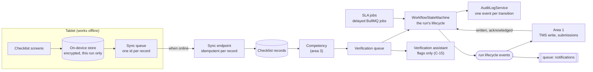

# Area 2: Assessment capture and verification

This guide is the starting point for area 2's owner, Azri. It explains what is already in the repository, what is yours to build, the design we recommend, a build plan by sprint, the risks, and how the area plugs into the rest of HuiTong. Area 2 covers capability C in [CLAUDE.md](../../CLAUDE.md) section 4, for Problem Statement #5 ([ADR 0023](../adr/0023-retarget-ps5-aspri-ipi.md)): assessors record each result once, on a tablet, during the assessment, even where there is no signal; each run moves from planned to submitted through the state machine you wrote; operations verify every result before it leaves HuiTong, and correct one only with a reason.

The ground rule is in [module ownership](module-ownership.md#ground-rules): the core logic (the run's lifecycle, the checklist and its sync, verification and corrections, the SLA logic) is yours to write. Whether the head start below is reworked for #5 by the team lead or by you is your call, relayed through the team lead (step 6 of [prompt 005](../ai/prompts/005-retarget-ps5-aspri-ipi.md)).

## What is in the repository today

| Piece             | Where                                                                                                                                                                                                                                                                                    | State                                                                                                                                                                                                    |
| ----------------- | ---------------------------------------------------------------------------------------------------------------------------------------------------------------------------------------------------------------------------------------------------------------------------------------- | -------------------------------------------------------------------------------------------------------------------------------------------------------------------------------------------------------- |
| The state machine | [`workflow-state-machine.ts`](../../apps/api/src/modules/workflows/workflow-state-machine.ts) and its tests                                                                                                                                                                              | Yours, from #147: definition-driven, so it carries over to #5 as it is ([Patterns in area 2](#patterns-in-area-2))                                                                                       |
| Data model        | `WorkflowDefinition`, `WorkflowInstance`, `WorkflowTask`, `WorkflowEvent`, `Notification` in [`schema.prisma`](../../apps/api/prisma/schema.prisma)                                                                                                                                      | Built, with indexes for the board, the task list and SLA scans. `sourceEventId` is unique, so one source event can start only one instance                                                               |
| The definition    | [`manpower-to-onboarding.ts`](../../packages/shared/src/workflows/manpower-to-onboarding.ts), seeded by [`seed/workflows.ts`](../../apps/api/prisma/seed/workflows.ts)                                                                                                                   | An earlier statement's onboarding, eight steps with their assignee role and SLA hours. The run's lifecycle replaces it                                                                                   |
| Contracts         | [`packages/shared/src/workflows/`](../../packages/shared/src/workflows/)                                                                                                                                                                                                                 | The board, instance, step, task and timeline views, their queries and the complete-task command                                                                                                          |
| API               | [`modules/workflows/`](../../apps/api/src/modules/workflows/): `GET /api/v1/workflows/board`, `GET instances`, `GET instances/:instanceId`, `GET tasks`, `POST tasks/:taskId/complete`                                                                                                   | Documented in Swagger at `/api/docs`. The reads serve typed sample data through `MockWorkflowsRepository`, and every response carries `meta.mock: true`. Completing a task answers `501 NOT_IMPLEMENTED` |
| Screens           | [`features/workflows/`](../../apps/web/src/features/workflows/): the board, the timeline, an instance and the task list                                                                                                                                                                  | Every state, EN and 中文, both themes; a "Sample data" badge while `meta.mock` is set ([screenshots](../design/screenshots/workflows/))                                                                  |
| Tests             | Unit skeletons in `modules/workflows/*.spec.ts`; [`workflows.int-spec.ts`](../../apps/api/test/workflows.int-spec.ts); [`workflows-page.test.tsx`](../../apps/web/src/features/workflows/workflows-page.test.tsx); [`workflow-pages.spec.ts`](../../apps/web/e2e/workflow-pages.spec.ts) | Real tests for the contract, the sample and the pages; cases named as `it.todo`                                                                                                                          |

**What carries over.** The state machine, the workflow models, the queues and the board's patterns carry over. The definition, the sample data (which follows an earlier statement's approval requests) and the onboarding screens do not: #5 needs the run's lifecycle, a tablet checklist and a verification queue. None of these exist yet; the tablet checklist is the first screen of the W4 prototype ([T-4](../agile/backlog.md#t-4-ui-prototype-w4)).

## The goal, with user stories

From the [backlog](../agile/backlog.md#epic-c-assessment-capture-and-verification) (edit `scripts/github/backlog.mjs`, not the page):

| Story                                                                 | Sprint | Acceptance criteria, in short                                                                                                                                                        |
| --------------------------------------------------------------------- | ------ | ------------------------------------------------------------------------------------------------------------------------------------------------------------------------------------ |
| C-2 Workflow state machine                                            | 8      | Delivered in part in #147. What remains: a failed step retries with backoff and is then flagged for a person, and every transition is audited and published as a domain event        |
| C-11 The run's lifecycle from planned to submitted                    | 8      | Planned, in assessment, captured, verified, in the TMS, submitted, closed, and nothing else; a definition on the state machine, whose code it does not change; 80% line coverage     |
| C-9 Record a run on the tablet checklist                              | 9      | The run's trainees and the checklist of its rule version; a trainee with a critical item unmarked cannot be finished; 44 px touch targets, EN and 中文; only the assessor's own runs |
| C-12 Verification queue with the evidence beside each result          | 9      | Each captured run with its course, assessor, trainees, outcomes and age; verifying is audited; nothing unverified leaves HuiTong; an assessor cannot verify                          |
| C-10 Keep capturing through a dropped connection, and sync afterwards | 10     | Results kept on the tablet, encrypted, until they sync; each record reaches HuiTong exactly once; a conflict goes to a person; the tablet is cleared after the sync                  |
| C-13 Correct a result with a reason, keeping the original             | 11     | No correction without a reason; the original, the new value, the reason, who and when are kept and audited; a result already sent is flagged so the TMS and the agencies follow      |
| C-14 SLA reminders and notifications                                  | 11     | A reminder, then an escalation, before an agency's deadline, counted from the assessment date; a captured run waiting too long reminds operations; nobody is reminded twice          |
| C-15 Verification assistant: flag unusual records for review          | 12     | Unusual records flagged with a reason and a confidence, labelled "Requires review"; operations decide; no trainee identifier or result reaches a third-party AI service              |

C-15 is proposed to area 2 in ADR 0023, because its flags appear in your verification queue; it is yours to accept or decline. The hero journey's E2E #1 holds your steps: an assessor records a run on a tablet, one record syncs after a dropped connection, and operations verify the run and correct one result with a reason. The journey and its failure matrix are rewritten for #5 in step 7 of prompt 005; the cases that are yours include offline conflicts, a duplicate sync, a rule change in the middle of a run (with area 3) and a correction after verification.

## The recommended design



**Patterns** (add each to [patterns.md](../architecture/patterns.md) as you build it):

| Pattern                  | Where it earns its place                                                                                                                                                                     |
| ------------------------ | -------------------------------------------------------------------------------------------------------------------------------------------------------------------------------------------- |
| State machine            | The run's lifecycle is a definition on your state machine: one place decides what is legal, so the tablet, the queue, the jobs and area 1's events cannot disagree                           |
| Observer (domain events) | Your lifecycle events drive area 1's TMS write and submissions, area 3's dashboards and the notifications; area 1's events move the run on ([ADR 0008](../adr/0008-jobs-events-realtime.md)) |
| Outbox on the device     | Each record waits in the tablet's sync queue until the server confirms it, so a dropped connection loses nothing                                                                             |
| Idempotency key          | A record id made on the tablet, so a retried sync stores each record once; an instance-and-step key on every job                                                                             |
| Command                  | Verifying a run and correcting a result are commands with their validation, transition, audit event and published event                                                                      |
| Repository               | Replace `MockWorkflowsRepository` with a Prisma repository bound to the same abstract `WorkflowsRepository`                                                                                  |

**The happy path.**

```mermaid
sequenceDiagram
  participant A as Assessor (tablet)
  participant H as HuiTong (area 2)
  participant R as Rules and competency (area 3)
  participant O as Operations
  participant I as Area 1 (TMS, agencies)
  A->>A: open the run while online; it stays on the tablet
  A->>A: record each trainee's criteria, offline if need be
  A->>H: sync when the connection returns (each record once)
  H->>R: calculate each outcome on the run's rule version
  H->>O: the run joins the verification queue
  O->>H: verify the run, correct one result with a reason
  H->>I: run verified (event)
  I-->>H: results in the TMS, submissions acknowledged (events)
  H->>H: the run moves to submitted, then closed
```

**Decisions that are yours** (record each in an ADR or an assumption when you make it):

- **How the run's states map onto the state machine.** The lifecycle's stages can be the definition's steps, with the instance's statuses kept for running, waiting, failed and cancelled. Whether verification is per run or per trainee decides whether one run holds one instance or one per trainee.
- **The tablet's storage.** A service worker and on-device storage ([A-82](../assumptions.md)): which library, how the data is encrypted and where its key lives, and when the run is cleared. GR-10 sets the bar: only the current run, encrypted, cleared once synced.
- **Conflicts.** What counts as a conflict when a record changed in HuiTong while the tablet was offline, and who settles it (GRS R-26).
- **SLA anchoring.** Reminders count from the assessment date to each agency's deadline ([A-77](../assumptions.md)); whether hours are calendar or working hours.
- **Notifications.** The earlier statement's chat adapters do not fit #5. In-app notifications, email or both is worth asking at the briefing call, with who does which job ([Q-81](../client/questions-for-client.md)).
- **The verification assistant.** Whether to take on C-15, and which features it looks at (computed inside HuiTong, never identifiers sent to a third party).

Decisions you recorded with the state machine in #147 still hold: one step at a time, as the definition lists them, with parallel steps a later extension; a task is due `slaHours` calendar hours after its step starts; and a cancellation blocks a task someone has picked up, with the reason, and skips a task nobody has.

## Step-by-step build plan

1. **The run's lifecycle (C-11, sprint 8).** A definition for the lifecycle on the state machine, its transitions tested first, with no change to the machine's code.
2. **The rest of C-2 (sprint 8).** A processor for `QUEUES.workflow` with backoff, so a failed step is flagged for a person after the last attempt; the service audits each transition in the same transaction and publishes a lifecycle event.
3. **The Prisma repository.** Implement `WorkflowsRepository` over the models, bind it in [`WorkflowsModule`](../../apps/api/src/modules/workflows/workflows.module.ts), remove `@ServesMockData()`, and delete the mock repository and its sample, so the "Sample data" badge disappears by itself.
4. **The tablet checklist (C-9, sprint 9).** The run's trainees from area 1's master data and the checklist from area 3's rule version; a trainee cannot be finished with a critical item unmarked; tablet-first, with 44 px targets and every state.
5. **The verification queue (C-12, sprint 9).** Captured runs with their outcomes and age; verifying is a command, audited; an assessor cannot verify.
6. **Offline capture and sync (C-10, sprint 10).** The on-device store and its sync queue, a sync endpoint that stores each record once, conflicts for a person, and the tablet cleared after the sync. Test the dropped connection in Playwright with the browser offline.
7. **Corrections (C-13, sprint 11).** A correction keeps the original and needs a reason, sends the result back to verification, and flags a result already sent so area 1 sends the correction on.
8. **SLA reminders (C-14, sprint 11).** Delayed jobs per run and agency deadline, cancelled when the run moves on. Test them with fake timers, never real time.
9. **The verification assistant (C-15, sprint 12), if you take it on.** Through the `LlmGateway`, flags only, labelled "Requires review", with every call recorded.
10. **Switch on your end-to-end steps** in the hero journey's spec in the pull request that makes each pass.

Lifecycle event names are yours to fix. We suggest `run.captured`, `run.verified`, `result.corrected` and `run.overdue`, added to `DOMAIN_EVENTS` and documented here.

## Patterns in area 2

Area 2's entries for the [design patterns register](../architecture/patterns.md), in the same format: what the pattern is, why it earns its place here, where it lives and how to extend it. Each is added as it is built, and copied into the register in a small pull request reviewed by area 1.

### State machine

**What.** A workflow instance is always in exactly one status, and a table lists which status may move to which. Every change goes through that table, so an illegal change is refused in one place.

**Why here.** The board, the API, the queue jobs and the SLA timers all change workflows. If each decided for itself what is legal, they would disagree, for example a retried job completing a workflow that HR had just cancelled. With one table, `COMPLETED`, `FAILED` and `CANCELLED` are final for every caller.

**Where.** [`WorkflowStateMachine`](../../apps/api/src/modules/workflows/workflow-state-machine.ts) runs one version of a definition, one step after another. Its commands (`start`, `completeTask`, `pause`, `resume`, `fail`, `cancel`) take the instance's current state and the time, and return the new state plus the transitions that happened (`task.completed`, `instance.cancelled` and so on). It changes nothing it is given, saves nothing, and calls no Prisma. An illegal command throws a 409 `ConflictError`. The service saves the new state and audits each transition in one transaction. The transition table is `INSTANCE_TRANSITIONS`:

| From        | May move to                                   |
| ----------- | --------------------------------------------- |
| `RUNNING`   | `WAITING`, `COMPLETED`, `FAILED`, `CANCELLED` |
| `WAITING`   | `RUNNING`, `FAILED`, `CANCELLED`              |
| `COMPLETED` | nothing                                       |
| `FAILED`    | nothing                                       |
| `CANCELLED` | nothing                                       |

Its other rules: only the current step's task can be completed, and only from `PENDING` or `IN_PROGRESS`; completing the last step completes the instance; `fail` names the step that failed, is refused when that step is no longer current (so a stale or repeated job cannot fail a later, healthy step), and blocks the step's task with the reason so the board shows where it stopped; `cancel` skips a task nobody has picked up (`PENDING`) and blocks one someone has (`IN_PROGRESS` or `BLOCKED`), so a person is flagged to undo work already under way; `pause`, `fail` and `cancel` take an optional reason (what a pause waits for, why a step failed), carried on each transition for the timeline; a definition that repeats a step key is refused; and an instance runs only on the definition version it started on. Its tests are in [`workflow-state-machine.spec.ts`](../../apps/api/src/modules/workflows/workflow-state-machine.spec.ts).

**Extend.** A new status is a new row in the table and the tests for it. Parallel steps (the admin preparation) would replace the single current step with a set of open steps.

## The risks

| Risk                                                      | Mitigation                                                                                                                                      |
| --------------------------------------------------------- | ----------------------------------------------------------------------------------------------------------------------------------------------- |
| An offline sync loses or duplicates a result              | A record id made on the tablet, stored once on the server; a test that syncs the same record twice and one that drops the connection (GRS R-26) |
| A lost or shared tablet exposes trainee data              | Only the current run on the device, encrypted, cleared after the sync; sign-in on every shared tablet (GRS R-25, GR-10)                         |
| A result changed improperly                               | A correction needs a reason, keeps the original and is audited; an assessor cannot verify (GRS R-29)                                            |
| A result leaves HuiTong before it is verified             | The lifecycle refuses it, and area 1 checks it again before any write ([A-74](../assumptions.md))                                               |
| A run assessed against the wrong rules                    | The run keeps the rule version it started with (area 3, GRS R-24)                                                                               |
| SLA tests that wait for real time                         | Fake timers, and due times computed from an injected clock                                                                                      |
| The real training environment differs from what we assume | Q-70, Q-71 and Q-74, and the sample checklists ([client questions](../client/questions-for-client.md#three-items-to-request-first))             |
| Sample data mistaken for the working product              | `@ServesMockData()` and the "Sample data" badge until the Prisma repository is bound                                                            |

## How it plugs into the platform

| You use                                                      | Where                                                                                                                                                                                                  |
| ------------------------------------------------------------ | ------------------------------------------------------------------------------------------------------------------------------------------------------------------------------------------------------ |
| The `workflow` and `notifications` queues                    | [`queue-names.ts`](../../apps/api/src/infrastructure/queues/queue-names.ts)                                                                                                                            |
| `AuditLogService.record(input, meta, tx)`                    | [`audit-log.service.ts`](../../apps/api/src/infrastructure/audit/audit-log.service.ts)                                                                                                                 |
| `DomainEventBus` and `RealtimeService`                       | [`infrastructure/events/`](../../apps/api/src/infrastructure/events/)                                                                                                                                  |
| `@RequirePermissions`                                        | [`permissions.ts`](../../packages/shared/src/auth/permissions.ts); the #5 roles' permissions are added with the roles                                                                                  |
| An assessor's runs, their trainees and courses               | Area 1's master data ([B-8](../agile/backlog.md#b-8-trainees-assessors-courses-and-runs-in-master-data))                                                                                               |
| A run's rule version and the competency calculation          | Area 3 ([D-8](../agile/backlog.md#d-8-course-rules-as-versioned-configuration), [D-9](../agile/backlog.md#d-9-calculate-competency-automatically-from-the-rules))                                      |
| Events when results reach the TMS and an agency acknowledges | Area 1 ([A-17](../agile/backlog.md#a-17-write-verified-results-to-the-tms-after-an-approved-preview), [A-18](../agile/backlog.md#a-18-submit-results-through-an-agency-api-and-track-each-submission)) |
| `LlmGateway` and `AiUsageTracker`                            | [`infrastructure/llm/`](../../apps/api/src/infrastructure/llm/), for C-15                                                                                                                              |

You expose the capture, verification and workflow endpoints, the lifecycle events, the verified results that area 1 writes and submits and area 3 renders, and the counts the overview shows.

## Which assessment requirements it covers

| Requirement           | Rows in the [traceability matrix](../requirements-traceability.md)                                                                                           |
| --------------------- | ------------------------------------------------------------------------------------------------------------------------------------------------------------ |
| M1 Design thinking    | HMW-16, HMW-17, HMW-20 and HMW-21; success metrics SM-13, SM-15 and SM-19 (M1-10)                                                                            |
| M2 GRS by design      | Verification before release, corrections with a reason, data on the tablet protected (GR-10), approval steps shown explicitly (M2-12), honest labels (M2-15) |
| M4 Best practices     | The state machine's and the lifecycle's unit tests and their coverage (M4.3-02), integration tests per module (M4.3-05), the failure matrix (M4.3-11)        |
| M6 Deploy and monitor | Sync and workflow jobs in the traces and metrics (area 4 instruments them)                                                                                   |

For the W7 mock interview, the questions to be ready for are in [module ownership](module-ownership.md#area-2-assessment-capture-and-verification-azri).
