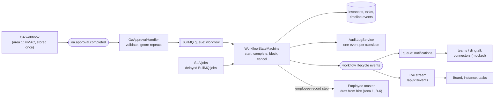

# Area 2: Workflow automation

This guide is the starting point for area 2's owner. It explains what the platform build already gives you, what is yours to build, the design we recommend, a build plan by sprint, the risks, and how the area plugs into the rest of HuiTong. Area 2 covers capability C in [CLAUDE.md](../../CLAUDE.md) section 4: an approved manpower request in OA becomes a recruitment requisition, a hire, an onboarding checklist, a draft employee record and the admin preparation, with nobody re-keying data.

The ground rule is in [module ownership](module-ownership.md#ground-rules): the platform build gives you a head start, and the core logic (the state machine, the event handlers and the SLA logic) is yours to write.

## What the head start gives you

| Piece          | Where                                                                                                                                                                                                                                                                                    | State                                                                                                                                                                                                    |
| -------------- | ---------------------------------------------------------------------------------------------------------------------------------------------------------------------------------------------------------------------------------------------------------------------------------------- | -------------------------------------------------------------------------------------------------------------------------------------------------------------------------------------------------------- |
| Data model     | `WorkflowDefinition`, `WorkflowInstance`, `WorkflowTask`, `WorkflowEvent`, `Notification` in [`schema.prisma`](../../apps/api/prisma/schema.prisma)                                                                                                                                      | Built, with indexes for the board, the task list and SLA scans. `sourceEventId` is unique, so one OA event can start only one instance                                                                   |
| The definition | [`manpower-to-onboarding.ts`](../../packages/shared/src/workflows/manpower-to-onboarding.ts), seeded by [`seed/workflows.ts`](../../apps/api/prisma/seed/workflows.ts)                                                                                                                   | Eight steps with their assignee role and SLA hours                                                                                                                                                       |
| Contracts      | [`packages/shared/src/workflows/`](../../packages/shared/src/workflows/)                                                                                                                                                                                                                 | The board, instance, step, task and timeline views, their queries and the complete-task command                                                                                                          |
| API            | [`modules/workflows/`](../../apps/api/src/modules/workflows/): `GET /api/v1/workflows/board`, `GET instances`, `GET instances/:instanceId`, `GET tasks`, `POST tasks/:taskId/complete`                                                                                                   | Documented in Swagger at `/api/docs`. The reads serve typed sample data through `MockWorkflowsRepository`, and every response carries `meta.mock: true`. Completing a task answers `501 NOT_IMPLEMENTED` |
| Screens        | [`features/workflows/`](../../apps/web/src/features/workflows/): the board, the timeline, an instance and the task list                                                                                                                                                                  | Every state, EN and 中文, both themes; a "Sample data" badge while `meta.mock` is set ([screenshots](../design/screenshots/workflows/))                                                                  |
| Tests          | Unit skeletons in `modules/workflows/*.spec.ts`; [`workflows.int-spec.ts`](../../apps/api/test/workflows.int-spec.ts); [`workflows-page.test.tsx`](../../apps/web/src/features/workflows/workflows-page.test.tsx); [`workflow-pages.spec.ts`](../../apps/web/e2e/workflow-pages.spec.ts) | Real tests for the contract, the sample and the pages; your cases named as `it.todo`, 47 in all                                                                                                          |

The sample data follows the synthetic OA requests that mock-oa serves (OA-2026-000101 to 000103), their approvers and dates, and the synthetic employee numbers. It shows a recruitment past its SLA, a hire in admin preparation with a draft record, and an on-track requisition, so every state on the screens has something to show.

## The goal, with user stories

From the [backlog](../agile/backlog.md#epic-c-workflow-automation) (edit `scripts/github/backlog.mjs`, not the page):

| Story                                                   | Sprint | Acceptance criteria, in short                                                                                                                                       |
| ------------------------------------------------------- | ------ | ------------------------------------------------------------------------------------------------------------------------------------------------------------------- |
| C-1 Start a recruitment requisition from an OA approval | 8      | One requisition per approved manpower request, even if the event arrives twice. A rejected request creates none, and its outcome is recorded                        |
| C-2 Workflow state machine from hire to day one         | 8      | A failed step retries with backoff, then is flagged for a person. An invalid transition is refused. At least 80% line coverage                                      |
| C-3 Create the employee record on hire                  | 9      | A draft (`PRE_HIRE`) record in the master with the workflow as the change source (B-6). The SG HR mock push needs HR's explicit approval, is idempotent and audited |
| C-4 Admin preparation tasks with SLA reminders          | 9      | Laptop, desk and account tasks for `ADMIN_OPS` with due dates; a reminder, then an escalation, once the SLA passes                                                  |
| C-5 Notify people in Teams or DingTalk (mocked)         | 10     | A message to the entity's mocked channel when a step completes; a retried delivery is never sent twice                                                              |
| C-6 Workflow board                                      | 10     | Each workflow in its stage with its next action and owner; completing my task moves the workflow on, audited                                                        |

Your steps in the [hero journey](../agile/hero-journey.md) are 1 to 3: the approval arrives once, the tasks appear on the board, and the draft record is linked. You present them at W5 and W18. The [failure matrix](../agile/test-plan.md) gives you five cases: duplicate, cancelled and incomplete approvals, a blocked onboarding task, and a stale event.

## The recommended design



**Patterns** (add each to [patterns.md](../architecture/patterns.md) as you build it):

| Pattern                  | Where it earns its place                                                                                                                                                                            |
| ------------------------ | --------------------------------------------------------------------------------------------------------------------------------------------------------------------------------------------------- |
| State machine            | A transition table per definition: from which status, by which event, to which status. One place decides what is legal, so the board, the API and the jobs cannot disagree                          |
| Observer (domain events) | The handler reacts to `oa.approval.completed`; your lifecycle events drive notifications, the live board and area 1's activation of draft records ([ADR 0008](../adr/0008-jobs-events-realtime.md)) |
| Repository               | Replace `MockWorkflowsRepository` with a Prisma repository bound to the same abstract `WorkflowsRepository`; the controllers and the contract do not change                                         |
| Command                  | Completing a task is one command with its validation, its transition, its audit event and its published event                                                                                       |
| Idempotency key          | The OA event id on the instance; an instance-and-step key on every job, so a retry after a partial success does nothing twice                                                                       |

**The happy path.**

```mermaid
sequenceDiagram
  participant OA as Area 1 (OA webhook)
  participant H as OaApprovalHandler
  participant Q as workflow queue
  participant SM as WorkflowStateMachine
  participant HR as HR in the task list
  participant M as Employee master (area 1)
  OA->>H: oa.approval.completed (MANPOWER_REQUEST, APPROVED)
  H->>H: validate; is this OA event id new?
  H->>Q: start(instance for the request)
  Q->>SM: start: create the instance and the requisition task
  HR->>SM: POST tasks/:id/complete
  SM->>SM: legal? next step, new task, timeline event, audit event
  SM->>M: employee-record step: a draft PRE_HIRE record
  SM-->>OA: onboarding milestones met (event), so area 1 can activate the record
```

**Statuses.** An instance is `RUNNING`, `WAITING` (paused on something outside HuiTong, such as a candidate's answer), `COMPLETED`, `FAILED` or `CANCELLED`; nothing leaves the last three. A task is `PENDING`, `IN_PROGRESS`, `DONE`, `BLOCKED` or `SKIPPED`. Keep the instance's `currentStepKey` and every task's `status` in step inside one transaction.

**Decisions that are yours** (record each in an ADR or an assumption when you make it):

- **One instance per request or per hire.** OA-2026-000101 asks for two relationship managers. One instance per request matches C-1; the steps after the offer are per hire, so they may need child tasks or one instance per hire.
- **Parallel admin steps.** The seeded definition runs laptop, desk and accounts one after another. In practice they run side by side, which needs more than one current step.
- **When an SLA clock starts.** The sample counts each step from its start. Admin preparation is better anchored to the requested day one ("three working days before"). Decide calendar or working hours too: working hours need the public-holiday calendar that area 3 counts working days with ([A-36](../assumptions.md)).
- **CN01 requests.** The definition is Singapore's (its HR steps go to `HR_SG`). Whether HQ's hires run a workflow, and with which roles, is a question for the client (Q-32, Q-33).
- **A cancelled approval** stops the workflow and flags the started tasks (failure matrix; Q-35).

## Step-by-step build plan

1. **The Prisma repository (sprint 8).** Implement `WorkflowsRepository` over the models, bind it in [`WorkflowsModule`](../../apps/api/src/modules/workflows/workflows.module.ts), remove `@ServesMockData()` from both controllers, and delete the mock repository and its sample. The integration test "drops meta.mock once the Prisma repository replaces the sample" then becomes real, and the badge disappears from the pages by itself.
2. **The state machine (C-2).** A domain class with no Prisma in it, tested first: turn the cases in [`workflow-state-machine.spec.ts`](../../apps/api/src/modules/workflows/workflow-state-machine.spec.ts) into tests one at a time.
3. **The OA handler (C-1).** Subscribe with `@OnEvent(DOMAIN_EVENTS.oaApprovalCompleted)`, validate with `oaApprovalCompletedSchema`, and enqueue the start on `QUEUES.workflow`. Throw only when the event cannot be accepted: a throw marks the stored event `FAILED`, and area 1's outbox republishes waiting events ([area 1 guide](area-1-integration-core.md#oa-webhooks-and-the-events-other-areas-use)).
4. **Jobs and retries (C-2).** A processor for `QUEUES.workflow` with backoff; after the last attempt the instance is `FAILED` and shows on the board.
5. **Completing a task (C-6).** Implement `WorkflowsService.completeTask`: only the assignee role may complete, the transition goes through the state machine, and `AuditLogService.record` is called in the same transaction. Publish a lifecycle event and a live message, then refetch on the board.
6. **The employee record step (C-3).** Call area 1's draft-from-hire use case, which area 1 builds with B-6. The push to SG HR waits for HR's explicit approval of a preview and goes to the mock only ([A-21](../assumptions.md)).
7. **SLA reminders and escalations (C-4).** Delayed jobs per open task, cancelled when the task completes. Test them with fake timers, never real time.
8. **Notifications (C-5).** Through the `teams` and `dingtalk` connectors (mocked) on `QUEUES.notifications`, with a delivery key so a retry never sends twice; each delivery appears on the instance timeline.
9. **Switch on your end-to-end steps.** Turn off `fixme` for steps 2 and 3 in [`hero-journey.spec.ts`](../../apps/web/e2e/hero-journey.spec.ts) in the pull request that makes each pass.

Lifecycle event names are yours to fix. We suggest `workflow.instance.started`, `workflow.instance.completed`, `workflow.task.overdue` and `workflow.milestones.met`, added to `DOMAIN_EVENTS` and documented here.

## The risks

| Risk                                                        | Mitigation                                                                                                                  |
| ----------------------------------------------------------- | --------------------------------------------------------------------------------------------------------------------------- |
| An event delivered twice starts two workflows               | The unique `sourceEventId`; a test that delivers the same event twice                                                       |
| A job retried after a partial success repeats a side effect | An idempotency key per instance and step; side effects only after the transition commits                                    |
| The workflow makes an employee active                       | It never does: activation is area 1's rule, after the milestones and the verified SG HR record (B-6). Test it               |
| SLA tests that wait for real time                           | Fake timers, and due times computed from an injected clock                                                                  |
| The real OA flow differs from the mock                      | Q-32, Q-33 and Q-35, and sample pack C ([client questions](../client/questions-for-client.md#three-items-to-request-first)) |
| Sample data mistaken for the working product                | `@ServesMockData()` and the "Sample data" badge until the Prisma repository is bound                                        |

## How it plugs into the platform

| You use                                                                                                | Where                                                                                                             |
| ------------------------------------------------------------------------------------------------------ | ----------------------------------------------------------------------------------------------------------------- |
| `oa.approval.completed`                                                                                | [`domain-events.ts`](../../packages/shared/src/events/domain-events.ts), published by area 1's OA webhook service |
| The `workflow` and `notifications` queues                                                              | [`queue-names.ts`](../../apps/api/src/infrastructure/queues/queue-names.ts)                                       |
| `AuditLogService.record(input, meta, tx)`                                                              | [`audit-log.service.ts`](../../apps/api/src/infrastructure/audit/audit-log.service.ts)                            |
| `DomainEventBus` and `RealtimeService`                                                                 | [`infrastructure/events/`](../../apps/api/src/infrastructure/events/)                                             |
| `@RequirePermissions` with `workflows:read`, `workflows:tasks`, `workflows:manage`, `manpower:request` | [`permissions.ts`](../../packages/shared/src/auth/permissions.ts)                                                 |
| The draft-from-hire use case                                                                           | Area 1's employee master, with B-6                                                                                |

You expose `/api/v1/workflows/*`, the lifecycle events, the onboarding milestones that area 1 needs to activate a draft record, and the open-task count the overview shows under pending approvals.

## Which assessment requirements it covers

| Requirement           | Rows in the [traceability matrix](../requirements-traceability.md)                                                                |
| --------------------- | --------------------------------------------------------------------------------------------------------------------------------- |
| M1 Design thinking    | The hero journey's steps 1 to 3; the success metric "approval-to-onboarding lead time" (M1-10)                                    |
| M2 GRS by design      | Approval steps shown explicitly (M2-12); draft before active; honest labels (M2-15)                                               |
| M4 Best practices     | The state machine's unit tests and their coverage (M4.3-02), integration tests per module (M4.3-05), the failure matrix (M4.3-11) |
| M6 Deploy and monitor | Workflow jobs in the traces and metrics (area 4 instruments them)                                                                 |

For the W7 mock interview, the questions to be ready for are in [module ownership](module-ownership.md#area-2-workflow-automation-owner-tbd).
