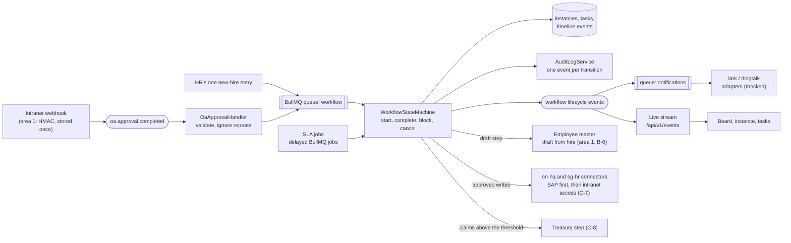
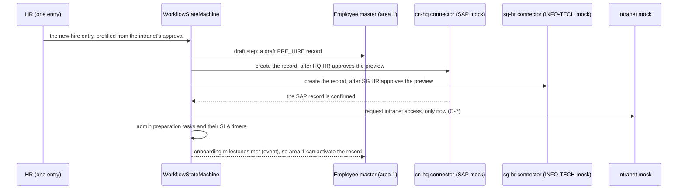

# Area 2: Onboarding and approval workflows

This guide is the starting point for area 2's owner. It explains what the platform build already gives you, what is yours to build, the design we recommend, a build plan by sprint, the risks, and how the area plugs into the rest of HuiTong. Area 2 covers capability C in [CLAUDE.md](../../CLAUDE.md) section 4, as statement #7 reshaped it ([ADR 0022](../adr/0022-final-statement-7-lesso-solar.md)): one new-hire entry onboards the hire into SAP and INFO-TECH, with intranet access only once the SAP record exists, and claims and payments above a configurable threshold get an extra HQ Treasury approval, with nobody re-keying data.

The ground rule is in [module ownership](module-ownership.md#ground-rules): the platform build gives you a head start, and the core logic (the state machine, the event handlers and the SLA logic) is yours to write.

## What the head start gives you

| Piece          | Where                                                                                                                                                                                                                                                                                    | State                                                                                                                                                                                                    |
| -------------- | ---------------------------------------------------------------------------------------------------------------------------------------------------------------------------------------------------------------------------------------------------------------------------------------- | -------------------------------------------------------------------------------------------------------------------------------------------------------------------------------------------------------- |
| Data model     | `WorkflowDefinition`, `WorkflowInstance`, `WorkflowTask`, `WorkflowEvent`, `Notification` in [`schema.prisma`](../../apps/api/prisma/schema.prisma)                                                                                                                                      | Built, with indexes for the board, the task list and SLA scans. `sourceEventId` is unique, so one OA event can start only one instance                                                                   |
| The definition | [`manpower-to-onboarding.ts`](../../packages/shared/src/workflows/manpower-to-onboarding.ts), seeded by [`seed/workflows.ts`](../../apps/api/prisma/seed/workflows.ts)                                                                                                                   | Eight steps with their assignee role and SLA hours                                                                                                                                                       |
| Contracts      | [`packages/shared/src/workflows/`](../../packages/shared/src/workflows/)                                                                                                                                                                                                                 | The board, instance, step, task and timeline views, their queries and the complete-task command                                                                                                          |
| API            | [`modules/workflows/`](../../apps/api/src/modules/workflows/): `GET /api/v1/workflows/board`, `GET instances`, `GET instances/:instanceId`, `GET tasks`, `POST tasks/:taskId/complete`                                                                                                   | Documented in Swagger at `/api/docs`. The reads serve typed sample data through `MockWorkflowsRepository`, and every response carries `meta.mock: true`. Completing a task answers `501 NOT_IMPLEMENTED` |
| Screens        | [`features/workflows/`](../../apps/web/src/features/workflows/): the board, the timeline, an instance and the task list                                                                                                                                                                  | Every state, EN and 中文, both themes; a "Sample data" badge while `meta.mock` is set ([screenshots](../design/screenshots/workflows/))                                                                  |
| Tests          | Unit skeletons in `modules/workflows/*.spec.ts`; [`workflows.int-spec.ts`](../../apps/api/test/workflows.int-spec.ts); [`workflows-page.test.tsx`](../../apps/web/src/features/workflows/workflows-page.test.tsx); [`workflow-pages.spec.ts`](../../apps/web/e2e/workflow-pages.spec.ts) | Real tests for the contract, the sample and the pages; your cases named as `it.todo`, 47 in all                                                                                                          |

The sample data follows the synthetic OA requests that mock-oa serves (OA-2026-000101 to 000103), their approvers and dates, and the synthetic employee numbers. It shows a recruitment past its SLA, a hire in admin preparation with a draft record, and an on-track requisition, so every state on the screens has something to show.

**Built for statement #17, reworked for #7.** The head start predates the final brief. Its seeded definition, `manpower-to-onboarding.ts`, runs a requisition and recruitment before the hire, and its sample follows OA manpower requests. Rework the definition into the statement #7 onboarding (one entry, then the SAP and INFO-TECH writes, intranet access only after the SAP record, and admin preparation), and add a second definition for claims and payments with the Treasury step. The models, contracts, screens and tests carry over; renaming the definition's key is your call.

## The goal, with user stories

From the [backlog](../agile/backlog.md#epic-c-onboarding-and-approval-workflows) (edit `scripts/github/backlog.mjs`, not the page):

| Story                                                   | Sprint | Acceptance criteria, in short                                                                                                                                                                                   |
| ------------------------------------------------------- | ------ | --------------------------------------------------------------------------------------------------------------------------------------------------------------------------------------------------------------- |
| C-1 Start onboarding from one new-hire entry            | 8      | One onboarding entry per approved hire, even if the intranet's event arrives twice; HR's entry creates a draft record and starts the workflow; a rejected approval starts nothing, and its outcome is recorded  |
| C-2 Workflow state machine from hire to day one         | 8      | A failed step retries with backoff, then is flagged for a person. An invalid transition is refused. At least 80% line coverage                                                                                  |
| C-3 Write the new hire to SAP and INFO-TECH             | 9      | A draft (`PRE_HIRE`) record in the master with the workflow as the change source (B-6). Each write to the SAP and INFO-TECH mocks needs its data steward's approval of a preview, and is idempotent and audited |
| C-4 Admin preparation tasks with SLA reminders          | 9      | Laptop, desk and account tasks for `ADMIN_OPS` with due dates; a reminder, then an escalation, once the SLA passes                                                                                              |
| C-5 Notify people in Lark/Feishu or DingTalk (mocked)   | 10     | A message to the entity's mocked channel when a step completes; a retried delivery is never sent twice                                                                                                          |
| C-6 Workflow board                                      | 10     | Each workflow in its stage with its next action and owner; completing my task moves the workflow on, audited                                                                                                    |
| C-7 Intranet access only after the SAP record exists    | 9      | The intranet step waits for the SAP connector's confirmation and shows what it waits for; the access is requested once, idempotently and audited                                                                |
| C-8 HQ Treasury approval above a configurable threshold | 9      | Above the threshold, a Treasury step follows the usual approvals, and the claim is not payable before it; at or below it, none; a threshold change is audited; a replay never approves twice                    |

Your steps in the [hero journey](../agile/hero-journey.md) are 1 to 4 and 7: the approval arrives once, one entry starts the onboarding, the SAP and INFO-TECH writes follow their stewards' approvals, intranet access waits for the SAP record, and a claim above the threshold goes to HQ Treasury. You present them at W5 and W18. The [failure matrix](../agile/test-plan.md) gives you five cases: duplicate, cancelled and incomplete approvals, a blocked onboarding task, and a stale event.

## The recommended design

**Patterns** (add each to [patterns.md](../architecture/patterns.md) as you build it):

| Pattern                  | Where it earns its place                                                                                                                                                                            |
| ------------------------ | --------------------------------------------------------------------------------------------------------------------------------------------------------------------------------------------------- |
| State machine            | A transition table per definition: from which status, by which event, to which status. One place decides what is legal, so the board, the API and the jobs cannot disagree                          |
| Observer (domain events) | The handler reacts to `oa.approval.completed`; your lifecycle events drive notifications, the live board and area 1's activation of draft records ([ADR 0008](../adr/0008-jobs-events-realtime.md)) |
| Repository               | Replace `MockWorkflowsRepository` with a Prisma repository bound to the same abstract `WorkflowsRepository`; the controllers and the contract do not change                                         |
| Command                  | Completing a task is one command with its validation, its transition, its audit event and its published event                                                                                       |
| Idempotency key          | The intranet's event id on the instance; an instance-and-step key on every job, so a retry after a partial success does nothing twice                                                               |

**The happy path.**

**Statuses.** An instance is `RUNNING`, `WAITING` (paused on something outside HuiTong, such as a candidate's answer), `COMPLETED`, `FAILED` or `CANCELLED`; nothing leaves the last three. A task is `PENDING`, `IN_PROGRESS`, `DONE`, `BLOCKED` or `SKIPPED`. Keep the instance's `currentStepKey` and every task's `status` in step inside one transaction.

**Decisions that are yours** (record each in an ADR or an assumption when you make it):

- **One instance per hire.** HR's entry is per hire, so one instance per hire is the natural fit. If one intranet approval covers two hires (the mock's OA-2026-000101 asks for two), it prefills two entries.
- **Parallel admin steps.** The seeded definition runs laptop, desk and accounts one after another. In practice they run side by side, which needs more than one current step. _For now (C-2): one step at a time, as the definition lists them. Parallel steps are a later extension of the state machine._
- **When an SLA clock starts.** The sample counts each step from its start. Admin preparation is better anchored to the requested day one ("three working days before"). Decide calendar or working hours too: working hours need the public-holiday calendar that area 3 counts working days with ([A-36](../assumptions.md)). _For now (C-2): a task is due `slaHours` calendar hours after its step starts._
- **CN01 hires.** The definition is Singapore's (its HR steps go to `HR_SG`). Whether HQ's own hires run through HuiTong, and with which roles, is a question for the client (Q-32, Q-33, Q-59).
- **The Treasury threshold.** One amount in SGD is the working assumption ([A-63](../assumptions.md)). Where it is configured (the tenant configuration, A-12, is a natural home), who may change it, whether a claim at exactly the threshold needs Treasury (the stories read "above" as strictly greater), and whether Treasury approves in HuiTong or in the intranet are yours to settle with Q-60.
- **A cancelled approval** stops the workflow and flags the started tasks (failure matrix; Q-35). _For now (C-2): a task someone has picked up is blocked with the reason, and a task nobody has picked up is skipped. Q-35 may change what counts as started._

## Step-by-step build plan

1. **The Prisma repository (sprint 8).** Implement `WorkflowsRepository` over the models, bind it in [`WorkflowsModule`](../../apps/api/src/modules/workflows/workflows.module.ts), remove `@ServesMockData()` from both controllers, and delete the mock repository and its sample. The integration test "drops meta.mock once the Prisma repository replaces the sample" then becomes real, and the badge disappears from the pages by itself.
2. **The state machine (C-2).** A domain class with no Prisma in it, tested first: turn the cases in [`workflow-state-machine.spec.ts`](../../apps/api/src/modules/workflows/workflow-state-machine.spec.ts) into tests one at a time.
3. **The intranet handler and the entry (C-1).** Subscribe with `@OnEvent(DOMAIN_EVENTS.oaApprovalCompleted)`, validate with `oaApprovalCompletedSchema`, and keep a hire's approval to prefill HR's entry; the entry enqueues the start on `QUEUES.workflow`. Throw only when the event cannot be accepted: a throw marks the stored event `FAILED`, and area 1's outbox republishes waiting events ([area 1 guide](area-1-integration-core.md#oa-webhooks-and-the-events-other-areas-use)).
4. **Jobs and retries (C-2).** A processor for `QUEUES.workflow` with backoff; after the last attempt the instance is `FAILED` and shows on the board.
5. **Completing a task (C-6).** Implement `WorkflowsService.completeTask`: only the assignee role may complete, the transition goes through the state machine, and `AuditLogService.record` is called in the same transaction. Publish a lifecycle event and a live message, then refetch on the board.
6. **The record steps (C-3).** Call area 1's draft-from-hire use case, which area 1 builds with B-6. Then write the hire to SAP and INFO-TECH through area 1's connectors, each after that system's data steward approves a preview, to the mocks only ([A-21](../assumptions.md), [A-62](../assumptions.md)).
7. **Intranet access after the SAP record (C-7).** The step waits for the SAP connector's confirmation and checks the SAP record before it requests the account; it is idempotent and audited, and SM-10 reports the order for every hire.
8. **SLA reminders and escalations (C-4).** Delayed jobs per open task, cancelled when the task completes. Test them with fake timers, never real time.
9. **Notifications (C-5).** Through the Lark/Feishu and DingTalk adapters (mocked; Lark arrives with A-11) on `QUEUES.notifications`, with a delivery key so a retry never sends twice; each delivery appears on the instance timeline.
10. **Claims and payments with the Treasury step (C-8).** A second definition, started by the intranet's claim and payment events: above the configured threshold, a Treasury approval step after the usual approvals; nothing above it is marked payable before Treasury approves, and a replayed event never approves twice.
11. **Switch on your end-to-end steps.** Turn off `fixme` for steps 2, 3, 4 and 7 in [`hero-journey.spec.ts`](../../apps/web/e2e/hero-journey.spec.ts) in the pull request that makes each pass.

Lifecycle event names are yours to fix. We suggest `workflow.instance.started`, `workflow.instance.completed`, `workflow.task.overdue` and `workflow.milestones.met`, added to `DOMAIN_EVENTS` and documented here.

## Patterns in area 2

Area 2's entries for the [design patterns register](../architecture/patterns.md), in the same format: what the pattern is, why it earns its place here, where it lives and how to extend it. Each is added as it is built, and copied into the register in a small pull request reviewed by area 1.

### State machine

**What.** A workflow instance is always in exactly one status, and a table lists which status may move to which. Every change goes through that table, so an illegal change is refused in one place.

**Why here.** The board, the API, the queue jobs and the SLA timers all change workflows. If each decided for itself what is legal, they would disagree, for example a retried job completing a workflow that HR had just cancelled. With one table, `COMPLETED`, `FAILED` and `CANCELLED` are final for every caller.

**Where.** [`WorkflowStateMachine`](../../apps/api/src/modules/workflows/workflow-state-machine.ts) runs one version of a definition, one step after another. Its commands (`start`, `completeTask`, `pause`, `resume`, `fail`, `cancel`) take the instance's current state and the time, and return the new state plus the transitions that happened (`task.completed`, `instance.cancelled` and so on). It changes nothing it is given, saves nothing, and calls no Prisma. An illegal command throws a 409 `ConflictError`. The service saves the new state and audits each transition in one transaction. The transition table is `INSTANCE_TRANSITIONS`:

| From        | May move to                                   |
| ----------- | --------------------------------------------- |
| `RUNNING`   | `WAITING`, `COMPLETED`, `FAILED`, `CANCELLED` |
| `WAITING`   | `RUNNING`, `FAILED`, `CANCELLED`              |
| `COMPLETED` | nothing                                       |
| `FAILED`    | nothing                                       |
| `CANCELLED` | nothing                                       |

Its other rules: only the current step's task can be completed, and only from `PENDING` or `IN_PROGRESS`; completing the last step completes the instance; `fail` names the step that failed, is refused when that step is no longer current (so a stale or repeated job cannot fail a later, healthy step), and blocks the step's task with the reason so the board shows where it stopped; `cancel` skips a task nobody has picked up (`PENDING`) and blocks one someone has (`IN_PROGRESS` or `BLOCKED`), so a person is flagged to undo work already under way; `pause`, `fail` and `cancel` take an optional reason (what a pause waits for, why a step failed), carried on each transition for the timeline; a definition that repeats a step key is refused; and an instance runs only on the definition version it started on. Its tests are in [`workflow-state-machine.spec.ts`](../../apps/api/src/modules/workflows/workflow-state-machine.spec.ts).

**Extend.** A new status is a new row in the table and the tests for it. Parallel steps (the admin preparation) would replace the single current step with a set of open steps.

## The risks

| Risk                                                           | Mitigation                                                                                                                              |
| -------------------------------------------------------------- | --------------------------------------------------------------------------------------------------------------------------------------- |
| An event delivered twice starts two workflows                  | The unique `sourceEventId`; a test that delivers the same event twice                                                                   |
| A job retried after a partial success repeats a side effect    | An idempotency key per instance and step; side effects only after the transition commits                                                |
| The workflow makes an employee active                          | It never does: activation is area 1's rule, after the milestones and the verified INFO-TECH record (B-6). Test it                       |
| Intranet access granted before the SAP record exists           | C-7's guard and a test that the step waits; GRS risk R-22                                                                               |
| A payment above the threshold made without Treasury's approval | C-8's rule on the server, tested at, below and above the threshold; GRS risk R-21                                                       |
| SLA tests that wait for real time                              | Fake timers, and due times computed from an injected clock                                                                              |
| The real intranet flow differs from the mock                   | Q-32, Q-33, Q-35, Q-59 and Q-60, and sample pack C ([client questions](../client/questions-for-client.md#three-items-to-request-first)) |
| Sample data mistaken for the working product                   | `@ServesMockData()` and the "Sample data" badge until the Prisma repository is bound                                                    |

## How it plugs into the platform

| You use                                                                                                | Where                                                                                                                          |
| ------------------------------------------------------------------------------------------------------ | ------------------------------------------------------------------------------------------------------------------------------ |
| `oa.approval.completed`                                                                                | [`domain-events.ts`](../../packages/shared/src/events/domain-events.ts), published by area 1's intranet (`oa`) webhook service |
| The `workflow` and `notifications` queues                                                              | [`queue-names.ts`](../../apps/api/src/infrastructure/queues/queue-names.ts)                                                    |
| `AuditLogService.record(input, meta, tx)`                                                              | [`audit-log.service.ts`](../../apps/api/src/infrastructure/audit/audit-log.service.ts)                                         |
| `DomainEventBus` and `RealtimeService`                                                                 | [`infrastructure/events/`](../../apps/api/src/infrastructure/events/)                                                          |
| `@RequirePermissions` with `workflows:read`, `workflows:tasks`, `workflows:manage`, `manpower:request` | [`permissions.ts`](../../packages/shared/src/auth/permissions.ts)                                                              |
| The draft-from-hire use case                                                                           | Area 1's employee master, with B-6                                                                                             |
| The `cn-hq` and `sg-hr` create calls and the intranet's account request                                | Area 1's connectors (A-10 adds the intranet's account endpoint to its mock)                                                    |

You expose `/api/v1/workflows/*`, the lifecycle events, the onboarding milestones that area 1 needs to activate a draft record, and the open-task count the overview shows under pending approvals.

## Which assessment requirements it covers

| Requirement           | Rows in the [traceability matrix](../requirements-traceability.md)                                                                     |
| --------------------- | -------------------------------------------------------------------------------------------------------------------------------------- |
| M1 Design thinking    | The hero journey's steps 1 to 4 and 7; success metrics SM-03, SM-04, SM-10 and SM-11 (M1-10)                                           |
| M2 GRS by design      | Approval steps shown explicitly (M2-12); draft before active; honest labels (M2-15); the SAP-first order and the Treasury step (M2-20) |
| M4 Best practices     | The state machine's unit tests and their coverage (M4.3-02), integration tests per module (M4.3-05), the failure matrix (M4.3-11)      |
| M6 Deploy and monitor | Workflow jobs in the traces and metrics (area 4 instruments them)                                                                      |

For the W7 mock interview, the questions to be ready for are in [module ownership](module-ownership.md#area-2-onboarding-and-approval-workflows-owner-tbd).
