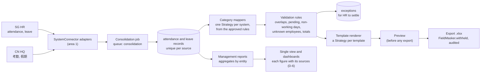
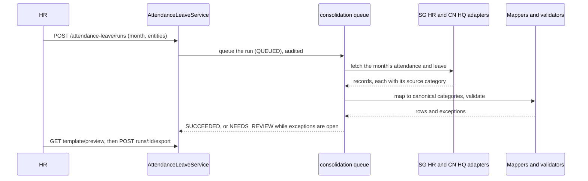

# Area 3: Single view, dashboards and insights

This guide is the starting point for area 3's owner. It explains what the platform build already gives you, what is yours to build, the design we recommend, a build plan by sprint, the risks, and how the area plugs into the rest of HuiTong. Area 3 covers capability D in [CLAUDE.md](../../CLAUDE.md) section 4, as statement #7 reshaped it ([ADR 0022](../adr/0022-final-statement-7-lesso-solar.md)): the single view across INFO-TECH, SAP and the intranet that the brief asks for, with dashboards for headcount, joiners and leavers, and leave and payroll summaries, plus data-consistency and duplicate-entry insights. Leave consolidation is one part of it: attendance and leave from Singapore and China HQ consolidate into the company's reporting template automatically, with exceptions explained.

The ground rule is in [module ownership](module-ownership.md#ground-rules): the platform build gives you a head start, and the core logic (the consolidation rules engine, report rendering, and the single view with its dashboards) is yours to write. The head start covers leave consolidation and the management reports; the dashboards (D-6) and insights (D-7) start from the reports page and its contract.

## What the head start gives you

| Piece              | Where                                                                                                                                                                                                                                                                                                                                                                                           | State                                                                                                                                                                                                     |
| ------------------ | ----------------------------------------------------------------------------------------------------------------------------------------------------------------------------------------------------------------------------------------------------------------------------------------------------------------------------------------------------------------------------------------------- | --------------------------------------------------------------------------------------------------------------------------------------------------------------------------------------------------------- |
| Data model         | `AttendanceRecord`, `LeaveRecord`, `LeaveCategoryMapping`, `ConsolidationRun`, `ConsolidationException`, `ReportTemplate`, `Report` in [`schema.prisma`](../../apps/api/prisma/schema.prisma)                                                                                                                                                                                                   | Built, with unique keys that make ingestion idempotent: `(employeeNo, workDate, connectorId)` for attendance, `(connectorId, externalId)` for leave                                                       |
| Rules and template | 19 seeded leave-category rules in [`seed/attendance-leave.ts`](../../apps/api/prisma/seed/attendance-leave.ts); the company template in [`company-template.ts`](../../packages/shared/src/attendance-leave/company-template.ts)                                                                                                                                                                 | Real data: 年假 to `ANNUAL`, 调休 to `TIME_OFF_IN_LIEU`, 探亲假 to `HOME_LEAVE` with no template column (A-09). The template's structure is assumed until the client shares theirs                        |
| Contracts          | [`packages/shared/src/attendance-leave/`](../../packages/shared/src/attendance-leave/) and [`reports/`](../../packages/shared/src/reports/)                                                                                                                                                                                                                                                     | Runs, exception types, rules, the template and its preview, the management report                                                                                                                         |
| API                | [`modules/attendance-leave/`](../../apps/api/src/modules/attendance-leave/) and [`modules/reports/`](../../apps/api/src/modules/reports/), documented in Swagger                                                                                                                                                                                                                                | Real reads: the rules and the template. Sample data with `meta.mock`: runs, exceptions, preview rows and the management report. Consolidating, exporting and changing a rule answer `501 NOT_IMPLEMENTED` |
| Screens            | [`features/attendance-leave/`](../../apps/web/src/features/attendance-leave/): consolidation, category rules, template preview and reports                                                                                                                                                                                                                                                      | Every state, EN and 中文, both themes; a "Sample data" badge while `meta.mock` is set ([screenshots](../design/screenshots/attendance-leave/))                                                            |
| Tests              | Unit skeletons in both modules; [`attendance-leave.int-spec.ts`](../../apps/api/test/attendance-leave.int-spec.ts) and [`reports.int-spec.ts`](../../apps/api/test/reports.int-spec.ts); [`attendance-leave-page.test.tsx`](../../apps/web/src/features/attendance-leave/attendance-leave-page.test.tsx); [`attendance-leave-pages.spec.ts`](../../apps/web/e2e/attendance-leave-pages.spec.ts) | Real tests for the contract, the samples, the scoping and the pages; your cases named as `it.todo`, 37 in all                                                                                             |

The sample was computed from the synthetic attendance and leave that mock-sg-hr and mock-cn-hq serve, through the seeded rules. September needs review, with four pending leaves and a home-leave record with no template column. Its first attempt failed. August is exported: HR settled its home leave by reporting it under Other leave.

## The goal, with user stories

From the [backlog](../agile/backlog.md#epic-d-single-view-dashboards-and-insights) (edit `scripts/github/backlog.mjs`, not the page):

| Story                                                  | Sprint | Acceptance criteria, in short                                                                                                                                                                         |
| ------------------------------------------------------ | ------ | ----------------------------------------------------------------------------------------------------------------------------------------------------------------------------------------------------- |
| D-1 Ingest attendance and leave from INFO-TECH and SAP | 8      | A month's records from both systems, each with its source category; a record for an unknown employee is an exception, not dropped                                                                     |
| D-2 Map leave categories between systems               | 8      | 年假, 病假 and 调休 become Annual Leave, Sick Leave and time off in lieu; a code with no approved rule is listed, never guessed                                                                       |
| D-3 Validate and report exceptions                     | 9      | Overlapping leave is reported with both records; each exception explains what is wrong and where it came from                                                                                         |
| D-4 Render the company template and export .xlsx       | 10     | The file follows the template exactly; a destination such as HQ gets only the fields on its allowlist (B-7), and the export is audited                                                                |
| D-5 Management reports from several sources            | 11     | Each figure names its systems; `MANAGEMENT` reads it, read-only, with no restricted fields                                                                                                            |
| D-6 Single view with dashboards                        | 10     | Headcount, joiners and leavers, and leave and payroll summaries; each figure names its systems and time; cross-entity figures are aggregates with small counts suppressed; read-only for `MANAGEMENT` |
| D-7 Data-consistency and duplicate-entry insights      | 11     | The share of consistent records (SM-02) and how often each new-hire field was typed (SM-05), from HuiTong's own records; too little data is said, not shown as a number                               |

Your steps in the [hero journey](../agile/hero-journey.md) are 8 and 9: the employee's later leave and payroll summary appear in the single view, mapped to the group categories, and HQ's summary is exported without the fields HQ may not receive. You present them at W5 and W18. The [failure matrix](../agile/test-plan.md) gives you four cases: an invalid date (with area 1), an unknown leave code, a denied export (with area 4), and a report requested while source data is incomplete.

## The recommended design

**Patterns** (add each to [patterns.md](../architecture/patterns.md) as you build it):

| Pattern         | Where it earns its place                                                                                                                                                                                     |
| --------------- | ------------------------------------------------------------------------------------------------------------------------------------------------------------------------------------------------------------ |
| Template Method | A run is extract → map → validate → render → audit, the same skeleton as area 1's sync job ([`sync`](../../apps/api/src/modules/connectors/sync/)), so a failure at any step leaves the run in a known state |
| Strategy        | One leave-category mapper per source system, configured by the approved rules, so another company's codes are configuration, not code; one renderer per template                                             |
| Repository      | Replace `MockConsolidationRepository` and `MockManagementReportsRepository` with Prisma repositories bound to the same abstract classes; the controllers and the contract do not change                      |
| Idempotency     | The unique keys above: running the same month twice changes nothing the second time                                                                                                                          |

**A run.**

**Rules to keep.**

- **Per-person data stays in its entity.** No transfer register entry shares attendance or leave between entities, so the service shows a run's exceptions and the template's rows for the caller's own entity, and counts the rest as withheld. If HQ's report needs Singapore staff's leave, that takes a register entry for attendance and leave, decided with area 4 and recorded in the register (B-7, F-4), not a code change.
- **Exports leave out what the register withholds.** Build the .xlsx through `FieldMasker.withheld(fields, viewer, entity)` and audit each export with the fields left out ([module ownership](module-ownership.md#area-3-single-view-dashboards-and-insights-owner-tbd)).
- **Exports neutralise formulas.** A cell that starts with `=`, `+`, `-` or `@` is written so that a spreadsheet reads it as text, in CSV and in .xlsx (OWASP CSV injection). Vendor exports, such as the INFO-TECH mock's, do not, so HuiTong must not pass their cells on untouched.
- **Nothing is guessed.** A code without an approved rule, leave pending at month end, and home leave with no column are exceptions for HR, never silent defaults.

**Decisions that are yours** (record each in an ADR or an assumption when you make it):

- **Working days.** Count per entity, Monday to Friday without that country's public holidays, including China's weekend make-up working days ([A-36](../assumptions.md)). Half days count as 0.5.
- **Leave across months.** The sample splits a record by the working days in each month (home leave of 26 Aug to 22 Sep counts 4 days in August and 16 in September).
- **Pending leave.** The sample leaves it out of the totals and raises an exception; the client confirms it (Q-57).
- **Home leave.** No template column exists. In the sample HR reported it under Other leave for August; the template may need a column instead (A-09, Q-24, sample pack B).
- **The .xlsx library and layout.** The API already reads Excel with `read-excel-file`; a writer such as ExcelJS can produce the export ([ADR 0019](../adr/0019-ideas-not-adopted-from-azri-plan.md)). Write values, not formulas, and test the file against a golden copy.

## Step-by-step build plan

1. **Ingestion (D-1, sprint 8).** Area 1 adds attendance and leave extraction to the SG HR and CN HQ adapters (`SystemConnector`). The mocks already serve them ([mock systems](../api/mock-systems.md)): SG HR `/api/attendance` and `/api/leave`, CN HQ `/sap/opu/hr/attendance` and `/sap/opu/hr/leave`. Then store the month's records through the unique keys, as a job on `QUEUES.consolidation`.
2. **Category mapping (D-2).** A mapper per system from the ACTIVE rules (the repository is real already). Then build the rule-change approval behind `PUT category-mappings/:mappingId`, audited at both steps; the dialog is already wired to it.
3. **Validation (D-3, sprint 9).** The rules in [`consolidation-engine.spec.ts`](../../apps/api/src/modules/attendance-leave/consolidation-engine.spec.ts), each raising one of the contract's exception types.
4. **Bind the Prisma repository.** Implement `ConsolidationRepository` over the models, bind it in [`AttendanceLeaveModule`](../../apps/api/src/modules/attendance-leave/attendance-leave.module.ts), remove `@ServesMockData()`, and delete the mock repository and its sample. The badge disappears from the pages by itself.
5. **Rendering and export (D-4, sprint 10).** The renderer, the golden-file test, then `POST runs/:runId/export`: build the file through `FieldMasker.withheld`, audit it, and return it. The export button becomes active once the data is real and the run is exportable.
6. **The single view (D-6, sprint 10).** Dashboards for headcount, joiners and leavers, and leave and payroll summaries, each figure naming its systems and time, read-only for `MANAGEMENT`; figures that span entities are aggregates with small counts suppressed ([A-39](../assumptions.md)).
7. **Management reports (D-5, sprint 11).** Aggregates by entity from the stored runs and the employee master, each with its sources; replace `MockManagementReportsRepository`.
8. **Insights (D-7, sprint 11).** The share of consistent records (SM-02) and how often each new-hire field was typed (SM-05), read from area 1's sync runs and field provenance, never re-computed from raw data.
9. **Switch on your end-to-end steps.** Steps 8 and 9 in [`hero-journey.spec.ts`](../../apps/web/e2e/hero-journey.spec.ts), the export case in [`hq-field-denial.spec.ts`](../../apps/web/e2e/hq-field-denial.spec.ts), and the smoke test's "run a consolidation" step.

## The risks

| Risk                                                                | Mitigation                                                                                          |
| ------------------------------------------------------------------- | --------------------------------------------------------------------------------------------------- |
| The client's template differs from the assumed one                  | The template is data (`ReportTemplate`, versioned); ask for sample pack B first                     |
| A category is mapped wrongly and the error spreads across months    | Rules need approval, are versioned and audited; unknown codes stop at an exception                  |
| HQ receives Singapore attendance it should not                      | Default deny through the register; the export goes through `FieldMasker.withheld`; E2E #3 covers it |
| Holiday calendars are wrong, so working days and absences are wrong | Calendars per entity as data, with tests for China's make-up days                                   |
| The .xlsx drifts from the template unnoticed                        | A golden-file test in CI                                                                            |
| Sample data mistaken for the working product                        | `@ServesMockData()` and the "Sample data" badge until the Prisma repositories are bound             |

## How it plugs into the platform

| You use                                                                                                            | Where                                                                                                                                                               |
| ------------------------------------------------------------------------------------------------------------------ | ------------------------------------------------------------------------------------------------------------------------------------------------------------------- |
| INFO-TECH and SAP adapters (`sg-hr`, `cn-hq`)                                                                      | [`SystemConnector`](../../apps/api/src/modules/connectors/adapters/system-connector.ts) (area 1 adds the attendance and leave methods)                              |
| The employee master, by employee number only                                                                       | Area 1's employees module                                                                                                                                           |
| Date and enum transformers                                                                                         | Area 1's [mapping engine](../../apps/api/src/modules/mapping/)                                                                                                      |
| `FieldMasker.withheld` and `canList`                                                                               | [`field-masker.ts`](../../apps/api/src/modules/access/field-masker.ts)                                                                                              |
| The `consolidation` queue, `AuditLogService`, the RBAC guard                                                       | [`queue-names.ts`](../../apps/api/src/infrastructure/queues/queue-names.ts), [`audit-log.service.ts`](../../apps/api/src/infrastructure/audit/audit-log.service.ts) |
| Permissions `attendance:read`, `attendance:consolidate`, `leave-mappings:manage`, `reports:read`, `reports:export` | [`permissions.ts`](../../packages/shared/src/auth/permissions.ts)                                                                                                   |

You expose `/api/v1/attendance-leave/*` and `/api/v1/reports/*`, the consolidation status and exception counts the overview will show, and the effort per run that the success metric "HR hours per month on consolidation" measures ([measurement protocol](../design-thinking/success-metrics.md#measurement-protocol)).

## Which assessment requirements it covers

| Requirement           | Rows in the [traceability matrix](../requirements-traceability.md)                                                                               |
| --------------------- | ------------------------------------------------------------------------------------------------------------------------------------------------ |
| M1 Design thinking    | The hero journey's steps 8 and 9; the management summary time in the measurement protocol; success metrics SM-01 and SM-07                       |
| M2 GRS by design      | Default deny across entities and the export allowlist (M2-18); preview before export (M2-10); every figure naming its source                     |
| M4 Best practices     | The mappers', validators' and renderers' unit tests and coverage (M4.3-03), integration tests per module (M4.3-05), the failure matrix (M4.3-11) |
| M6 Deploy and monitor | Consolidation jobs in the traces and metrics (area 4 instruments them)                                                                           |

For the W7 mock interview, the questions to be ready for are in [module ownership](module-ownership.md#area-3-single-view-dashboards-and-insights-owner-tbd).
