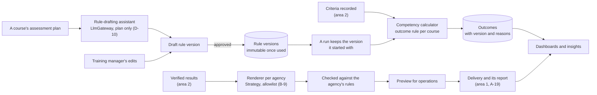
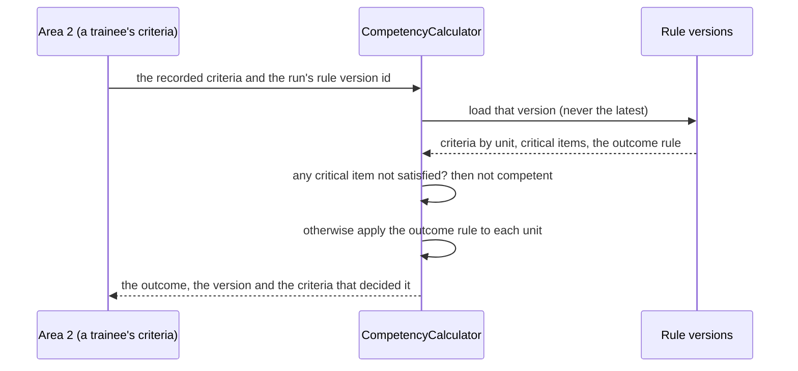

# Area 3: Competency, submissions and insights

This guide is the starting point for area 3's owner, Iok Teck. It explains what is already in the repository, what is yours to build, the design we recommend, a build plan by sprint, the risks, and how the area plugs into the rest of HuiTong. Area 3 covers capability D in [CLAUDE.md](../../CLAUDE.md) section 4, for Problem Statement #5 ([ADR 0023](../adr/0023-retarget-ps5-aspri-ipi.md)): each course's assessment rules held as versioned configuration that a training manager approves, competency calculated from them automatically, each agency's submission file rendered from its template, and dashboards and insights for management and operations. The rule-drafting assistant, which drafts a new course's rules from its assessment plan, is yours too.

The ground rule is in [module ownership](module-ownership.md#ground-rules): the core logic (the rules and their versions, the calculation, the renderers, the dashboards and the rule-drafting assistant) is yours to write. Whether the head start below is reworked for #5 by the team lead or by you is your call, relayed through the team lead (step 6 of [prompt 005](../ai/prompts/005-retarget-ps5-aspri-ipi.md)), and so is whether the `attendance-leave` module and feature are renamed.

## What is in the repository today

The head start was built for an earlier statement, around leave consolidation and management reports. None of its domain carries over, but several of its parts do.

| Piece      | Where                                                                                                                                                                                                                                                                                                                                                                                                                                                                                      | For #5                                                                                                                                                                                             |
| ---------- | ------------------------------------------------------------------------------------------------------------------------------------------------------------------------------------------------------------------------------------------------------------------------------------------------------------------------------------------------------------------------------------------------------------------------------------------------------------------------------------------ | -------------------------------------------------------------------------------------------------------------------------------------------------------------------------------------------------- |
| Data model | `AttendanceRecord`, `LeaveRecord`, `LeaveCategoryMapping`, `ConsolidationRun`, `ConsolidationException`, `ReportTemplate`, `Report` in [`schema.prisma`](../../apps/api/prisma/schema.prisma)                                                                                                                                                                                                                                                                                              | To be replaced by course rules, rule versions, outcomes and file templates; `ReportTemplate`'s idea (a versioned template as data) carries over                                                    |
| Contracts  | [`packages/shared/src/attendance-leave/`](../../packages/shared/src/attendance-leave/) and [`reports/`](../../packages/shared/src/reports/)                                                                                                                                                                                                                                                                                                                                                | The reports contract is a starting point for the dashboards                                                                                                                                        |
| API        | [`modules/attendance-leave/`](../../apps/api/src/modules/attendance-leave/) and [`modules/reports/`](../../apps/api/src/modules/reports/), documented in Swagger. Real reads: the leave-category rules and the company template, seeded by [`seed/attendance-leave.ts`](../../apps/api/prisma/seed/attendance-leave.ts). Sample data with `meta.mock`: runs, exceptions, preview rows and the management report. Consolidating, exporting and changing a rule answer `501 NOT_IMPLEMENTED` | The module structure, the mock-repository pattern and the reports endpoints carry over; the seeded rules and template do not                                                                       |
| Screens    | [`features/attendance-leave/`](../../apps/web/src/features/attendance-leave/): consolidation, category rules, template preview and reports                                                                                                                                                                                                                                                                                                                                                 | The rule editor's approval dialog, the template preview and the reports page are patterns to reuse; every state, EN and 中文, both themes ([screenshots](../design/screenshots/attendance-leave/)) |
| Tests      | Unit skeletons in both modules; [`attendance-leave.int-spec.ts`](../../apps/api/test/attendance-leave.int-spec.ts) and [`reports.int-spec.ts`](../../apps/api/test/reports.int-spec.ts); [`attendance-leave-page.test.tsx`](../../apps/web/src/features/attendance-leave/attendance-leave-page.test.tsx); [`attendance-leave-pages.spec.ts`](../../apps/web/e2e/attendance-leave-pages.spec.ts)                                                                                            | To be replaced by the calculation's and renderers' tests                                                                                                                                           |

## The goal, with user stories

From the [backlog](../agile/backlog.md#epic-d-competency-submissions-and-insights) (edit `scripts/github/backlog.mjs`, not the page):

| Story                                                                         | Sprint | Acceptance criteria, in short                                                                                                                                                                       |
| ----------------------------------------------------------------------------- | ------ | --------------------------------------------------------------------------------------------------------------------------------------------------------------------------------------------------- |
| D-8 Course rules as versioned configuration                                   | 8      | Criteria by competency unit, critical items and an outcome rule; a new version is a draft until a training manager approves it; a run keeps its version; a version in use is never edited           |
| D-9 Calculate competency automatically from the rules                         | 9      | The outcome follows the run's rule version; one critical item not satisfied makes it not competent; each outcome names its version and deciding criteria; 80% line coverage                         |
| D-11 Render agency submission files from templates                            | 10     | The agency's column order, codes and date format; only its allowlisted fields and the internal trainee ID; problems listed before delivery; a golden file per agency                                |
| D-10 Rule-drafting assistant: draft a course's rules from its assessment plan | 11     | Proposed criteria, critical items and outcome rule, each with a confidence and a rationale, labelled "Requires approval" (and "Mock AI"); nothing used before approval; the plan only in the prompt |
| D-12 Dashboards for operations and management                                 | 12     | Runs by state, submissions by agency and status, those near their deadline; read-only aggregates for `MANAGEMENT`; each figure says when and from what                                              |
| D-13 Insights: effort saved, first-time acceptance and rework                 | 12     | SM-12, SM-17 and SM-18, labelled as lab estimates on synthetic data; too little data is said, not shown as a number                                                                                 |

Your steps in the hero journey: in E2E #1 the competency is calculated and one agency receives a validated file; E2E #2 is yours almost whole: a new course's assessment plan, the AI's draft rules with the "Mock AI" badge, a training manager's approval, and the next run using them with no code change. The journey and its failure matrix are rewritten for #5 in step 7 of prompt 005; the cases that are yours include a rule change in the middle of a run and a rejected file (with area 1).

## The recommended design

**Patterns** (add each to [patterns.md](../architecture/patterns.md) as you build it):

| Pattern            | Where it earns its place                                                                                                                                        |
| ------------------ | --------------------------------------------------------------------------------------------------------------------------------------------------------------- |
| Strategy           | One renderer per agency format, and one class per kind of outcome rule, so another agency or course is configuration or one class, never a change to the others |
| Immutable versions | A rule version, once a run uses it, is never edited; a change makes a new version. An outcome always names the version that decided it                          |
| Template Method    | Rendering a file is render → check → preview → hand to delivery → audit, so a failure at any step leaves the submission in a known state                        |
| Repository         | Replace the mock repositories with Prisma repositories bound to the same abstract classes; the controllers and the contract do not change                       |

**A calculation.**

**Rules to keep.**

- **A run keeps its rules.** The calculation loads the version the run started with, never the latest ([A-75](../assumptions.md), GRS R-24).
- **Nothing is guessed.** A criterion with no mark is never read as satisfied; a code with no mapping in an agency's template stops the file with a problem for operations.
- **People decide.** An AI draft is a proposal: it becomes a version only when a training manager approves it, and the prompt carries the assessment plan only, never trainee data ([A-17](../assumptions.md), GRS R-07 to R-09).
- **Files hold only what the agency may receive.** Build each file through area 1's `FieldMasker.withheld` for that agency and audit what it left out (B-9, GRS R-23). Until the client decides on national ID numbers, files carry the internal trainee ID ([A-69](../assumptions.md)).
- **Files neutralise formulas.** A cell that starts with `=`, `+`, `-` or `@` is written so that a spreadsheet reads it as text, in CSV and in .xlsx (OWASP CSV injection).

**Decisions that are yours** (record each in an ADR or an assumption when you make it):

- **The outcome rule.** Whether a unit is competent when all its criteria are satisfied or when a threshold is met, and how units combine into the course's outcome ([A-70](../assumptions.md); the sample checklists, [Q-72](../client/questions-for-client.md), will tell).
- **Re-assessment.** How a trainee who was not yet competent is assessed again, and which outcome an agency receives.
- **Each agency's format.** CSV or Excel, column order, codes and dates are assumed until the client shares one submission example per agency ([A-66](../assumptions.md), [Q-67](../client/questions-for-client.md)); the templates are data, so a real example is a template change.
- **The .xlsx library.** The API reads Excel with `read-excel-file`; a writer such as ExcelJS can produce the files ([ADR 0019](../adr/0019-ideas-not-adopted-from-azri-plan.md)). Write values, not formulas, and test each file against a golden copy.
- **The module's name.** `attendance-leave` stays unless you decide to rename it; if you do, rename the module, the feature, the namespaces and the routes in one pull request.

## Step-by-step build plan

1. **Course rules and their versions (D-8, sprint 8).** The models, the draft-then-approve flow (audited at both steps), and the rule that a version in use is never edited.
2. **The calculation (D-9, sprint 9).** A domain class with no Prisma in it, tested first: every kind of outcome rule, critical items, missing marks and a version change in the middle of a run.
3. **Bind the Prisma repositories.** Remove `@ServesMockData()` and delete the mock repositories and their samples, so the "Sample data" badge disappears by itself.
4. **The agency files (D-11, sprint 10).** A renderer per agency format, the allowlist through `FieldMasker.withheld`, the checks before delivery, and a golden-file test per agency. Area 1 delivers the files and records each portal's report (A-19).
5. **The rule-drafting assistant (D-10, sprint 11).** A responder for the mock provider first, so E2E #2 runs in CI without a key; then the same contract on Bedrock with area 1 (E-4). Validate the model's output against the rule schema and refuse anything else.
6. **Dashboards and insights (D-12 and D-13, sprint 12).** From runs, outcomes and submissions, read-only aggregates for `MANAGEMENT`, each figure with its time and source.
7. **Switch on your end-to-end steps** in the hero journey's specs in the pull request that makes each pass.

## The risks

| Risk                                                        | Mitigation                                                                                                                      |
| ----------------------------------------------------------- | ------------------------------------------------------------------------------------------------------------------------------- |
| A wrong or outdated rule gives a wrong outcome              | Approval of every version, versions immutable once used, runs pinned to their version, tests per rule kind (GRS R-24)           |
| The AI drafts a wrong rule and it is approved               | Confidence and rationale per rule, the training manager's edit and approval, and the acceptance rate measured (GRS R-07, SM-09) |
| An uploaded plan carries instructions to the model          | The plan is data in a delimited field of a fixed prompt, the model has no tools, and its output must validate (GRS R-08)        |
| An agency rejects a file                                    | Checks before delivery, golden files, and the portal's report recorded against each trainee (GRS R-27)                          |
| A file carries a field the agency should not receive        | Default deny through the allowlist, audited; E2E #3 covers it (GRS R-23)                                                        |
| A dashboard shows one trainee's personal data to management | Aggregates by default, masking by role                                                                                          |
| Sample data mistaken for the working product                | `@ServesMockData()` and the "Sample data" badge until the Prisma repositories are bound                                         |

## How it plugs into the platform

| You use                                                   | Where                                                                                                                                                                                                                                                                                                                                            |
| --------------------------------------------------------- | ------------------------------------------------------------------------------------------------------------------------------------------------------------------------------------------------------------------------------------------------------------------------------------------------------------------------------------------------ |
| Courses and runs; lookup by the TMS trainee ID            | Area 1's master data ([B-8](../agile/backlog.md#b-8-trainees-assessors-courses-and-runs-in-master-data))                                                                                                                                                                                                                                         |
| The criteria recorded for each trainee; verified results  | Area 2 ([C-9](../agile/backlog.md#c-9-record-a-run-on-the-tablet-checklist), [C-12](../agile/backlog.md#c-12-verification-queue-with-the-evidence-beside-each-result))                                                                                                                                                                           |
| `FieldMasker.withheld` for each agency                    | [`field-masker.ts`](../../apps/api/src/modules/access/field-masker.ts), per agency with [B-9](../agile/backlog.md#b-9-each-agency-receives-only-its-allowlisted-fields)                                                                                                                                                                          |
| Date and code transformers                                | Area 1's [mapping engine](../../apps/api/src/modules/mapping/)                                                                                                                                                                                                                                                                                   |
| Delivery of the files and each portal's report            | Area 1 ([A-19](../agile/backlog.md#a-19-deliver-an-agencys-file-and-record-the-portals-validation-report))                                                                                                                                                                                                                                       |
| `LlmGateway` and `AiUsageTracker`                         | [`infrastructure/llm/`](../../apps/api/src/infrastructure/llm/)                                                                                                                                                                                                                                                                                  |
| Queues, `AuditLogService`, the RBAC guard and permissions | [`queue-names.ts`](../../apps/api/src/infrastructure/queues/queue-names.ts), [`audit-log.service.ts`](../../apps/api/src/infrastructure/audit/audit-log.service.ts), [`permissions.ts`](../../packages/shared/src/auth/permissions.ts); the #5 roles' baseline permissions come with the roles, and your stories add the ones their routes check |

You expose each run's rule version and the calculation to area 2, the rendered files to area 1, `/api/v1/reports/*` for the dashboards, and the measures SM-12, SM-14, SM-17 and SM-18 ([measurement protocol](../design-thinking/success-metrics.md#measurement-protocol)).

## Which assessment requirements it covers

| Requirement           | Rows in the [traceability matrix](../requirements-traceability.md)                                                                                     |
| --------------------- | ------------------------------------------------------------------------------------------------------------------------------------------------------ |
| M1 Design thinking    | HMW-18, HMW-19, HMW-22 and HMW-23; success metrics SM-12, SM-14, SM-17 and SM-18 (M1-10)                                                               |
| M2 GRS by design      | Rule approval and versions, AI drafts labelled and approved (M2-11), the allowlist in every file (M2-18), a preview before delivery (M2-10)            |
| M4 Best practices     | The calculation's and renderers' unit tests and coverage (M4.3-03), golden files, integration tests per module (M4.3-05), the failure matrix (M4.3-11) |
| M6 Deploy and monitor | The rule-drafting assistant's calls in the AI usage dashboard; rendering jobs in the traces (area 4 instruments them)                                  |

For the W7 mock interview, the questions to be ready for are in [module ownership](module-ownership.md#area-3-competency-submissions-and-insights-iok-teck).
