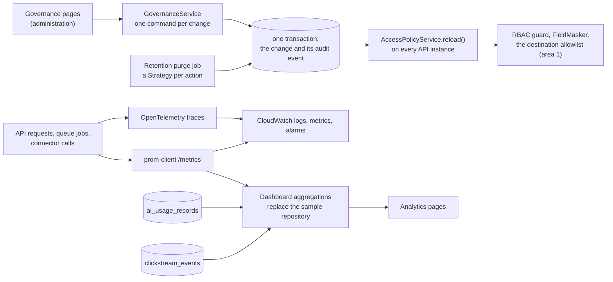

# Area 4: Governance, security and monitoring

This guide is the starting point for area 4's owner. It explains what the platform build already gives you, what is yours to build, the design we recommend, a build plan by sprint, the risks, and how the area plugs into the rest of HuiTong. Area 4 covers capabilities F and G in [CLAUDE.md](../../CLAUDE.md) section 4: the policy that decides who may see what is administered, audited and visible; the system is observable; its use is measured with consent; every AI call is costed; and the demo runs on AWS.

The ground rule is in [module ownership](module-ownership.md#ground-rules): the platform build gives you a head start, and the core logic is yours to write. For area 4 that is the administration of the policy and the registers, the retention purge, OpenTelemetry tracing and metrics, the clickstream and AI usage aggregations with budgets and alerts, and the AWS deployment.

## What the head start gives you

| Piece       | Where                                                                                                                                                                                                                                                                                                                                                                                                                                                                                                                                                                                                                                                                                                                                                                                                                                                                                                                                     | State                                                                                                                                                                                                                                                                                                                                                                                                        |
| ----------- | ----------------------------------------------------------------------------------------------------------------------------------------------------------------------------------------------------------------------------------------------------------------------------------------------------------------------------------------------------------------------------------------------------------------------------------------------------------------------------------------------------------------------------------------------------------------------------------------------------------------------------------------------------------------------------------------------------------------------------------------------------------------------------------------------------------------------------------------------------------------------------------------------------------------------------------------- | ------------------------------------------------------------------------------------------------------------------------------------------------------------------------------------------------------------------------------------------------------------------------------------------------------------------------------------------------------------------------------------------------------------ |
| Data model  | Yours: `RolePermission`, `ClearanceRule`, `DataClassification`, `CrossBorderTransfer`, `RetentionPolicy`. Read only: `AuditEvent`, `AiUsageRecord`, `ClickstreamEvent`. All in [`schema.prisma`](../../apps/api/prisma/schema.prisma)                                                                                                                                                                                                                                                                                                                                                                                                                                                                                                                                                                                                                                                                                                     | Built. A database trigger refuses `UPDATE`, `DELETE` and `TRUNCATE` on the audit log                                                                                                                                                                                                                                                                                                                         |
| Seeded data | [`seed/governance.ts`](../../apps/api/prisma/seed/governance.ts) and [`seed/access.ts`](../../apps/api/prisma/seed/access.ts)                                                                                                                                                                                                                                                                                                                                                                                                                                                                                                                                                                                                                                                                                                                                                                                                             | Real data: the permission matrix and clearance rules from `@huitong/shared`, 24 classified fields, three transfer entries (SG01's employee master to HQ, active; SG01's compensation data to HQ, pending review; CN01's organisation data to Singapore, active) and seven retention rules. The values are placeholders until the client sets them ([GRS 2.8](../grs/grs-by-design.md#28-retention-defaults)) |
| Contracts   | [`governance-views.ts`](../../packages/shared/src/governance/governance-views.ts), [`audit-trail.ts`](../../packages/shared/src/audit/audit-trail.ts), [`dashboards.ts`](../../packages/shared/src/analytics/dashboards.ts)                                                                                                                                                                                                                                                                                                                                                                                                                                                                                                                                                                                                                                                                                                               | The access matrix, the three registers, the audit view and its filters, the chain check, and the three dashboards                                                                                                                                                                                                                                                                                            |
| API         | [`modules/governance/`](../../apps/api/src/modules/governance/), [`modules/audit/`](../../apps/api/src/modules/audit/), [`modules/analytics/dashboards/`](../../apps/api/src/modules/analytics/dashboards/), documented in Swagger                                                                                                                                                                                                                                                                                                                                                                                                                                                                                                                                                                                                                                                                                                        | Real reads: the matrix from the live `AccessPolicyService`, the registers, and the audit log with its filters and chain check. Sample data with `meta.mock`: the three dashboards. Changing a register entry's status answers `501 NOT_IMPLEMENTED`                                                                                                                                                          |
| Screens     | [`features/governance/`](../../apps/web/src/features/governance/): access, classification, transfers, retention and the audit log; [`features/analytics/`](../../apps/web/src/features/analytics/): observability, clickstream and AI usage                                                                                                                                                                                                                                                                                                                                                                                                                                                                                                                                                                                                                                                                                               | Every state, EN and 中文, both themes; a "Sample data" badge on the dashboards while `meta.mock` is set ([governance](../design/screenshots/governance/) and [analytics](../design/screenshots/analytics/) screenshots). The status dialog on the transfers page is wired to your endpoint: it preselects nothing, names the fields a change starts or stops sending, and asks for a reason                  |
| Tests       | [`governance.service.spec.ts`](../../apps/api/src/modules/governance/governance.service.spec.ts), [`audit-trail.service.spec.ts`](../../apps/api/src/modules/audit/audit-trail.service.spec.ts), [`changed-fields.spec.ts`](../../apps/api/src/modules/audit/changed-fields.spec.ts), the dashboards' specs; [`governance.int-spec.ts`](../../apps/api/test/governance.int-spec.ts), [`audit-trail.int-spec.ts`](../../apps/api/test/audit-trail.int-spec.ts), [`analytics-dashboards.int-spec.ts`](../../apps/api/test/analytics-dashboards.int-spec.ts); [`governance-page.test.tsx`](../../apps/web/src/features/governance/governance-page.test.tsx), [`analytics-page.test.tsx`](../../apps/web/src/features/analytics/analytics-page.test.tsx), with unit tests for the clearance helpers, the URL filters and the permission groups; [`governance-analytics-pages.spec.ts`](../../apps/web/e2e/governance-analytics-pages.spec.ts) | Real tests for the contracts, the withholding, the samples and the pages; your cases named as `it.todo`, 36 in all, mostly in [`governance-administration.spec.ts`](../../apps/api/src/modules/governance/governance-administration.spec.ts) and [`analytics-dashboards.spec.ts`](../../apps/api/src/modules/analytics/dashboards/analytics-dashboards.spec.ts)                                              |

The dashboards' sample is a stable function of the date, so a reload never changes it and the 7-day window is the end of the 30-day one. It uses the demo stack's only AI provider (the deterministic mock), costed at the reference prices in [A-52](../assumptions.md), and credits the calls to the two HR demo users, the only roles that may call the AI features. Its funnel is the e2e smoke test's journey, and one mock service is shown as degraded, so the screen's states are visible.

**Not built yet.** The telemetry bootstrap that [ADR 0016](../adr/0016-observability-baseline.md) describes (`apps/api/src/infrastructure/telemetry/`, loaded with `node --import`) does not exist. The platform build leaves OpenTelemetry to this area, bootstrap included ([the amendment](../adr/0016-observability-baseline.md#amendment-21-oct-2026-the-telemetry-bootstrap)). Until it lands, the error envelope's `traceId` is the request id (`X-Request-Id`), which every log line carries.

## The goal, with user stories

From the [backlog](../agile/backlog.md#epic-f-governance-and-compliance) (edit `scripts/github/backlog.mjs`, not the page):

| Story                                              | Sprint | Acceptance criteria, in short                                                                                                      |
| -------------------------------------------------- | ------ | ---------------------------------------------------------------------------------------------------------------------------------- |
| F-1 Administer roles and field masking             | 8      | A changed clearance rule masks on the next request and is audited; an administrator who tries to resolve an HR conflict is refused |
| F-2 Audit-log viewer                               | 9      | `/governance/audit?entityType=Employee&entityId=E100030` lists every event for that record; an altered event is detected           |
| F-3 Data classification register                   | 9      | Every canonical field shows its classification and who may see it                                                                  |
| F-4 Cross-border transfer register (PDPA and PIPL) | 10     | Approving an entry shows its fields to HQ roles, audited; a field with no approved entry is masked; a change raises the version    |
| F-5 Retention settings and purge                   | 11     | Data past its period is removed or anonymised by the purge job, which records what it did                                          |
| F-6 OWASP Top 10 and API Security Top 10 checklist | 12     | Each category links to the control, the code and a test or scan result                                                             |
| G-1 Observability: traces, metrics and dashboards  | 14     | A failed request's trace id links the browser error, the API log and the trace; `/metrics` exposes rates, latencies, queue depths  |
| G-2 First-party clickstream analytics with consent | 15     | No consent, no event; the route pattern, never the URL, is recorded and shown                                                      |
| G-3 AI token usage and cost dashboard              | 16     | Tokens, cost and outcome by feature, day and user; a rejected proposal counts as rejected                                          |
| G-4 Deploy the demo on AWS with CloudWatch         | 17     | Web, API and mocks on AWS behind HTTPS; an alarm fires for an unhealthy service                                                    |
| G-5 DAST against the deployed demo                 | 17     | A ZAP baseline in CI keeps its report, and High findings fail the job                                                              |

Your steps in the [hero journey](../agile/hero-journey.md) are 7 and 8, with areas 3 and 1: HQ's report holds only the fields its register entry allows, and the audit trail shows the journey. You present them at W5 and W18. In the [failure matrix](../agile/test-plan.md) you share "Unsafe destination field" with area 1 (the refusal must be visible in the viewer) and "Denied export" with area 3.

## The recommended design



**Patterns** (add each to [patterns.md](../architecture/patterns.md) as you build it):

| Pattern                | Where it earns its place                                                                                                                                                                                                             |
| ---------------------- | ------------------------------------------------------------------------------------------------------------------------------------------------------------------------------------------------------------------------------------ |
| Command with its audit | Each administration change is one service method: validate, write, and record the audit event with the before and after state and the reason, in one transaction (`AuditLogService.record(input, meta, tx)`), then reload the policy |
| Observer               | API instances each cache the policy. On ECS there are several, so publish a `policy.changed` event that every instance answers with `reload()`; the in-process `DomainEventBus` covers one instance only, so this needs Redis        |
| Strategy               | One retention action per kind (delete, anonymise, archive), chosen by each rule; one aggregation per dashboard                                                                                                                       |
| Repository             | Replace `MockAnalyticsDashboardsRepository` with aggregations bound to the same abstract class; give `GovernanceRepository` its writes. The controllers and the contract do not change                                               |
| Interceptor            | One NestJS interceptor records each request's duration and outcome as a prom-client histogram, labelled by route pattern and status, never by user or URL                                                                            |

**A register change.**

```mermaid
sequenceDiagram
  participant A as System administrator
  participant S as GovernanceService
  participant DB as PostgreSQL
  participant P as AccessPolicyService
  A->>S: PUT /governance/transfers/:id/status (ACTIVE, reason)
  S->>DB: in one transaction: update the entry (version + 1 if its coverage changed) and append the audit event
  S->>P: reload(), and publish policy.changed for the other instances
  P-->>A: the entry; HQ roles see its fields on their next request
```

**Rules to keep.**

- **The audit log only grows.** No endpoint updates or deletes an event, and the viewer names the fields an event changed, never their values. Archiving old segments records the last archived hash, so the chain still verifies ([GRS 2.4](../grs/grs-by-design.md#24-audit)).
- **Default deny across entities, in the viewer too.** An event about another entity's employee keeps its place but not the employee's number, and filtering on that employee finds nothing. Keep this when you add the withheld fields to `access.fields_withheld` events.
- **Separation of duties.** System administrators configure the platform; they never hold `conflicts:resolve` or `mappings:approve`. Refuse any change that grants them, and any change that leaves no role with `governance:manage`.
- **Every change has a reason and a version.** A register entry's version goes up when what it covers changes; every change records who made it and why.
- **Monitoring never identifies people.** Metric labels and trace attributes carry route patterns, status codes and connector ids, never user ids, emails or employee numbers. Clickstream stays anonymous: no consent or Global Privacy Control, no event ([ADR 0016](../adr/0016-observability-baseline.md)).
- **Costs are estimates.** The AI usage dashboard prices tokens at the reference prices (A-52), and says so.

**Decisions that are yours** (record each in an ADR or an assumption when you make it):

- **Day boundaries.** The dashboards count whole UTC days ([`dashboard-window.ts`](../../apps/api/src/modules/analytics/dashboards/dashboard-window.ts)). Both entities work in UTC+8, so Asia/Singapore days may read better.
- **The infrastructure-as-code tool** for `infra/aws` (Terraform, the AWS CDK or CloudFormation), recorded in its own ADR ([ADR 0014](../adr/0014-deployment-docker-aws.md)), and ECS Fargate or App Runner for the demo.
- **Local dashboards.** Grafana with Prometheus, or the in-app observability page alone ([ADR 0016](../adr/0016-observability-baseline.md)).
- **Budgets and alerts.** A monthly budget per feature, the threshold for a warning, and the channel it goes to (a mocked Lark or DingTalk message, CloudWatch, or both).
- **Retention mechanics.** What "anonymise" removes for each category, how the audit log is archived, and how often the purge runs. The client sets the periods (Q-41).
- **Who may receive compensation data.** The pending SG01 compensation entry should stay pending until the client says which HQ roles may receive it (Q-08, Q-39).

## Step-by-step build plan

1. **Access administration (F-1, sprint 8).** Endpoints to change a role's permissions and clearance, each a command with its audit and a policy reload, and the edit mode on the access page. Start with the refusals in [`governance-administration.spec.ts`](../../apps/api/src/modules/governance/governance-administration.spec.ts).
2. **The audit viewer's additions (F-2, sprint 9).** Name the fields an `access.fields_withheld` event withheld (they are in its metadata), then switch on the third case of [`hq-field-denial.spec.ts`](../../apps/web/e2e/hq-field-denial.spec.ts). Add a CSV export that is itself audited, and a scheduled chain check that alerts when the chain breaks.
3. **Classification changes (F-3, sprint 9).** A changed level with its reason, audited, and a refusal to lower a field that a register entry depends on without review.
4. **Register administration (F-4, sprint 10).** Implement `GovernanceService.changeTransferStatus`. The dialog on the transfers page already sends it with the chosen status and the reason, after showing which fields start or stop reaching the destination. Then add the `policy.changed` event for the other instances.
5. **Retention and purge (F-5, sprint 11).** A purge job with one strategy per action. Add a queue for it to [`queue-names.ts`](../../apps/api/src/infrastructure/queues/queue-names.ts), which every area shares, in a small pull request of its own. Then record `lastAppliedAt`, and audit each run.
6. **The security checklist (F-6, sprint 12).** `docs/grs/security-checklist.md` with the team: each OWASP Top 10 and API Security Top 10 category, its control, the code and the test or scan that proves it.
7. **Traces and metrics (G-1, sprint 14).** The telemetry bootstrap (a shared file: area 1 reviews it), traces across API requests, BullMQ jobs and connector calls, the trace id as the error envelope's `traceId`, and `/metrics`. Then an observability repository that reads them, replacing the sample.
8. **Clickstream (G-2, sprint 15).** Page statistics and the funnel from `clickstream_events` (order each session's page views by time), sessions by language, and the 13-month retention of raw events.
9. **AI usage (G-3, sprint 16).** Aggregations over `ai_usage_records` by feature, person, model and day, with the median latency, then budgets and alerts. Bind the real repository in [`AnalyticsModule`](../../apps/api/src/modules/analytics/analytics.module.ts), remove `@ServesMockData()` and delete the sample: the badge disappears by itself.
10. **AWS (G-4 and G-5, sprint 17).** The deployment in ADR 0014, documented in `infra/aws/`, with CloudWatch alarms and the ZAP baseline. Area 4's backup takes part in one rehearsal ([module ownership](module-ownership.md)).
11. **Switch on your end-to-end steps.** Steps 7 and 8 in [`hero-journey.spec.ts`](../../apps/web/e2e/hero-journey.spec.ts), and the audit-log case in `hq-field-denial.spec.ts`.

## The risks

| Risk                                                   | Mitigation                                                                                     |
| ------------------------------------------------------ | ---------------------------------------------------------------------------------------------- |
| A policy change locks everyone out of administration   | Refuse a change that leaves no role with `governance:manage`; a test for it                    |
| API instances disagree about the policy after a change | `policy.changed` through Redis, and a test with two application instances                      |
| The chain check slows down as the log grows            | Verify from a stored checkpoint (the last archived hash); the endpoint is rate-limited already |
| Metrics or traces leak personal data                   | An allowlist of labels and attributes, and a test that inspects `/metrics`                     |
| Small numbers in the clickstream point to one person   | No user ids are stored; show page counts only above a minimum number of sessions               |
| AI costs surprise the team                             | Budgets with alerts; the reference prices reviewed when the provider changes                   |
| The AWS setup is known by one person, or costs run on  | The backup's rehearsal; the demo scaled down outside demo windows (ADR 0014)                   |
| Sample data mistaken for the working product           | `@ServesMockData()` and the "Sample data" badge until the real repositories are bound          |

## How it plugs into the platform

| You use                                                                                             | Where                                                                                                                                                                                                                                                                                        |
| --------------------------------------------------------------------------------------------------- | -------------------------------------------------------------------------------------------------------------------------------------------------------------------------------------------------------------------------------------------------------------------------------------------- |
| `AccessPolicyService`: `permissionsFor`, `clearanceRules`, `reload`                                 | [`access-policy.service.ts`](../../apps/api/src/modules/access/access-policy.service.ts)                                                                                                                                                                                                     |
| `FieldMasker.withheld` and `canList`                                                                | [`field-masker.ts`](../../apps/api/src/modules/access/field-masker.ts)                                                                                                                                                                                                                       |
| `AuditLogService.record` (with the caller's transaction) and `verifyChain`                          | [`audit-log.service.ts`](../../apps/api/src/infrastructure/audit/audit-log.service.ts)                                                                                                                                                                                                       |
| `AiUsageTracker` records, clickstream events, request ids in the logs, the health indicators        | [`ai-usage.tracker.ts`](../../apps/api/src/infrastructure/llm/ai-usage.tracker.ts), [`clickstream.repository.ts`](../../apps/api/src/modules/analytics/clickstream.repository.ts), [`logging/`](../../apps/api/src/infrastructure/logging/), [`health/`](../../apps/api/src/modules/health/) |
| `DomainEventBus` and Redis                                                                          | [`events/`](../../apps/api/src/infrastructure/events/), [`redis/`](../../apps/api/src/infrastructure/redis/)                                                                                                                                                                                 |
| Permissions `governance:read`, `governance:manage`, `audit:read`, `analytics:read`, `ai-usage:read` | [`permissions.ts`](../../packages/shared/src/auth/permissions.ts)                                                                                                                                                                                                                            |

You expose `/api/v1/governance/*`, `/api/v1/audit/*` and `/api/v1/analytics/*`, `/metrics`, the trace id every error state shows, and the AWS deployment the team presents from W14.

## Which assessment requirements it covers

| Requirement           | Rows in the [traceability matrix](../requirements-traceability.md)                                                                 |
| --------------------- | ---------------------------------------------------------------------------------------------------------------------------------- |
| M2 GRS by design      | Administration of the matrix, masking, classification, the register and retention (M2-05 to M2-09); the audit-log viewer (M2-06)   |
| M4 Best practices     | The security checklist (F-6); unit tests and coverage for the policy logic (M4.3-04); integration tests per module (M4.3-05); DAST |
| M6 Deploy and monitor | Deployment on AWS (M6.1); observability (M6.2); clickstream analytics (M6.3); AI token usage and cost (M6.4)                       |

For the W7 mock interview, the questions to be ready for are in [module ownership](module-ownership.md#area-4-governance-security-and-monitoring-owner-tbd).
